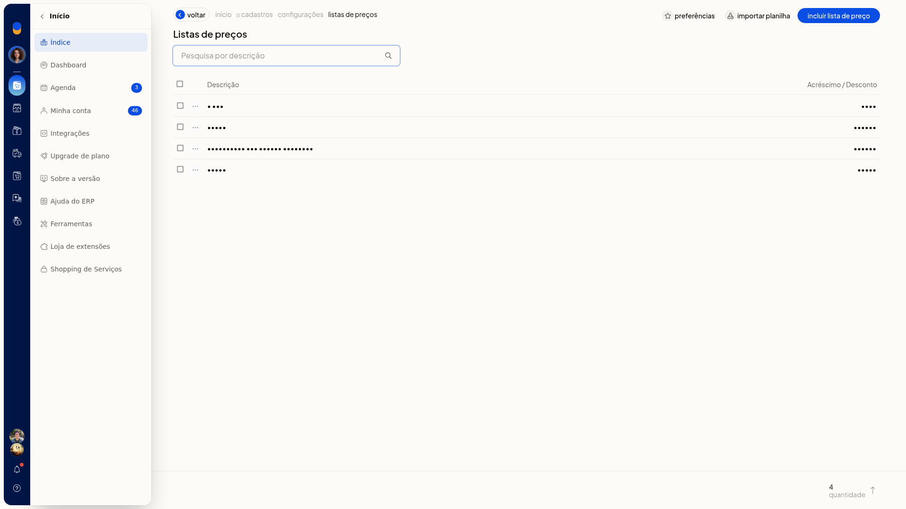
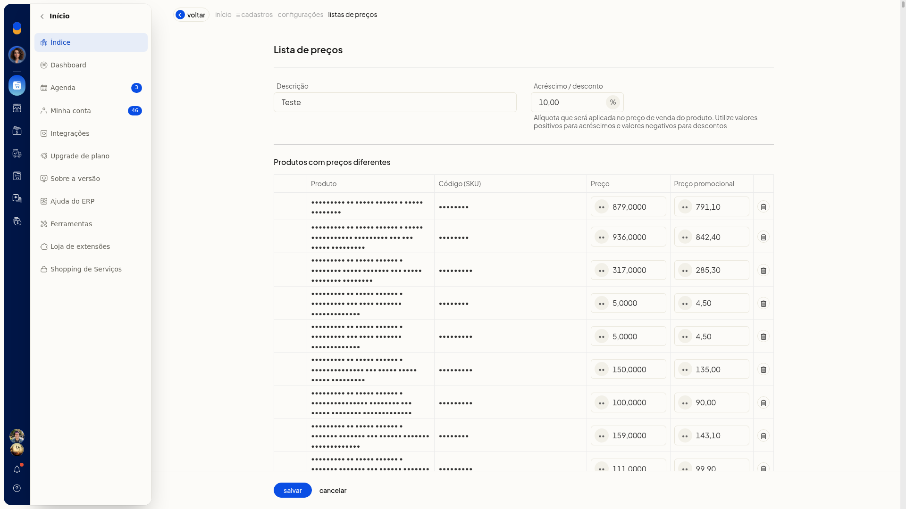
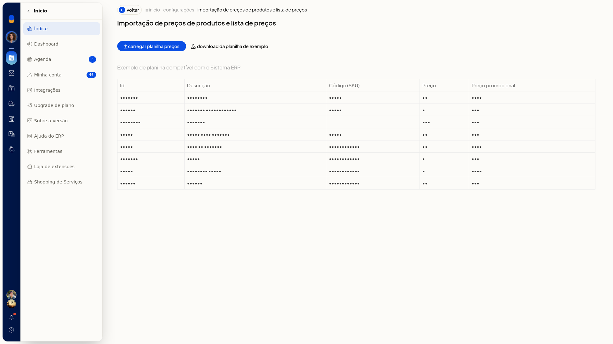
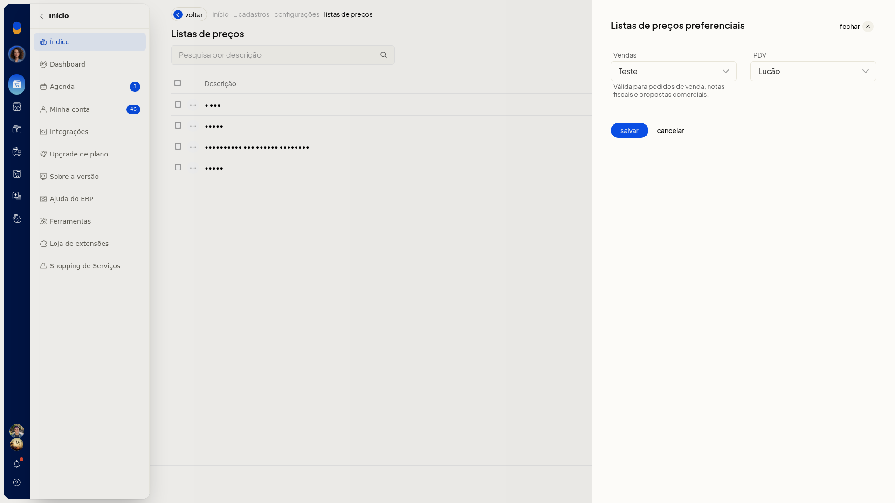
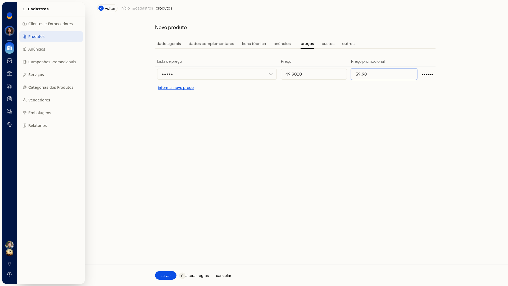

# Listas de preços

No ERP da Olist, uma lista de preços aplica um acréscimo ou um desconto sobre o preço de venda. Você cadastra a lista, informa preço e preço promocional diferentes por produto, importa esses valores por planilha e escolhe qual lista vale em vendas e no PDV da Olist.

A tela fica em **Configurações > Configurações ERP > Cadastros > Listas de preços**.

## Importante
- O acréscimo ou desconto da lista não se aplica a vendas pelo aplicativo móvel nem a vendas via API.
- Use valor positivo para acréscimo e valor negativo para desconto. O percentual segue o texto da tela: alíquota aplicada no preço de venda do produto.
- **Preço** e **Preço promocional** usam vírgula decimal, em reais.

## Instruções
### Cadastrar uma lista de preços

1. Acesse **Configurações > Configurações ERP > Cadastros > Listas de preços**.
2. Confira as listas já cadastradas, com as colunas **Descrição** e **Acréscimo/Desconto**. Use a pesquisa para localizar uma lista.

   

3. Clique em **Incluir lista de preço**.
4. Informe a **Descrição**. O campo não é obrigatório.
5. Informe **Acréscimo/desconto**. O campo não é obrigatório.
6. Clique em **Salvar**. A alíquota informada será aplicada ao preço de venda do produto.

### Informar preços diferentes na lista

Para lançar preço diferenciado, o produto já precisa existir no cadastro.

1. Em **Listas de preços**, abra a lista desejada.
2. Confira **Acréscimo/desconto** e a tabela **Produtos com preços diferentes**, com as colunas **Produto**, **Código (SKU)**, **Preço** e **Preço promocional**.

   

3. Clique em **Adicionar item**.
4. Busque o **Produto** já cadastrado.
5. Informe **Preço** e **Preço promocional**. Os campos não são obrigatórios. O **Código (SKU)** aparece na linha e não é digitado nela.
6. Clique em **Salvar**. A lista passa a usar esses preços no lugar do percentual geral para os produtos informados.

### Importar preços por planilha

1. Em **Listas de preços**, clique em **Importar planilha**. O mesmo caminho está em **Mais ações > Importar preços de produtos para lista de preços**.
2. Clique em **Download da planilha de exemplo**. As colunas são **Id**, **Descrição**, **Código (SKU)**, **Preço** e **Preço promocional**.

   

3. Preencha a planilha com os preços da lista.
4. Clique em **Carregar planilha** para enviar o arquivo.

### Definir as listas preferenciais

1. Em **Listas de preços**, clique em **Preferências**. O mesmo caminho está em **Mais ações > Configurar as listas de preços preferenciais**.
2. Em **Vendas**, selecione a lista já cadastrada. Essa lista vale para pedidos de venda, notas fiscais e propostas comerciais.
3. Em **PDV**, selecione a lista já cadastrada. Os dois campos não são obrigatórios e mostram **Selecione** e as listas da conta.

   

4. Clique em **Salvar**. O ERP da Olist passa a usar a lista escolhida em vendas e a lista escolhida no PDV.

### Informar a lista no cadastro do produto

1. Acesse **Cadastros > Produtos > Incluir produto**.
2. Abra a aba **Preços**.
3. Selecione **Lista de preço**.
4. Informe **Preço** e **Preço promocional**. Os campos não são obrigatórios.

   

5. Clique em **Salvar**. O produto fica com a lista, o preço e o preço promocional informados.

## Informações adicionais
### A lista de vendas cobre os documentos comerciais

A lista selecionada em **Vendas** vale para pedidos de venda, notas fiscais e propostas comerciais.

### A lista pode ser exportada

No menu da linha da lista, exporte o arquivo em CSV ou Excel.
