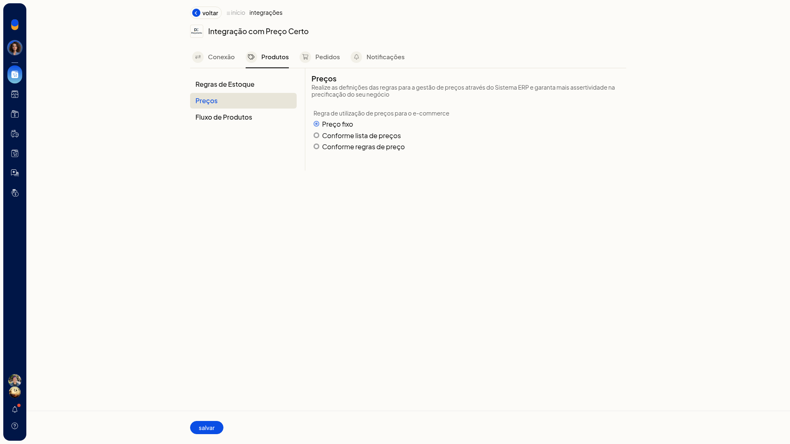
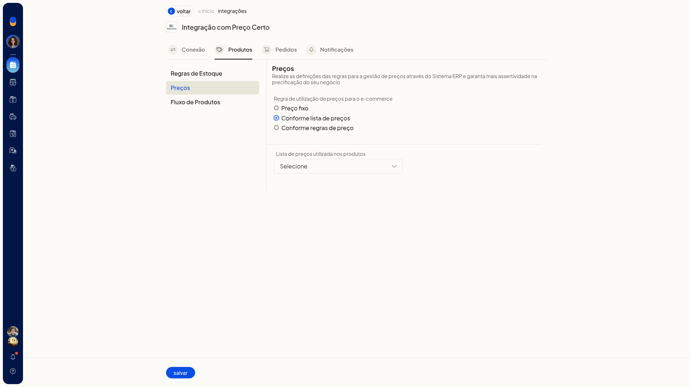
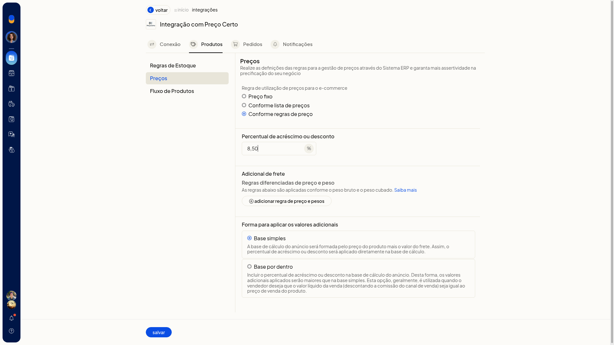
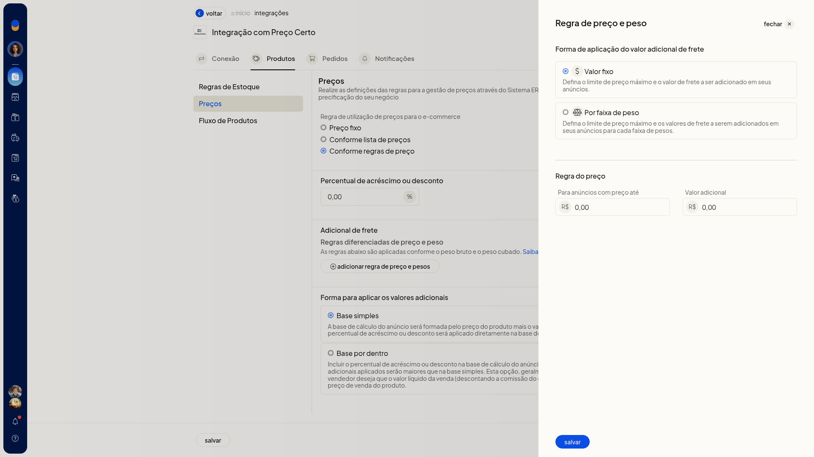
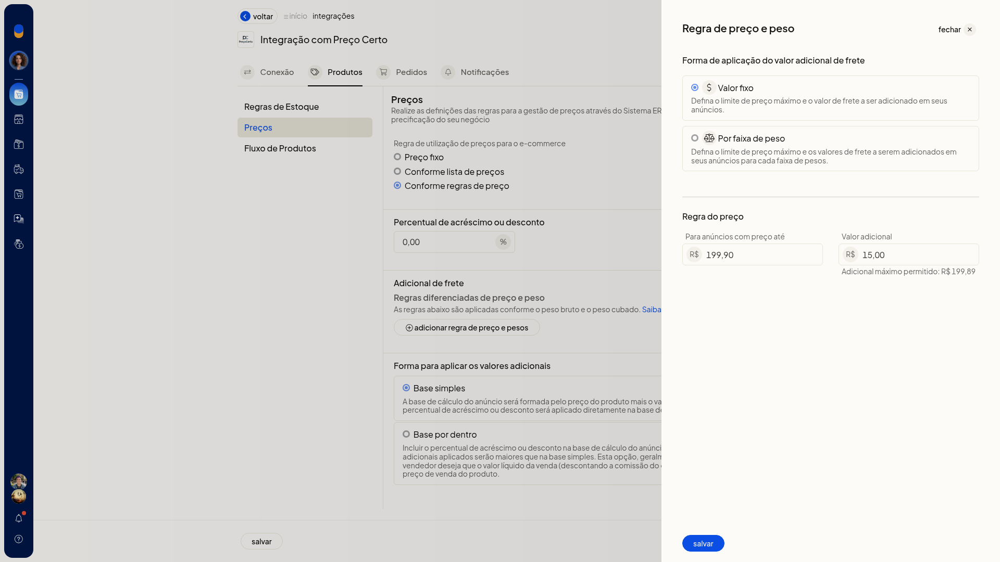
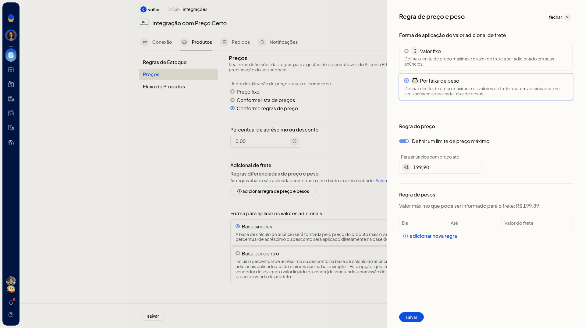
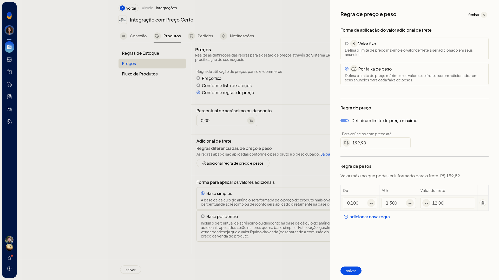

# Regras de preço para e-commerce

## Importante
- No adicional de frete, a tela mostra um adicional máximo permitido inferior ao limite de preço informado.

## Instruções
1. Acesse **Integração com Preço Certo > Produtos > Preços**.
2. Em **Regra de utilização de preços para o e-commerce**, selecione **Preço fixo**, **Conforme lista de preços** ou **Conforme regras de preço**.

### Preço fixo

1. Selecione **Preço fixo**.
Essa opção não exibe campo adicional.

2. Clique em **Salvar**.

### Conforme lista de preços

1. Selecione **Conforme lista de preços**.
2. Em **Lista de preços utilizada nos produtos**, selecione uma lista já cadastrada na conta.

   

3. Clique em **Salvar**.

### Conforme regras de preço

1. Selecione **Conforme regras de preço**.

   

2. Informe o **Percentual de acréscimo ou desconto** com vírgula decimal.

   

3. Em **Forma para aplicar os valores adicionais**, selecione **Base simples** ou **Base por dentro**.
   - **Base simples**: a base do anúncio é o preço do produto mais o frete, e o percentual incide direto nessa base.
   - **Base por dentro**: o percentual entra na base, e os adicionais ficam maiores do que na base simples.
4. Em **Adicional de frete**, clique em **Adicionar regra de preço e pesos**.
5. No modal **Regra de preço e peso**, selecione **Valor fixo** ou **Por faixa de peso**.

#### Valor fixo

1. Selecione **Valor fixo**.

   

2. Informe **Para anúncios com preço até** e **Valor adicional**.
Use o adicional máximo mostrado na tela como limite do **Valor adicional**.

#### Por faixa de peso

1. Selecione **Por faixa de peso**.

   

2. Para limitar o preço, marque **Definir um limite de preço máximo** e informe o limite.
3. Clique em **adicionar nova regra**.
4. Informe **De** e **Até** em kg e o **Valor do frete** em reais.

   

5. Clique em **Salvar**.
