# Margem de contribuição e custos do e-commerce

A margem de contribuição e os custos do ecommerce, no ERP da Olist, partem das vendas e separam o que entra como faturamento do que sai em frete, comissões, taxas e custo de compra. O resultado também aparece por canal de venda online.

Em **Vendas > Margem Contribuição**, você consulta a composição da margem, o índice do período e os recortes por canal, produto ou pedido. Em **Vendas > Custos do e-commerce**, você acompanha faturamento, frete e comissão de cada canal, revisa a configuração e monta o relatório de custos até a geração.

## Importante
- O cálculo da margem é feito por mês e usa regime, base de custo e alíquotas sem e com substituição tributária.
- A configuração dos custos do ecommerce parte de situações de pedido já marcadas e de uma base de custo.
- Nenhum campo destas telas é obrigatório.

## Instruções
### Consultar a margem de contribuição

1. Acesse **Vendas > Margem Contribuição**.
2. Confira o período e a composição: faturamento, frete, custo adicional de frete, comissões, taxas, custos de compras, impostos, incentivos, créditos, adicionais, margem e índice.

   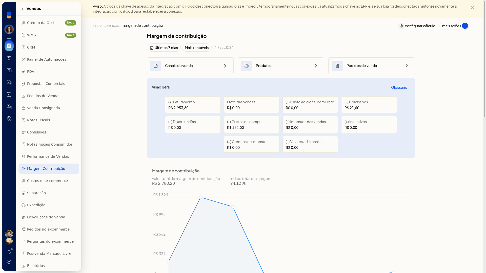

3. Clique em **Canais**, **Produtos** ou **Pedidos** e escolha **Mais rentáveis** ou **Menos rentáveis** para mudar o recorte.

   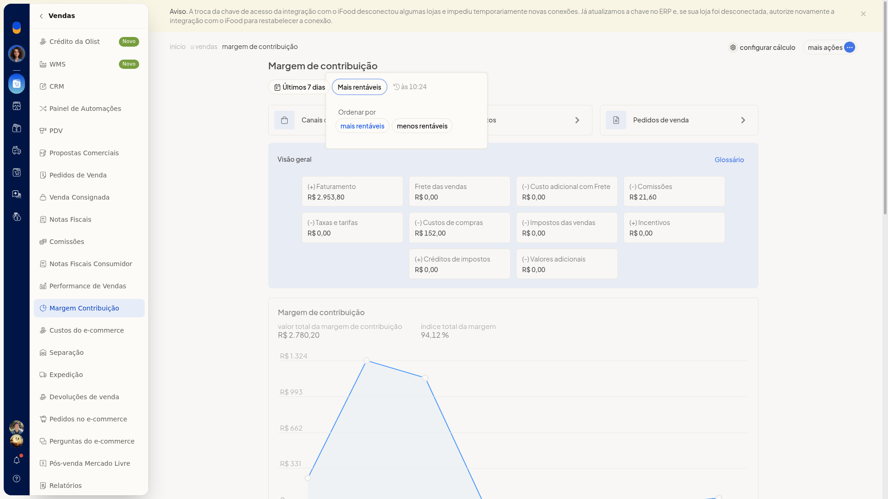

4. Abra o seletor de período e escolha **Hoje**, **Ontem**, **Últimos 7 dias**, **Últimos 30 dias**, **Mês** ou **Período**. Em **Período**, preencha **De** e **Até** no formato DD/MM/AAAA. Feche sem aplicar se quiser manter a consulta atual.

   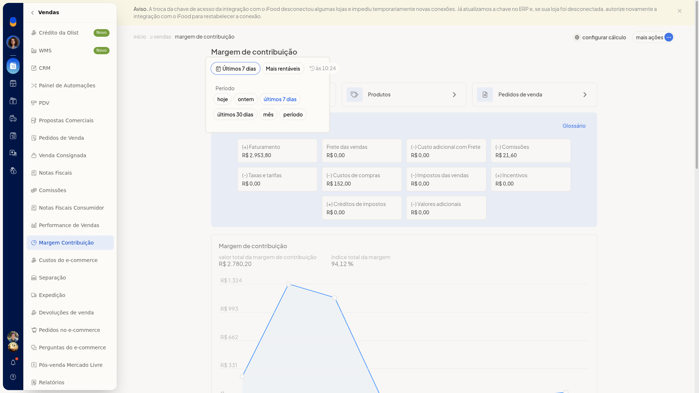

5. Abra o **glossário**, leia o significado dos indicadores e feche-o. A tela mostra a margem do período e o índice, no recorte de canal, produto ou pedido.

   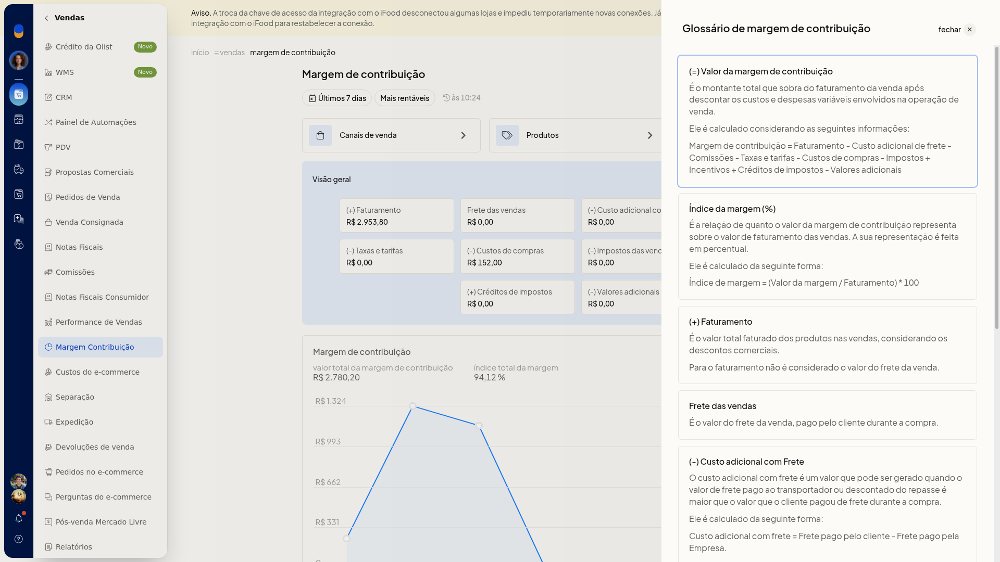

### Configurar o cálculo da margem

1. Em **Margem Contribuição**, abra **Mais ações** e escolha **configurar cálculo**.
2. Confira as linhas mensais, o regime, as alíquotas sem e com substituição tributária e a indicação do último processamento.

   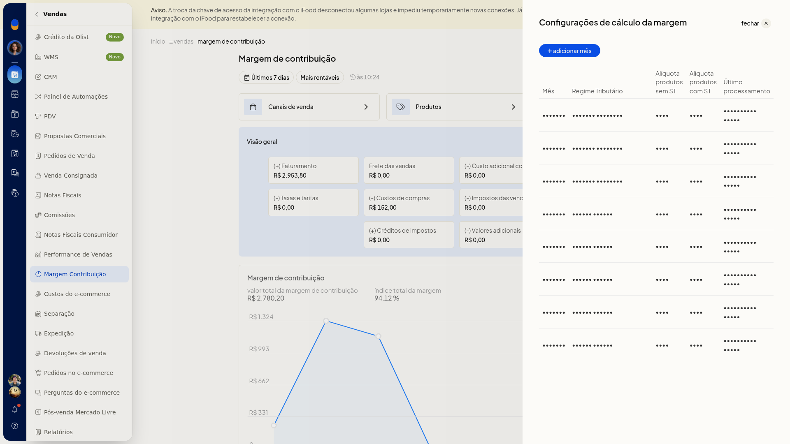

3. Abra **adicionar mês** e preencha o cálculo do mês.

#### Período e regime

- Em **Mês**, informe mês e ano, como 11/2026.
- Em **Regime**, escolha **Simples nacional**, excesso de sublimite, **Regime normal** ou **MEI**.
- Em **Frete no cálculo**, defina se o frete entra no cálculo.

#### Custo e naturezas

- Em **Custo**, escolha **Custo da compra** ou **Custo médio**.
- Em **Naturezas**, inclua naturezas somente se precisar.
- Marque **Atualizar todos os dados** e **Recalcular vendas editadas** se quiser essas opções.

#### Alíquotas

- Em **Alíquota sem ST** e **Alíquota com ST**, use percentual com vírgula decimal, como 6,50 ou 4,20.

4. Revise os dados. Para não alterar o cálculo, volte sem salvar ou recalcular.

   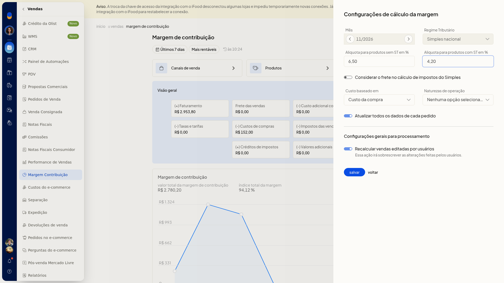

### Consultar os custos do ecommerce

1. Acesse **Vendas > Custos do e-commerce**.
2. Confira o período, o faturamento, o frete do pedido, a comissão e os cartões de cada canal.

   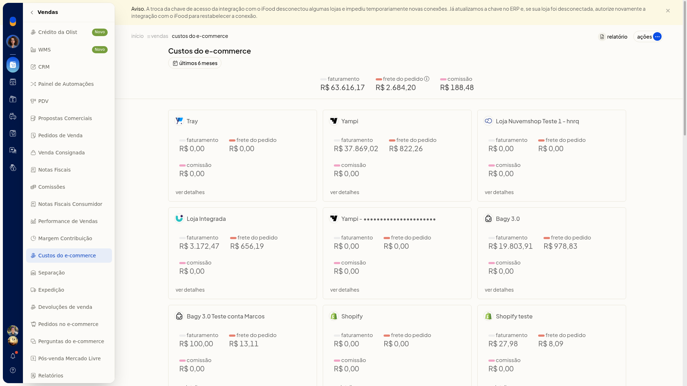

3. Abra **ver detalhes** de um canal para ver faturamento, diferencial de frete, comissão, custo total, incentivo, total líquido, quantidade e o gráfico do período.

   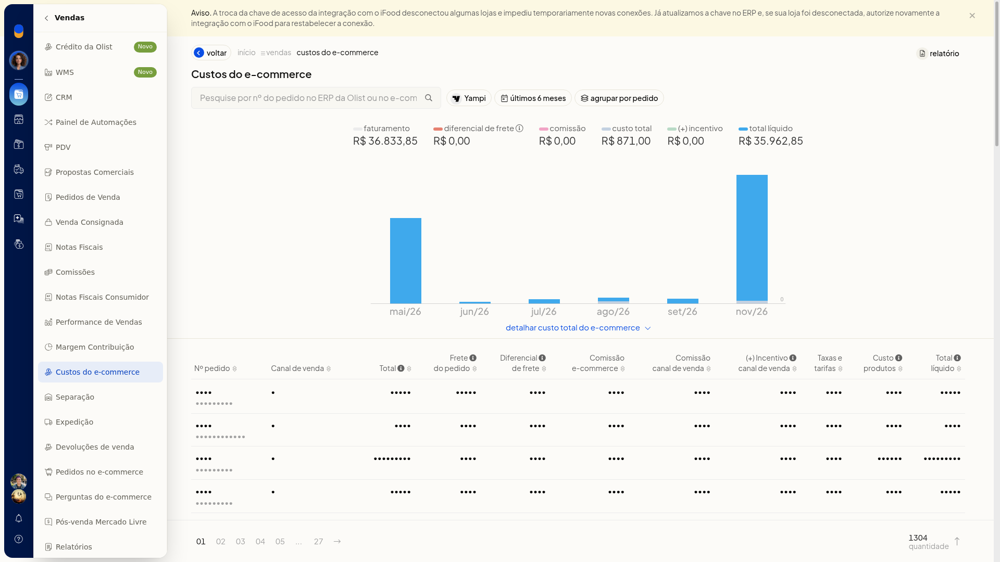

4. Abra **detalhar custo total** para ver também o frete do pedido e as comissões e taxas de ecommerce e marketplace. O agrupamento pode ser **Pedido** ou **Produto**. A tela mostra o custo e o líquido do canal.

   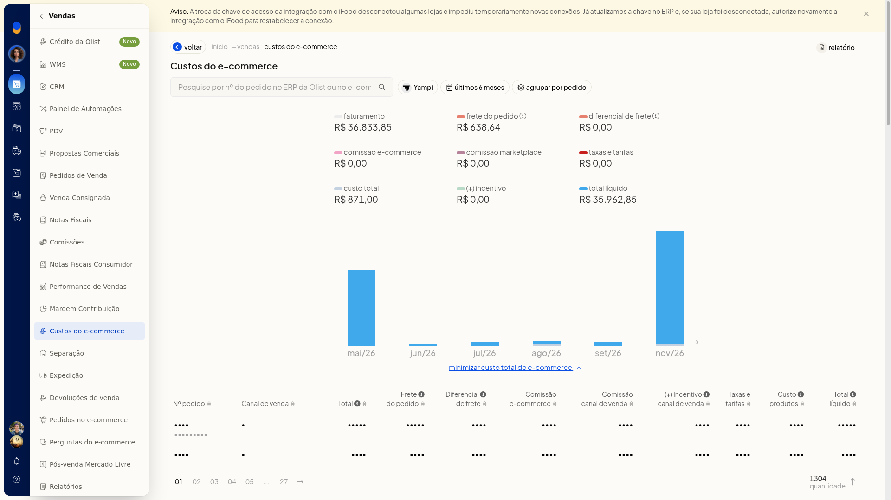

### Configurar os custos do ecommerce

1. Em **Custos do e-commerce**, abra **Ações** e escolha **Configurar**.
2. Revise as situações de pedido já marcadas e a base de custo. Na base de custo, a opção **Selecione** também aparece.

   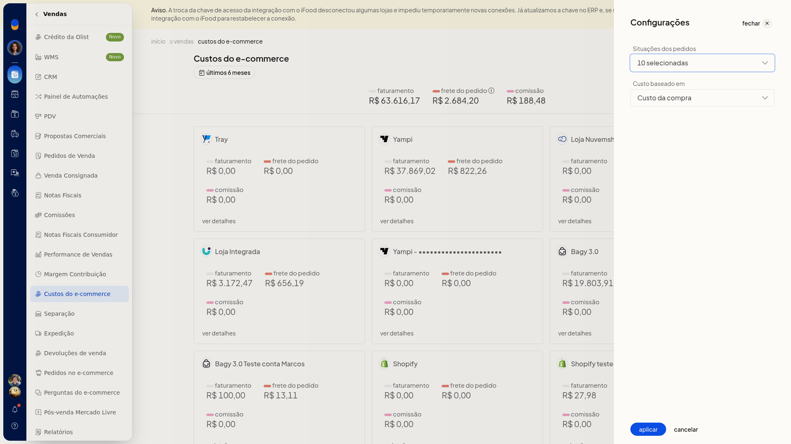

3. Clique em **Cancelar** para sair sem alterar a configuração.

### Montar o relatório de custos do ecommerce

1. Na tela de **Custos do e-commerce**, abra o formulário de relatório.
2. Escolha **Mês** ou **Intervalo** e preencha o restante.
 - Em **Mês**, use mês e ano, como 11/2026. Em **Intervalo**, preencha **De** e **Até** no formato DD/MM/AAAA.
 - Informe **Produto**, se precisar.
 - Em **E-commerce**, selecione o canal.
 - Em **Categoria**, pesquise na árvore.
 - Em **Agrupar por**, escolha **Pedido**, **E-commerce** ou **Produto**.
 - Em **Custo**, escolha **Não exibir**, custo dos produtos ou última compra.
 - Em **Situações**, selecione as situações do pedido.

   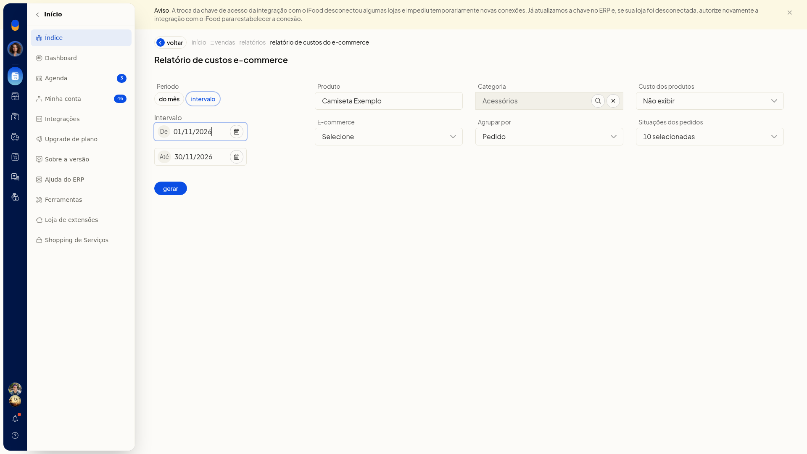

3. Revise o formulário. A geração fica no botão **Gerar**.

## Resultado
A margem de contribuição exibe a composição de entradas e deduções e o índice do período. Os custos do ecommerce exibem faturamento, frete do pedido e comissão, com o detalhe e o custo total de um canal. Os formulários de cálculo, configuração e relatório permanecem preenchidos até o botão de confirmação.

## Informações adicionais
- No detalhe do custo total, não é preciso trocar o agrupamento entre **Pedido** e **Produto** para ler os totais.
