# Configurar e emitir NFS-e

## Pré-requisitos
- A prefeitura do município precisa estar homologada para emitir a NFS-e.
- A emissão não ocorre se o limite de emissões da empresa já foi atingido.
- Na emissão externa, o município precisa usar o serviço externo de NFS-e, a empresa precisa estar configurada nessa integração e o certificado digital A1 precisa estar vinculado.
- Para usar um CNAE que não seja o padrão da empresa, ele precisa estar em **Meus CNAEs** ou ser incluído em **Cadastre o seu CNAE**.
- Se a opção não aparecer para você, peça acesso ao administrador da conta.

## Importante
- Notas emitidas no ambiente de **Homologação** não têm valor fiscal e servem apenas para testes.
- Com **Cálculo automático impostos federais** marcado, o cálculo federal vale para valor igual ou acima de R$ 215,05.
- Em **Calcular PIS, COFINS e CSLL**, as opções são notas acima de R$ 215,05, notas acima de R$ 5.000,00 (exigência revogada pela Lei nº 13.317) ou não calcular.
- Não é possível editar uma nota já autorizada pela prefeitura.
- Não é possível editar a nota enquanto houver contas lançadas. Nesse caso, estorne as contas antes.

## Instruções
### Configurar a NFS-e

1. Acesse **Configurações > Configurações ERP > Notas Fiscais**.
2. Selecione **Configuração da nota fiscal eletrônica de serviços (NFSe)**.

   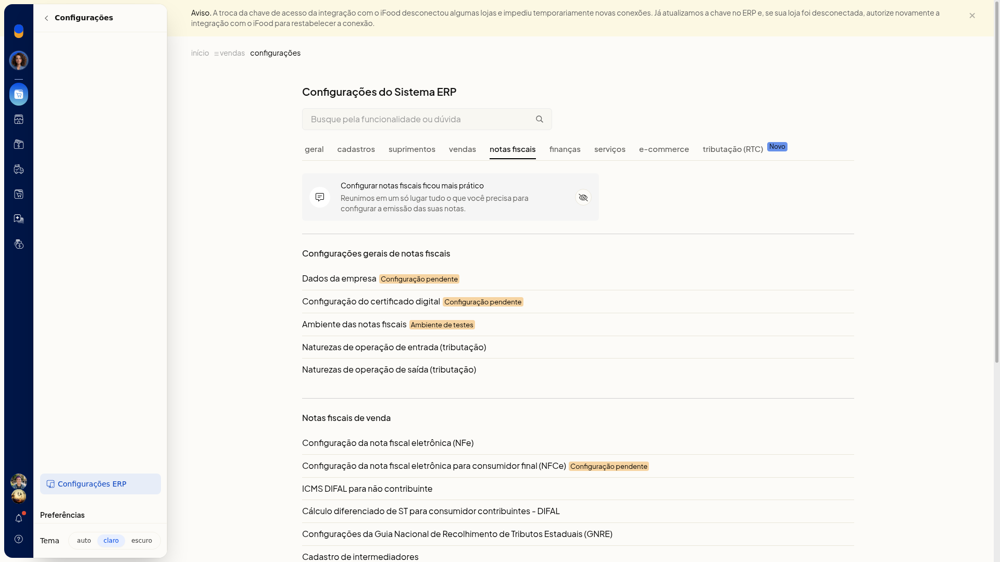

3. Revise **Emitir NFS-e no padrão nacional**, **Ambiente**, **Série**, **Próximo número do lote** e **Enviar parcelas no XML do RPS**. Em **Ambiente**, as opções são **Produção** e **Homologação**.

   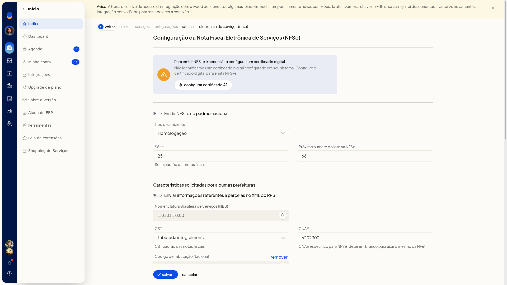

4. Informe **CNAE**, **NBS** e **Código de Tributação Nacional**. No **CNAE**, deixe em branco para usar o mesmo da NFe. No código de tributação, pesquise e selecione o resultado.

   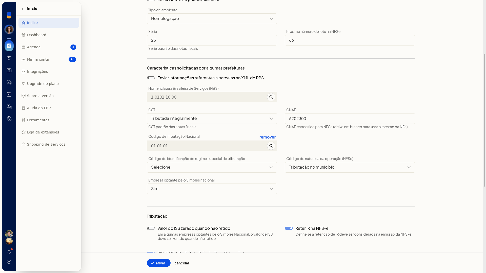

   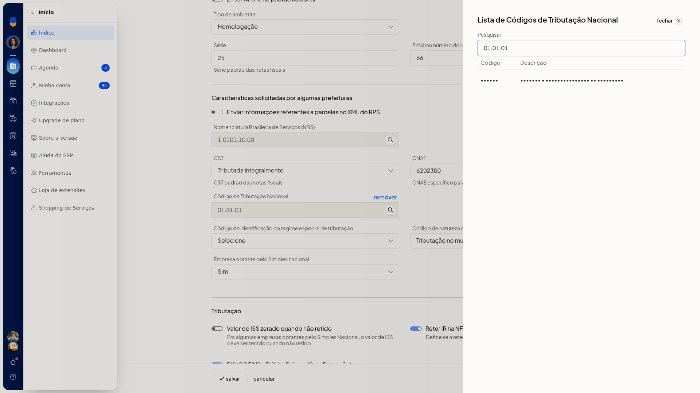

5. Ajuste tributação, retenções e textos.

   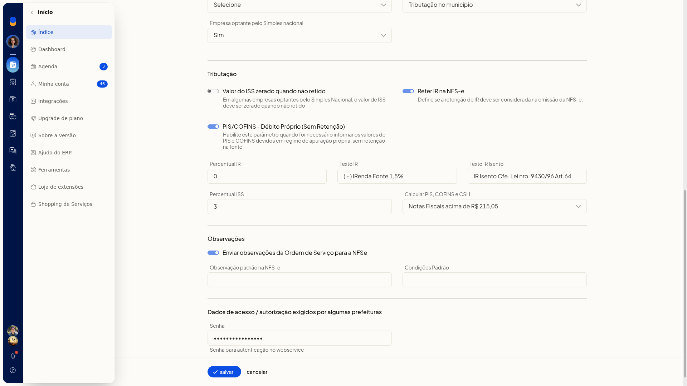

#### Tributação

- **CST**: as opções incluem **Tributada integralmente**, **ISSRF**, **ST**, redução de base, **Isenta**, **Imune**, **Não Tributada**, regime **Fixo**, **Estimativa**, **Construção Civil**, antecipado e **Ato Cooperado**.
- **Natureza**: **Tributação no município** ou tributação fora do município.
- **Regime especial**: **Selecione**, **Microempresa municipal**, **Estimativa**, **Sociedade de profissionais**, **Cooperativa**, **MEI** e **ME EPP**.
- **Optante Simples**.
- **Percentual ISS**.
- **Valor do ISS zerado quando não retido**.

#### Retenções e textos

- **Reter IR**, **Percentual IR**, **Texto IR** e **Texto IR Isento**.
- **PIS/COFINS - Débito Próprio (Sem Retenção)**.
- **Calcular PIS, COFINS e CSLL**.
- **Enviar observações da OS**.
- **Observação padrão** e **Condições Padrão**, se quiser.
- **Senha webservice**, sem copiar o valor para outro lugar.

6. Clique em **Salvar** para gravar o padrão de emissão, a tributação e o CNAE.

### Cadastrar um CNAE

1. Acesse **Configurações > Configurações ERP > Serviços**.

   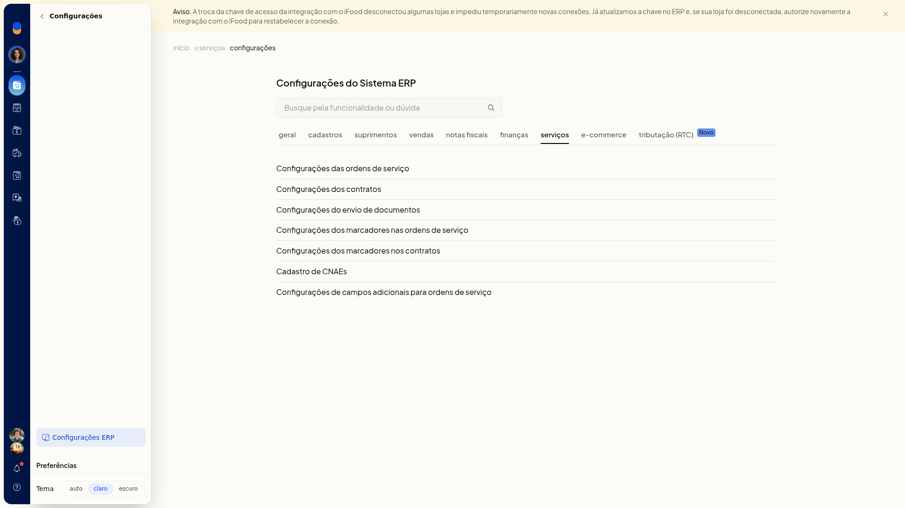

2. Abra **Cadastro de CNAEs**. A lista **Meus CNAEs** tem busca, **Incluir CNAE** e as colunas **Código** e **Descrição**.

   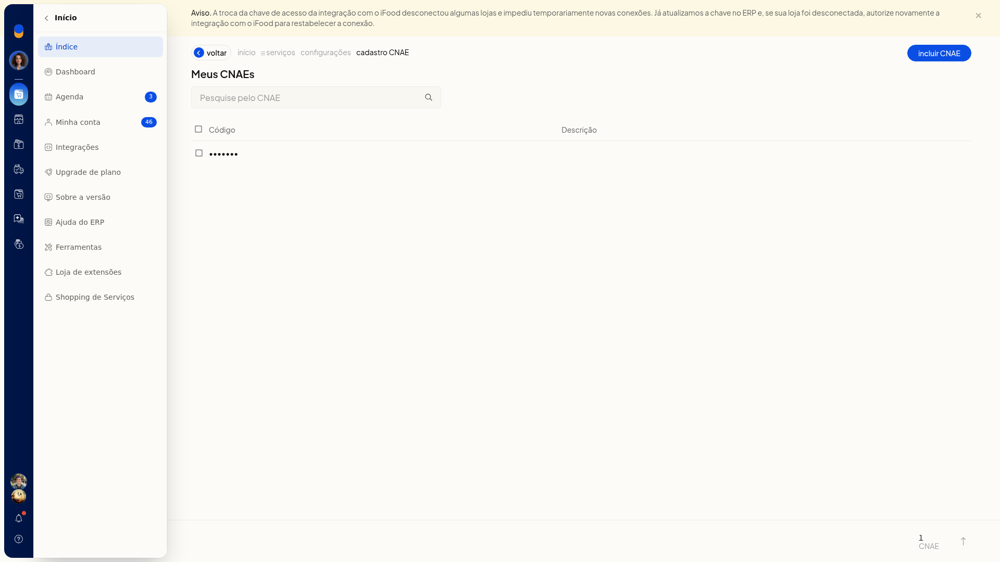

3. Clique em **Incluir CNAE**.

   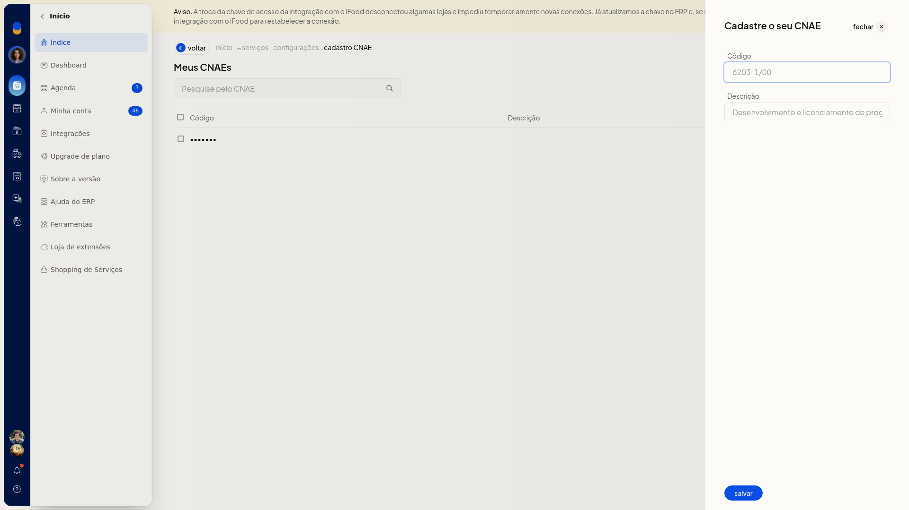

4. Preencha **Código** e **Descrição**. Clique em **Salvar** para gravar o CNAE. Fechar o modal sem **Salvar** não grava o CNAE.

   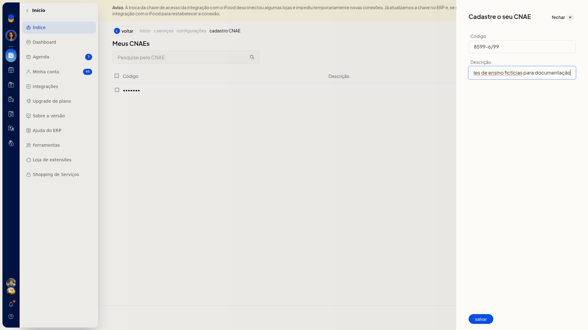

### Incluir a nota de serviço

1. Acesse **Serviços > Notas de Serviço**. Se o aviso de homologação aparecer, ative o ambiente de produção por ele quando a nota precisar ter valor fiscal.

   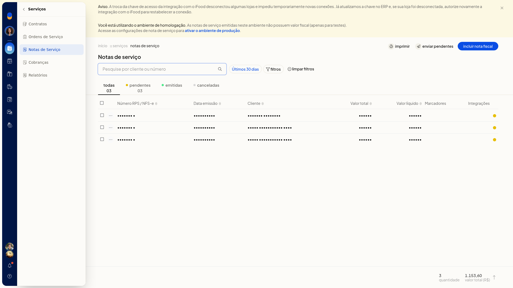

2. Clique em **Incluir nota fiscal**.

   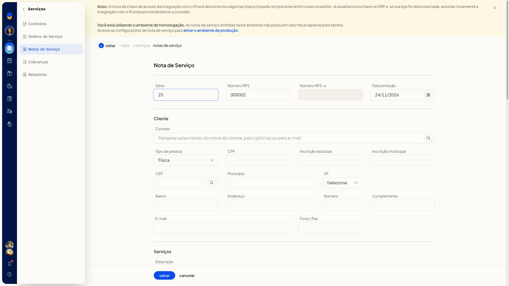

3. Preencha o tomador e a descrição do serviço. Se o contato não for encontrado, complete os dados do tomador no formulário.

   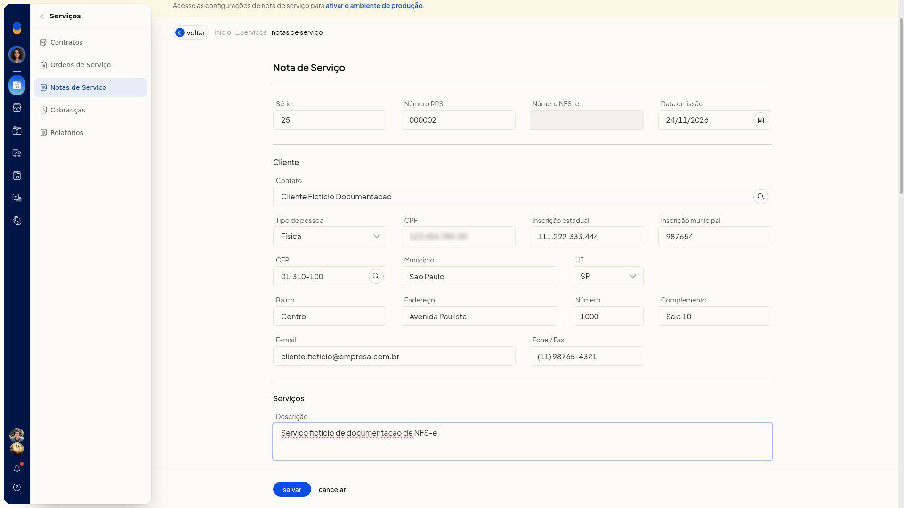

#### Dados do tomador

- **Série**, **Número RPS**, **Data emissão** no formato DD/MM/AAAA e **Número NFS-e**.
- **Tipo de pessoa**: **Física** ou **Jurídica**.
- **Contato**, **CPF**, **IE**, **IM**, **E-mail** e **Fone**.
- **CEP**. Use a busca de dados do CEP.
- **Município**, **UF**, **Bairro**, **Endereço**, **Número** e **Complemento**.
- **Descrição** do serviço.

4. Informe o **Valor**. A tela calcula o ISS. Com **Cálculo automático impostos federais** marcado, ela mostra os impostos federais quando o valor atinge a regra exibida.

   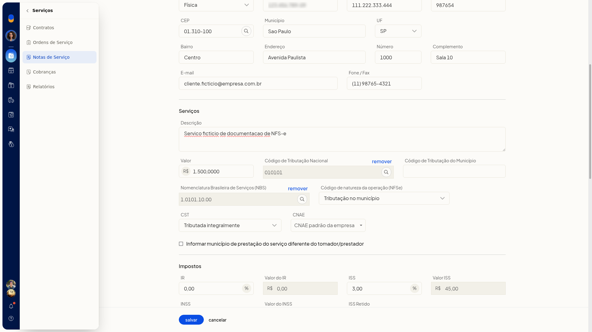

5. Vincule o **CNAE** e confira os tributos.

   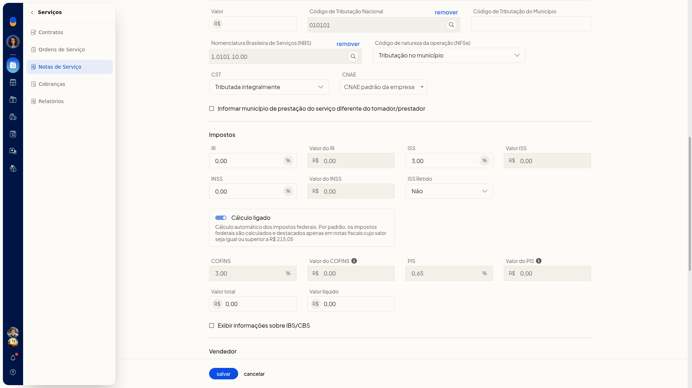

   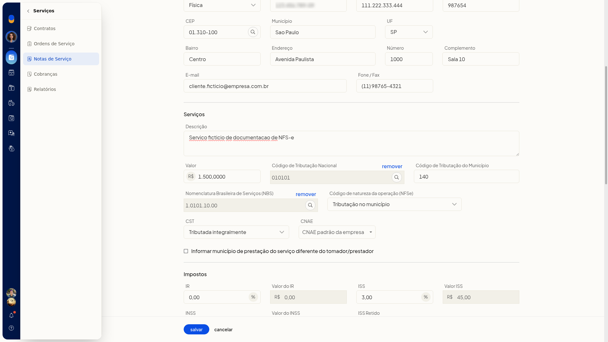

No seletor de **CNAE**, escolha **CNAE padrão da empresa**, um CNAE já cadastrado ou **Incluir CNAE**.

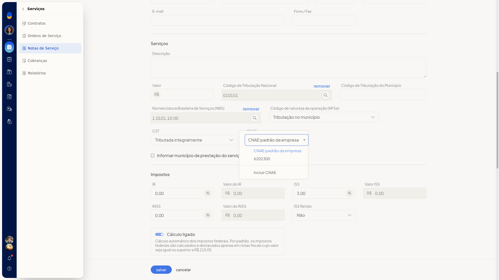

**Incluir CNAE** abre **Cadastre o seu CNAE**. Preencha **Código** e **Descrição** e clique em **Salvar**. Fechar o modal não grava o CNAE.

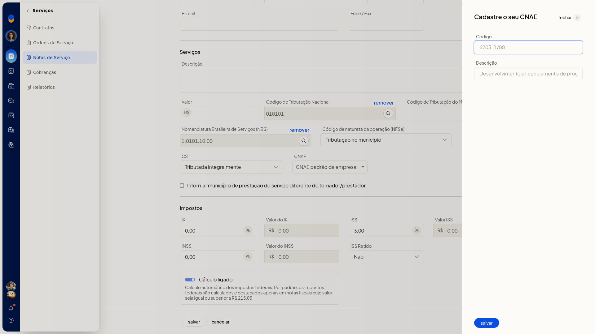

Confira também **Código de Tributação**, **NBS**, **Código de Tributação do Município**, **Natureza**, **CST**, **ISS Retido** e **Exibir IBS/CBS**.

6. Escolha a **Forma de recebimento**. O parcelamento vai de 1x a 12x. Clique em **Gerar parcelas** se quiser gerar as parcelas. Confira **Meio** e **Gateway**.

   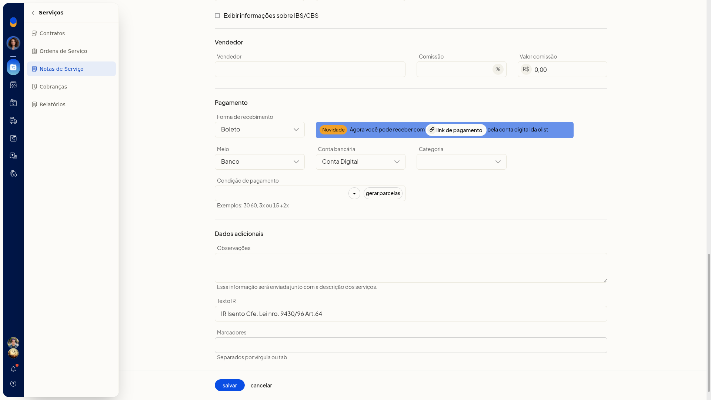

   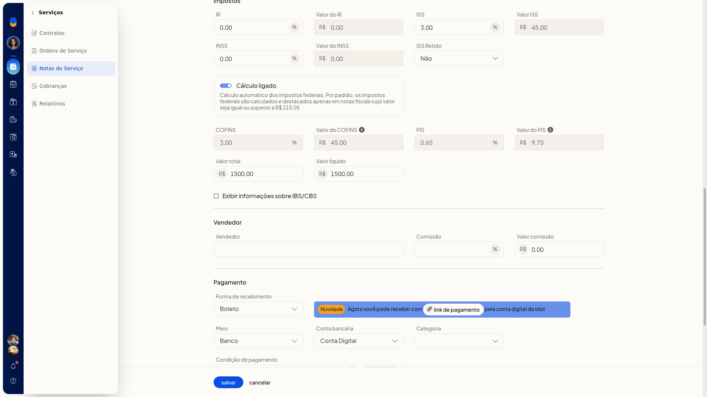

7. Preencha **Observações** e **Marcadores**. O texto de **Observações** é enviado junto com a descrição do serviço. O texto de **Marcadores** separado vira marcadores. Clique em **Salvar** para gravar a nota com tomador, serviço, valor e tributos calculados na tela.

   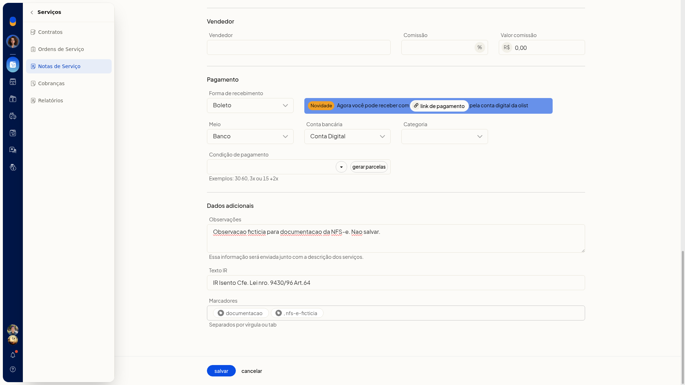

### Enviar a NFS-e

1. Em **Serviços > Notas de Serviço**, localize a nota pela busca de cliente ou número, pelo período ou pela aba **Pendentes**. As situações do filtro são **Todas**, **Pendentes**, **Emitidas** e **Canceladas**.
2. Clique em **Enviar pendentes** ou, no menu da linha, em **Enviar NFS-e**. No mesmo menu estão **Clonar nota**, **Emitir cobrança**, **Lançar contas**, **Marcar como enviada**, **Imprimir RPS** e **Marcadores**. **Emitir cobrança** só aparece quando a empresa usa contas a receber. **Lançar contas** só aparece quando a empresa pode lançar contas de serviços pelo contas a receber.

   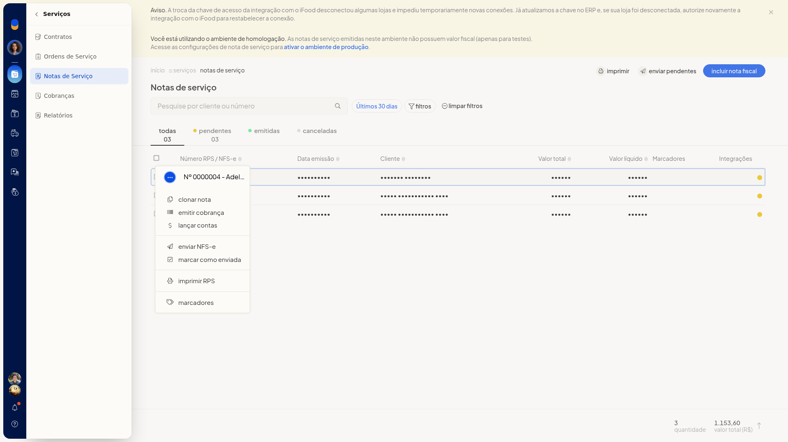

3. Selecione a linha para usar **Baixar XMLs NFSe**, **Enviar NFSe por e-mail** ou **Mais ações**. Em **Mais ações** estão **Excluir notas**, **Alterar marcadores**, **Baixar XMLs NFSe** e **Enviar NFSe por e-mail**. Use o comando desejado para enviar a NFS-e, baixar o XML ou enviar a nota por email.

   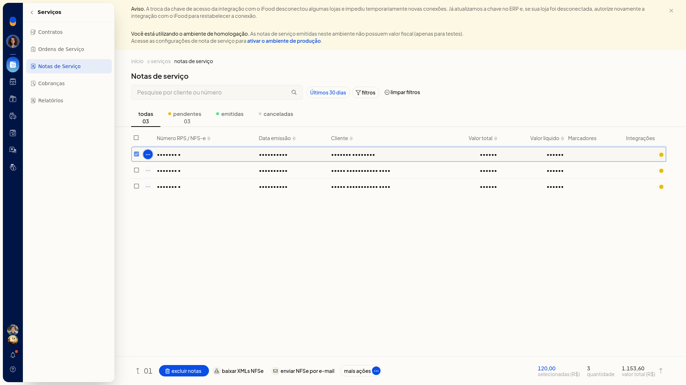

   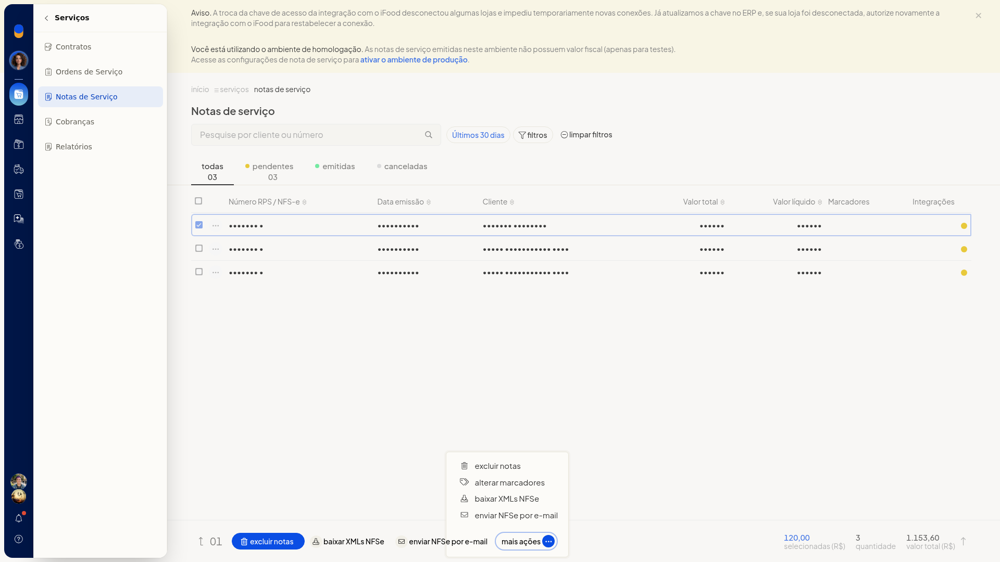

## Resultado
A lista de **Notas de Serviço** mostra as abas **Todas**, **Pendentes**, **Emitidas** e **Canceladas**, a pesquisa, os filtros e a coluna **Integrações**. Na lista também estão **Imprimir** e **Enviar pendentes**.

## Informações adicionais
- Só é possível cancelar notas de serviço que já foram emitidas. **Cancelar** a NFS-e só aparece se a prefeitura permitir o cancelamento, ou se o modelo da nota permitir quando não houver serviço externo.
- Na consulta pela tela, só notas de serviço em processamento podem ser consultadas.
- Estornar contas exige permissão de contas a receber e permissão para remover nessas contas.
