# Cadastro de serviços

No ERP da Olist, o cadastro de serviços é a lista e o formulário em que a empresa registra os serviços que comercializa ou executa. Você inclui um serviço, consulta e edita um já existente, clona um serviço para aproveitar os dados, pesquisa e filtra a lista, imprime a relação e, com itens marcados, exclui serviços ou os transforma em produtos.

O acesso fica em **Cadastros > Serviços**.

## Importante
- **Excluir serviço** e **Transformar em produtos** só aparecem na barra inferior depois que ao menos um serviço é marcado na listagem.
- Para transformar serviços em produtos, a empresa precisa ter Produtos.

## Instruções
### Cadastrar pela tela

1. Acesse **Cadastros > Serviços**.

   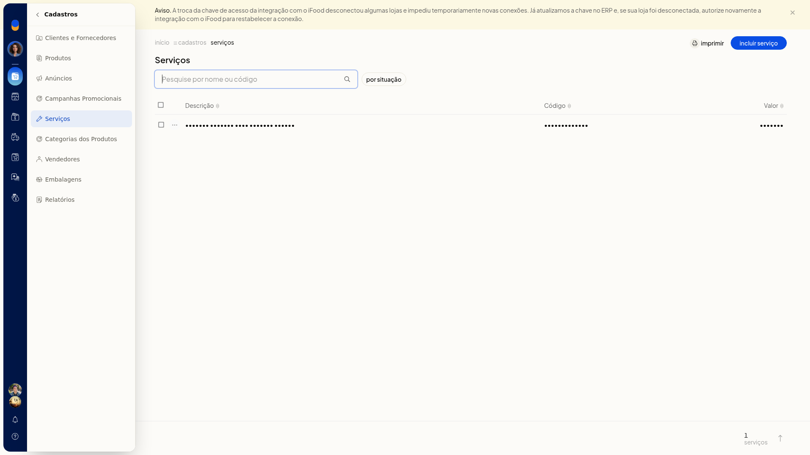

2. Clique em **Incluir serviço**.

   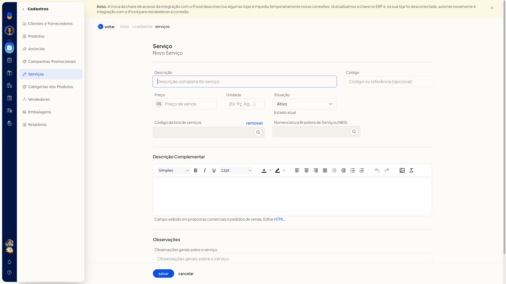

3. Preencha os dados do serviço. Nenhum campo do formulário é obrigatório.

#### Dados do serviço

- **Descrição**
- **Código**
- **Preço**: valor em reais (R$)
- **Unidade**
- **Situação**: **Ativo** ou **Inativo**. **Ativo** já vem selecionado.

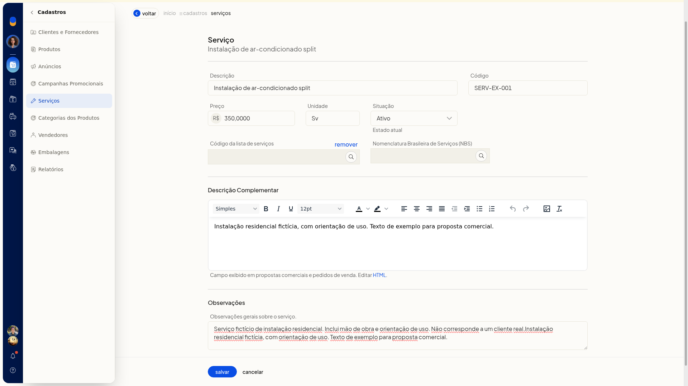

4. Se quiser, informe **Código da lista de serviços**. Pesquise em **Pesquisar Serviços** por código ou nome, ou abra **Informar Serviço** e preencha **Código do serviço** e **Descrição**. Não é necessário concluir a seleção. Quando há código informado, o campo exibe **Remover**.

   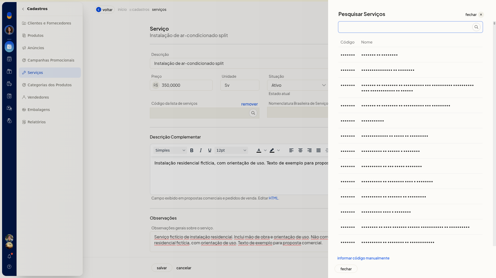

   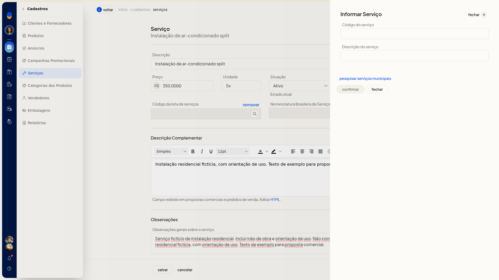

   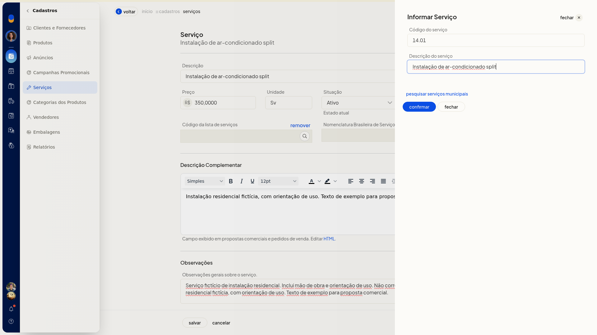

5. Se quiser, pesquise **Nomenclatura Brasileira de Serviços (NBS)** por código ou descrição. Não é necessário concluir a seleção.

   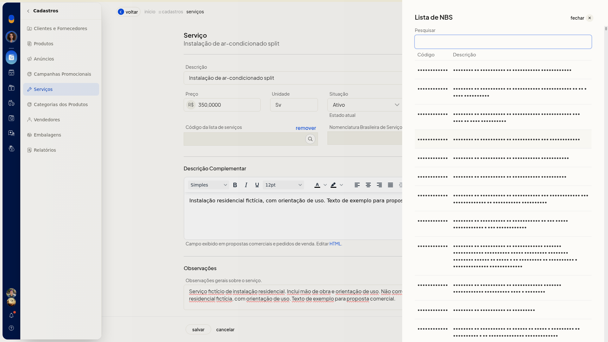

6. Se quiser, escreva **Descrição complementar** e **Observações**. Em **Descrição complementar**, use a formatação ou clique em **Editar HTML** e depois em **Aplicar** ou **Cancelar**. O campo **Observações** traz a legenda Observações gerais sobre o serviço.

   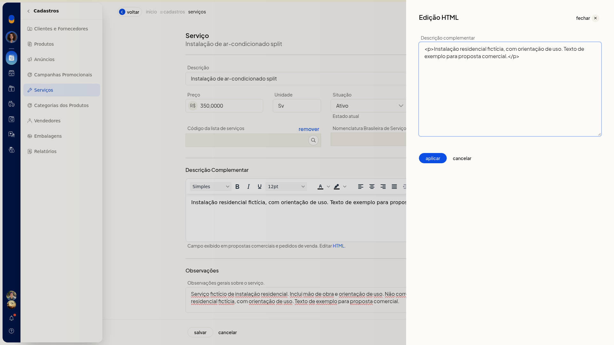

7. Clique em **Salvar** para gravar o serviço. Para sair sem gravar, clique em **Cancelar**.

### Clonar um serviço

1. Na listagem, abra o menu da linha (reticências) e clique em **Clonar serviço**. Outro caminho: abra o serviço, clique em **Ações** e depois em **Clonar serviço**.

   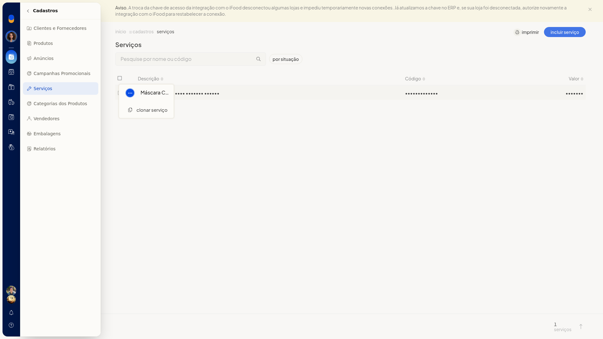

   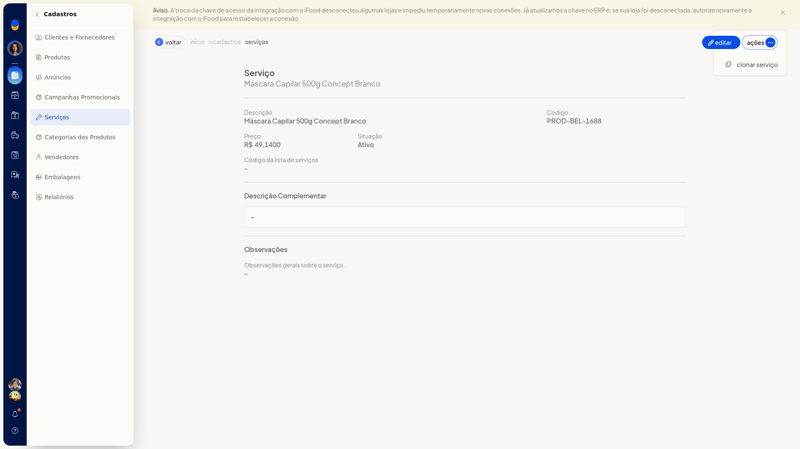

2. Revise os campos. O formulário abre com os dados do serviço de origem, a **Situação** permanece **Ativo** e o **Código** fica em branco.

   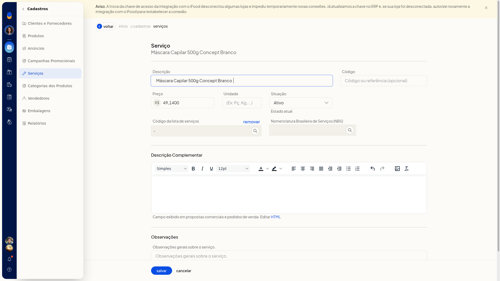

3. Clique em **Salvar** para gravar o clone. **Cancelar** descarta o formulário e volta à listagem, sem gravar.

### Editar um serviço

1. Na listagem, clique na linha do serviço.

   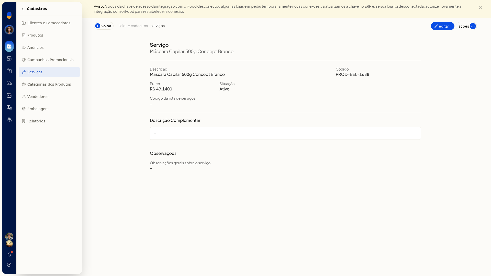

2. Clique em **Editar**.

   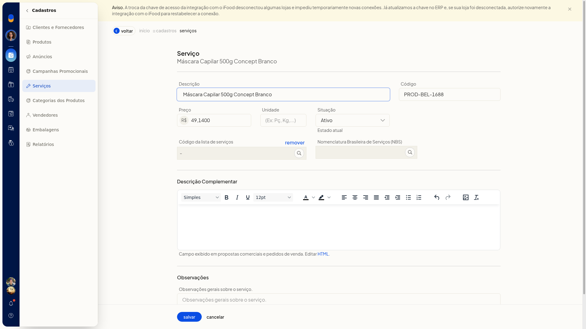

3. Altere o que for necessário em **Descrição**, **Código**, **Preço**, **Unidade**, **Situação**, **Código da lista de serviços**, **Nomenclatura Brasileira de Serviços (NBS)**, **Descrição complementar** e **Observações**.

4. Clique em **Salvar** para gravar as alterações. **Cancelar** volta à ficha sem gravar.

### Pesquisar e filtrar a listagem

1. Em **Cadastros > Serviços**, use o campo **Pesquise por nome ou código**.
2. Clique em **por situação** e escolha **Sem filtro**, **Ativos**, **Inativos** ou **Excluídos**. Para retirar o filtro, use **limpar filtros**.

   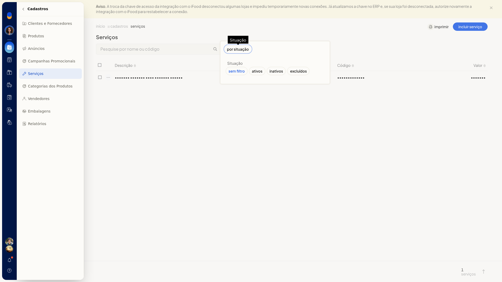

### Imprimir a relação

1. Na listagem, clique em **Imprimir**.
2. Confira a pré-visualização, com as colunas **Código**, **Descrição**, **Unidade** e **Preço de venda**.

   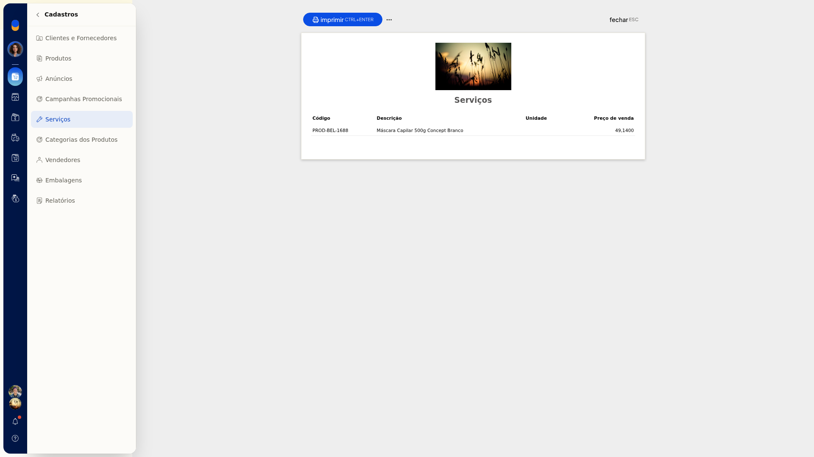

3. Em **Mais ações**, está disponível **Abrir em outra página**. Clique em **Fechar** para encerrar a pré-visualização sem imprimir.

   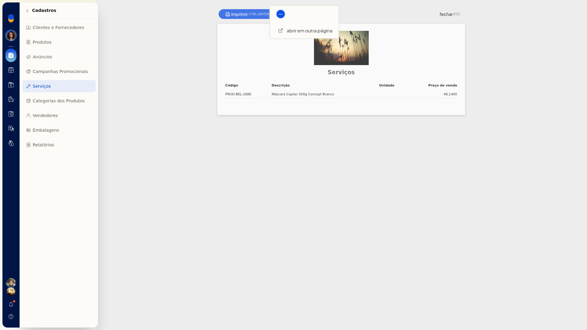

### Excluir serviços

1. Na listagem, marque a caixa de seleção de um ou mais serviços.
2. Na barra inferior, clique em **Excluir serviço**.

   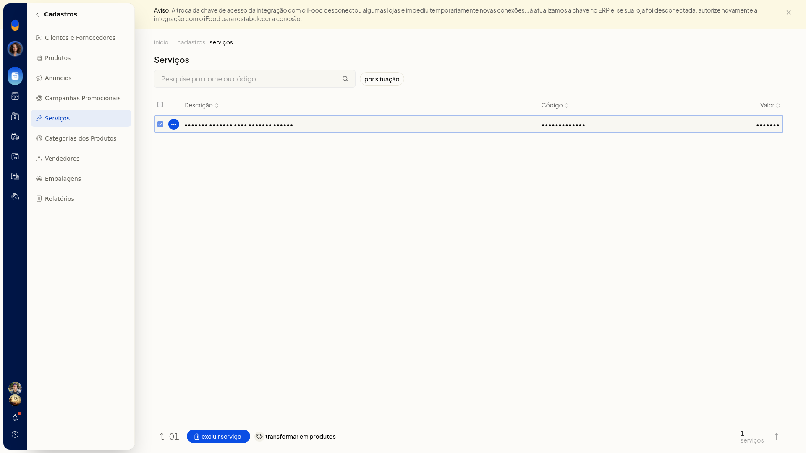

### Transformar serviços em produtos

1. Na listagem, marque a caixa de seleção de um ou mais serviços.
2. Na barra inferior, clique em **Transformar em produtos**.

## Resultado
A listagem de **Serviços** mostra as colunas **Descrição**, **Código** e **Valor**. Ao clicar na linha, a ficha abre somente leitura, com **Voltar**, **Editar** e **Ações**. **Cancelar** na edição volta à ficha sem gravar. **Cancelar** na clonagem volta à listagem sem gravar. **Fechar** encerra a pré-visualização sem imprimir.

## Informações adicionais
- O menu **Ações** da ficha contém **Clonar serviço**.
- Na clonagem, o **Código** fica em branco para você informar outro antes de salvar.
- A barra inferior da seleção mostra a quantidade de serviços marcados, **Excluir serviço** e **Transformar em produtos**.
