# Guia de implantação: serviços

No ERP da Olist, o cadastro de serviços é a lista e o formulário em que você registra os serviços que a empresa comercializa ou executa. Você inclui um serviço, consulta e edita um já existente, clona um cadastro para aproveitar os dados, pesquisa e filtra a lista, imprime a relação e, com itens marcados, exclui serviços ou os transforma em produtos. O caminho é **Cadastros > Serviços**.

## Importante
- **Excluir serviço** e **Transformar em produtos** só aparecem na barra inferior depois que você marca ao menos um serviço na listagem.
- Para transformar serviços em produtos, a conta precisa ter o cadastro de produtos.
- Se **Editar**, **Excluir serviço** ou **Transformar em produtos** não aparecer, peça acesso ao administrador da conta.

## Instruções
### Cadastrar um serviço

1. Acesse **Cadastros > Serviços**.

   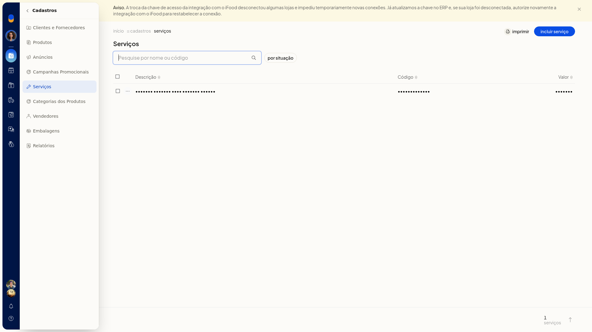

2. Clique em **Incluir serviço**.

   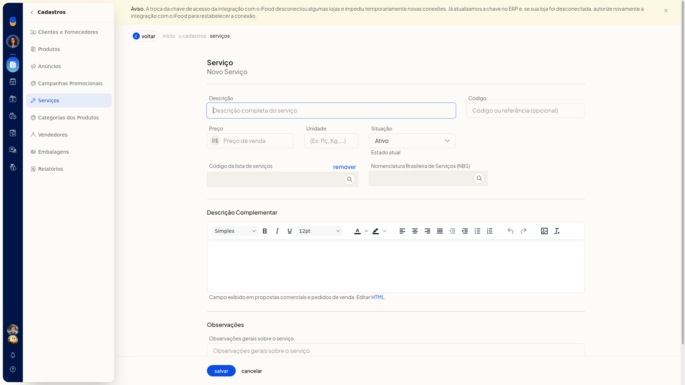

3. Preencha os campos. Nenhum deles é obrigatório. **Situação** já vem como **Ativo**.
 - **Descrição**
 - **Código**
 - **Preço**: valor em reais, como 350,00
 - **Unidade**
 - **Situação**: **Ativo** ou **Inativo**

   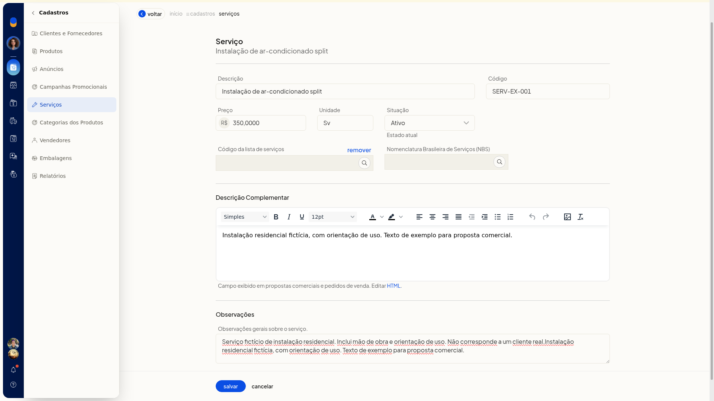

4. Se quiser, informe **Código da lista de serviços**. Pesquise em **Pesquisar Serviços**, por código ou nome, ou abra **Informar Serviço** e preencha **Código do serviço** e **Descrição**. Quando houver código informado, o campo também exibe **Remover**. Não é necessário concluir a seleção.

   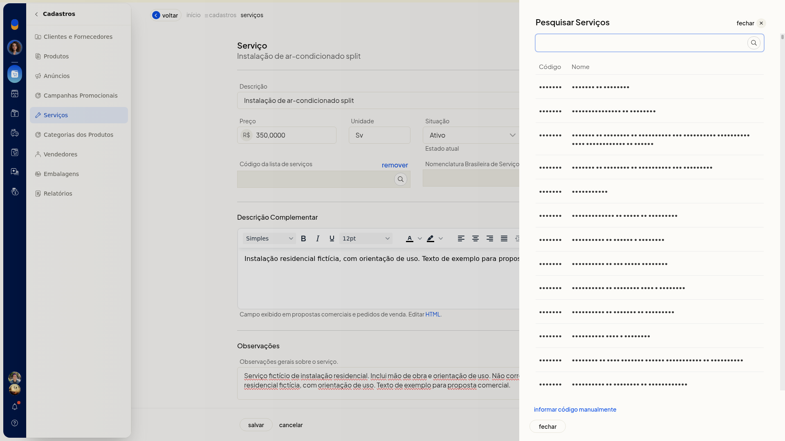

   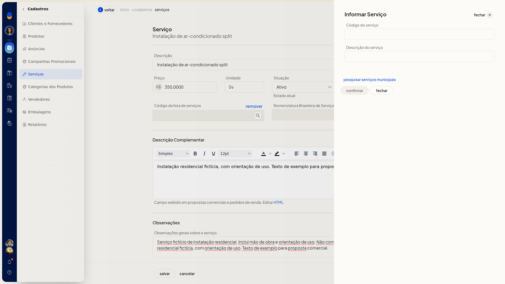

   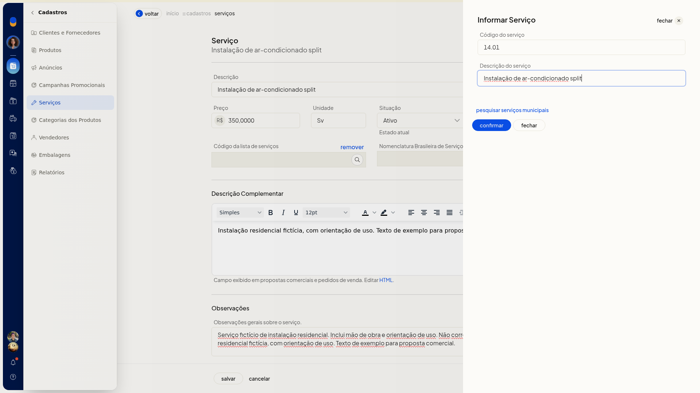

5. Se quiser, pesquise a **Nomenclatura Brasileira de Serviços (NBS)** por código ou descrição. Não é necessário concluir a seleção.

   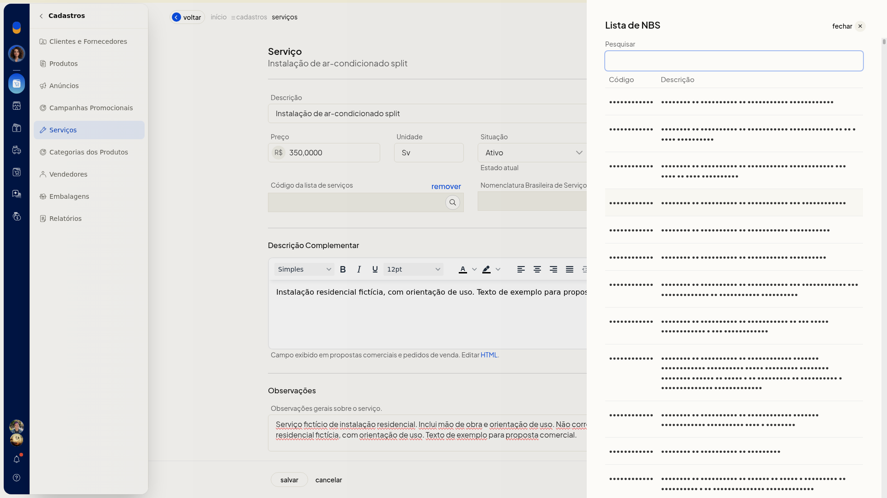

6. Se quiser, escreva a **Descrição complementar** e as **Observações**. No editor da descrição complementar há formatação e o botão **Editar HTML**, com **Aplicar** e **Cancelar**.

   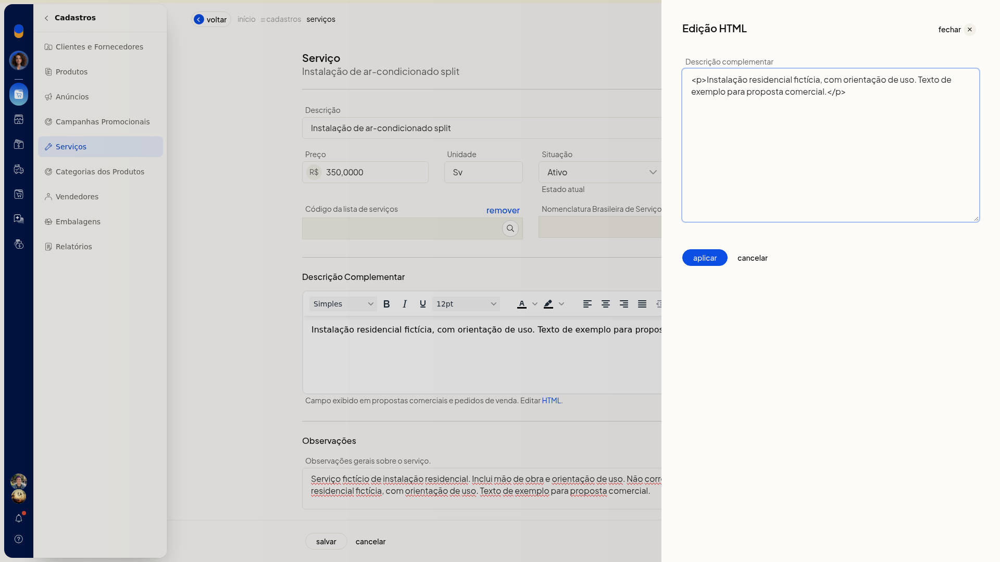

7. Clique em **Salvar** para gravar o serviço. **Cancelar** fecha o formulário sem gravar.

### Consultar e editar um serviço

1. Acesse **Cadastros > Serviços**.
2. Clique na linha do serviço. A ficha abre com **Voltar**, **Editar** e **Ações**.

   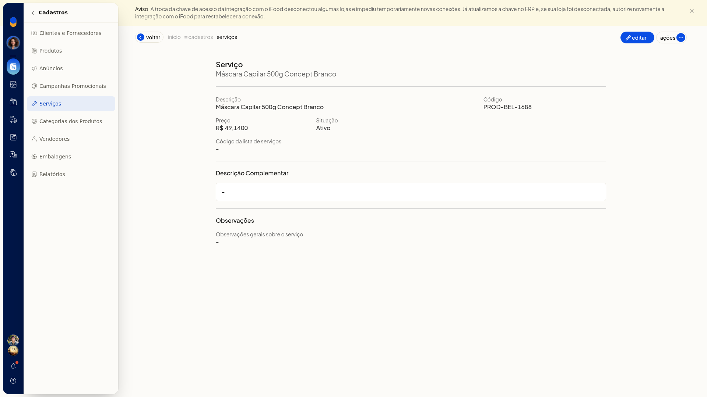

3. Clique em **Editar**.
4. Altere o que for necessário em **Descrição**, **Código**, **Preço**, **Unidade**, **Situação**, **Código da lista de serviços**, **Nomenclatura Brasileira de Serviços (NBS)**, **Descrição complementar** e **Observações**. Em **Código da lista de serviços**, use **Remover** quando houver código informado.

   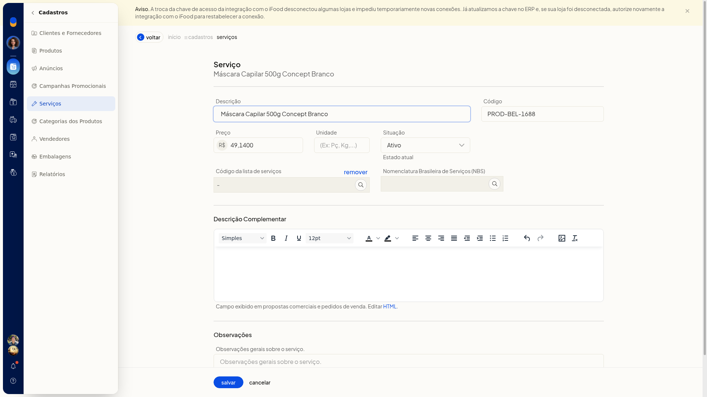

5. Clique em **Salvar** para gravar as alterações. **Cancelar** volta à ficha sem gravar.

### Clonar um serviço

1. Acesse **Cadastros > Serviços**.
2. Na linha do serviço, abra o menu de contexto (reticências) e clique em **Clonar serviço**. Outro caminho: abra o serviço, clique em **Ações** e depois em **Clonar serviço**.

   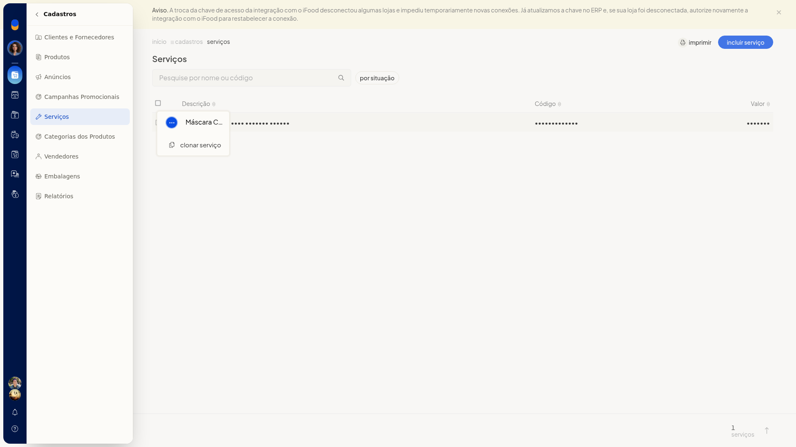

   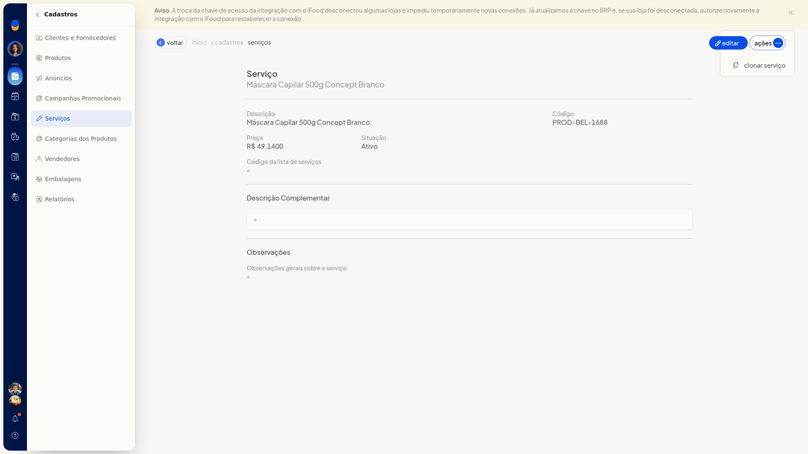

3. Revise o formulário. Ele abre com os dados do serviço de origem, a **Situação** em **Ativo** e o **Código** em branco. Ajuste o que for necessário.

   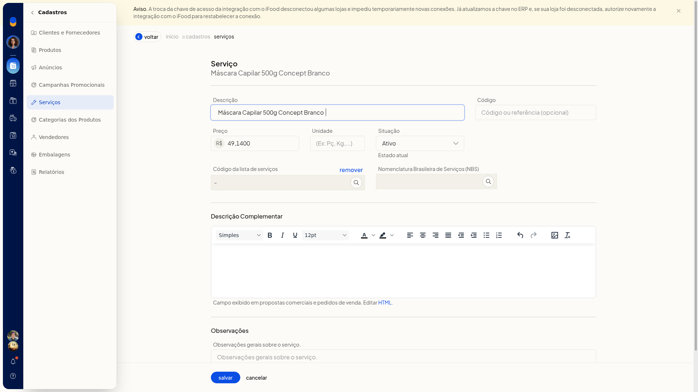

4. Clique em **Salvar** para gravar o novo serviço. **Cancelar** descarta o formulário e volta à listagem sem gravar.

### Pesquisar e filtrar a listagem

1. Acesse **Cadastros > Serviços**.
2. Use o campo **Pesquise por nome ou código**.
3. Clique em **por situação** e escolha **Sem filtro**, **Ativos**, **Inativos** ou **Excluídos**. Para retirar o filtro, use **limpar filtros**.

   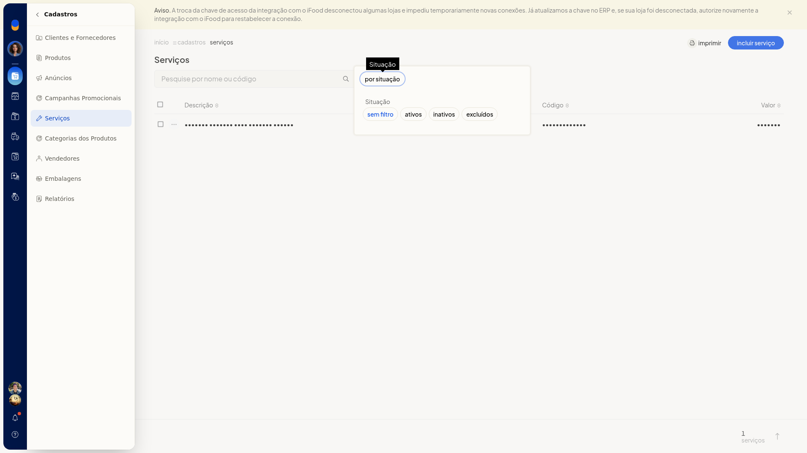

### Imprimir a relação

1. Acesse **Cadastros > Serviços**.
2. Clique em **Imprimir**. A pré-visualização mostra as colunas **Código**, **Descrição**, **Unidade** e **Preço de venda**.

   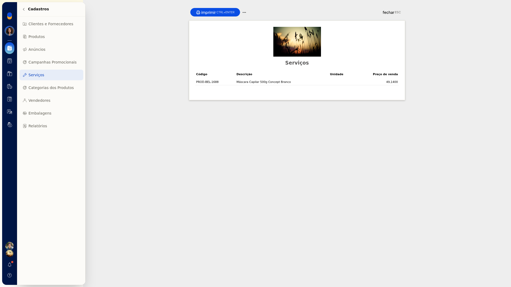

3. Em **Mais ações**, use **Abrir em outra página** se quiser ver a relação em outra página. **Fechar** encerra a pré-visualização sem imprimir.

   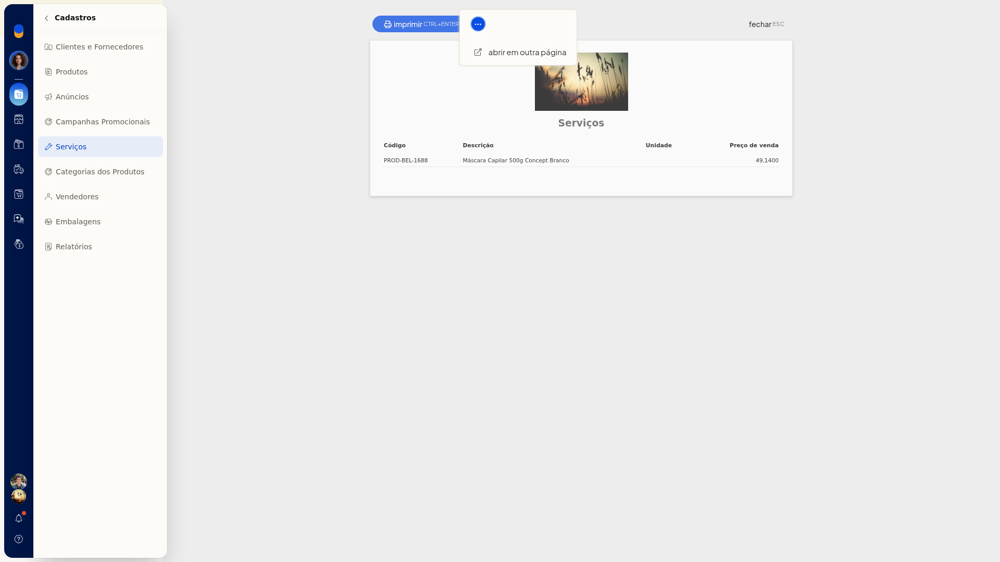

### Excluir serviços

1. Acesse **Cadastros > Serviços**.
2. Marque a caixa de seleção de um ou mais serviços. A barra inferior mostra a quantidade selecionada e **Excluir serviço**.

   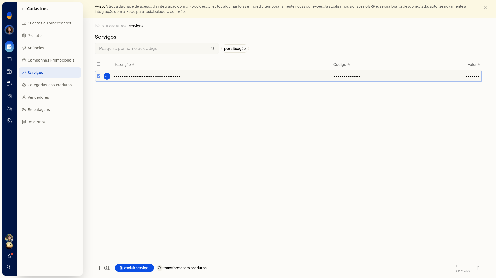

3. Clique em **Excluir serviço**.

### Transformar serviços em produtos

1. Acesse **Cadastros > Serviços**.
2. Marque a caixa de seleção de um ou mais serviços.
3. Clique em **Transformar em produtos**.

## Resultado
A listagem de **Serviços** mostra as colunas **Descrição**, **Código** e **Valor**. **Incluir serviço** abre o formulário de novo serviço. Clicar na linha abre a ficha do serviço, com **Voltar**, **Editar** e **Ações**. **Imprimir** abre a pré-visualização da relação.

## Informações adicionais
- Os campos de situação tributária e dos indicadores do PAF NFC-e só aparecem quando a conta tem o PAF NFC-e.
- Ao marcar serviços, a barra inferior mostra a quantidade selecionada, **Excluir serviço** e **Transformar em produtos**.
