# Ordens de serviço

No cadastro de serviços do ERP da Olist, você registra os serviços que a empresa comercializa ou executa. Em **Cadastros > Serviços**, você inclui um serviço, consulta e edita um já existente, clona um cadastro, pesquisa e filtra a lista, imprime a relação e, com itens marcados, exclui serviços ou os transforma em produtos.

## Importante
- Nenhum campo do formulário é obrigatório.
- **Excluir serviço** e **Transformar em produtos** só aparecem na barra inferior depois que você marca ao menos um serviço.
- Para transformar serviços em produtos, a conta também precisa poder cadastrar produtos e alterar serviços.
- Se **Editar**, **Excluir serviço** ou **Transformar em produtos** não aparecerem, peça acesso ao administrador da conta.

## Instruções
### Incluir um serviço

1. Acesse **Cadastros > Serviços**.

   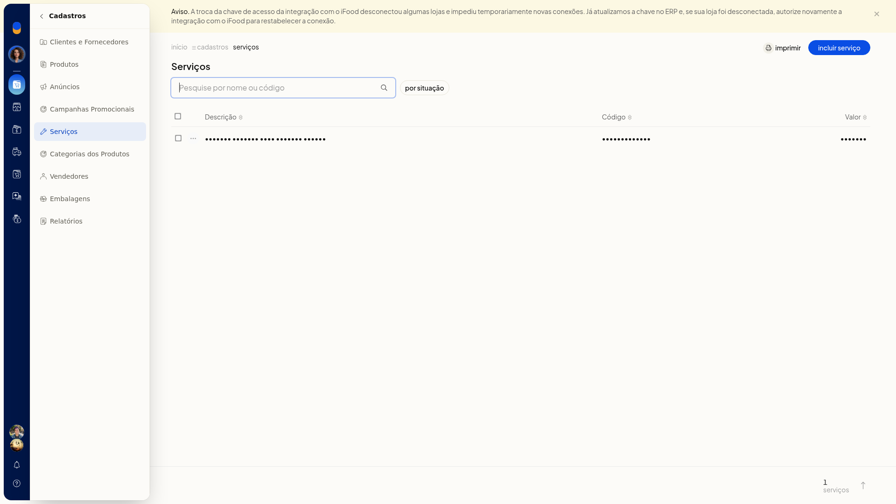

2. Clique em **Incluir serviço**.

   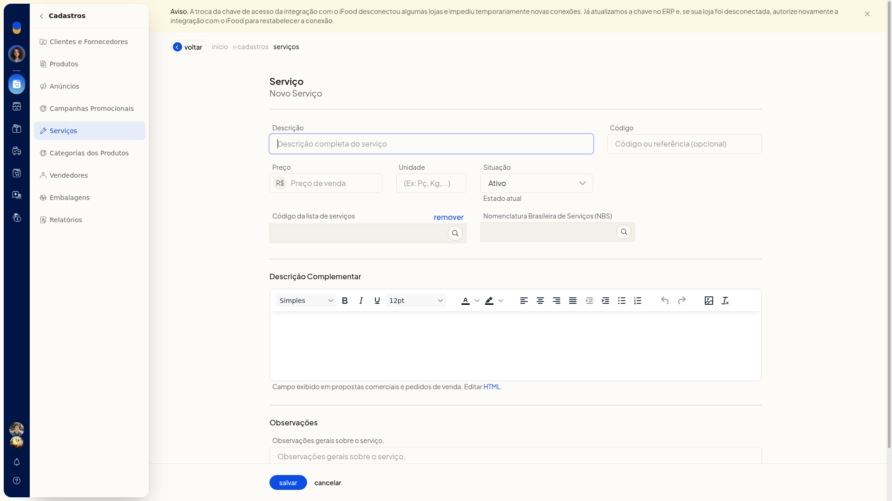

3. Preencha **Descrição**, **Código**, **Preço**, **Unidade** e **Situação**. Em **Situação**, escolha **Ativo** ou **Inativo**. **Ativo** já vem selecionado. Em **Preço**, informe o valor em reais (R$).

   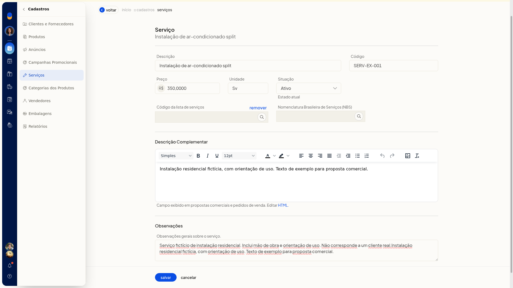

4. Se quiser, em **Código da lista de serviços**, busque em **Pesquisar Serviços** por código ou nome, ou informe o código no diálogo **Informar Serviço**, nos campos **Código do serviço** e **Descrição**. Não é necessário concluir a seleção. Com código informado, **Remover** limpa o campo.

   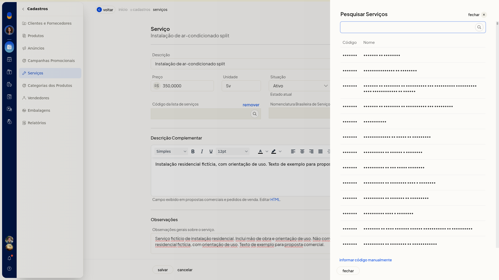

   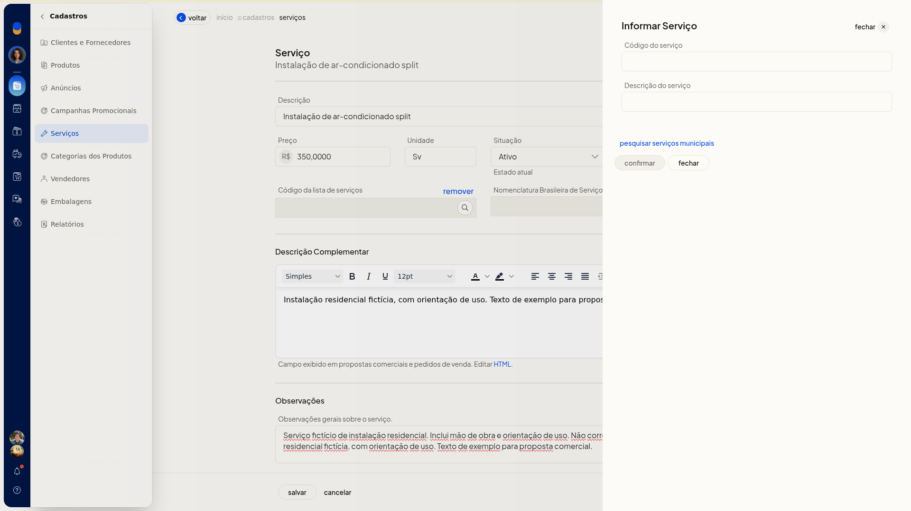

   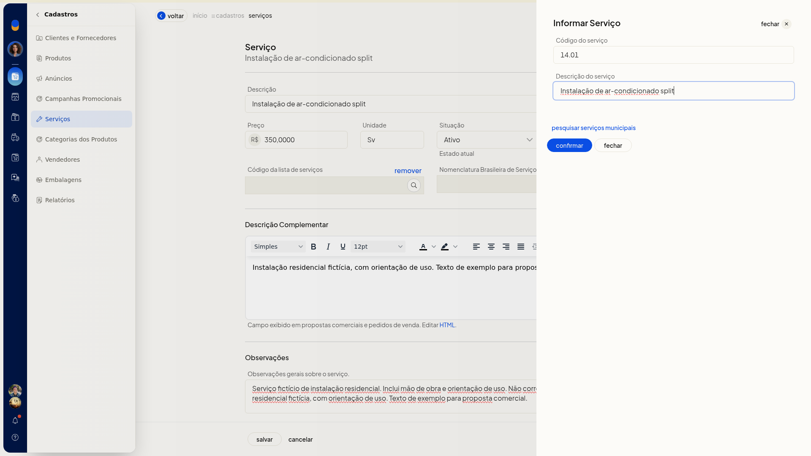

5. Se quiser, pesquise a **Nomenclatura Brasileira de Serviços (NBS)** por código ou descrição.

   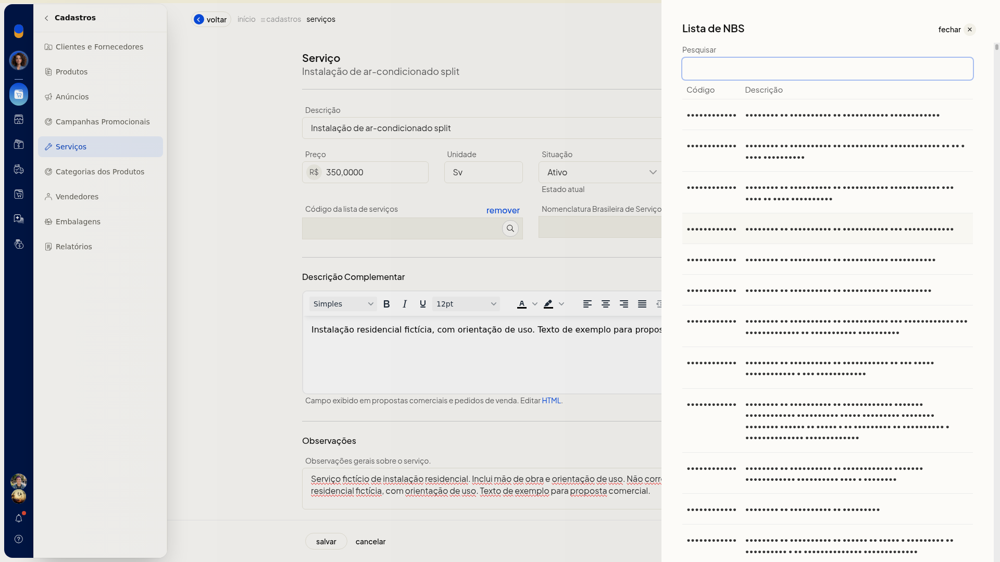

6. Se quiser, escreva a **Descrição Complementar**. No editor, clique em **Editar HTML** e depois em **Aplicar** ou **Cancelar**. Preencha **Observações** se precisar registrar notas gerais sobre o serviço.

   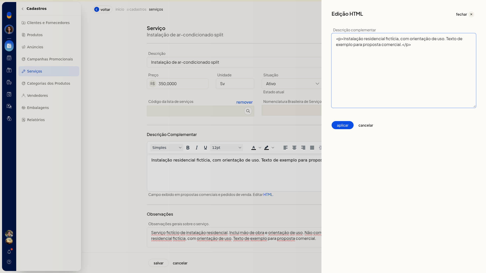

7. Clique em **Salvar** para gravar o serviço. **Cancelar** fecha o formulário sem gravar.

### Consultar e editar um serviço

1. Na listagem, clique na linha do serviço. A ficha abre somente leitura, com **Voltar**, **Editar** e **Ações**.

   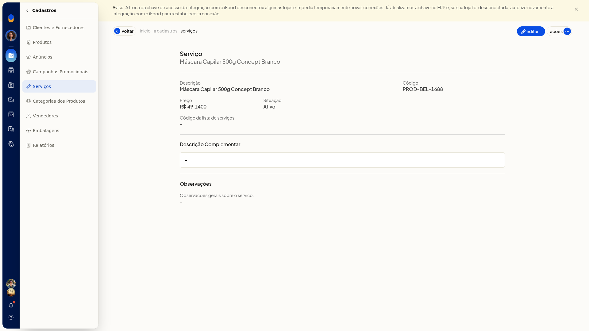

2. Clique em **Editar**. Ajuste **Descrição**, **Código**, **Preço**, **Unidade**, **Situação**, **Código da lista de serviços**, **Nomenclatura Brasileira de Serviços (NBS)**, **Descrição Complementar** e **Observações**. Em **Código da lista de serviços**, use **Remover** se houver código informado.

   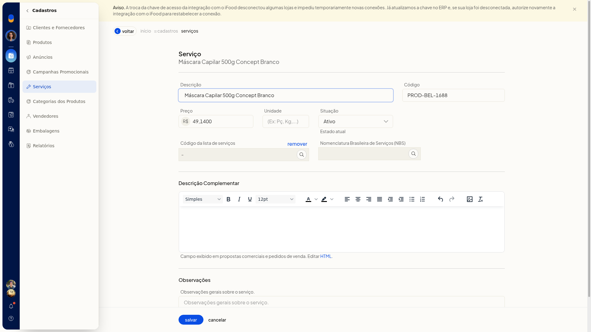

3. Clique em **Salvar** para gravar as alterações. **Cancelar** volta à ficha somente leitura sem gravar.

### Clonar um serviço

1. Na listagem, abra o menu da linha (reticências) e clique em **Clonar serviço**. Outro caminho: abra o serviço, clique em **Ações** e depois em **Clonar serviço**.

   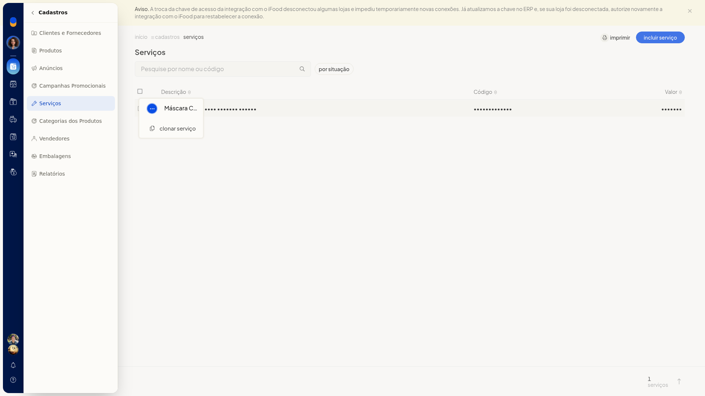

   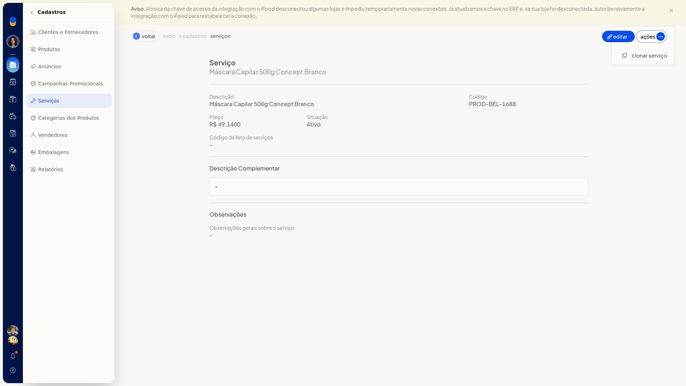

2. Revise o formulário. Os dados do serviço de origem vêm preenchidos, o **Código** fica em branco e a **Situação** permanece **Ativo**. Ajuste o que for necessário.

   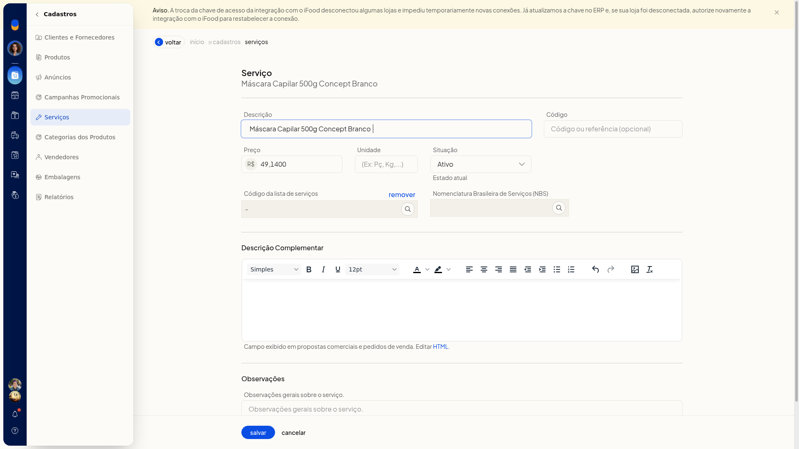

3. Clique em **Salvar** para gravar o novo serviço. **Cancelar** descarta o formulário e volta à listagem sem gravar.

### Pesquisar e filtrar a listagem

1. Em **Cadastros > Serviços**, use o campo **Pesquise por nome ou código**.
2. Clique em **por situação** e escolha **Sem filtro**, **Ativos**, **Inativos** ou **Excluídos**. Use **limpar filtros** para remover o filtro.

   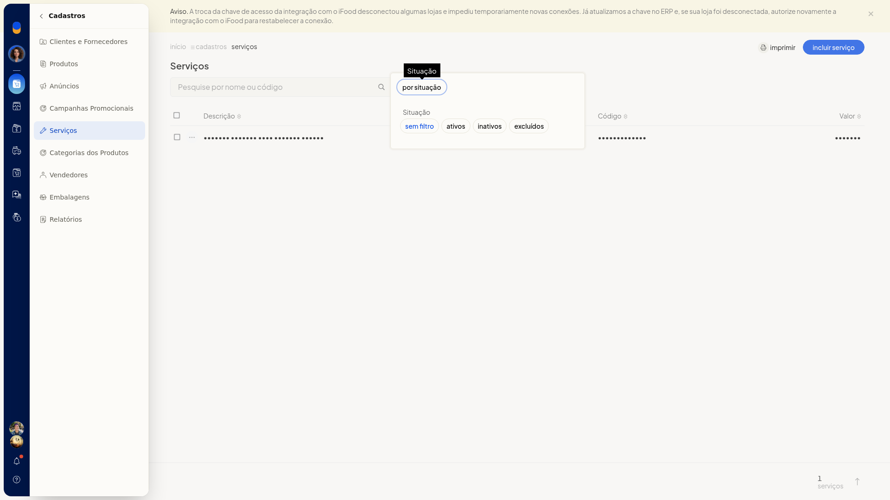

### Imprimir a relação

1. Na listagem, clique em **Imprimir**.
2. Confira a pré-visualização, com as colunas **Código**, **Descrição**, **Unidade** e **Preço de venda**.

   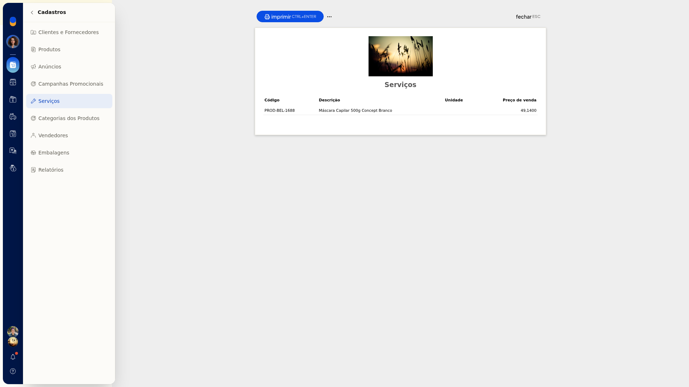

3. Em **Mais ações**, clique em **Abrir em outra página** se quiser abrir a relação em outra página. **Fechar** encerra a pré-visualização sem imprimir.

   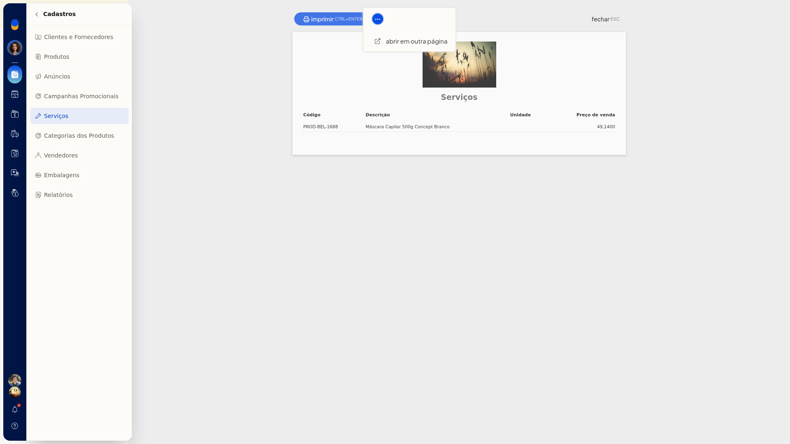

### Excluir serviços

1. Na listagem, marque a caixa de seleção de um ou mais serviços. A barra inferior mostra a quantidade selecionada, **Excluir serviço** e **Transformar em produtos**.

   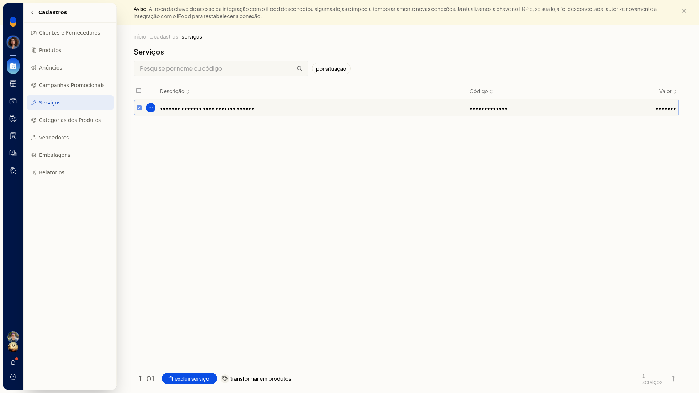

2. Clique em **Excluir serviço**.

### Transformar serviços em produtos

1. Na listagem, marque a caixa de seleção de um ou mais serviços.
2. Na barra inferior, clique em **Transformar em produtos**.

## Resultado
A listagem de **Serviços** mostra as colunas **Descrição**, **Código** e **Valor**. Ao clicar na linha, a ficha abre somente leitura. **Cancelar** na edição volta à ficha sem gravar, e **Cancelar** na clonagem volta à listagem sem gravar. **Imprimir** abre a pré-visualização, e **Fechar** a encerra sem imprimir.

## Informações adicionais
- No menu **Ações** da ficha, a opção exibida é **Clonar serviço**.
- A clonagem inicia um cadastro novo com os dados copiados e o **Código** vazio, para você revisar antes de salvar.
