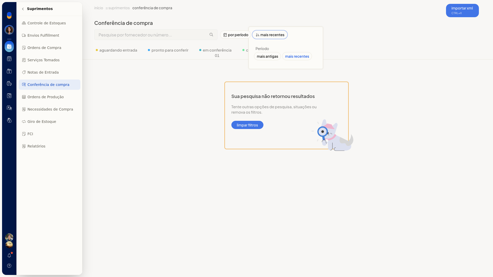
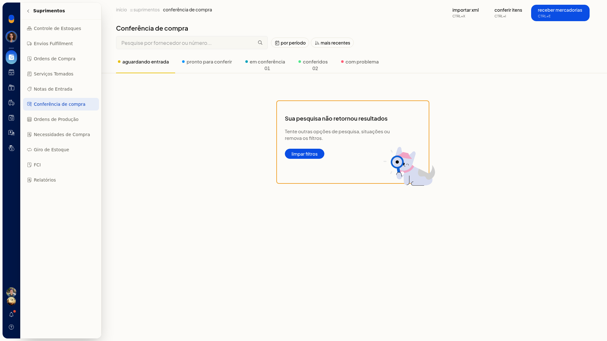
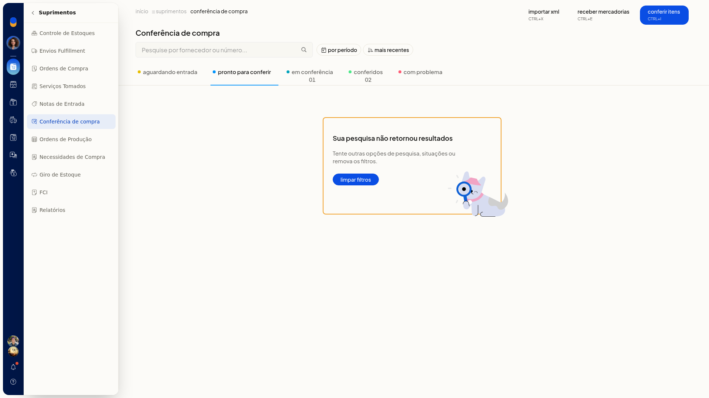
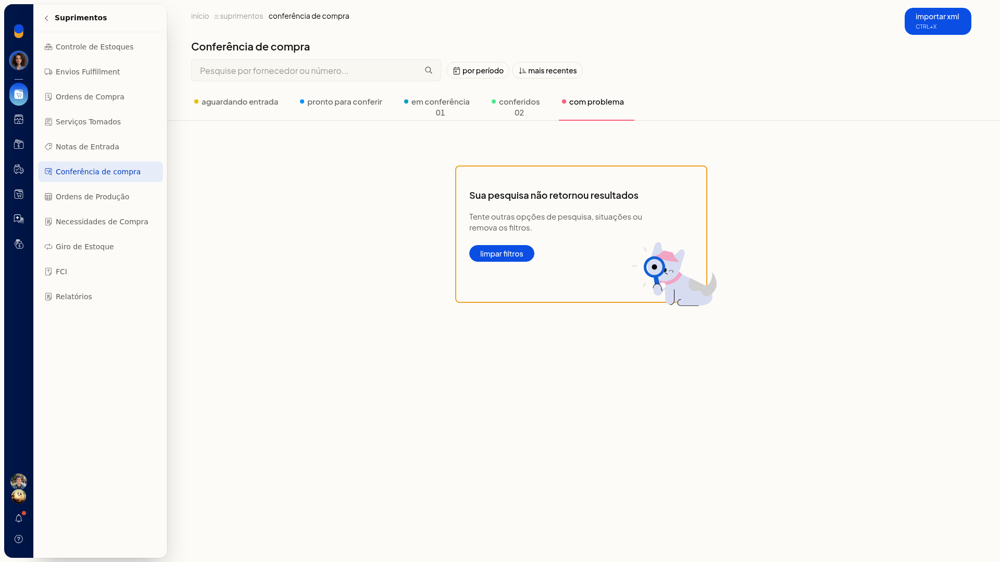
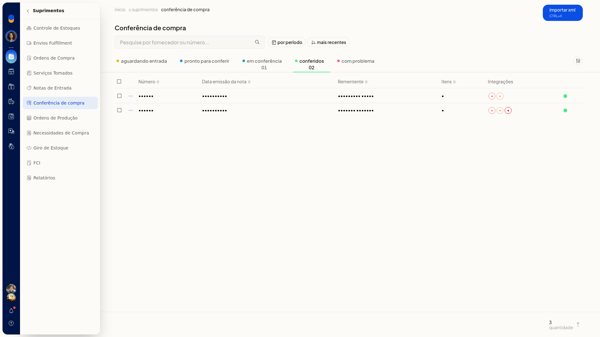
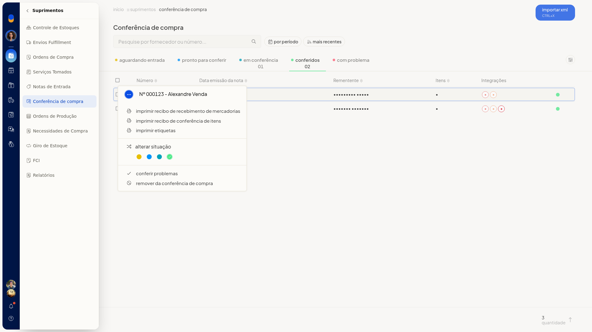

# Conferência de compra

## Pré-requisitos
- A lista parte de notas ou recebimentos já existentes.
- Para a entrada por XML, tenha um arquivo XML de NF-e.

## Importante
- O arquivo XML de NF-e tem limite de 2 Mb.

## Instruções
### Conferir os itens

1. Acesse **Suprimentos > Conferência de compra**.
2. Em **por período**, selecione **Sem filtro**, **Do dia**, **Últimos 7 dias**, **Últimos 30 dias**, **Do mês** ou **Do intervalo**.
3. Ordene por **Mais recentes** ou **Mais antigas**.

   

4. Abra a aba **Aguardando entrada**, **Pronto para conferir**, **Em conferência**, **Conferidos** ou **Com problema**. Se não houver notas, a tela mostra **Sua pesquisa não retornou resultados**.

   

   

   

5. Na aba **Conferidos**, a lista mostra **Número**, **Data emissão da nota**, **Rementente**, **Itens** e **Integrações**.

   

6. Na aba **Em conferência**, abra o menu da linha para **iniciar recebimento**, **continuar conferência**, **reiniciar conferência**, **imprimir recibo**, **imprimir etiquetas**, **alterar situação**, **conferir problemas** ou **remover**.
7. Na aba **Conferidos**, abra o menu da linha para **imprimir recibo de recebimento**, **imprimir recibo de conferência**, **imprimir etiquetas**, **alterar situação**, **conferir problemas** ou **remover**.

   

8. Abra **Conferência de itens**.
9. Pesquise pela descrição, pelo SKU ou pelo GTIN. **Quantidade** é opcional.
10. Confira na linha a quantidade contada e a esperada, a descrição, o SKU, o GTIN, o código do fornecedor e a unidade. Clique em **Concluir (ctrl+enter)**, em **Informar problemas (ctrl+i)** ou em **Cancelar (esc)**.

### Informar um problema

1. Acesse **Suprimentos > Conferência de compra** e abra **Conferência de itens**.
2. Clique em **Informar problemas**.
3. Escolha **divergência nas quantidades** ou **item com avaria**.
4. Selecione **Item da nota fiscal**, informe **Quantidade com problema** e preencha **Descreva o problema**. O informe fica preenchido na tela. Clique em **Cancelar** para descartar antes de gravar.

### Receber mercadorias

1. Acesse **Suprimentos > Conferência de compra**.
2. Clique em **Receber mercadorias**.
3. Pesquise pelo fornecedor, pelo número ou pela chave de acesso.
4. Pressione ENTER em **Receber mercadorias** para confirmar. **Cancelar** sai com ESC.

### Importar o XML da NF-e

1. Acesse **Suprimentos > Conferência de compra**.
2. Clique em **Importar XML (ctrl+x)**.
3. Na **Integração por Arquivo XML NFe**, selecione o arquivo XML, de no máximo 2 Mb, e preencha **Marcadores** se quiser.
4. Clique em **Cancelar** para sair. A navegação permanece em **Notas Fiscais de Entrada**. Para voltar à conferência, acesse **Suprimentos > Conferência de compra**.

## Resultado
A pesquisa mostra as notas da situação e do período escolhidos ou a mensagem **Sua pesquisa não retornou resultados**. Na conferência de itens, a quantidade contada aparece em relação à esperada antes de concluir.
