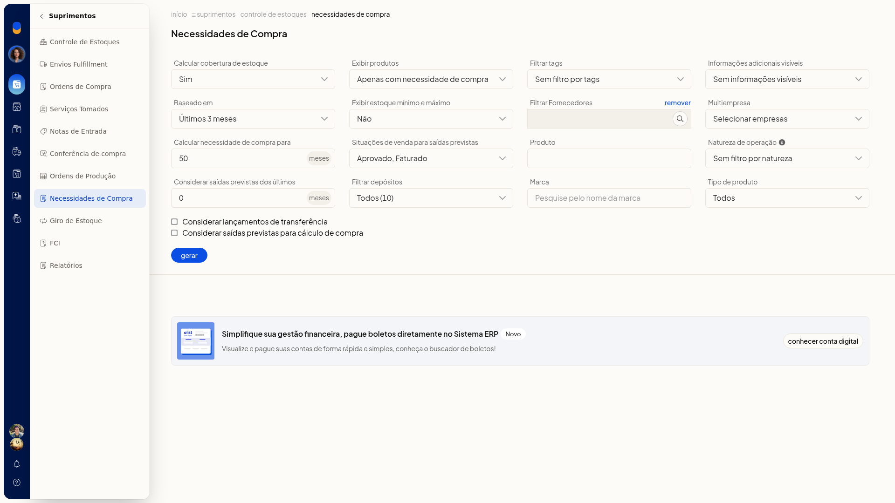
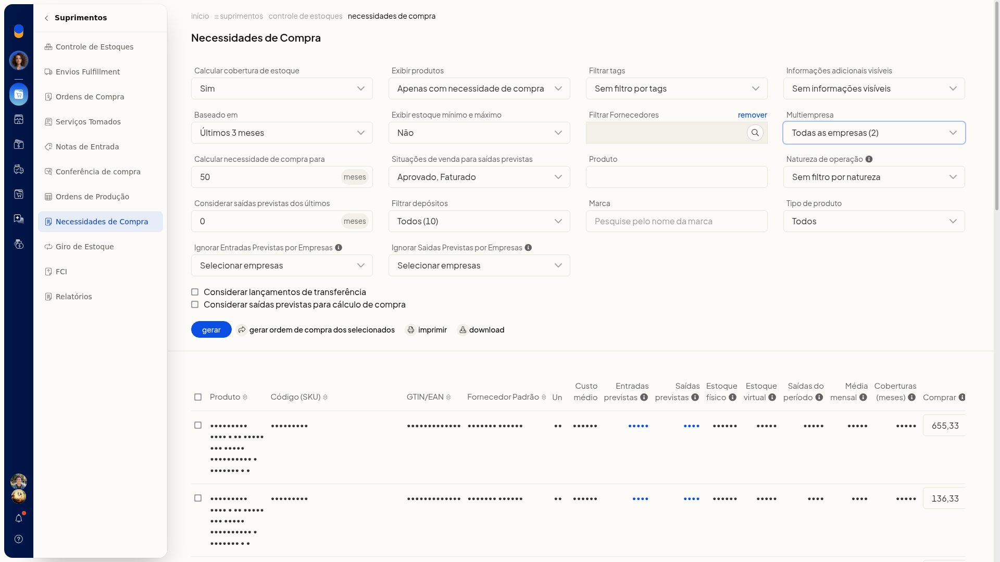
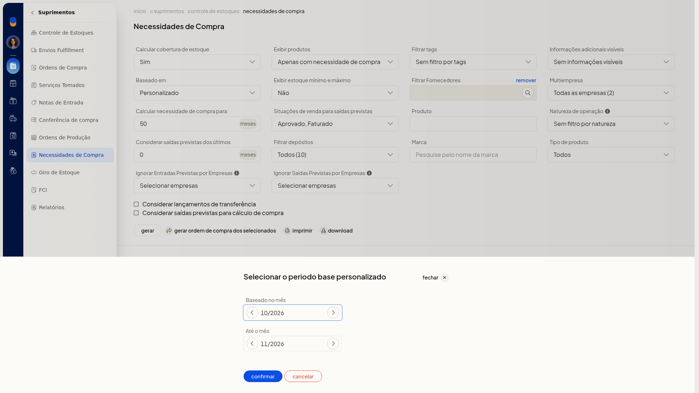
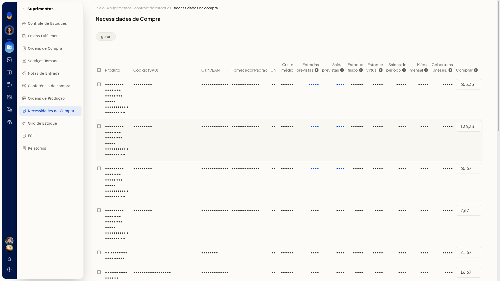
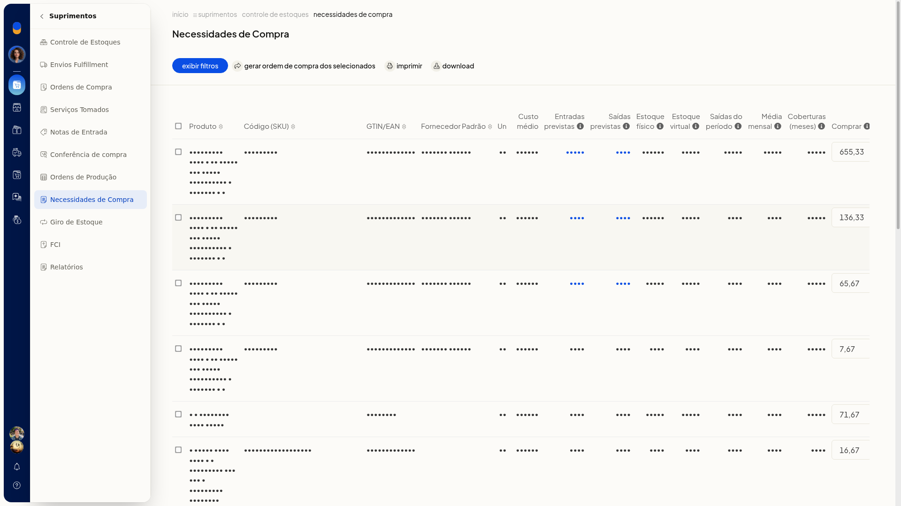
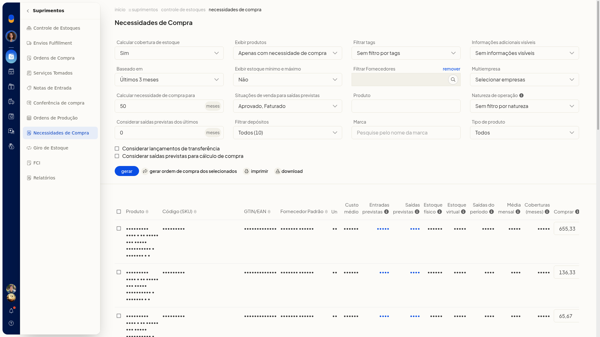

# Necessidades de compra

## Importante
- Alterar o estoque mínimo ou máximo neste relatório também atualiza o cadastro do produto.
- As saídas do período contabilizam todos os lançamentos de saída de estoque.
- Naturezas marcadas para não controlar estoque não entram no cálculo.
- Em **Multiempresa**, o nome da natureza de operação precisa ser igual em todas as empresas.
- **Ignorar Entradas Previstas por Empresas** e **Ignorar Saidas Previstas por Empresas** só aparecem depois de selecionar todas as empresas em **Multiempresa**.

## Instruções
1. Acesse **Suprimentos > Necessidades de Compra**.

   

2. Defina **Calcular cobertura de estoque** como **Não** ou **Sim**.
3. Em **Baseado em**, escolha **Último mês**, **Últimos 2 meses**, **Últimos 3 meses** ou **Personalizado**.
4. Em **Calcular necessidade de compra para**, informe a quantidade de meses em número inteiro.
5. Em **Exibir produtos**, escolha **Todos**, **Apenas com necessidade de compra** ou **Com necessidade de compra para atender o estoque mínimo**.
6. Ajuste os filtros que quiser usar. Nenhum deles é obrigatório:
 - **Exibir estoque mínimo e máximo**: **Não** ou **Sim**
 - **Situações de venda para saídas previstas**: uma ou mais entre **Em aberto**, **Aprovado**, **Preparando envio**, **Faturado**, **Pronto para envio**, **Enviado**, **Entregue**, **Não entregue**, **Dados incompletos**, **Em devolução** e **Cancelado**
 - **Filtrar tags**: tags já cadastradas, ou sem filtro
 - **Filtrar Fornecedores**: pesquise o fornecedor; use **Remover** ao lado do campo para limpar
 - **Produto**: pesquise o produto
 - **Informações adicionais visíveis**: **Código no Fornecedor Padrão** ou **Sem informações visíveis**
 - **Natureza de operação**: naturezas já cadastradas
 - **Considerar saídas previstas dos últimos**: número inteiro de meses
 - **Filtrar depósitos**: depósitos já cadastrados, ou todos
 - **Marca**: pesquise pelo nome da marca
 - **Tipo de produto**: **Todos**, **Simples**, **Fabricado** ou **Matéria-prima**
7. Marque, se quiser, **Considerar lançamentos de transferência** e **Considerar saídas previstas para cálculo de compra**.
8. Em **Multiempresa**, selecione as empresas. Ao marcar todas, o rótulo passa a indicar todas as empresas e surgem **Ignorar Entradas Previstas por Empresas** e **Ignorar Saidas Previstas por Empresas**. Use esses campos para indicar as empresas cujas entradas ou saídas previstas não devem entrar no cálculo.

   

9. Se escolheu **Personalizado**, informe **Baseado no mês** e **Até o mês** no formato mm/aaaa. Clique em confirmar para aplicar. **Cancelar** fecha o modal sem aplicar.

   

10. Clique em **Gerar**. Ao terminar, a tabela mostra a sugestão por produto, com seleção por linha e a coluna **Comprar** editável. Na barra do resultado ficam **Exibir filtros**, **Gerar Ordem de Compra dos selecionados**, **Imprimir** e **Download**.

   

   

11. Para mudar os filtros com o resultado na tela, clique em **Exibir filtros**.

   

## Resultado
O relatório lista, por produto, estoques, cobertura e a quantidade em **Comprar**. Selecione as linhas e use **Gerar Ordem de Compra dos selecionados** para seguir com a ordem, ou **Imprimir** e **Download** para sair com o resultado.

## Informações adicionais
### O que cada coluna representa

- **Entradas previstas**: ordens em aberto e em andamento ainda não integradas ao estoque.
- **Saídas previstas**: notas pendentes e autorizadas e pedidos nas situações selecionadas, ainda não integrados ao estoque.
- **Estoque físico**: estoque atual.
- **Estoque virtual**: estoque físico mais entradas previstas menos saídas previstas.
- **Saídas do período**: lançamentos de saída.
- **Média mensal**: saídas do período dividido pelo período base.
- **Coberturas (meses)**: estoque físico dividido pela média mensal.
- **Comprar**: média mensal vezes a necessidade de compra, menos estoque físico, menos entradas previstas.

A tabela também mostra **Produto**, **Código (SKU)**, **GTIN/EAN**, **Fornecedor Padrão**, **Un** e **Custo médio**.
