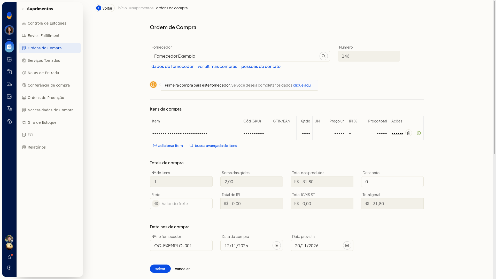
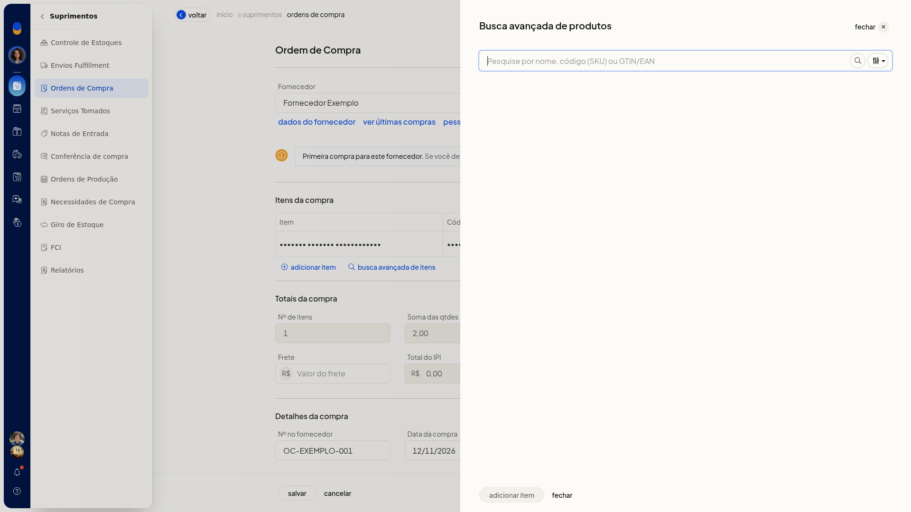

# Ordens de compra

No ERP da Olist, a ordem de compra registra o pedido ao fornecedor, com datas, condição, transporte, marcadores e itens. Você consulta as ordens por busca, período, filtros e situação, inclui uma ordem pela tela ou inicia a importação por planilha em **Suprimentos > Ordens de Compra**.

## Importante
- Para lançar a ordem pela tela, informe um fornecedor e ao menos um item.
- A planilha de importação precisa seguir o layout indicado na tela: Excel.xls,.xlsx ou CSV, com no máximo 2 Mb.

## Instruções
### Pela tela

1. Acesse **Suprimentos > Ordens de Compra**.
2. Na lista, use a busca, o filtro por período e os demais filtros. As abas são **Todos**, **Em aberto**, **Em andamento**, **Atendidas** e **Canceladas**.
3. Clique em **Incluir ordem de compra**.
4. Informe o **Fornecedor**. Se o nome não estiver cadastrado, a tela avisa que o cadastro não foi encontrado e indica primeira compra.
5. Preencha os dados da ordem.

#### Dados da ordem

- **Nº no fornecedor**
- **Data compra**, no formato DD/MM/AAAA
- **Data prevista**, no formato DD/MM/AAAA
- **Condição**
- **Categoria**
- **Transportador**
- **Frete**
- **Observações**
- **Marcadores**

6. No item, informe o produto, o **Código (SKU)**, a **Quantidade** em decimal com vírgula e o **Preço unitário** em decimal com vírgula. A linha e o total da ordem são recalculados na tela.

   

7. Para localizar o produto, abra a busca avançada, pesquise por nome, código (SKU) ou GTIN/EAN e filtre. Clique em **Adicionar item** para incluir, ou em **Fechar** para sair sem incluir.

   

8. Revise os totais da ordem.

### Por planilha

1. Acesse **Suprimentos > Ordens de Compra**.
2. Abra **Mais ações**.
3. Clique em **Importar ordens de compra de uma planilha**.
4. Use um arquivo Excel.xls,.xlsx ou CSV, no layout do Olist ERP, com no máximo 2 Mb.
5. Monte a planilha com as colunas indicadas na tela:
 - ID
 - Data
 - ID contato
 - Nome do contato
 - Desconto
 - Observações
 - Situação
 - ID produto
 - Descrição
 - Quantidade
 - Valor unitário
 - Número da ordem de compra
 - Código (SKU)
6. Clique em **Carregar arquivo** para enviar a planilha. Para voltar sem enviar, clique em **Cancelar**.

## Resultado
A lista exibe as ordens nas abas de situação, com as colunas **Número**, **Data**, **Previsto**, **Fornecedor**, **Total**, **Marcadores** e **Integrações**. No formulário, o total da linha e o total da ordem aparecem enquanto o item é preenchido.

## Informações adicionais
### Impressão e exportação na lista

Em **Mais ações**, a lista também oferece **Imprimir relatório** e **Exportar ordens de compra para planilha**. A própria lista tem o botão **Imprimir**.
