# Depósitos e configurações de estoque

No ERP da Olist, o estoque fica organizado em depósitos. Você consulta o saldo de cada produto, inclusive quando o saldo físico ou o disponível está negativo, prepara um lançamento manual e define quando entradas, saídas e estornos são feitos.

No cadastro do produto, **Dias para preparação** informa quantos dias corridos o item leva para ficar disponível. Na inclusão de depósito, os tipos são **Próprio** e **Exclusivo para um canal de venda**.

## Importante
- Se **Permite estoque negativo** não estiver em **Sim**, o sistema não lança estoque de nota fiscal, pedidos e ordem de serviço quando o saldo é insuficiente.
- O lançamento automático de saídas ao salvar o pedido é desaconselhado na tela.
- Ao excluir a nota fiscal, o estorno de estoque também é automático.
- O filtro de lançamentos lista **Sem filtro**, **Entrada**, **Saída** e **Balanço**. O estorno fica em **Configurações de estoque**.

## Instruções
### Consultar saldos e preparar um lançamento

1. Acesse **Suprimentos > Controle de Estoques**.
   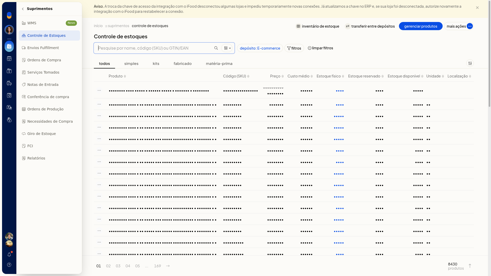

2. No menu **Mais ações**, use **Transferir**, **Inventário** ou **Imprimir relatório**. No menu da linha do saldo, use **Imprimir etiquetas**.

3. Abra o saldo físico para ver os detalhes por depósito.
   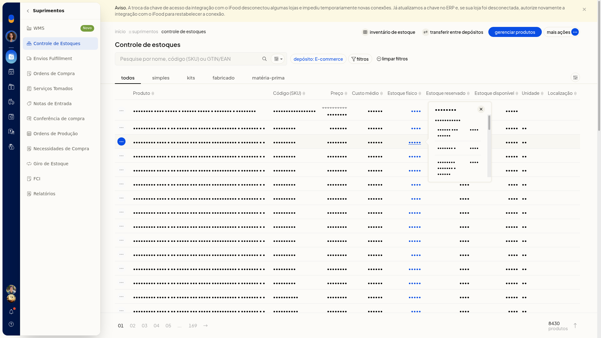

4. Na tela de lançamentos do produto, confira os saldos físico, reservado, disponível e multiempresa.
   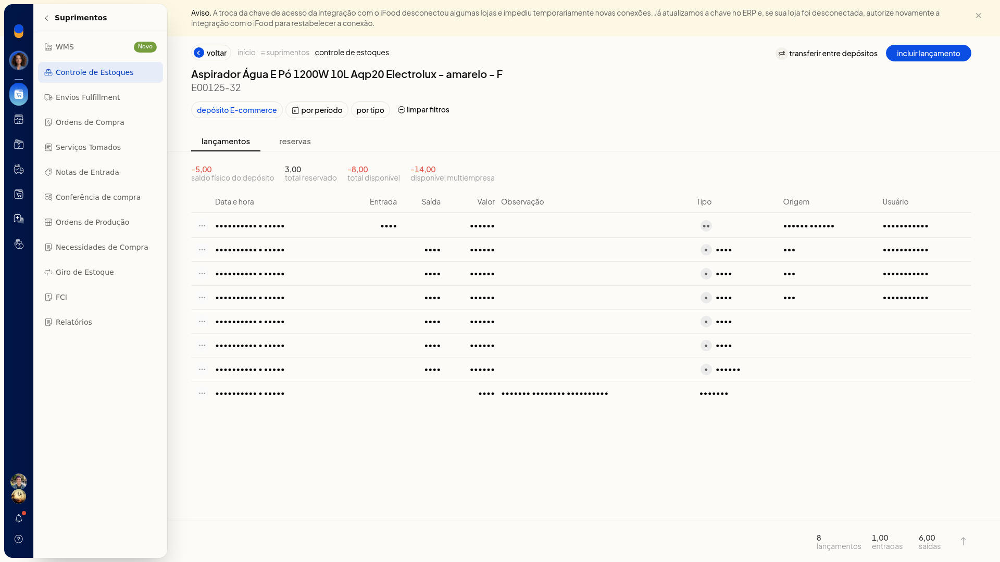

5. Em **Incluir lançamento**, preencha **Qtd**, **Preço** e **Observação**. Nenhum desses campos é obrigatório. O preço aceita casas decimais.
   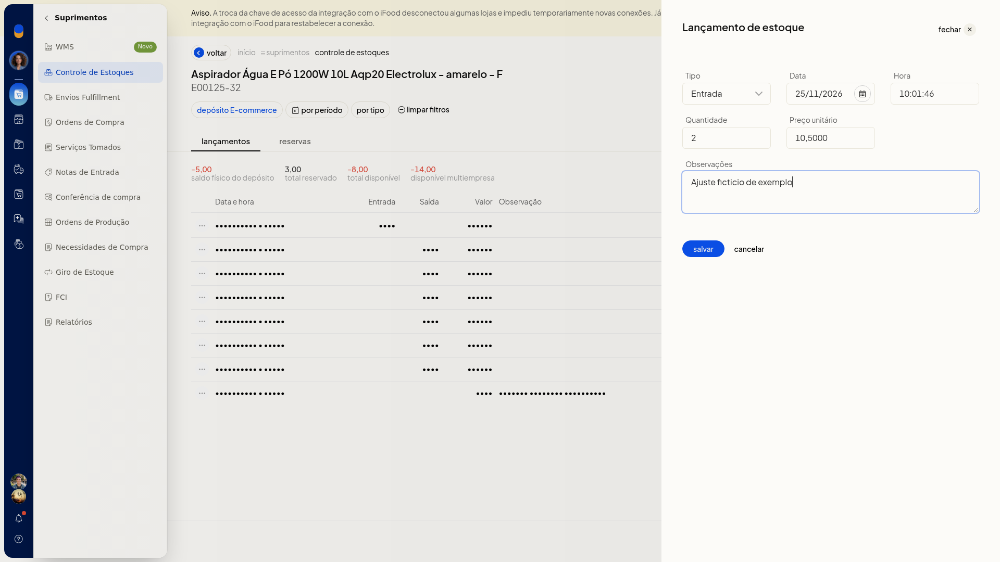

6. Filtre os lançamentos por **Sem filtro**, **Entrada**, **Saída** ou **Balanço**.
   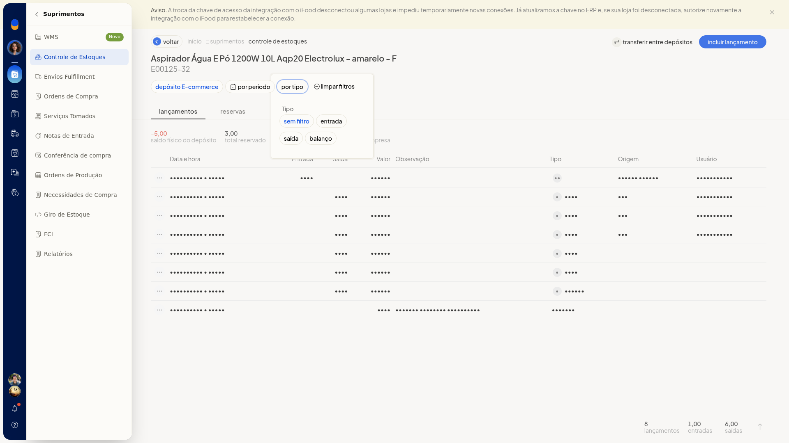

7. No menu da linha de um lançamento, calcule o saldo no período do lançamento ou remova o lançamento.
   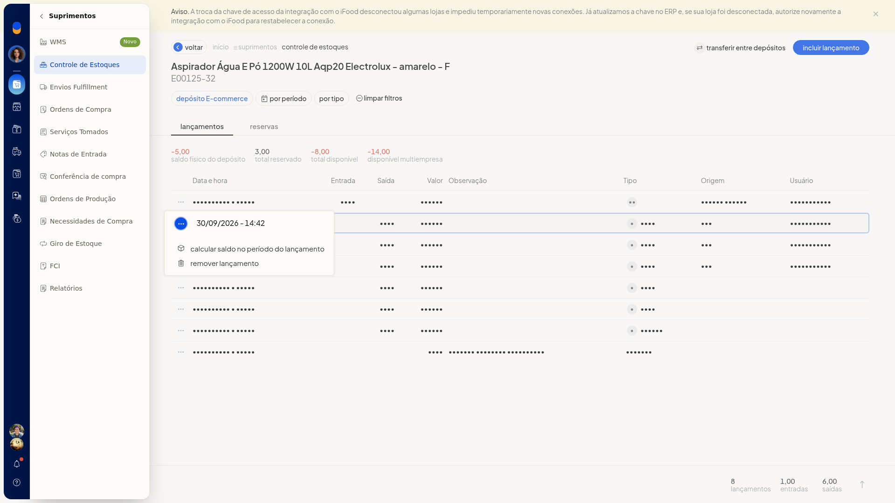

### Incluir um depósito

1. Acesse **Configurações > Configurações ERP > Suprimentos > Depósitos de estoque**. A lista tem filtro de ativos, busca e **Incluir depósito**.
   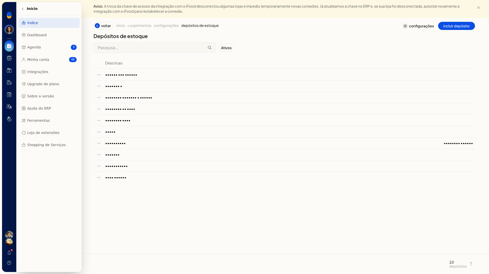

2. No menu da linha de um depósito, use **Inativar depósito** ou **Tornar depósito padrão**.
   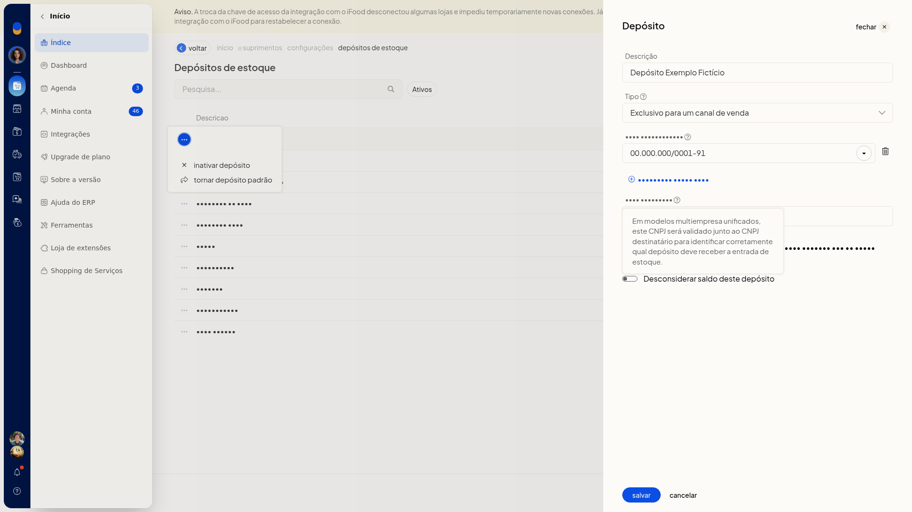

3. Clique em **Incluir depósito**.
   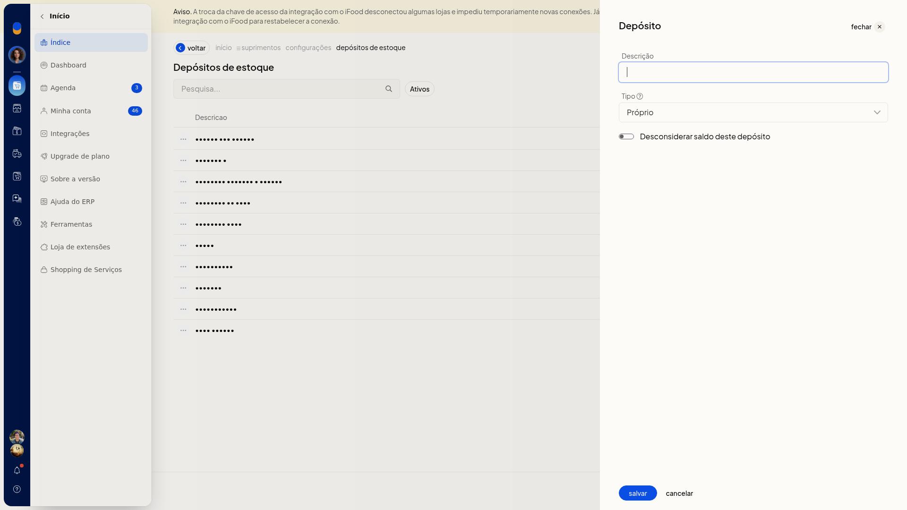

4. Preencha **Descrição**. O campo não é obrigatório.
   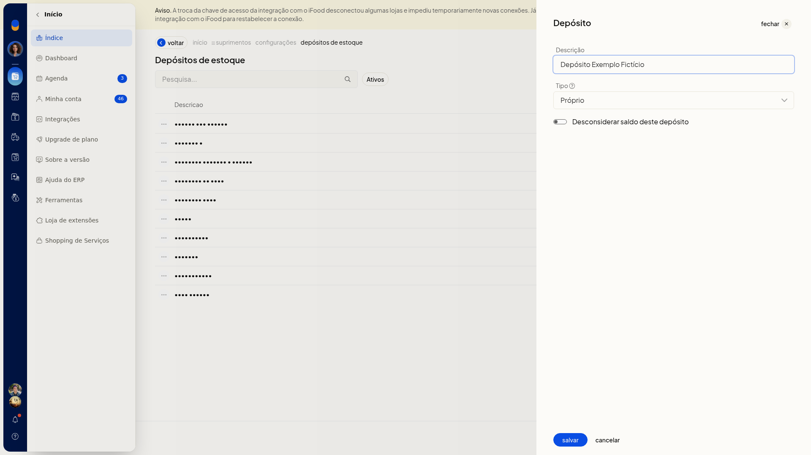

5. Em **Tipo**, selecione **Próprio** ou **Exclusivo para um canal de venda**. **Próprio** vem selecionado. Depósitos próprios são compartilhados entre canais. Depósitos externos, em geral, são de fulfillment e exclusivos de um canal.
   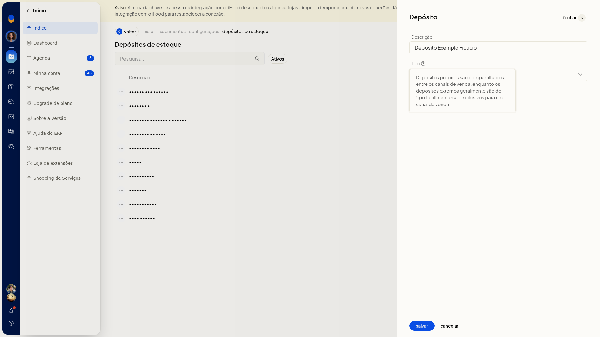

6. Marque **Desconsiderar saldo deste depósito** quando o saldo desse depósito não deve ser considerado.

7. Se escolher **Exclusivo para um canal de venda**, preencha **CNPJ** no formato AA.AAA.AAA/AAAA-00, use **Adicionar outro CNPJ** para incluir mais um e preencha **CNPJ Remetente**. Em multiempresa unificado, o **CNPJ Remetente** é validado junto ao CNPJ destinatário para identificar o depósito da entrada. Marque **Criar transferências de estoque para notas fiscais com os CNPJs informados acima** quando quiser essa transferência. Esses campos não são obrigatórios.
   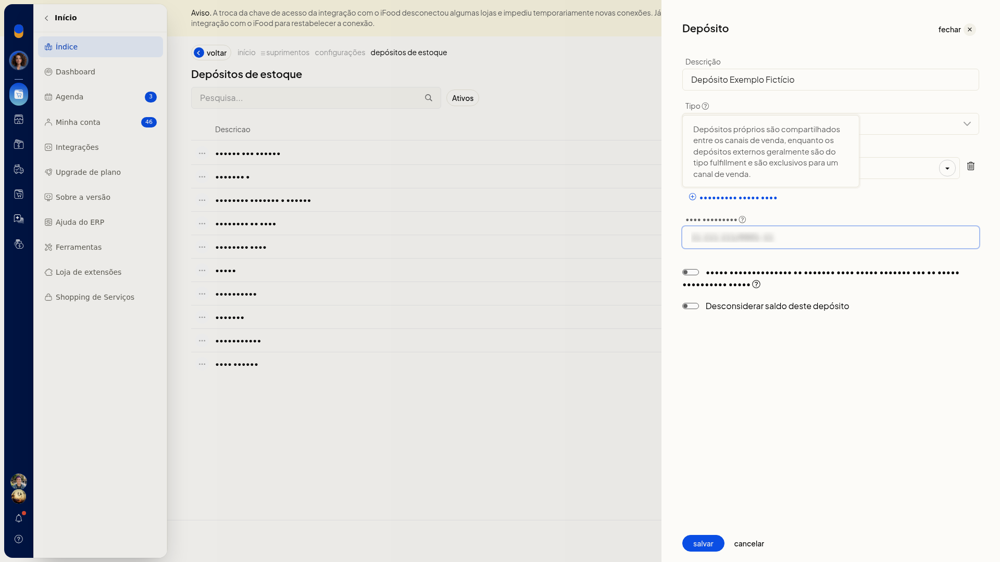
   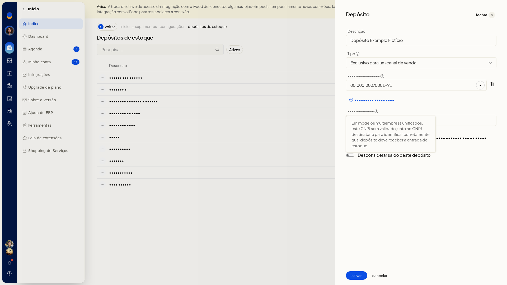

### Definir as configurações de estoque

1. Acesse **Configurações > Configurações ERP > Suprimentos > Configurações de estoque**.

2. Em **Permite estoque negativo**, escolha **Sim**, **Não - validar todos os depósitos com saldos a considerar** ou **Não - validar depósito da venda**.
   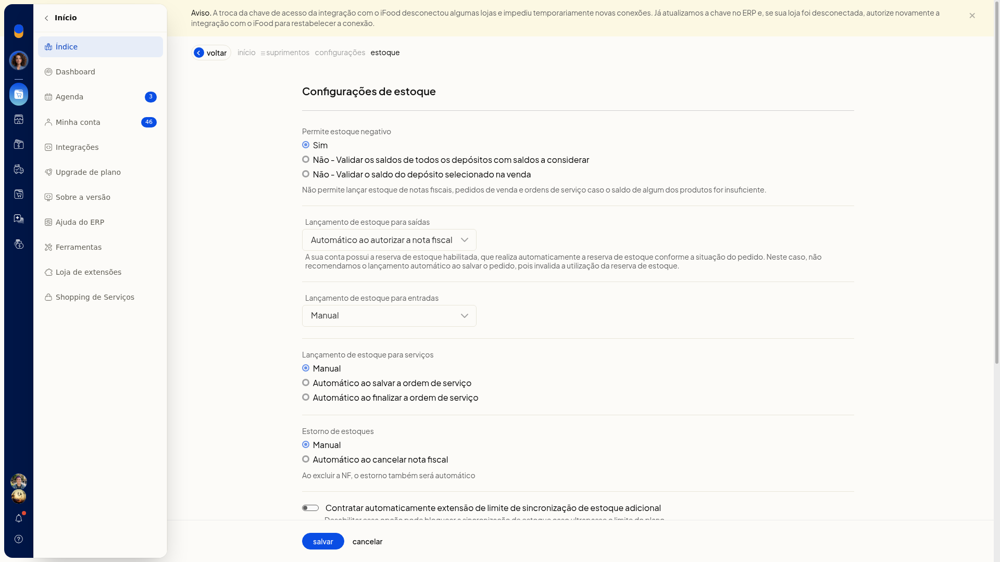

3. Em saídas, escolha **Manual**, automático ao autorizar a nota fiscal, ao salvar a nota fiscal, ao salvar o pedido ou ao marcar enviado.

4. Em entradas, escolha **Manual**, ao autorizar a nota fiscal, ao salvar a nota fiscal, ao salvar a ordem de compra ou ao finalizar a conferência.

5. Em serviços, escolha **Manual**, ao salvar a ordem de serviço ou ao finalizar a ordem de serviço.

6. Em **Estorno de estoques**, escolha **Manual** ou **Automático ao cancelar nota fiscal**. Na mesma tela, ajuste as demais caixas: contratar extensão de limite de sincronização, exibir estoque na lista de preços, estornar ao cancelar pedido, e-mail abaixo do mínimo, considerar saldo no sob encomenda, confirmar lotes e validades e permitir editar quantidade na importação de inventário.
   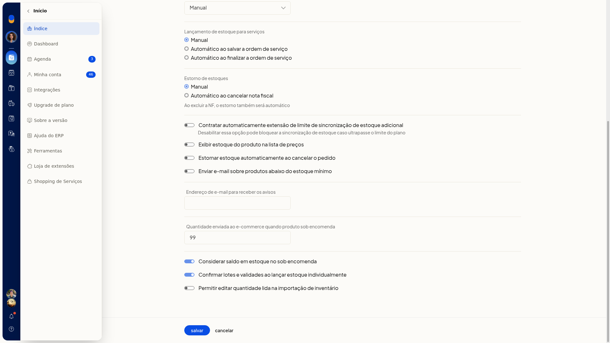

### Informar os dias para preparação

1. Acesse **Cadastros > Produtos**.

2. Clique em **Incluir produto**.

3. Na seção **Estoque**, preencha **Controlar estoque**, **Estoque inicial**, **Estoque mínimo**, **Estoque máximo**, **Sob encomenda**, **Controlar lotes**, **Localização** e **Dias para preparação**. Nenhum desses campos é obrigatório. **Estoque inicial** é a quantidade no depósito escolhido. **Sob encomenda** e **Controlar lotes** aceitam **Sim** ou **Não**.
   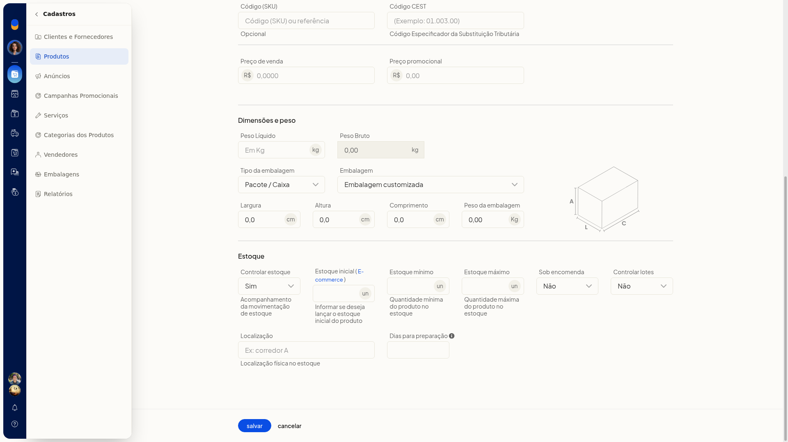

4. Em **Dias para preparação**, informe quantos dias corridos você demora para disponibilizar o produto. O depósito das variações usa o rótulo **Depósito utilizado para as variações**, com os depósitos já cadastrados.
   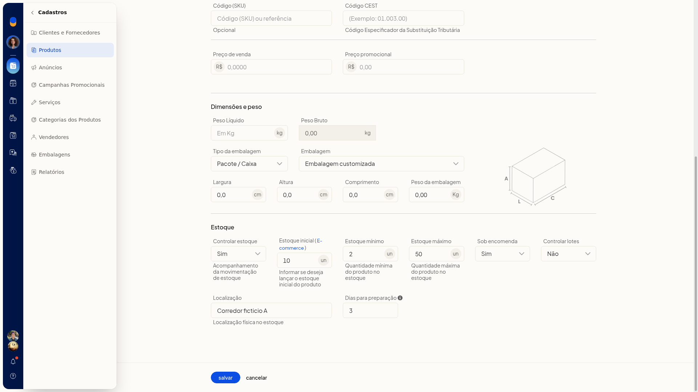

## Resultado
Em **Depósitos de estoque**, o formulário do novo depósito fica com a descrição e, no tipo exclusivo, com os CNPJs informados. Em **Configurações de estoque**, a tela mostra as regras de estoque negativo, de lançamento e de estorno. No novo produto, a seção **Estoque** reúne sob encomenda, localização e **Dias para preparação**.
