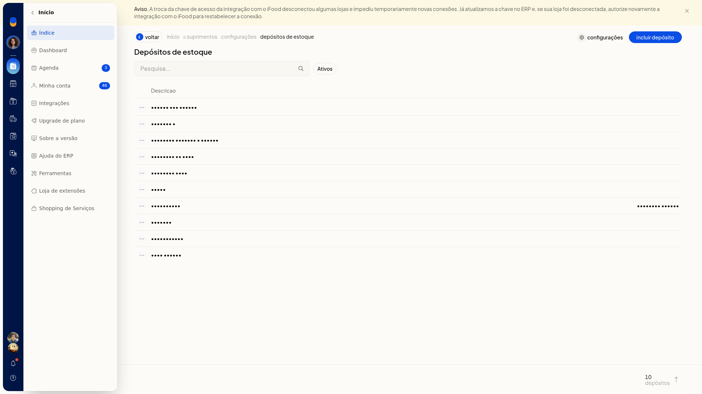
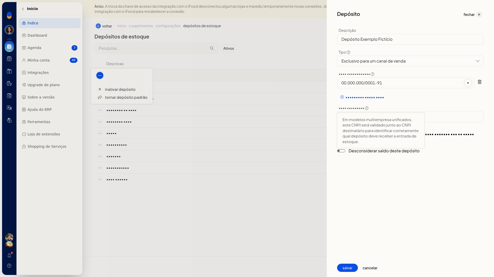
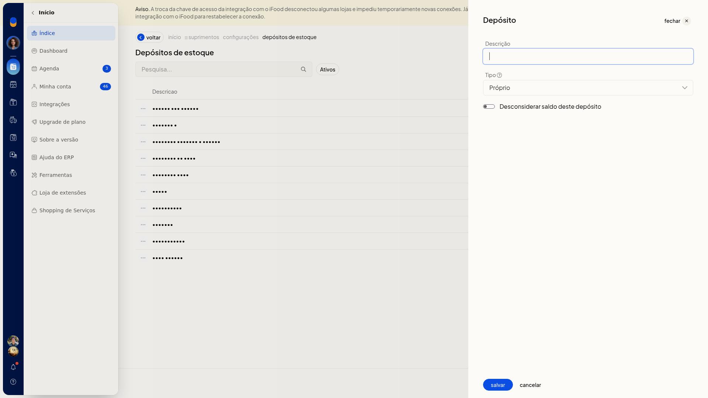
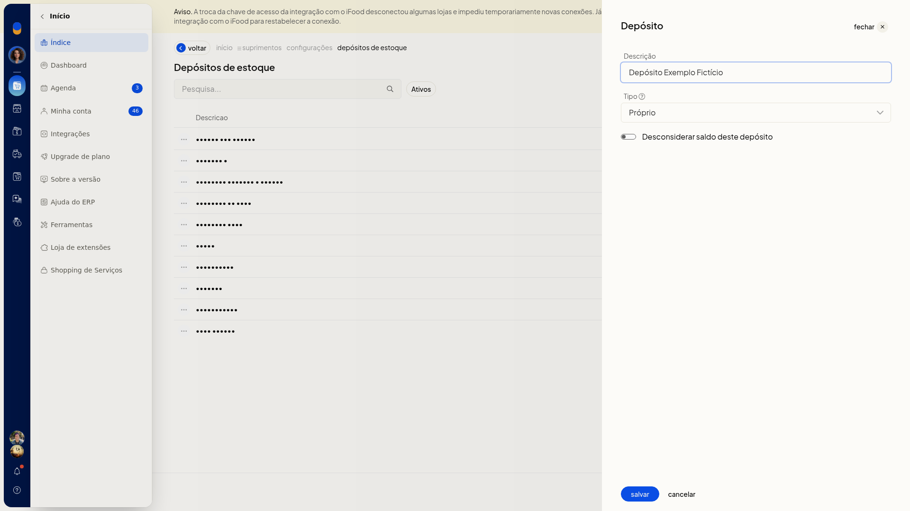
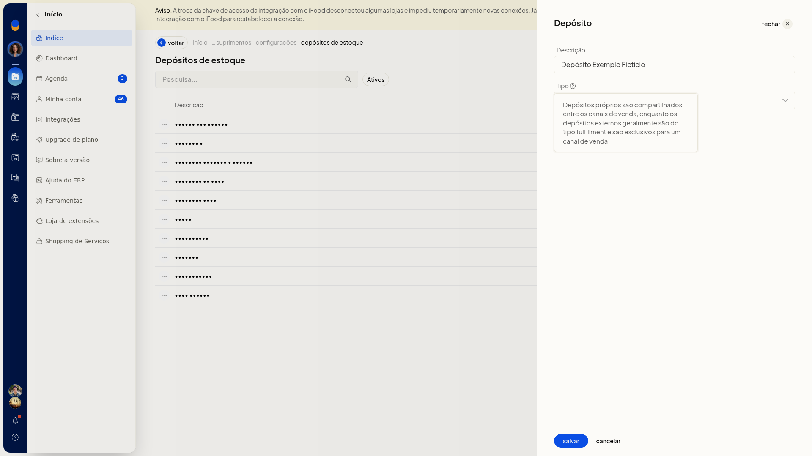
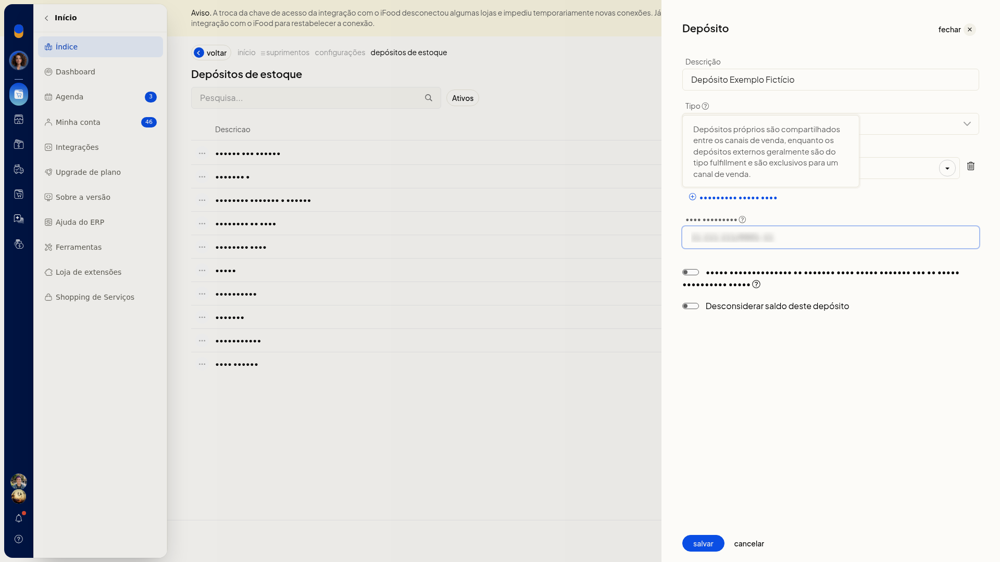
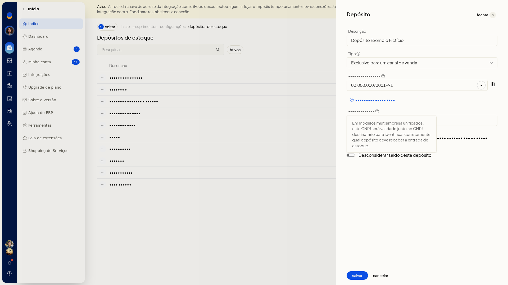
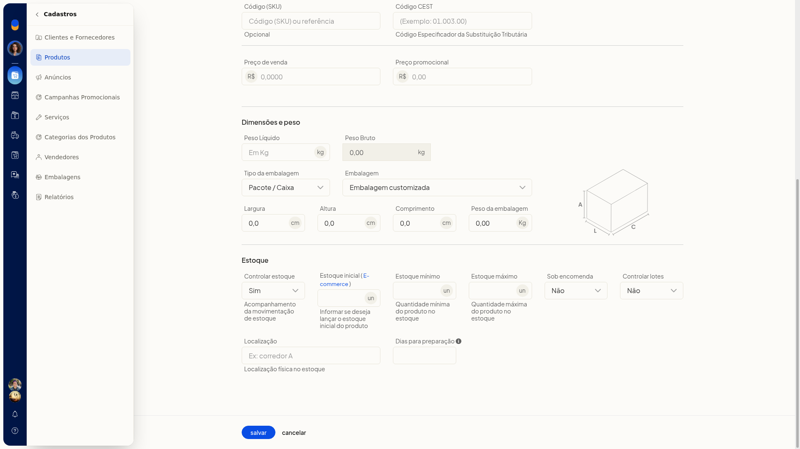
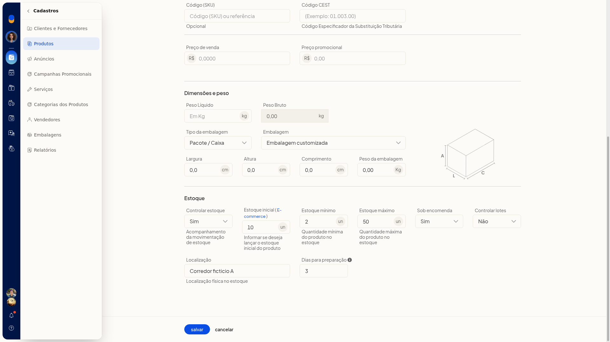
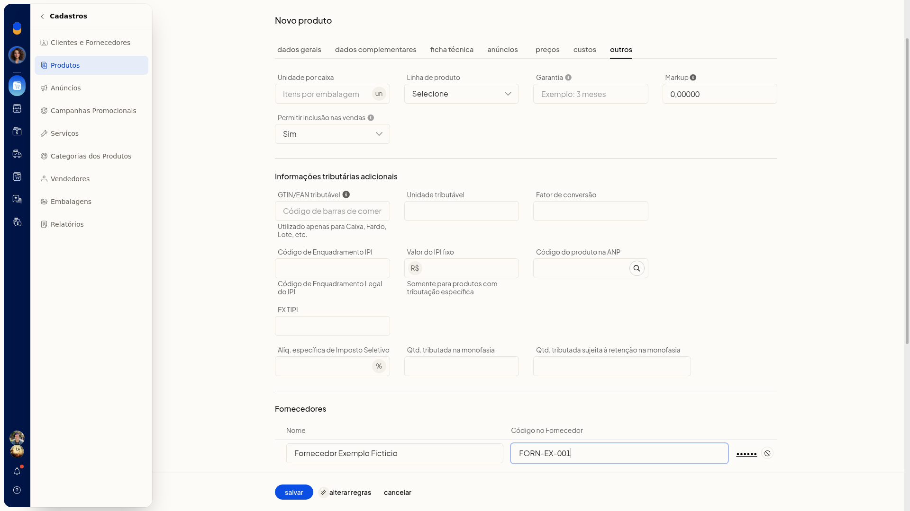

# Dropshipping: depósito do fornecedor e dias de preparação

No ERP da Olist, o estoque é organizado em depósitos. Na inclusão, o **Tipo** pode ser **Próprio** ou **Exclusivo para um canal de venda**. Não há tipo, campo nem ação com o nome depósito de fornecedor.

No cadastro do produto, **Dias para preparação** informa quantos dias corridos o item leva para ficar disponível. O campo fica na seção **Estoque**, não na tela de depósitos.

## Importante
- O **Tipo** do depósito só oferece **Próprio** e **Exclusivo para um canal de venda**.
- A ajuda do **Tipo** informa que depósitos próprios são compartilhados entre canais e que depósitos externos, em geral, são de fulfillment e exclusivos de um canal.
- **Dias para preparação** não é obrigatório.
- O menu da linha de um depósito oferece **Inativar depósito** e **Tornar depósito padrão**. Não há ação de depósito de fornecedor.

## Instruções
### Incluir o depósito

1. Acesse **Configurações > Configurações ERP > Suprimentos > Depósitos de estoque**.

   

2. Abra o menu da linha do depósito para ver **Inativar depósito** e **Tornar depósito padrão**.

   

3. Clique em **Incluir depósito**.

   

4. Preencha **Descrição**. O campo não é obrigatório. Marque **Desconsiderar saldo deste depósito** se o saldo desse depósito não deve ser considerado.

   

5. Em **Tipo**, mantenha **Próprio** ou selecione **Exclusivo para um canal de venda**. **Próprio** já vem selecionado. O campo não é obrigatório.

   

6. Se escolher **Exclusivo para um canal de venda**, preencha **CNPJ** no formato AA.AAA.AAA/AAAA-00. Use **Adicionar outro CNPJ** para informar outro número. Preencha **CNPJ Remetente** quando a operação for multiempresa unificado: esse CNPJ é validado junto ao CNPJ destinatário para identificar o depósito da entrada. Marque **Criar transferências de estoque para notas fiscais com os CNPJs informados acima** somente se quiser essa transferência. Esses campos não são obrigatórios. O formulário reúne a descrição, o tipo exclusivo e os CNPJs informados.

   

   

### Informar os dias para preparação

1. Acesse **Cadastros > Produtos**.
2. Clique em **Incluir produto**.
3. Na seção **Estoque**, localize **Dias para preparação** junto de **Controlar estoque**, **Estoque inicial**, **Estoque mínimo**, **Estoque máximo**, **Sob encomenda**, **Controlar lotes** e **Localização**.

   

4. Em **Dias para preparação**, digite quantos dias corridos você demora para disponibilizar o produto. O campo não é obrigatório. Para variações, **Depósito utilizado para as variações** lista somente os depósitos já cadastrados.

   

5. Na aba **Outros**, a seção **Fornecedores** tem **Nome**, **Código no Fornecedor** e **Adicionar fornecedor**. Se o nome não existir no cadastro, a tela avisa **Cadastro não encontrado no sistema**. Essa seção não cria um depósito.

   

## Resultado
O formulário de novo depósito mostra a descrição e, no tipo exclusivo, os CNPJs. No produto, **Dias para preparação** fica na seção **Estoque** com a quantidade de dias corridos para disponibilizar o item.

## Informações adicionais
- A planilha de produtos não nomeia colunas de depósito nem de dias para preparação.
- Na planilha, a coluna **Sob Encomenda** é obrigatória e aceita Sim ou Não. No cadastro do produto, **Sob encomenda** também aceita Sim ou Não.
