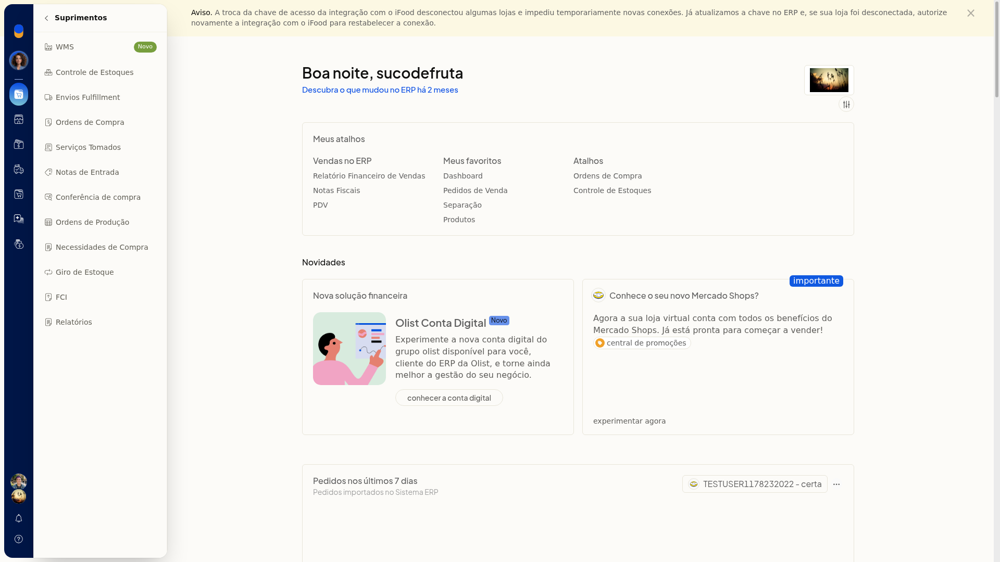
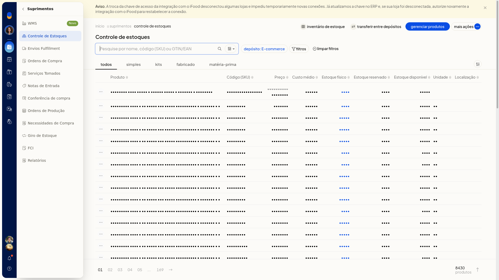

# Controle de estoques

No ERP da Olist, o controle de estoques mostra o saldo dos produtos no depósito escolhido: estoque físico, estoque reservado e estoque disponível. Em **Suprimentos > Controle de Estoques**, você consulta esses saldos, busca produtos e alterna a lista por tipo.

## Pré-requisitos
- Depósitos já cadastrados na conta. O seletor lista os depósitos cadastrados.

## Instruções
1. No menu lateral, clique em **Suprimentos**.

   

2. Clique em **Controle de Estoques**.

   

3. Busque o produto e selecione a aba **Todos**, **Simples**, **Kits**, **Fabricado** ou **Matéria-prima**. A lista do depósito selecionado mostra **Estoque físico**, **Estoque reservado** e **Estoque disponível**.

## Resultado
A grade de **Controle de Estoques** exibe o saldo físico, reservado e disponível dos produtos no depósito escolhido.

## Informações adicionais
A lista também traz as colunas **Produto**, **Código (SKU)**, **Preço**, **Custo médio**, **Unidade** e **Localização**.

Na mesma tela aparecem **Inventário de estoque**, **Transferir entre depósitos**, **Gerenciar produtos** e **Mais ações**, com **Imprimir relatório**.
