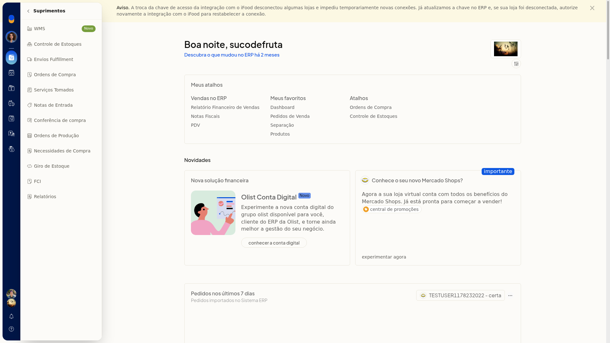
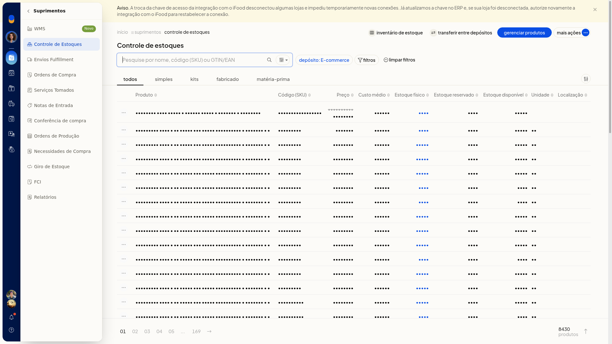
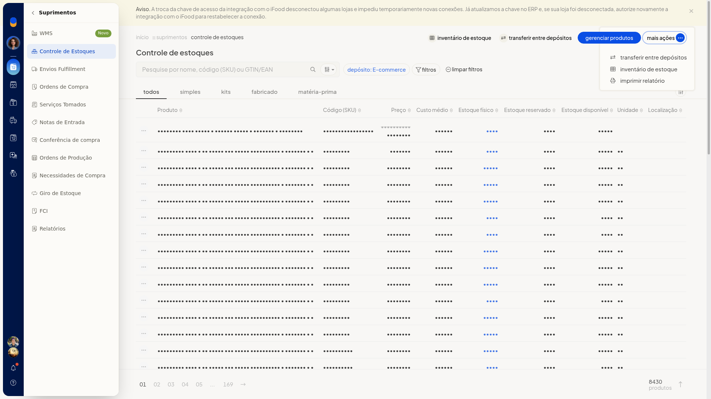
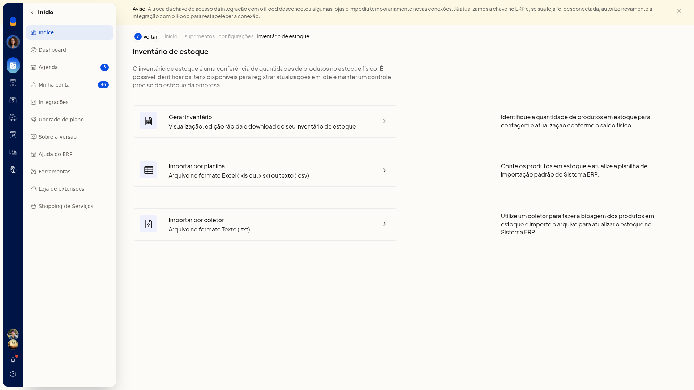
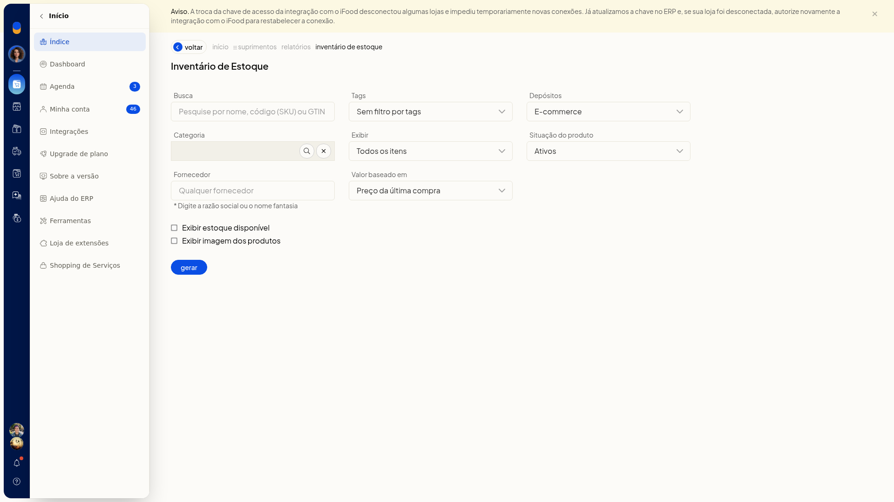
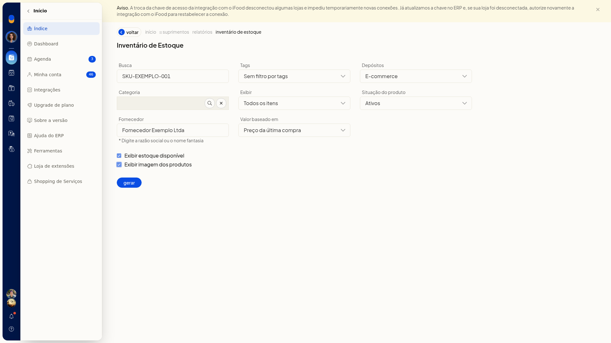
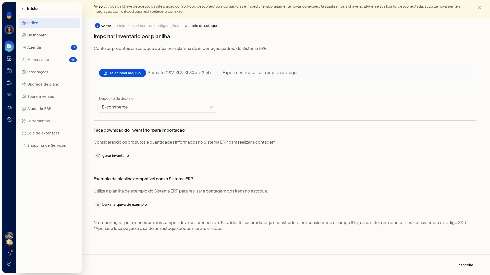
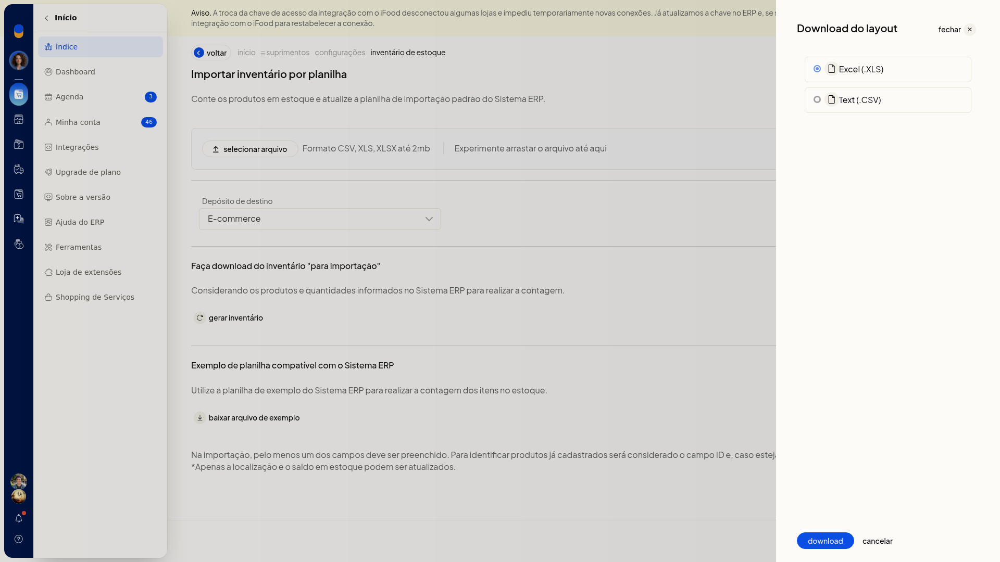
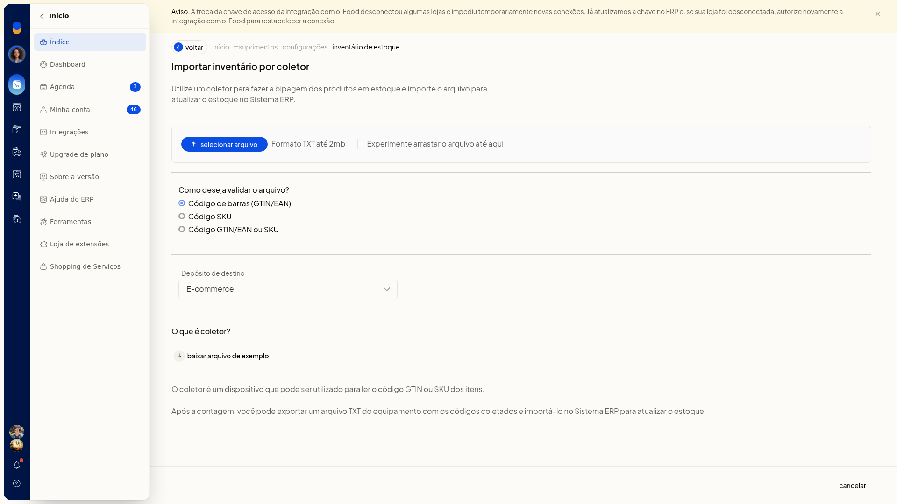

# Inventário e balanço de estoque

## Pré-requisitos
- Ter depósitos já cadastrados: o seletor lista os depósitos da conta.
- Para importar a contagem, ter o arquivo no formato aceito pela tela. O layout de exemplo pode ser baixado antes do envio.

## Importante
- Na importação por planilha, o arquivo aceito é CSV, XLS ou XLSX de até 2 MB. O produto é identificado por ID ou SKU, e só localização e saldo podem ser atualizados.
- Na importação por coletor, o arquivo aceito é TXT de até 2 MB.
- Para filtrar o inventário por fornecedor ou categoria, o cadastro correspondente já precisa existir: os dois campos buscam cadastro, não aceitam texto livre.

## Instruções
### Pela tela

1. Acesse **Suprimentos > Controle de Estoques**.

   

   

2. Clique em **Inventário de estoque**. O mesmo item também aparece em **Mais ações**.

   

   

3. Escolha **Gerar inventário (visualização, edição rápida e download)**.

   

4. Preencha os filtros. Nenhum deles é obrigatório.

#### Quem entra na lista

- **Busca**: localiza o produto.
- **Tags**: lista de tags. Sem filtro, a opção é **Sem filtro por tags**.
- **Depósitos**: lista dos depósitos cadastrados.
- **Categoria**: busca em categorias já cadastradas.
- **Fornecedor**: busca por razão social ou nome fantasia de um fornecedor já cadastrado.
- **Situação do produto**: **Ativos**, **Inativos** ou **Todos exceto excluídos**.

#### O que a visão mostra

- **Exibir**: **Todos os itens**, **Itens com saldo em estoque** ou **Itens sem saldo em estoque**.
- **Valor baseado em**: **Preço da última compra**, **Preço de custo atual**, **Preço de custo médio atual** ou **Preço de venda atual**.
- **Exibir estoque disponível**: marque para incluir o estoque disponível.
- **Exibir imagem dos produtos**: marque para incluir a imagem dos produtos.

5. Clique em **Gerar**. O inventário filtrado fica pronto para visualização, edição rápida e download.

### Por planilha

1. Em **Inventário de estoque**, escolha **Importar por planilha**.

   

2. Clique em **baixar arquivo de exemplo**.
3. No modal **Download do layout**, escolha **Excel (.XLS)** ou **Text (.CSV)**.

   

4. Selecione o **Depósito de destino**.
5. Indique o arquivo CSV, XLS ou XLSX de até 2 MB.
6. Clique em **gerar inventário**. A planilha atualiza localização e saldo dos produtos desse depósito.

### Por coletor

1. Em **Inventário de estoque**, escolha **Importar por coletor**.

   

2. Em **Como deseja validar o arquivo?**, escolha **Código de barras (GTIN/EAN)**, **Código SKU** ou **Código GTIN/EAN ou SKU**.
3. Para ver o layout, clique em **baixar arquivo de exemplo**. O TXT traz um código de barras por linha.

   

4. Selecione o **Depósito de destino** e indique o arquivo TXT de até 2 MB. A contagem do coletor entra nesse depósito, validada por GTIN/EAN, SKU ou ambos.

## Resultado
Em **Controle de Estoques**, a grade mostra o saldo do depósito selecionado, com busca, abas de tipo e as colunas de estoque físico, reservado e disponível. Em **Inventário de estoque**, os três caminhos ficam disponíveis: gerar a visão, importar a planilha ou importar o coletor.

## Informações adicionais
### O que a lista de saldos mostra

A lista usa as abas **Todos**, **Simples**, **Kits**, **Fabricado** e **Matéria-prima**. As colunas visíveis são **Produto**, **Código (SKU)**, **Preço**, **Custo médio**, **Estoque físico**, **Estoque reservado**, **Estoque disponível**, **Unidade** e **Localização**.
