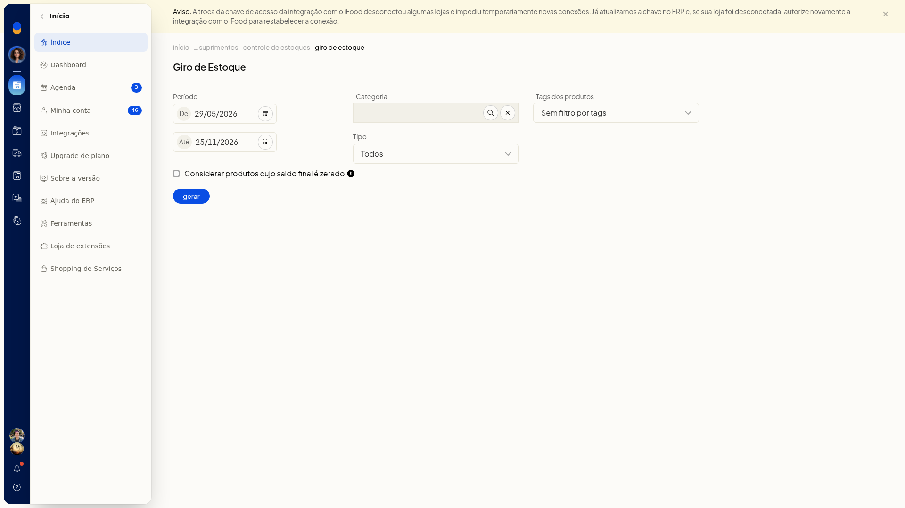

# Giro de estoque

## Instruções
1. Acesse **Suprimentos > Giro de Estoque**.
2. Em **Período**, informe **De** e **Até** no formato dia/mês/ano, como 01/06/2026 e 30/06/2026. Esses campos não são obrigatórios.

   

3. Se quiser restringir a análise, busque uma **Categoria** com os botões **buscar** e **limpar**.
4. Escolha o **Tipo**. A lista abre em **Todos** e também oferece **Simples**, **Com variações**, **Fabricado** e **Matéria-prima**.
5. Selecione as **Tags dos produtos** já cadastradas. O estado inicial é **Sem filtro por tags**.
6. Marque **Considerar produtos cujo saldo final é zerado** somente se quiser incluí-los na análise.
7. Clique em **Gerar** para gerar o giro com o período e os filtros informados.
