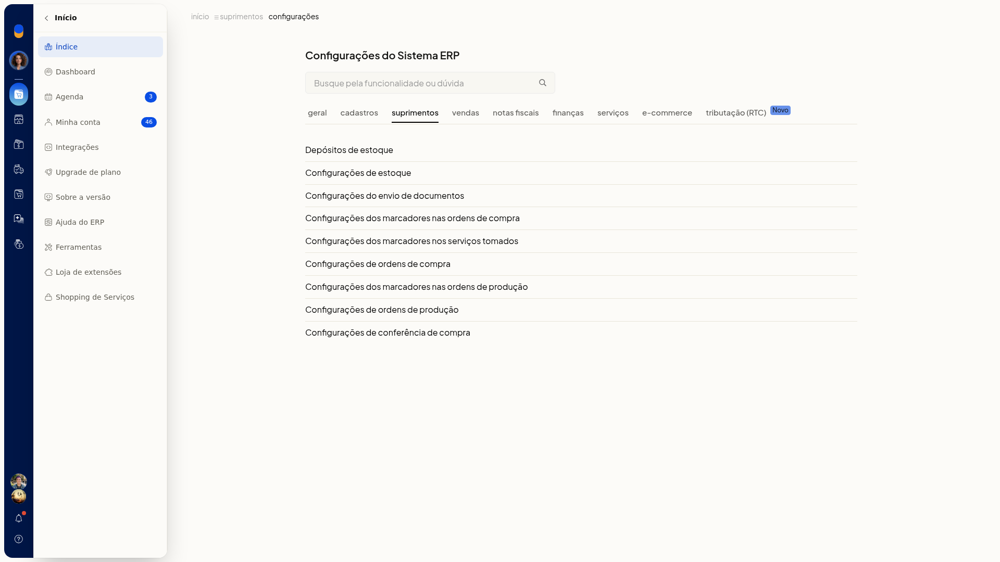
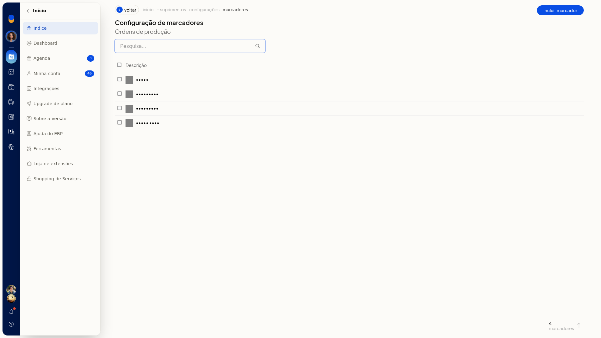
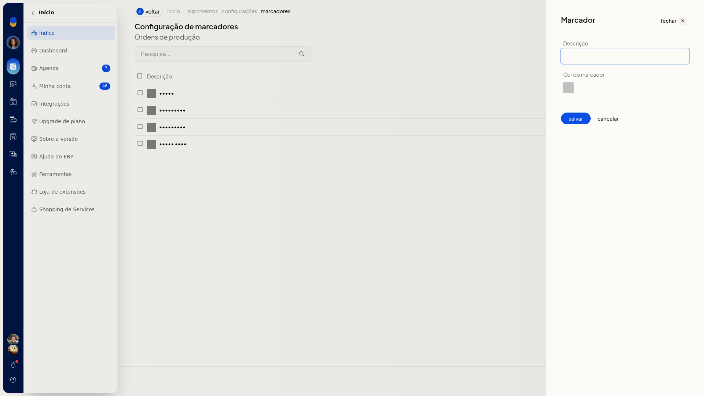
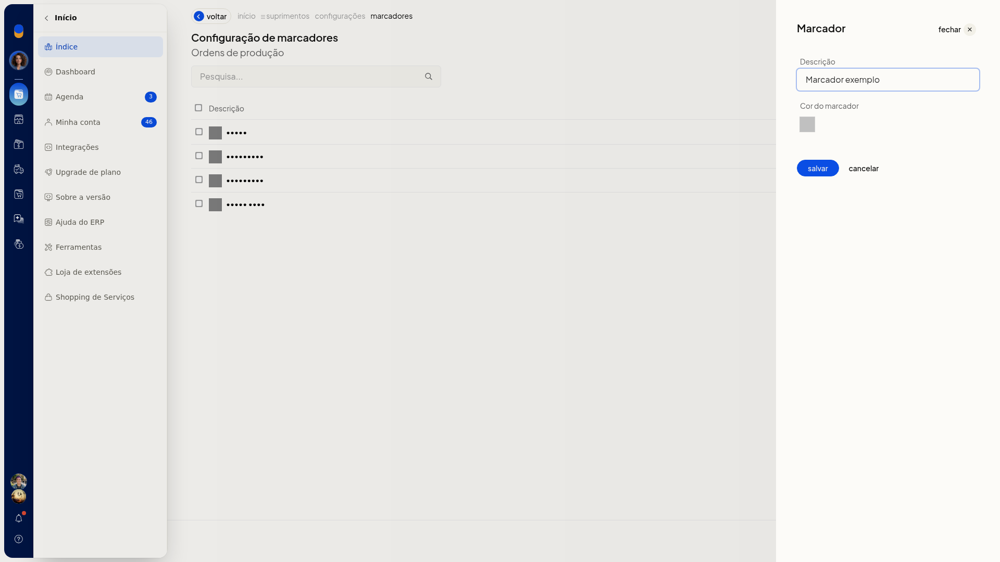

# Cadastrar marcadores nas ordens de produção

Os marcadores classificam as ordens de produção no ERP da Olist. Com eles, você organiza as ordens e as localiza depois na lista.

O cadastro fica em **Configurações dos marcadores nas ordens de produção**, nas configurações de Suprimentos.

## Instruções
1. Acesse **Configurações > Configurações ERP**.
2. Na lista de configurações de Suprimentos, clique em **Configurações dos marcadores nas ordens de produção**.

   

3. Na lista de marcadores, clique em **Incluir marcador**.

   

   

4. Informe a **Descrição**. O campo não é obrigatório. A **Cor do marcador** também está no painel e não é obrigatória.

   

5. Clique em **salvar**. O marcador é gravado para uso nas ordens de produção. **cancelar** descarta o que foi informado.

## Informações adicionais
### Uso dos marcadores na ordem

Na inclusão da ordem de produção, o campo **Marcadores** também recebe marcadores. Separe cada um por vírgula ou tab. Cada marcador passa a aparecer como um chip.

Na lista de ordens, o filtro **Marcador** mostra os marcadores já cadastrados.
