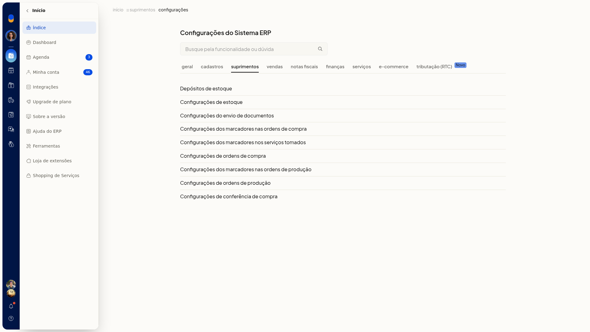
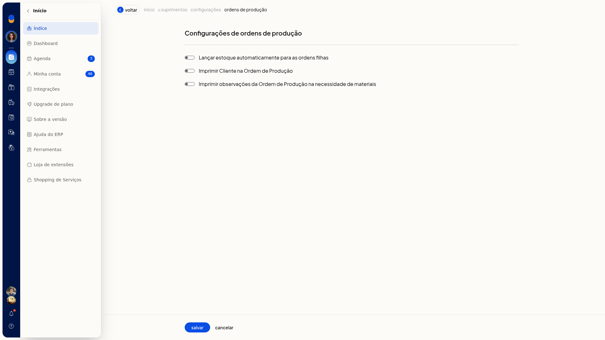
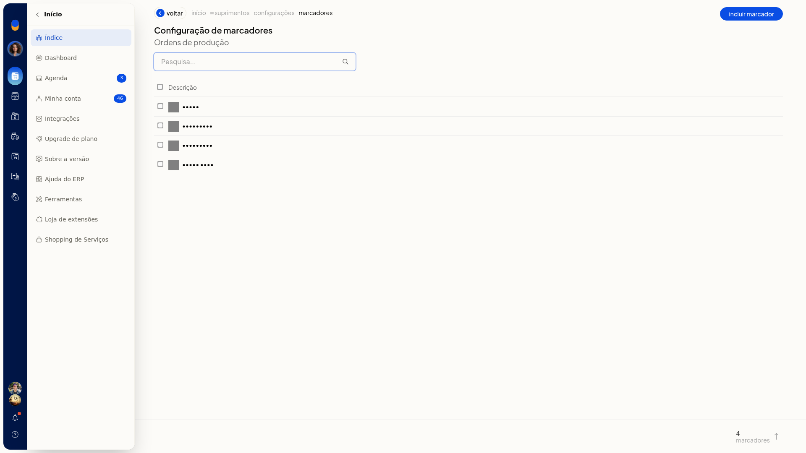
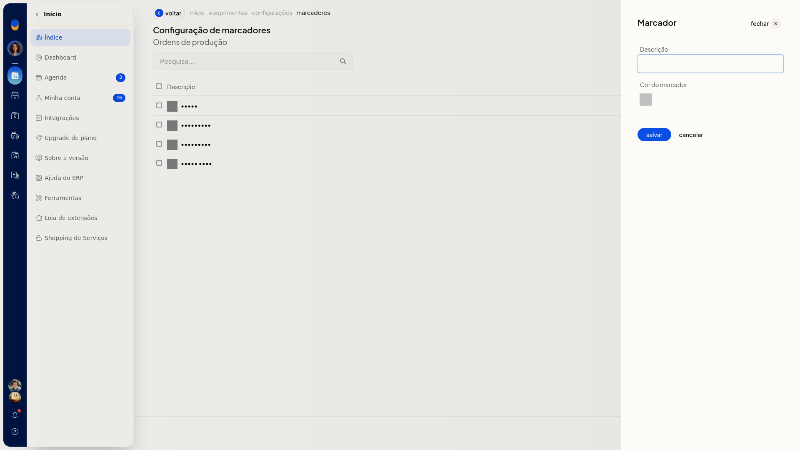
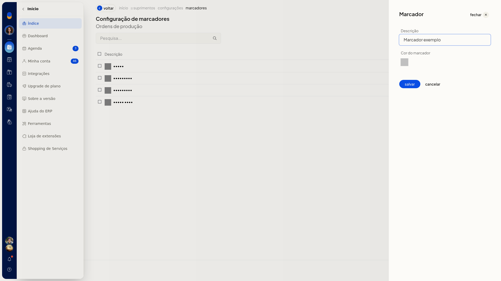

# Configurar as ordens de produção

As configurações de ordens de produção no ERP da Olist definem se o estoque das ordens filhas é lançado automaticamente e se o cliente e as observações saem na impressão. Também é possível cadastrar marcadores para classificar as ordens.

## Importante
Se a opção não aparecer para você, peça acesso ao administrador da conta.

## Como acessar
**Configurações > Configurações ERP**

Na lista de configurações de Suprimentos, abra **Configurações de ordens de produção** ou **Configurações dos marcadores nas ordens de produção**.

## Grupos de configuração
### Configurações de ordens de produção

Este grupo reúne as opções de estoque das ordens filhas e de impressão:

- **Lançar estoque automaticamente para as ordens filhas**
- **Imprimir Cliente na Ordem de Produção**
- **Imprimir observações da Ordem de Produção na necessidade de materiais**

Marque ou desmarque cada opção. Clique em **Salvar** para gravar. **Cancelar** descarta a alteração.

### Configurações dos marcadores nas ordens de produção

A tela **Configuração de marcadores**, no contexto Ordens de produção, lista os marcadores já cadastrados. Há pesquisa e a coluna **Descrição**.

Clique em **Incluir marcador**. O painel **Marcador** traz **Descrição** e **Cor do marcador**.

Informe a **Descrição**. A **Cor do marcador** aparece como uma amostra. Clique em **salvar** para gravar o marcador. **cancelar** descarta o que foi informado.

