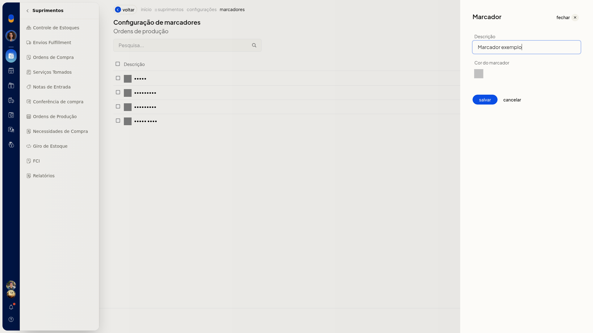
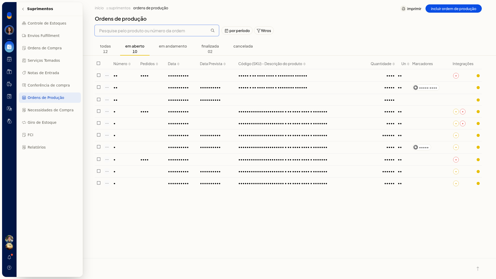
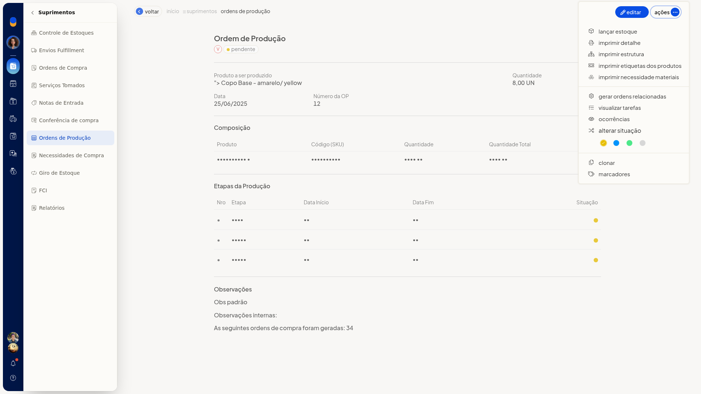
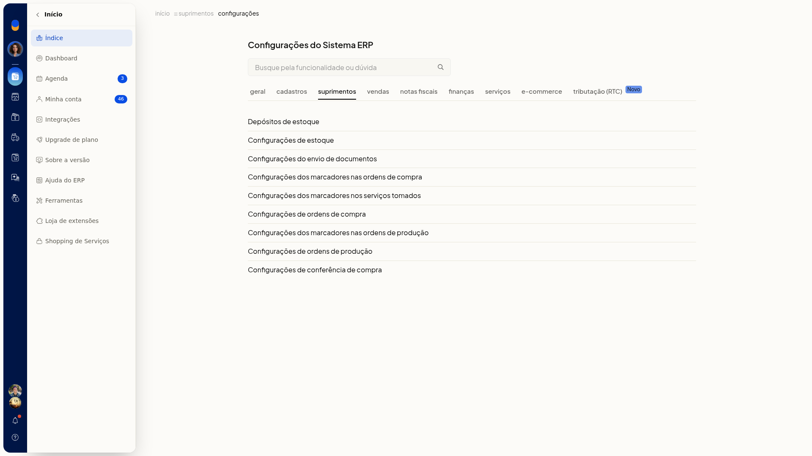
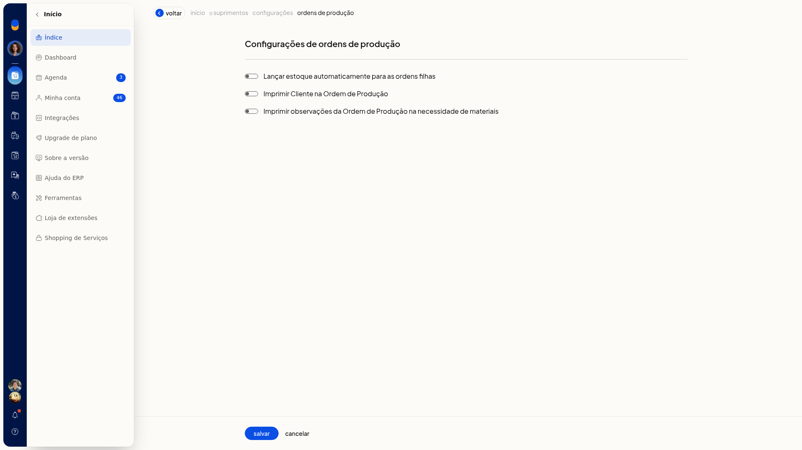

# Imprimir ordem de produção, estrutura e necessidade de materiais

No ERP da Olist, você imprime a ordem de produção, a estrutura e a necessidade de materiais a partir da lista de ordens. Dá para imprimir uma ordem pela linha ou várias ordens de uma vez.

## Importante
- O que sai na impressão da ordem e da necessidade de materiais depende das opções em **Configurações de ordens de produção**.
- Se a configuração não aparecer para você, peça acesso ao administrador da conta.

## Instruções
### Pela linha da ordem

1. Acesse **Suprimentos > Ordens de Produção**.

   

   

2. Na linha da ordem, abra o menu de ações.

   

3. Clique em **Imprimir detalhe**, **Imprimir estrutura** ou **Imprimir Necessidade materiais**.

### Em lote

1. Acesse **Suprimentos > Ordens de Produção**.
2. Selecione as ordens na lista.
3. Clique em **Imprimir** ou em **Imprimir necessidade materiais**.

## Informações adicionais
### O que pode sair na impressão

1. Acesse **Configurações > Configurações ERP**.
2. Em Suprimentos, abra **Configurações de ordens de produção**.

   

3. Marque **Imprimir Cliente na Ordem de Produção** para o cliente sair na ordem.
4. Marque **Imprimir observações da Ordem de Produção na necessidade de materiais** para as observações saírem na necessidade de materiais.
5. Clique em **Salvar**.

   
