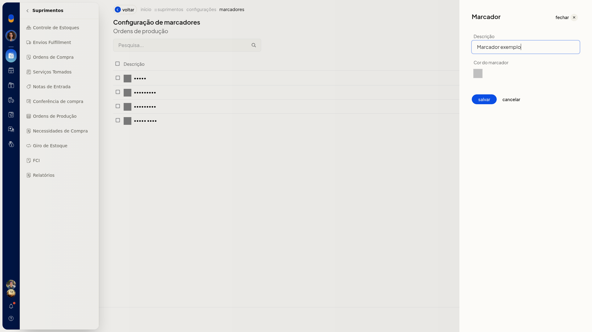
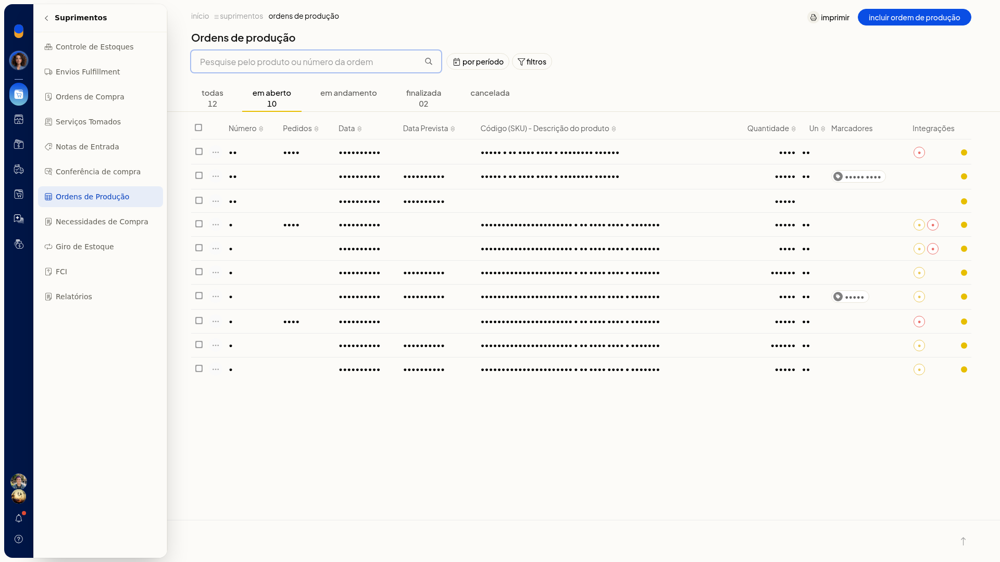
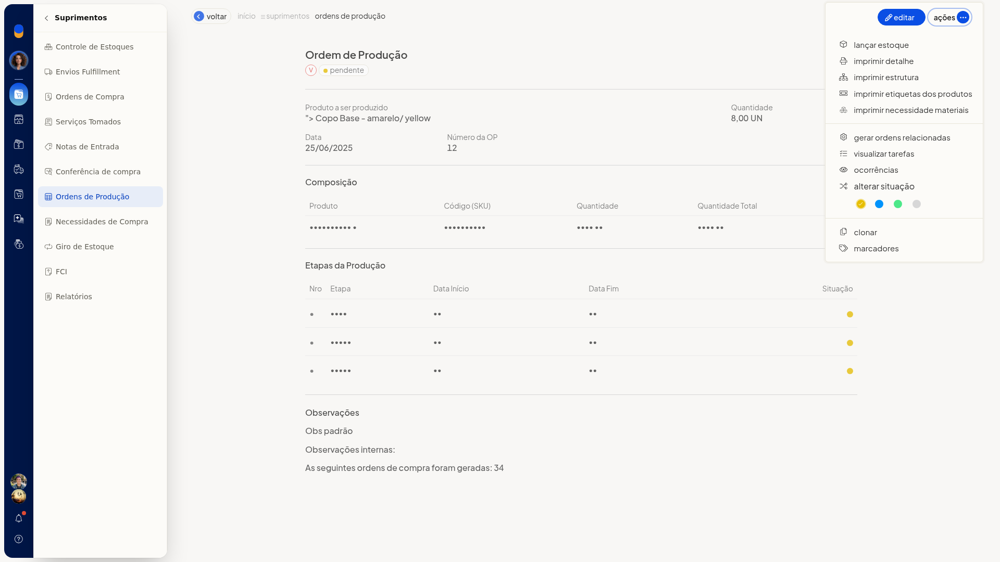
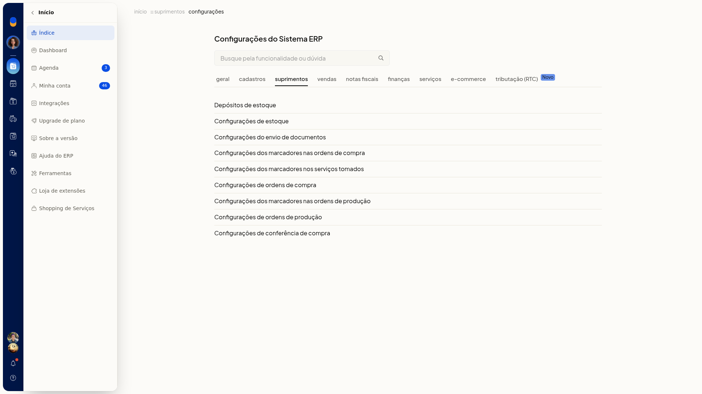
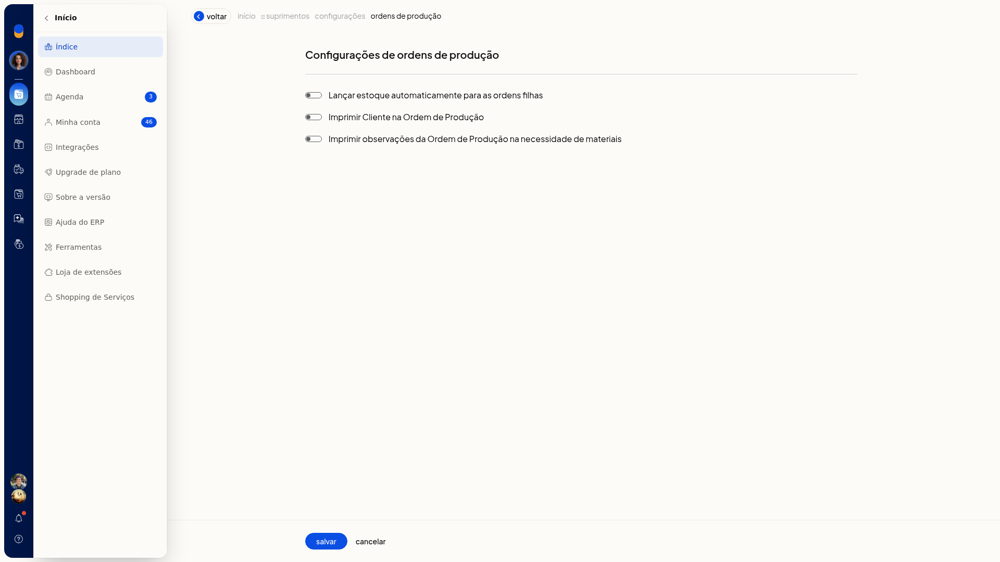

# Lançar estoque da ordem de produção

No ERP da Olist, você lança o estoque de uma ordem de produção em **Suprimentos > Ordens de Produção**. Dá para lançar pela linha de uma ordem ou de várias ordens ao mesmo tempo. Na lista, o selo **E** indica **Estoque lançado**.

## Instruções
### Pela linha da ordem

1. Acesse **Suprimentos > Ordens de Produção**.

   

2. Na lista, localize a ordem.

   

3. Abra o menu de ações da linha.

   

4. Clique em **Lançar estoque**.

### Em lote

1. Acesse **Suprimentos > Ordens de Produção**.
2. Selecione as ordens na lista.
3. Clique em **Lançar estoque**.

## Informações adicionais
### Estoque das ordens filhas

Em **Configurações > Configurações ERP**, na lista de configurações de Suprimentos, abra **Configurações de ordens de produção**. A opção **Lançar estoque automaticamente para as ordens filhas** define se o estoque das ordens filhas é lançado automaticamente.

Se a opção não aparecer para você, peça acesso ao administrador da conta.
