# Ordens de produção

As ordens de produção do ERP da Olist registram e acompanham a fabricação de um produto: o que será produzido, a quantidade, as datas, a composição e as etapas. Você consulta a lista, inclui a ordem, imprime, lança estoque, muda a situação e identifica ordens ligadas a uma venda.

A consulta fica em **Suprimentos > Ordens de Produção**. O lançamento de estoque das ordens filhas, o que sai na impressão e os marcadores ficam nas configurações de Suprimentos.

## Importante
- Para a ordem aparecer como gerada pela venda nesta tela, ela já precisa estar ligada a uma venda.
- O produto da inclusão precisa ser localizado na busca de **Produto a ser produzido**.

## Instruções
### Consultar as ordens

1. Acesse **Suprimentos > Ordens de Produção**.

   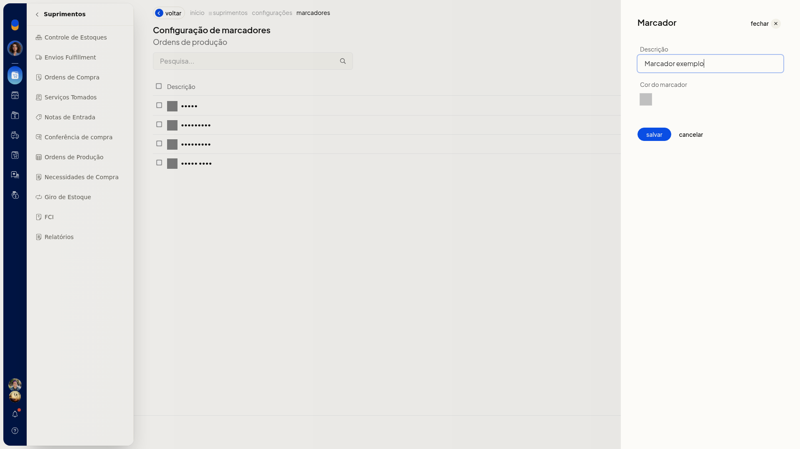

2. Clique em **Todas**, **Em aberto**, **Em andamento**, **Finalizada** ou **Cancelada**. Cada aba mostra a situação e a quantidade.

   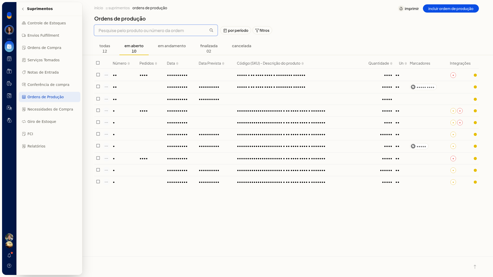

3. Use a pesquisa ou o período. No período, escolha **Sem filtro**, **Do dia**, **Do mês**, **Do intervalo** ou **Previstos para**.

   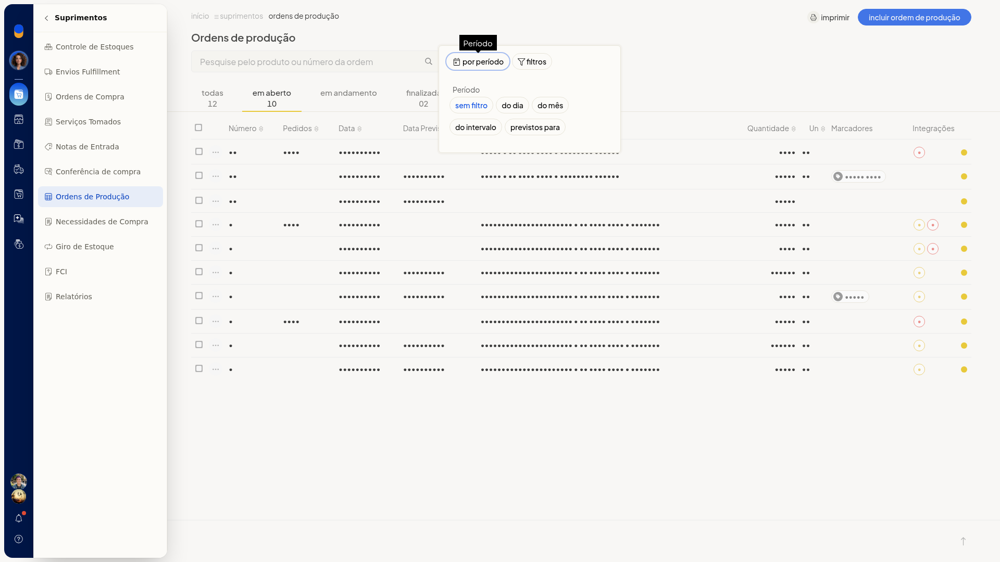

4. Em **Do intervalo**, informe **De** e **Até** no formato dd/mm/aaaa.

   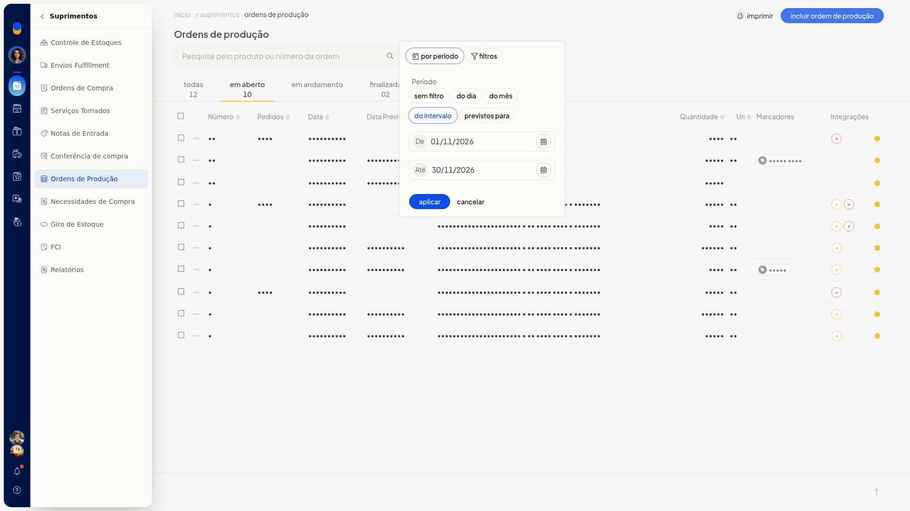

5. Abra os filtros, informe o texto em **Ordens de produção**, o **Número do Pedido de Venda** e o **Marcador**. Clique em **Aplicar**. A lista passa a mostrar as ordens da situação e do período ou filtro escolhidos, sem alterar os registros. **Cancelar** descarta o filtro.

   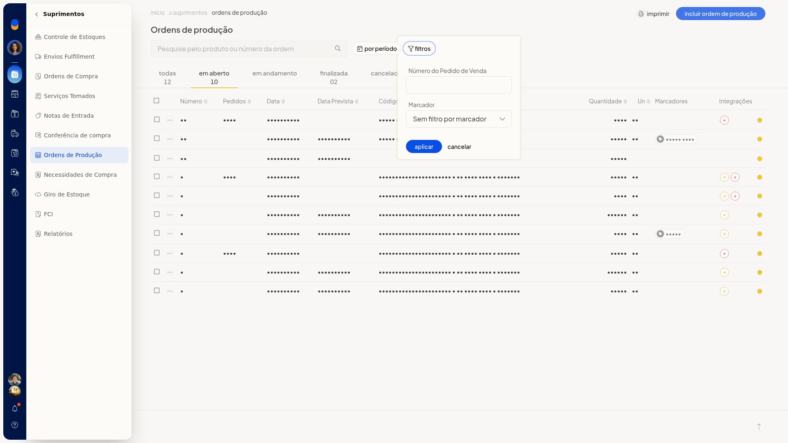

### Incluir uma ordem de produção

1. Em **Ordens de Produção**, clique em **Incluir ordem de produção**.
2. Em **Produto a ser produzido**, digite ao menos 2 caracteres e escolha o produto sugerido.
3. Informe **Quantidade**, **Data**, **Data prevista**, **Número da OP**, **Observações** e **Marcadores**. Use dd/mm/aaaa nas datas. O **Número da OP** pode já vir preenchido. Em **Marcadores**, separe os nomes por vírgula ou tab. Cada marcador passa a aparecer como chip. Nenhum desses campos é obrigatório.

   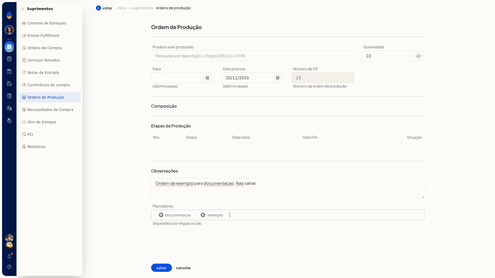

4. Confira **Composição** e **Etapas da Produção**. As colunas das etapas são **Nro**, **Etapa**, **Data Início**, **Data Fim** e **Situação**. Na inclusão, as etapas ficam vazias até você escolher o produto.
5. Clique em **Salvar** para gravar a ordem. **Cancelar** descarta os dados e volta à lista.

### Usar as ações da ordem

1. Na lista, abra a ordem ou o menu de ações da linha.

   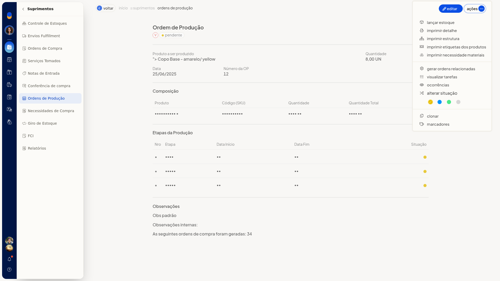

2. Escolha a ação: **Lançar estoque**, **Estornar estoque**, **Imprimir detalhe**, **Imprimir estrutura**, **Imprimir etiquetas dos produtos**, **Imprimir Necessidade materiais**, **Gerar ordens relacionadas**, **Gerar ordens de compra**, **Gerenciar lotes e validades**, **Visualizar tarefas**, **Ocorrências**, **Alterar situação**, **Clonar**, **Marcadores**, **Alterar marcadores** ou **Excluir ordens de produção**.
3. Em **Alterar situação**, escolha **Pendente**, **Andamento**, **Finalizada** ou **Cancelada**.
4. Na ordem aberta, confira a composição pelas colunas **Produto**, **Código (SKU)**, **Quantidade** e **Quantidade Total**. **Etapas da Produção** é somente leitura, com **Nro**, **Etapa**, **Data Início**, **Data Fim** e **Situação**. A página também mostra **Data Término** e **Pedidos Relacionados**.

   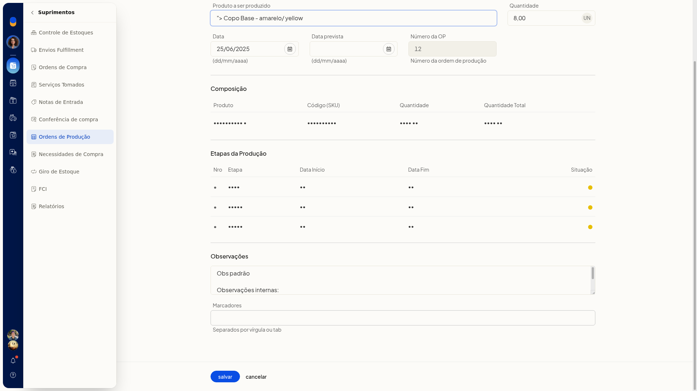

5. Em **Visualizar tarefas**, clique em **Fechar** para sair do painel.

   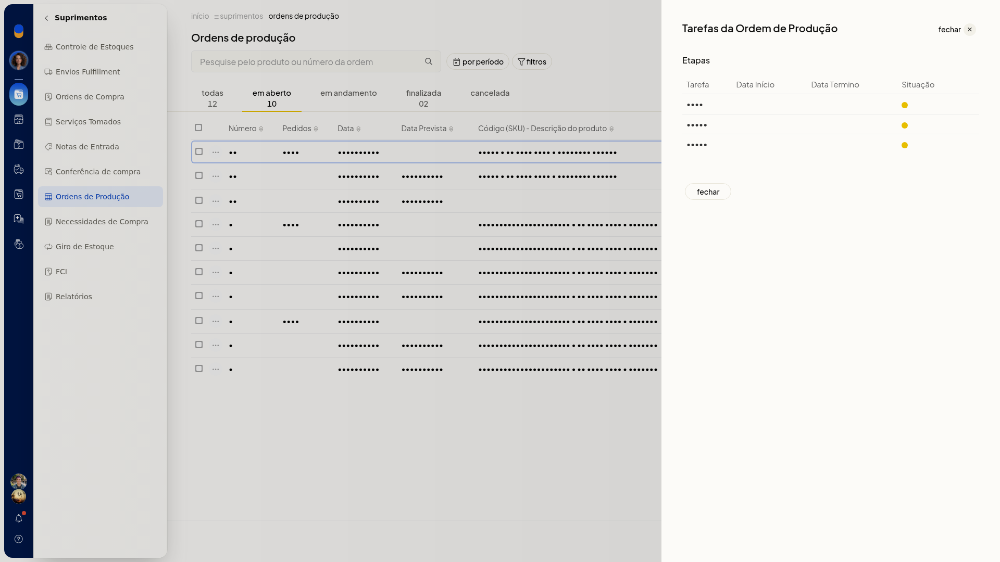

### Reconhecer ordens ligadas à venda

1. Na lista, leia o selo **V**, com o texto **Gerada pela Venda**, e o selo **E**, com o texto **Estoque lançado**. Os dois podem aparecer juntos.
2. No filtro, informe o **Número do Pedido de Venda** e clique em **Aplicar**. A lista mostra as ordens desse pedido.

### Configurar estoque e impressão

1. Acesse **Configurações > Configurações ERP**.
2. Na lista de configurações de Suprimentos, clique em **Configurações de ordens de produção**.

   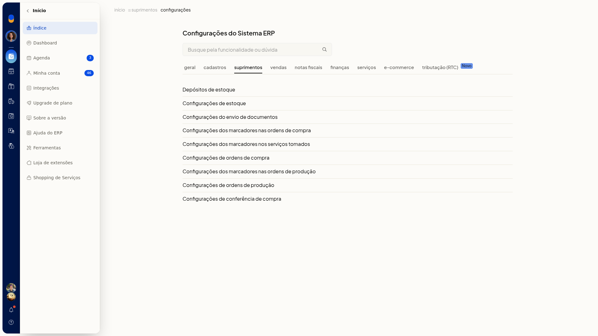

3. Marque ou desmarque **Lançar estoque automaticamente para as ordens filhas**, **Imprimir Cliente na Ordem de Produção** e **Imprimir observações da Ordem de Produção na necessidade de materiais**.

   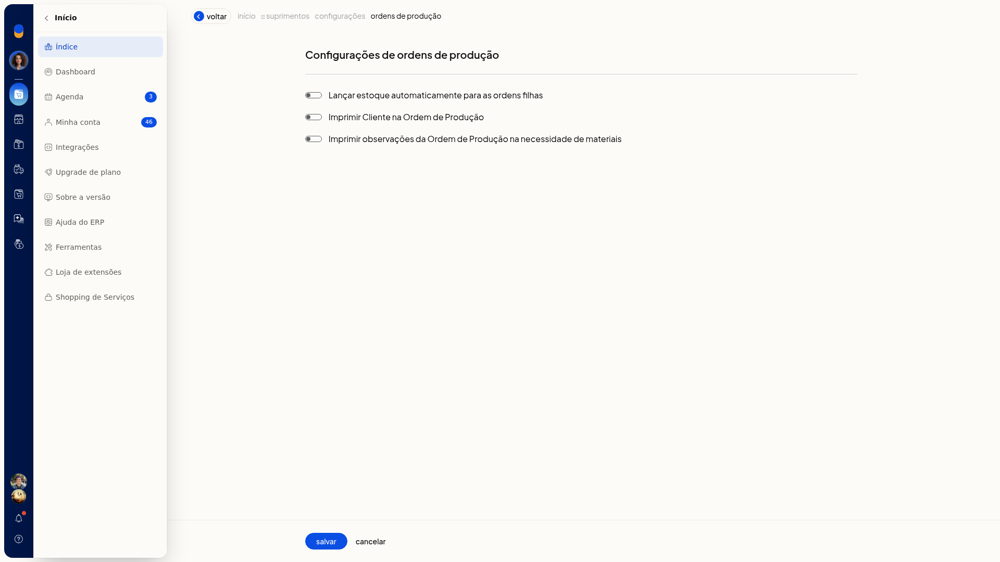

4. Clique em **Salvar** para gravar o que será lançado nas ordens filhas e o que sai na impressão. **Cancelar** descarta.

### Cadastrar marcadores

1. Acesse **Configurações > Configurações ERP**.
2. Na lista de Suprimentos, clique em **Configurações dos marcadores nas ordens de produção**. A tela **Configuração de marcadores**, no contexto **Ordens de produção**, tem pesquisa e a coluna **Descrição**.

   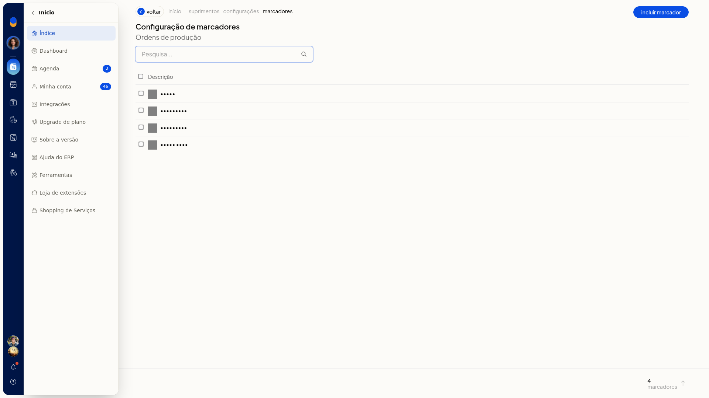

3. Clique em **Incluir marcador**.

   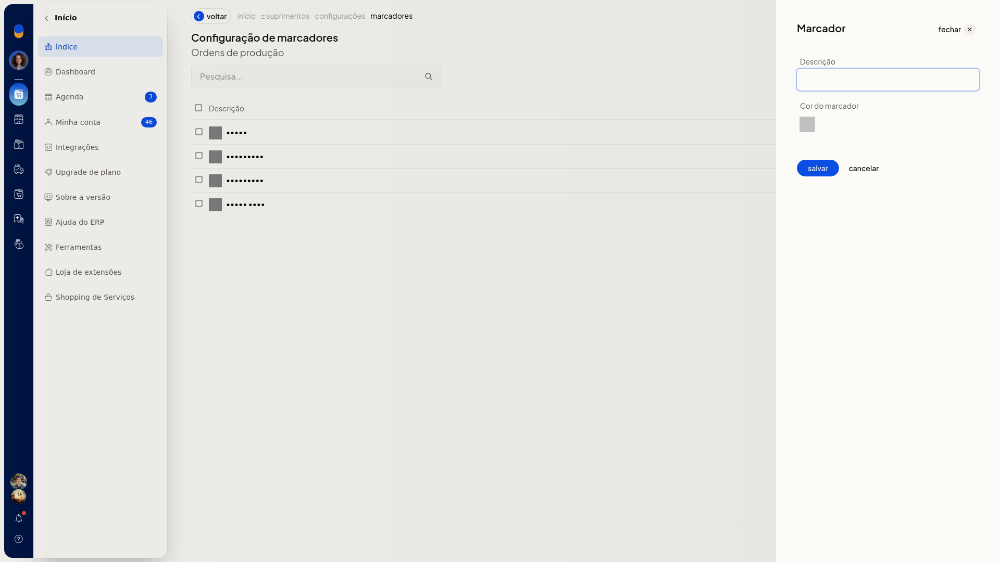

4. Informe a **Descrição**. A **Cor do marcador** aparece como uma amostra. A descrição não é obrigatória.

   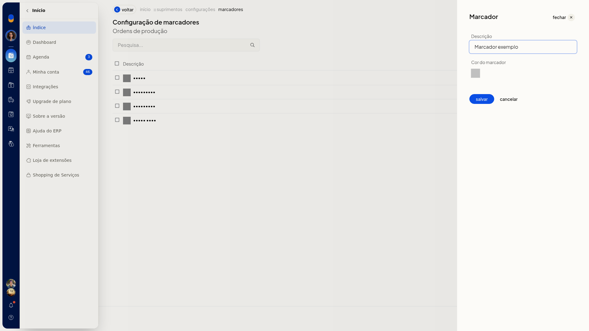

5. Clique em **salvar** para gravar o marcador usado nas ordens de produção. **cancelar** descarta. **fechar** sai do painel.

## Informações adicionais
### A lista mostra estas colunas

**Número**, **Pedidos**, **Data**, **Data Prevista**, **Código (SKU) - Descrição do produto**, **Quantidade**, **Un**, **Marcadores** e **Integrações**.

### As abas e a alteração de situação usam nomes diferentes

Em **Alterar situação**, as opções são **Pendente**, **Andamento**, **Finalizada** e **Cancelada**. Nas abas da lista, as situações são **Em aberto**, **Em andamento**, **Finalizada** e **Cancelada**. Na ordem aberta, a situação exibida pode ser **Pendente**.

### Ordens selecionadas têm ações em lote

Com ordens selecionadas, a lista oferece **Imprimir**, **Lançar estoque**, **Alterar marcadores**, **Alterar situação**, **Imprimir etiquetas dos produtos**, **Excluir ordens de produção** e **Imprimir necessidade materiais**.

### O filtro de marcador lista o que já está cadastrado

O seletor **Marcador** tem opção sem filtro e sem marcadores, além dos marcadores já cadastrados. Você também pode informar marcadores no campo **Marcadores** ao incluir a ordem.
