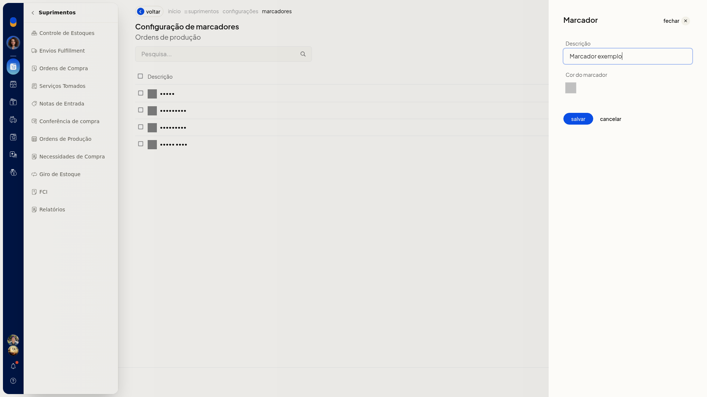
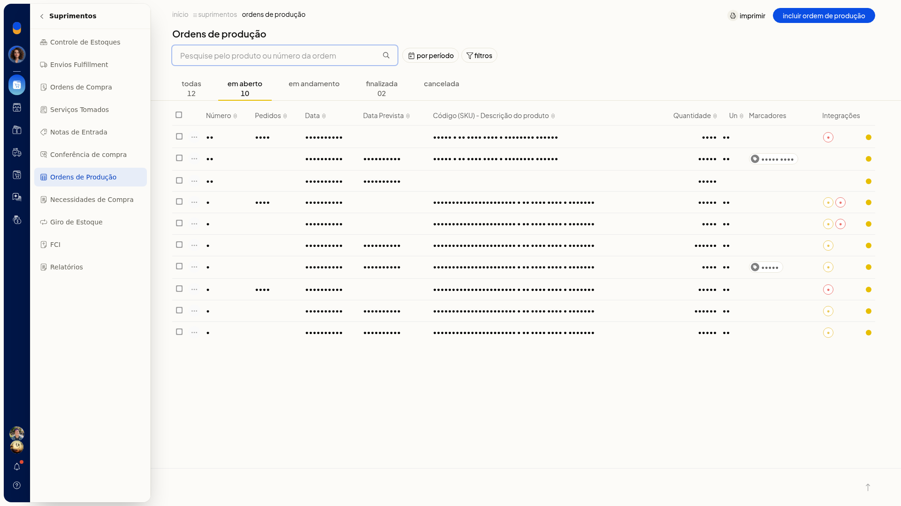
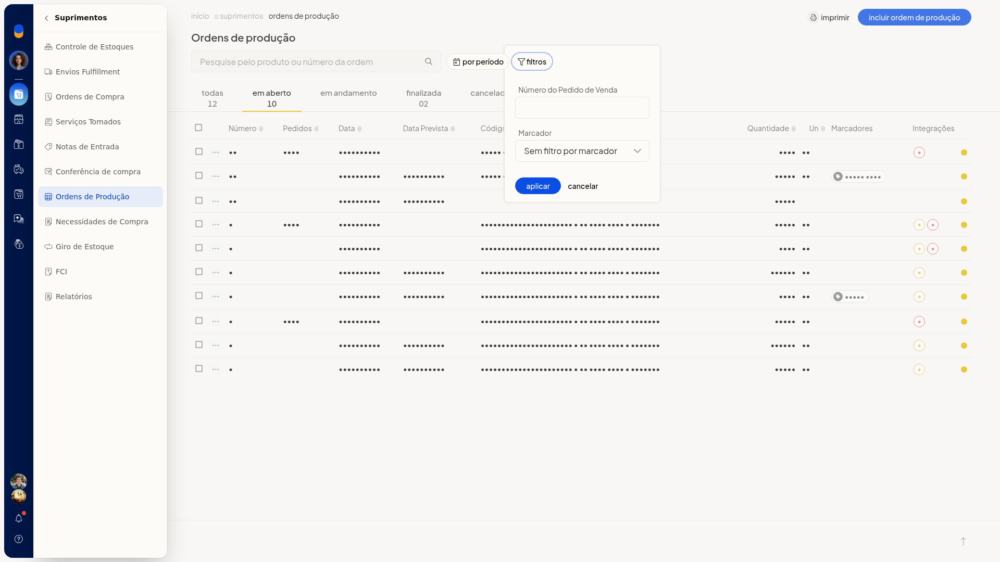

# Produtos sob encomenda

No ERP da Olist, as ordens de produção ligadas a uma venda aparecem identificadas na lista. Com isso, você acompanha produtos sob encomenda: reconhece a origem pela venda, vê se o estoque já foi lançado e localiza a ordem pelo número do pedido.

A consulta fica em **Suprimentos > Ordens de Produção**.

## Pré-requisitos
- A ordem já precisa estar ligada a uma venda para ser reconhecida como sob encomenda nesta tela.

## Importante
- O selo **V** (**Gerada pela Venda**) e o selo **E** (**Estoque lançado**) podem aparecer juntos na mesma linha.

## Instruções
1. Acesse **Suprimentos > Ordens de Produção**.

   

2. Escolha a aba **Todas**, **Em aberto**, **Em andamento**, **Finalizada** ou **Cancelada**. Cada aba mostra a situação e a quantidade de ordens.

   

3. Na linha da ordem, confira o selo **V**, com o texto **Gerada pela Venda**. O selo **E** indica **Estoque lançado**.

4. Abra os filtros da lista.

   

5. Informe **Número do Pedido de Venda**. O campo não é obrigatório.

6. Clique em **Aplicar**. A lista mostra as ordens do filtro escolhido, sem alterar os registros.

## Resultado
Na lista, a ordem gerada pela venda aparece com o selo **V**. Quando o estoque já foi lançado, a mesma linha também pode trazer o selo **E**.
