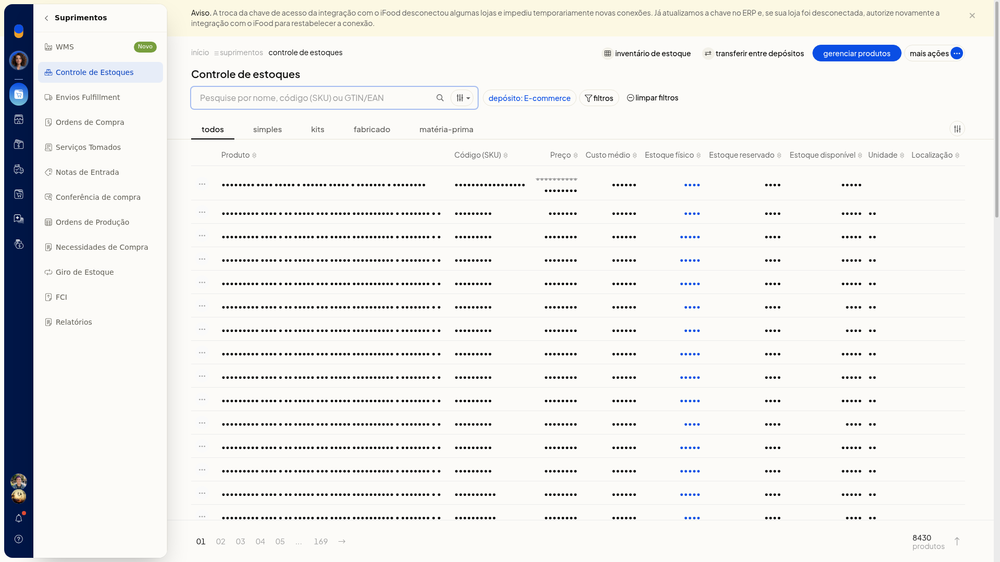
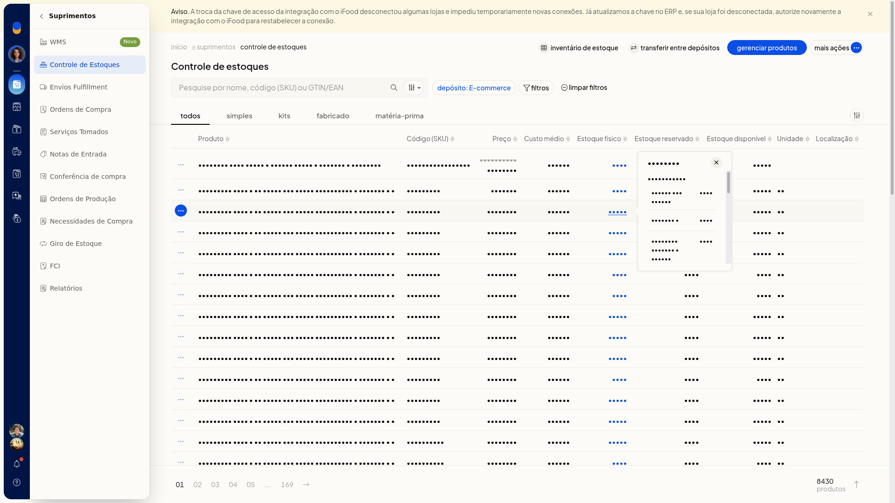
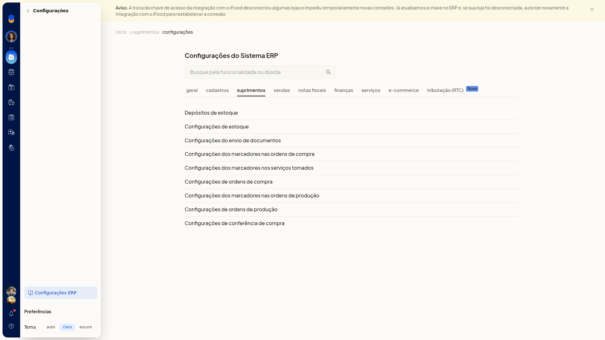
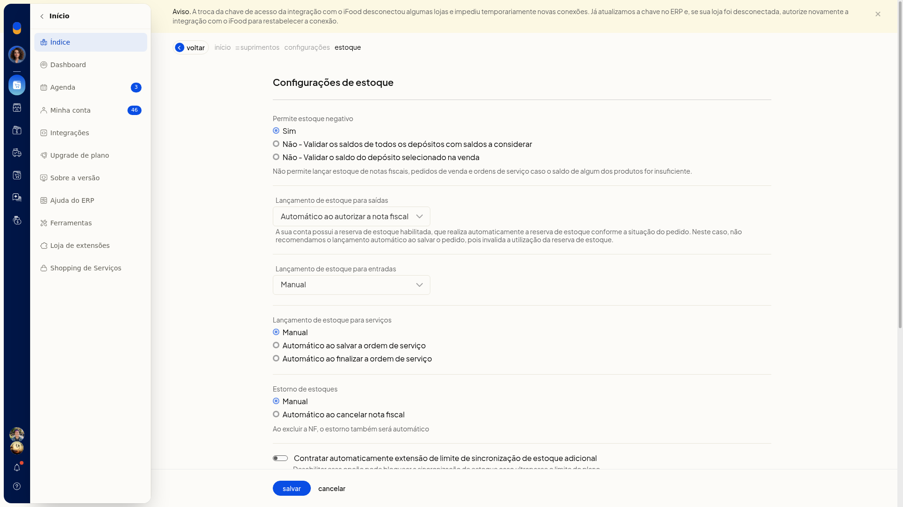

# Reserva de estoque

No ERP da Olist, a reserva de estoque separa a quantidade já comprometida pelos pedidos. Em **Suprimentos > Controle de Estoques**, você consulta o estoque físico, o estoque reservado e o estoque disponível.

A reserva já fica habilitada na conta e acontece automaticamente conforme a situação do pedido. Em **Configurações de estoque**, você define o momento do lançamento das saídas sem invalidar essa reserva.

## Importante
- Não escolha **Automático ao salvar o pedido** em **Lançamento de estoque para saídas**. Com a reserva habilitada, essa opção invalida a reserva de estoque.

## Instruções
### Consultar saldo reservado e disponível

1. Acesse **Suprimentos > Controle de Estoques**.
2. Na lista, leia **Estoque físico**, **Estoque reservado** e **Estoque disponível**.

   

3. Clique no valor de **Estoque físico** para ver a divisão do saldo físico por depósito no painel **Detalhes**. **Estoque reservado** e **Estoque disponível** não abrem esse painel.

   

### Definir o lançamento das saídas

1. Acesse **Configurações > Configurações ERP > Suprimentos > Configurações de estoque**.

   

2. Em **Lançamento de estoque para saídas**, escolha o momento do lançamento. O campo não é obrigatório. As opções são **Manual**, **Automático ao autorizar a nota fiscal**, **Automático ao salvar a nota fiscal**, **Automático ao salvar o pedido** e **Automático ao marcar pedido como enviado**.

   

3. Leia o aviso de que a reserva de estoque está habilitada e reserva automaticamente conforme a situação do pedido. Não use **Automático ao salvar o pedido**, para a reserva continuar válida.

## Resultado
Na lista de **Controle de Estoques**, você vê quanto está físico, quanto está reservado e quanto está disponível. O detalhe por depósito aparece só a partir do estoque físico. Em **Configurações de estoque**, o momento do lançamento das saídas fica definido junto da reserva automática já habilitada.

## Informações adicionais
- A reserva de estoque já vem habilitada na conta. Não há, nesta tela, um controle para ligar ou desligar a reserva.
- O estoque disponível é o estoque físico menos as reservas.
- O mesmo aviso de reserva aparece em **Lançamento de estoque para saídas** nas regras de estoque da integração. Lá, você pode manter **Usar configuração padrão da conta** ou escolher outro momento, sem usar **Automático ao salvar o pedido**.
