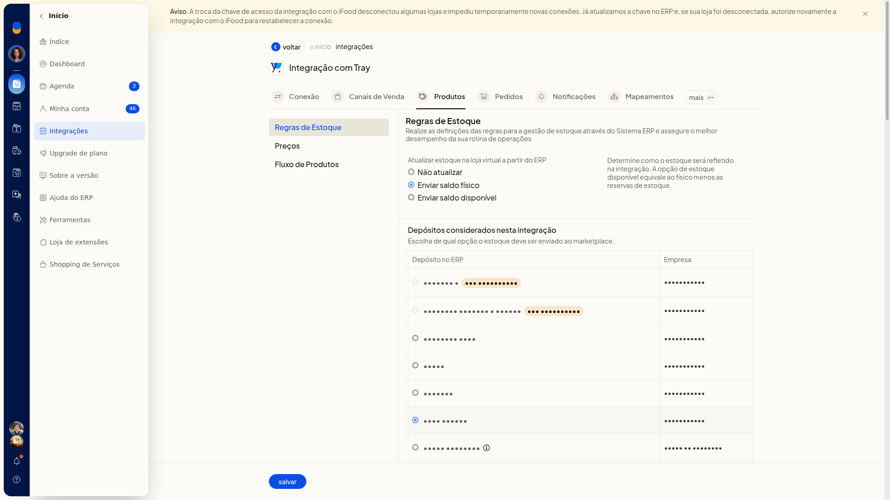
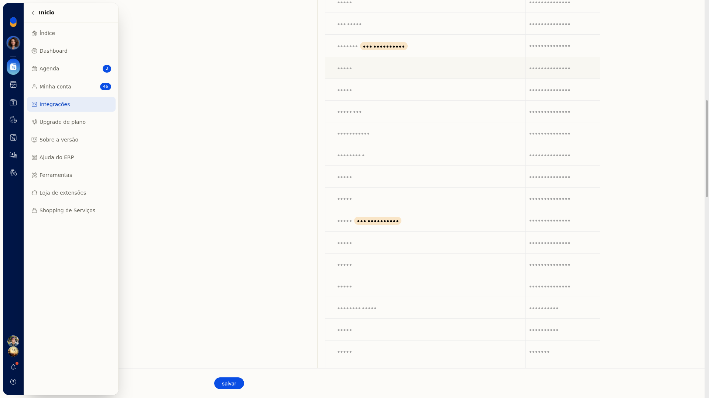
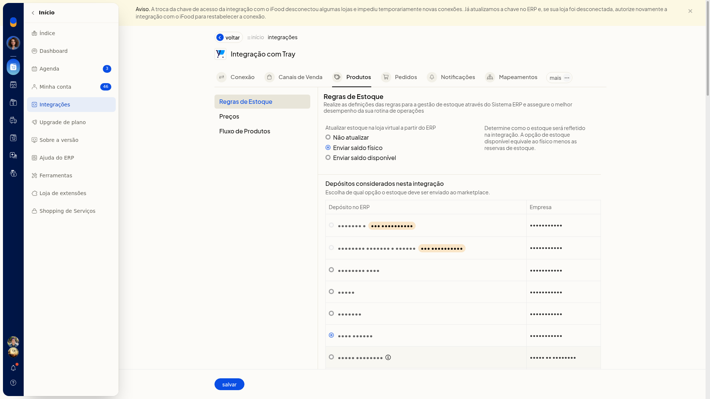
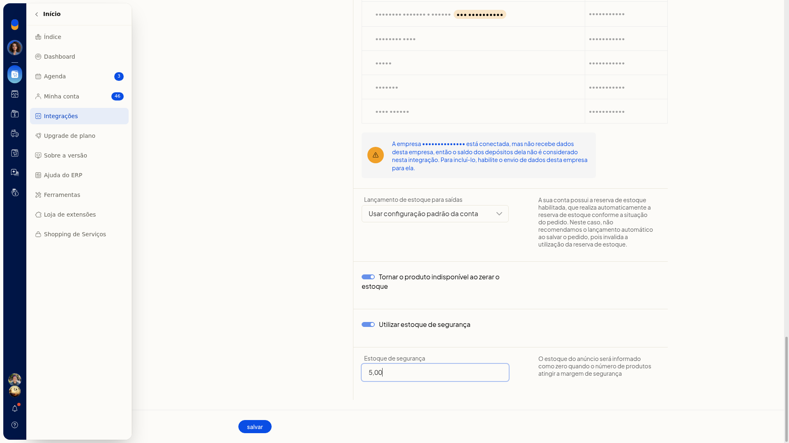

# Sincronização de estoque com os canais

No ERP da Olist, você define qual saldo a loja virtual recebe a partir da integração conectada. Pode não atualizar a loja, enviar o saldo físico ou enviar o saldo disponível, que é o físico menos as reservas.

Você também escolhe os depósitos que entram nesse saldo e, se quiser, uma margem de estoque de segurança. A reserva de estoque já está habilitada na conta e ocorre automaticamente conforme a situação do pedido.

## Pré-requisitos
- A integração da loja virtual precisa estar conectada.
- Os depósitos que entram no saldo precisam existir. Linhas marcadas como **não habilitado** não entram no saldo da integração.
- Depósitos de outra empresa do grupo só entram se o envio de dados desta empresa para ela estiver habilitado.

## Importante
- Com a reserva habilitada, não escolha **Automático ao salvar o pedido** em **Lançamento de estoque para saídas**. Esse lançamento invalida a reserva.
- O saldo disponível enviado à loja é o físico menos as reservas.
- O saldo de depósitos de uma empresa conectada que não recebe dados desta empresa fica de fora até você habilitar esse envio.
- Com estoque de segurança, o anúncio é informado como zero quando a quantidade atinge a margem.
- Em **Configurações > Configurações ERP > Suprimentos > Configurações de estoque**, desmarcar **Contratar automaticamente extensão de limite de sincronização de estoque adicional** pode bloquear o envio de estoque se o limite do plano for excedido.

## Instruções
1. Acesse **Início > Integrações** e, na integração da loja virtual conectada, clique em **gerenciar**.
2. Acesse **Produtos > Regras de Estoque**.
3. Em **Atualizar estoque na loja virtual a partir do ERP**, escolha **Não atualizar**, **Enviar saldo físico** ou **Enviar saldo disponível**. O campo não é obrigatório. **Enviar saldo disponível** envia o físico menos as reservas.

   

4. Na tabela **Depósito no ERP | Empresa**, selecione os depósitos que entram no saldo. **Todos Próprios** reúne os depósitos de todas as empresas do grupo. Depósitos marcados como **não habilitado** ficam de fora.

   

   

5. Em **Lançamento de estoque para saídas**, mantenha **Usar configuração padrão da conta** ou escolha **Manual**, **Automático ao autorizar a nota fiscal**, **Automático ao salvar a nota fiscal**, **Automático ao salvar o pedido** ou **Automático ao marcar pedido como enviado**. O campo não é obrigatório. Não use **Automático ao salvar o pedido**, porque invalida a reserva.
6. Marque **Tornar o produto indisponível ao zerar o estoque** se quiser que o produto fique indisponível na loja quando o estoque zerar. O campo não é obrigatório.
7. Marque **Utilizar estoque de segurança** para exibir **Estoque de segurança**. Informe a margem no formato de número com vírgula decimal, como 5,00. O campo não é obrigatório e só aparece com **Utilizar estoque de segurança** marcado. O anúncio passa a ser informado como zero quando o estoque atinge essa margem.

   

8. Clique em **Salvar** para gravar as regras da integração.

## Resultado
A integração fica pronta para refletir na loja o saldo físico, o saldo disponível ou nenhum saldo, com os depósitos e a margem escolhidos.

## Informações adicionais
### Todos Próprios reúne depósitos do grupo

**Todos Próprios** considera depósitos de todas as empresas do grupo. Confira o detalhamento na tabela.
