# Vários depósitos e transferências

No Controle de Estoques do ERP da Olist, você consulta o saldo dos produtos no depósito escolhido e transfere quantidade de um depósito para outro. A consulta mostra estoque físico, estoque reservado e estoque disponível, com preço, custo médio, unidade e localização.

Você também pode abrir o saldo por empresa e por depósito a partir do cadastro do produto, em **Consultar Estoque Multiempresa**. Dá para filtrar a lista por depósito, tipo, categoria, tags, variações, fornecedor e busca por nome, código (SKU) ou GTIN/EAN.

## Pré-requisitos
- A empresa já precisa ter depósitos cadastrados. Origem, destino e o filtro de depósito só listam depósitos existentes. Esta tela não cadastra depósito novo.
- A transferência entre depósitos só aparece quando há mais de um depósito cadastrado.
- Os produtos já precisam constar no Controle de Estoques para aparecer na lista e na busca da transferência.
- Para ver o saldo em outra empresa do grupo, o produto precisa estar mapeado nela.

## Importante
- Na transferência, a quantidade não pode ser maior que o saldo do depósito de origem.
- A observação informada vale para todas as transferências daquele lançamento.
- Na consulta multiempresa, empresa sem o produto mapeado aparece como **Produto não mapeado**, sem linhas de depósito.

## Instruções
### Consultar saldos por depósito

1. Acesse **Suprimentos > Controle de Estoques**. A lista traz **Produto**, **Código (SKU)**, **Preço**, **Custo médio**, **Estoque físico**, **Estoque reservado**, **Estoque disponível**, **Unidade** e **Localização**, com paginação e total de produtos.

   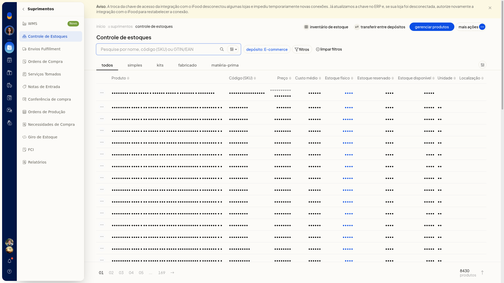

2. No menu **•••** da linha, a opção exibida é **Imprimir etiquetas**.

   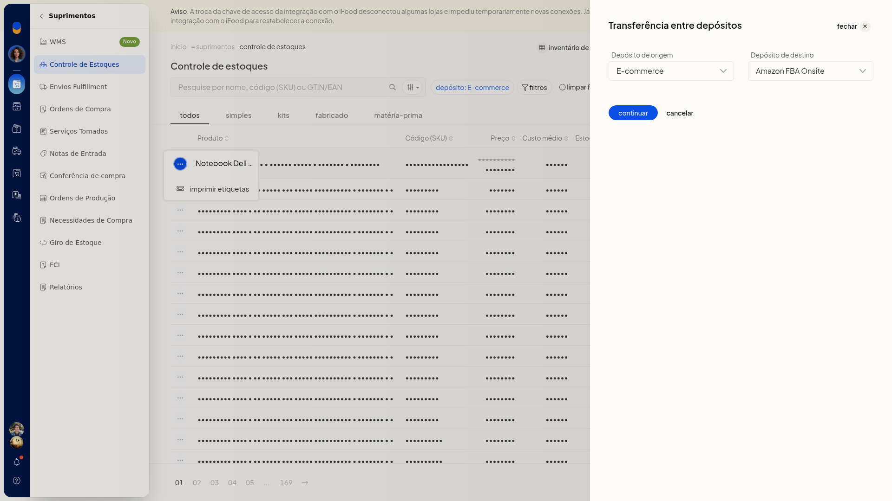

3. No filtro **depósito**, escolha o depósito da consulta ou **Todos**. O filtro só aparece quando a empresa tem mais de um depósito. O depósito ativo aparece no chip ao lado da busca.

4. Pesquise por nome, código (SKU) ou GTIN/EAN em **Pesquise por nome, código (SKU) ou GTIN/EAN**, se quiser.
5. Troque a aba **todos**, **simples**, **kits**, **fabricado** ou **matéria-prima**, se quiser.
6. Abra **filtros** para usar **Categoria**, **Exibir estoque de todas as empresas do grupo**, **Tags de produtos**, **Variações** e **Fornecedor**. Em **Tags de produtos**, a opção inicial é **Todas**. Em **Variações**, use **Sem filtro por variações** quando não quiser filtrar por variação.

   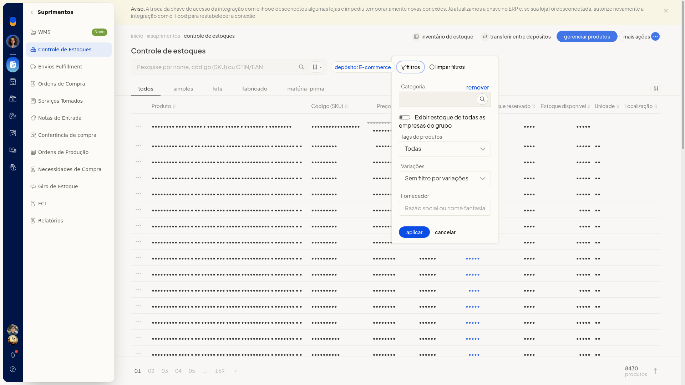

   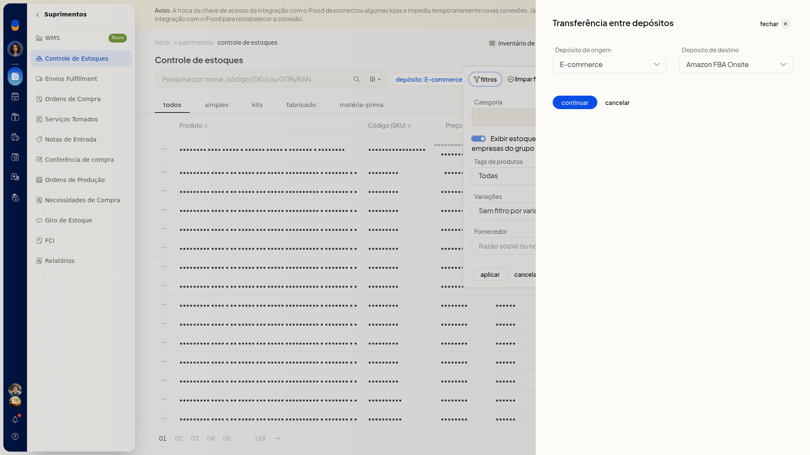

7. Clique em **Aplicar** para recarregar a lista. **Cancelar** fecha sem aplicar. **Limpar filtros** remove os filtros da lista.

   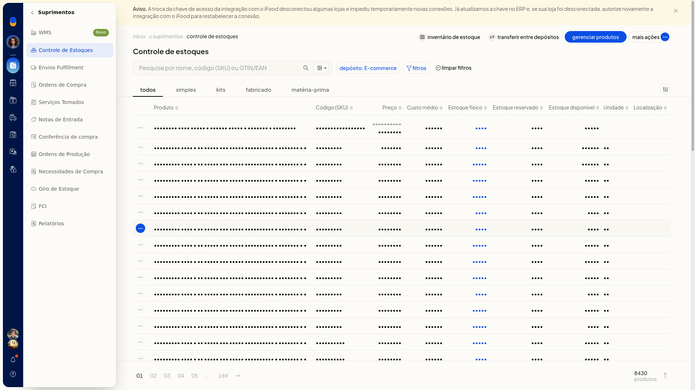

8. Clique no valor de **Estoque físico** para ver as empresas do grupo, os depósitos de cada empresa e o total por empresa.

   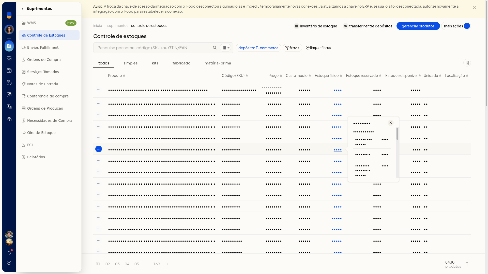

   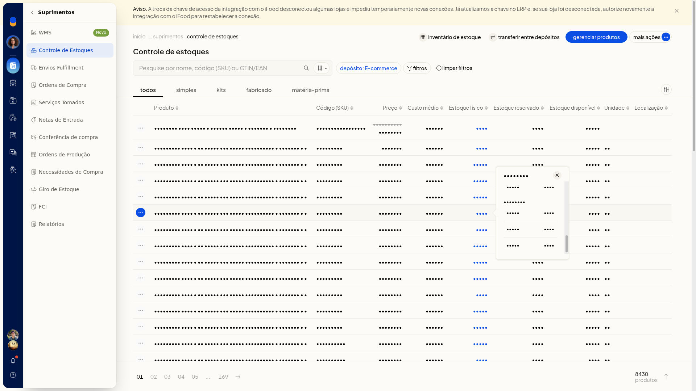

### Transferir entre depósitos

1. Em **Suprimentos > Controle de Estoques**, clique em **transferir entre depósitos**. O mesmo comando está em **Mais ações**, junto de **Inventário de estoque** e **Imprimir relatório**.

   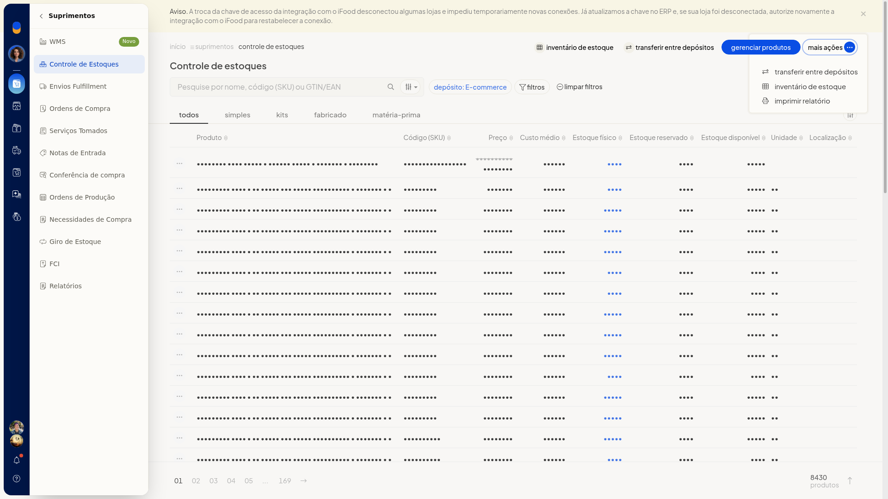

2. No painel **Transferência entre depósitos**, selecione **Depósito de origem** e **Depósito de destino**. Os dois usam a mesma lista de depósitos cadastrados.
3. Clique em **Continuar**. **Cancelar** ou o **X** fecham o painel nesta etapa.

   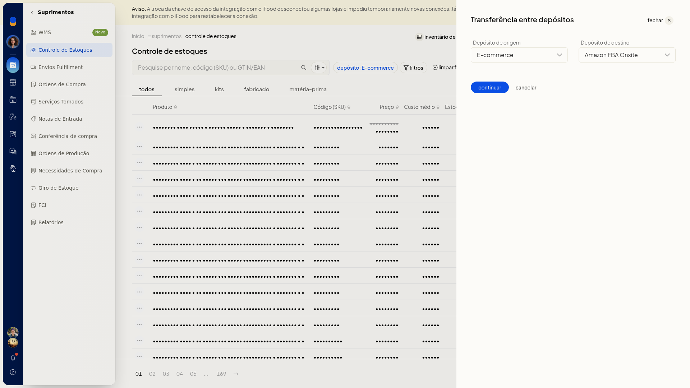

4. Na etapa de itens, confira origem e destino já preenchidos. Preencha **Observação** se quiser. O campo não é obrigatório, e o texto de ajuda informa que a observação será aplicada a todas as transferências.

   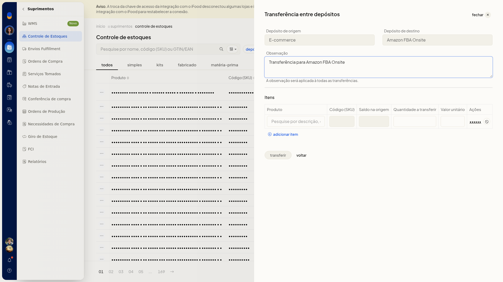

5. Pesquise o produto e escolha uma sugestão. A linha mostra **Produto**, **Código (SKU)**, **Saldo na origem**, **Quantidade a transferir** e **Valor unitário**.

   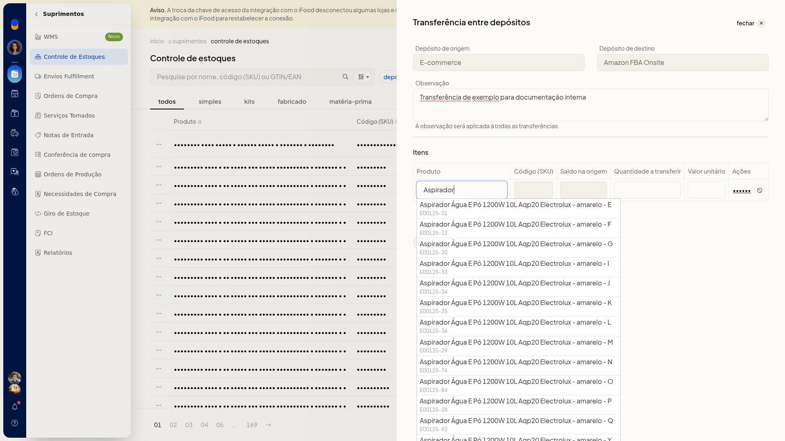

   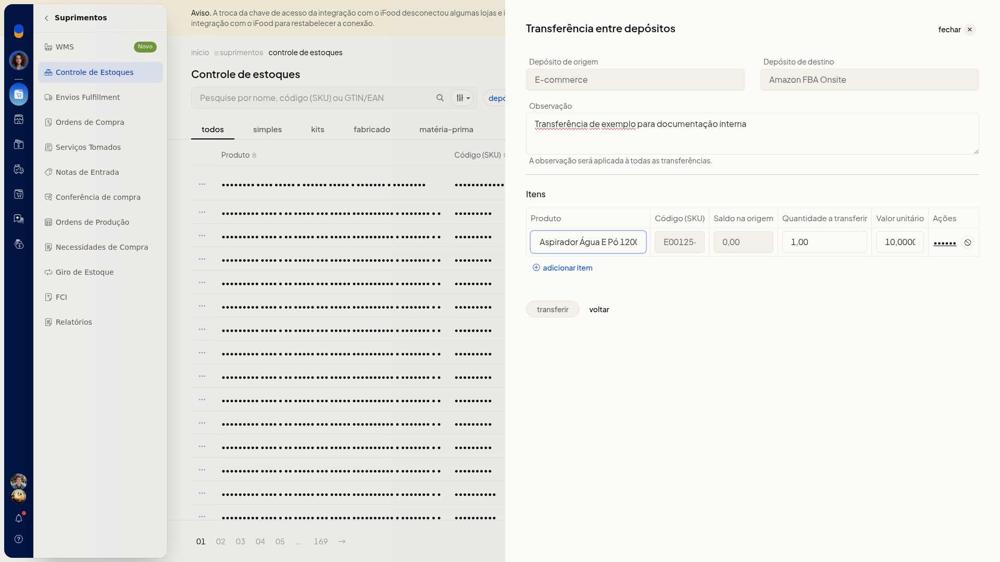

6. Ajuste **Quantidade a transferir** e **Valor unitário**. Informe os dois com vírgula decimal. A quantidade não pode ser maior que o saldo do depósito de origem.
7. Clique em **adicionar item** para incluir outros produtos.
8. Clique em **Salvar** ou em **Transferir**. São os comandos finais desta etapa. O lançamento reúne origem, destino, observação e itens.

### Descartar a transferência sem gravar

1. Na etapa de itens, clique em **Voltar**.
2. No aviso **Deseja retornar à tela anterior? Os dados não salvos serão perdidos**, clique em **Confirmar**. O painel fecha e a lista volta, sem gravar a transferência.

   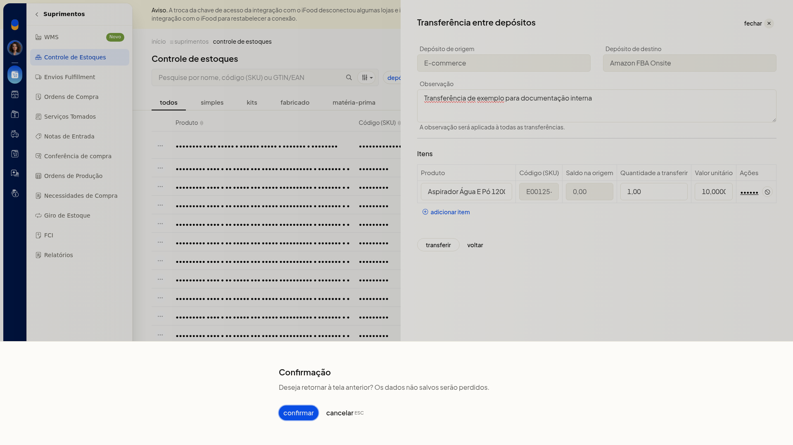

### Consultar estoque multiempresa

1. Acesse **Cadastros > Produtos**.
2. Na linha do produto, abra o menu **•••** e clique em **Consultar Estoque Multiempresa**. Esse comando não aparece no **Mais ações** da página.

   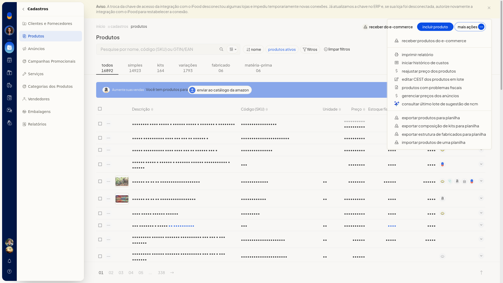

   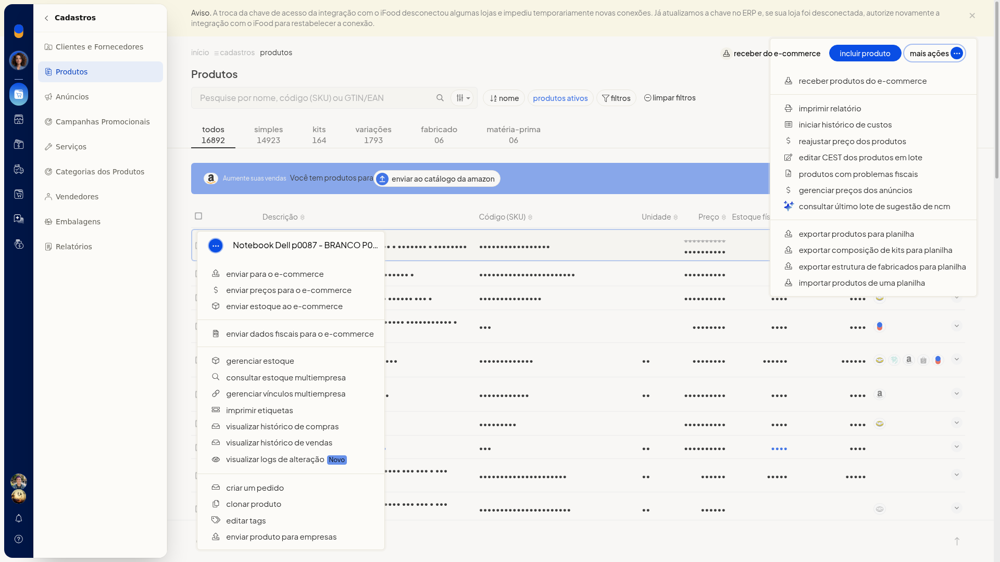

3. Confira **Descrição**, **Código (SKU)**, **Unidade**, **Preço**, **Estoque** e **Estoque Disponível**.

   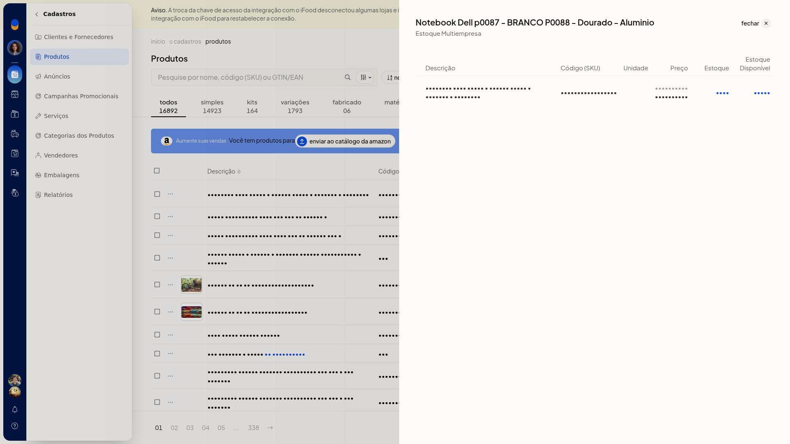

4. Clique no valor de **Estoque** para ver o agrupamento por empresa e, dentro dela, por depósito, com total por empresa. Empresa sem mapeamento mostra **Produto não mapeado**.

   

   

   

5. Clique no valor de **Estoque Disponível** para ver só o total de cada empresa, sem a quebra por depósito.

   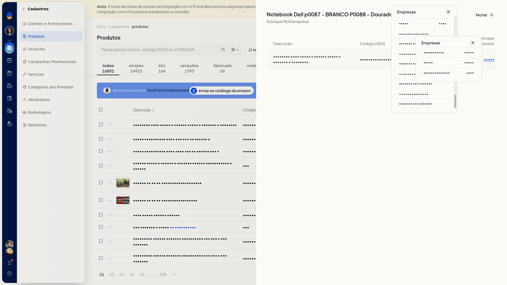

## Resultado
Na grade, você vê os saldos do depósito escolhido. No detalhe do estoque físico, a composição por empresa e por depósito.

Na transferência, depois de **Continuar**, a etapa de itens mostra origem, destino, observação e a grade de produtos. Ao escolher o produto, a linha exibe saldo na origem, quantidade a transferir e valor unitário.

Em **Consultar Estoque Multiempresa**, você vê o estoque daquele produto nas empresas do grupo: detalhe por depósito em **Estoque** e total por empresa em **Estoque Disponível**.
