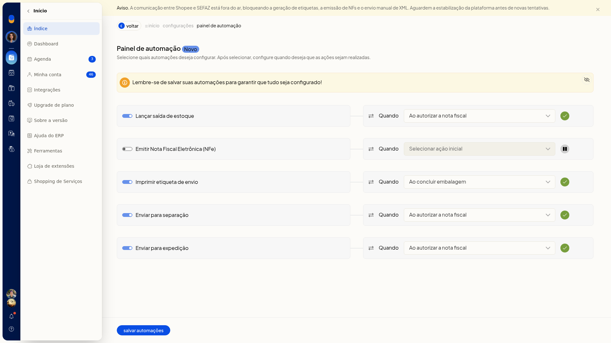
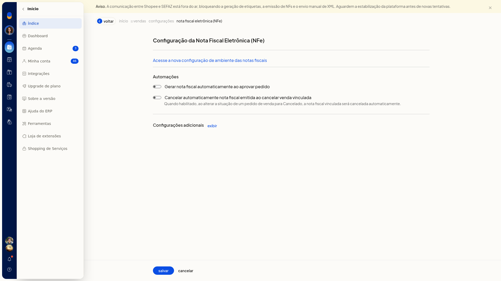

# Automações do fluxo de vendas

No ERP da Olist, o Painel de automação define quais ações do fluxo de vendas o ERP executa e em que momento. Você liga ou desliga cada ação e escolhe o gatilho no campo **Quando**.

Há também duas automações de nota fiscal eletrônica, em outra tela: gerar a nota ao aprovar o pedido e cancelar a nota emitida quando o pedido de venda vinculado for marcado como **Cancelado**.

## Importante
- No Painel de automação, a configuração só fica garantida depois de salvar.
- Os gatilhos não são os mesmos em todas as automações.
- Em **Configurações adicionais**, na configuração da NFe, aparecem parâmetros gerais da NFe e do DANFE, não outras automações do fluxo de vendas.

## Instruções
### Pelo Painel de Automações

1. Acesse **Vendas > Painel de Automações**.
2. Ligue ou desligue as automações que deseja usar. Nenhuma é obrigatória:
 - **Lançar saída de estoque**
 - **Emitir Nota Fiscal Eletrônica (NFe)**
 - **Imprimir etiqueta de envio**
 - **Enviar para separação**
 - **Enviar para expedição**

   

3. No campo **Quando** de cada automação ligada, escolha o gatilho. Todos esses campos também têm a opção **Selecionar ação inicial**.
 - **Lançar saída de estoque**: **Ao autorizar a nota fiscal**, **Ao salvar a nota fiscal**, **Ao salvar o pedido** ou **Ao marcar pedido como enviado**.
 - **Emitir Nota Fiscal Eletrônica (NFe)**: **Ao aprovar o pedido**.
 - **Imprimir etiqueta de envio**: **Ao concluir embalagem**.
 - **Enviar para separação** e **Enviar para expedição**: **Ao autorizar a nota fiscal**, **Ao salvar a nota fiscal**, **Ao salvar o pedido** ou **Ao aprovar o pedido**.
4. Clique em **Salvar automações**. A tela indica quais ações devem ocorrer e em qual gatilho, e só garante a configuração depois desse clique.

### Na configuração da nota fiscal eletrônica

1. Acesse **Configurações > Configurações ERP**.
2. Abra a aba **Notas Fiscais** e clique em **Configuração da nota fiscal eletrônica (NFe)**.
3. Na seção **Automações**, ligue ou desligue **Gerar nota fiscal automaticamente ao aprovar pedido**.
4. Ligue ou desligue **Cancelar automaticamente nota fiscal emitida ao cancelar venda vinculada**. Com essa opção ligada, ao alterar a situação do pedido de venda para **Cancelado**, a nota fiscal vinculada é cancelada automaticamente. Essas duas automações ficam nesta tela, separadas da lista do Painel de automação.

   

## Informações adicionais
### A lista de automações é fixa

Não há formulário para incluir uma automação nova. Você só liga, desliga e define o gatilho das ações já exibidas no Painel de automação.
