# Devoluções de venda

No ERP da Olist, esta tela registra a devolução de uma venda já existente, acompanha as devoluções e emite vale-troca. Você escolhe a venda, informa quantidades, depósito, logística reversa e a forma de devolver o valor, e consulta ou age sobre devoluções já lançadas.

Em **Configurações > Configurações ERP > Vendas > Configurações das devoluções de vendas**, você define se o estoque entra automaticamente ao finalizar a devolução.

## Pré-requisitos
- Para incluir uma devolução, selecione uma venda já existente. A busca usa cliente, número do pedido ou chave de acesso, com filtro **Pedido de venda**, **Nota fiscal** ou **Produto**.
- **Depósito**, **Forma de envio (reversa)** e **Forma de frete (reversa)** listam opções já cadastradas na conta.

## Importante
- Não há formulário de devolução em branco. A inclusão começa pela seleção da venda.
- **Emitida por**, **Identificador no e-commerce** e **Nº no canal de venda** não aceitam digitação.
- Se **Gerenciar vales-troca** não aparecer, peça acesso ao administrador da conta.

## Instruções
### Incluir uma devolução

1. Acesse **Vendas > Devoluções de venda**.
2. Clique em **Incluir devolução**.

   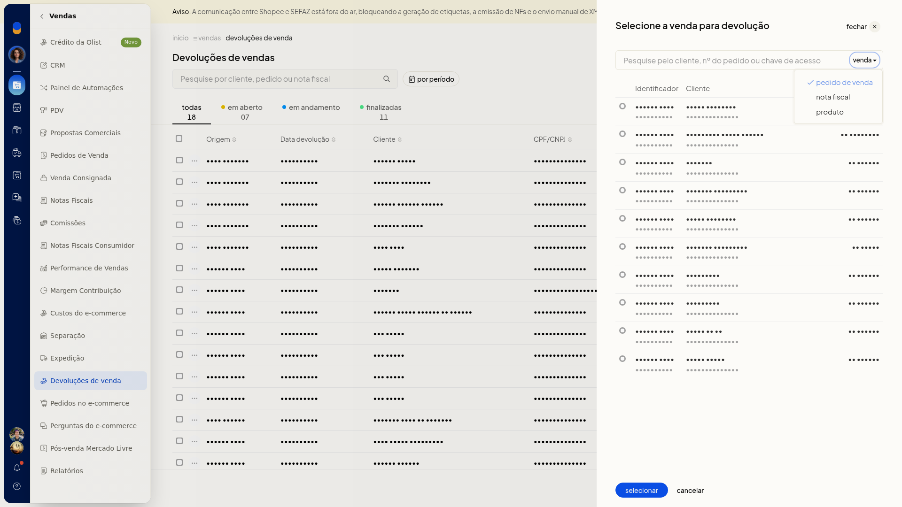

3. Busque por cliente, número do pedido ou chave de acesso.
4. Filtre por **Pedido de venda**, **Nota fiscal** ou **Produto**.
5. Clique na linha da venda.

#### Dados da devolução

6. Preencha os campos. Nenhum deles é obrigatório.
 - **Data da devolução**
 - **Observações Internas**
 - **Marcadores**: informe uma tag
 - **Devolução parcial**: ligue quando a devolução não for total e informe **Qtde devolução** com duas casas decimais

   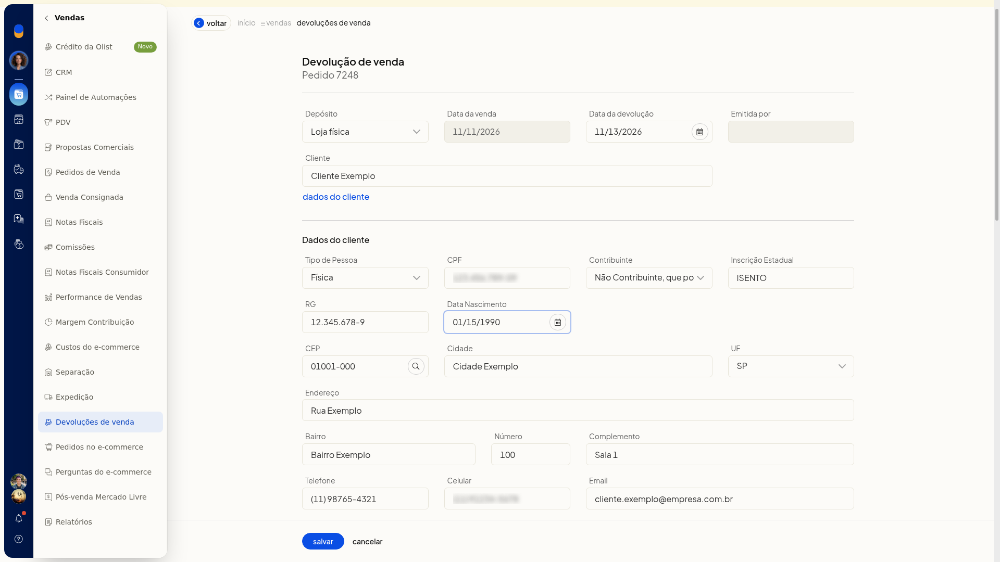

#### Logística reversa

7. Escolha **Depósito**, **Forma de envio (reversa)** e **Forma de frete (reversa)**.
 - No depósito, as opções cadastradas podem incluir **Padrão**, **E-commerce**, **Fulfillment** e **Loja física**.
 - Na forma de envio, a lista inclui **Não definida** e opções de Correios.
 - Na forma de frete, a lista inclui **Não definida**.

#### Dados do cliente

8. Abra **Dados do cliente** se precisar completar nome, CPF, inscrição estadual, RG, data de nascimento, CEP, cidade, UF, endereço e contatos.

#### Devolução do valor

9. Escolha como devolver o valor.
 - **Sem pagamento**, **Vale-troca** e **Estornar da venda / nota** não pedem campos extras.
 - **Contas a pagar** pede **Categoria**.
 - **Dinheiro** pede **Conta financeira** e **Categoria**.

   

   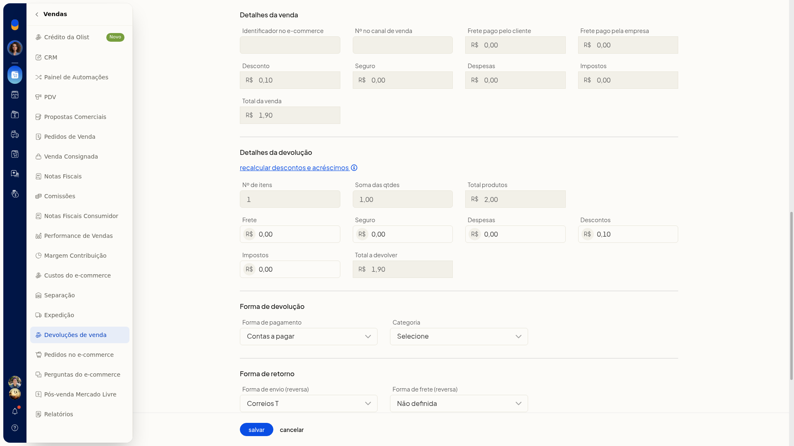

   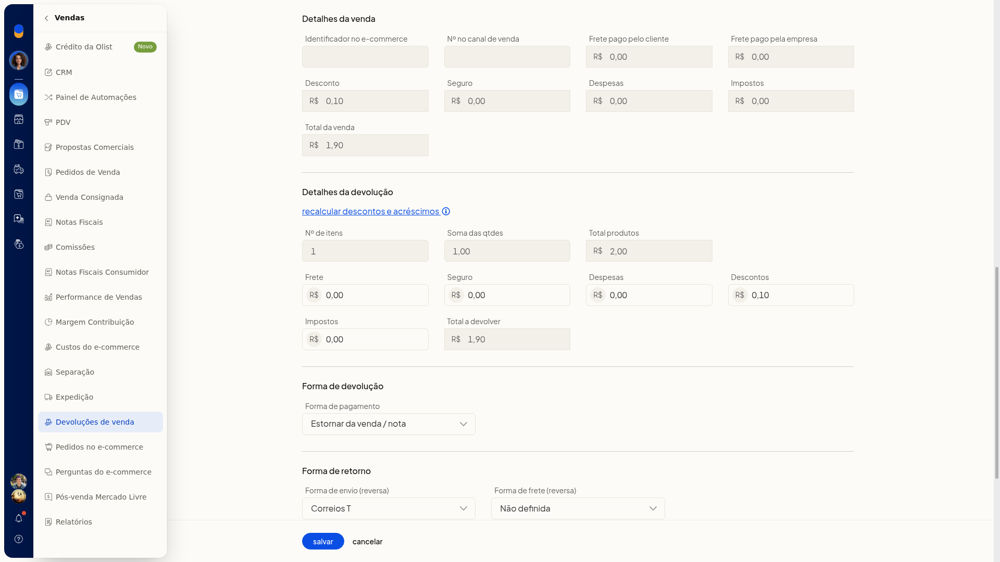

   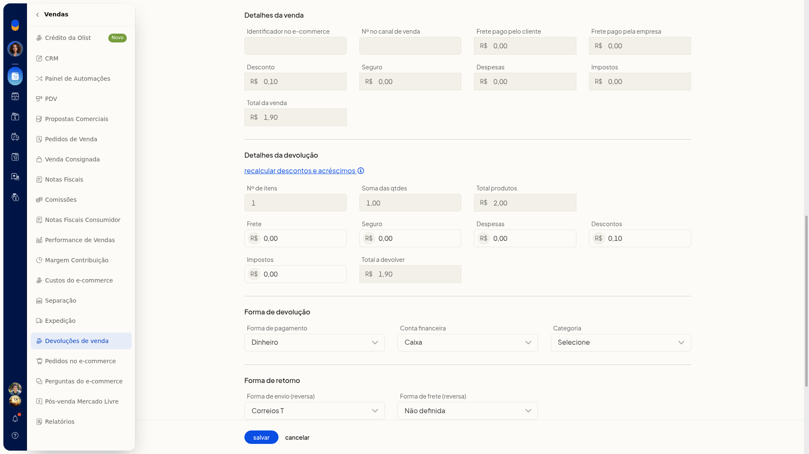

10. Clique em **Salvar** para gravar a devolução, com a venda de origem já vinculada.

### Incluir um vale-troca

1. Na lista **Devoluções de venda**, clique em **Gerenciar vales-troca**.

   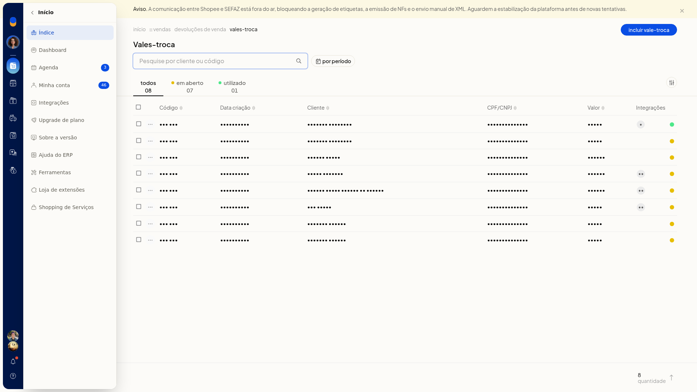

2. Use a busca por cliente ou código, o filtro por período e as abas **Todos**, **Em aberto** e **Utilizado**.
3. Clique em **Incluir vale-troca**.

   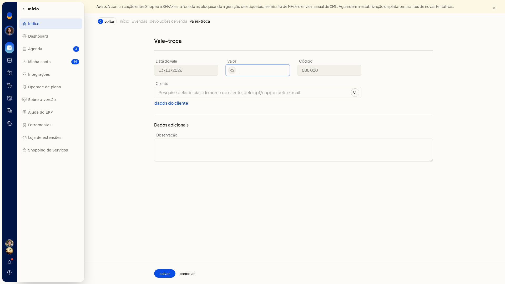

4. Confira **Data do vale**, já preenchida no formato DD/MM/AAAA, e **Código**, já exibido.
5. Informe o **Valor** com vírgula decimal.
6. Em **Cliente**, pesquise pelas iniciais do nome, pelo CPF/CNPJ ou pelo email.
7. Clique em **Dados do cliente**.
8. Escolha **Tipo de Pessoa**: **Jurídica**, **Física**, **Estrangeiro** ou **Estrangeiro no Brasil**.
9. Para pessoa jurídica, preencha **CNPJ**, **Contribuinte**, **Inscrição Estadual**, **CEP**, **Cidade**, **UF**, **Endereço**, **Bairro**, **Número**, **Complemento**, **Telefone**, **Celular** e **Email**. Nenhum desses campos é obrigatório.
 - Em **Contribuinte**, as opções confirmadas são **Não informado** e **Contribuinte ICMS**.
 - Informe o **CEP** com hífen. Use **Buscar dados do CEP** se quiser localizar o endereço.
 - Em **UF**, escolha a sigla na lista.

   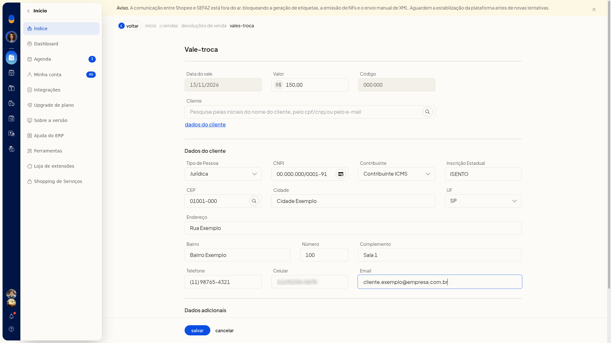

10. Em **Dados adicionais**, preencha **Observação**.

   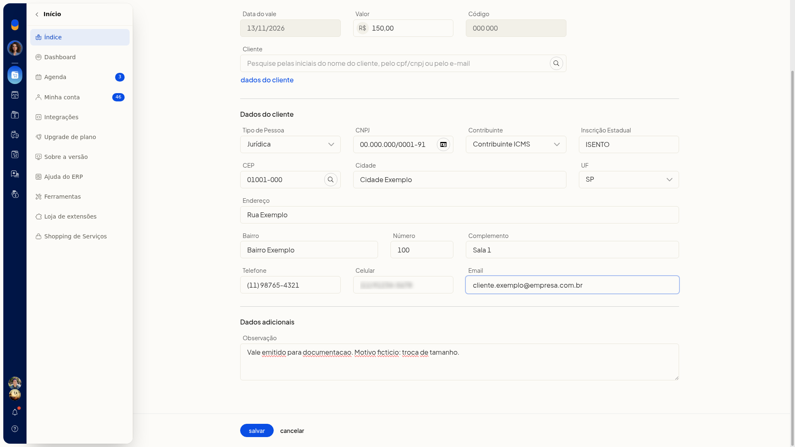

11. Clique em **Salvar** para gravar o vale-troca.

### Consultar e agir sobre uma devolução

1. Acesse **Vendas > Devoluções de venda**.

   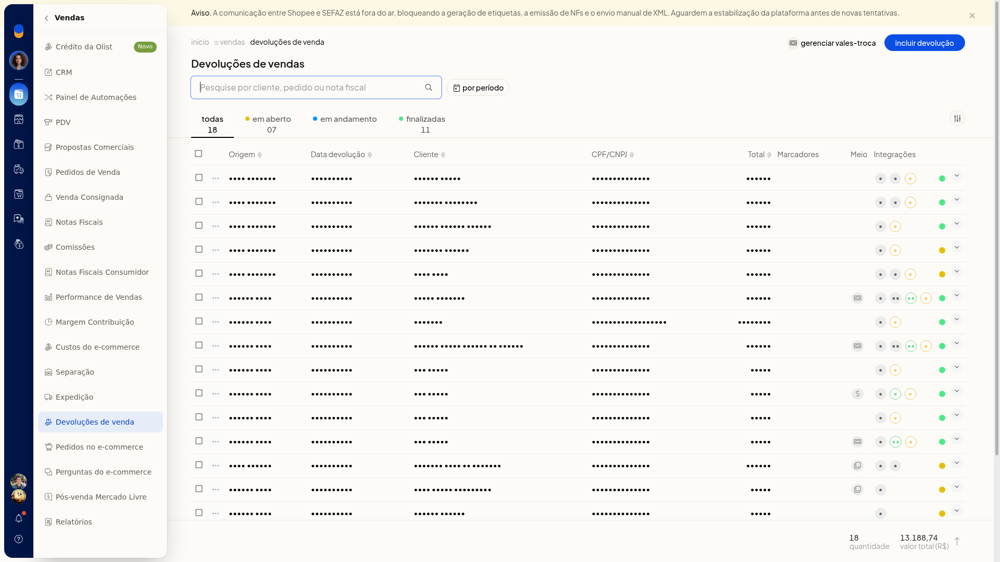

2. Busque por cliente, pedido ou nota.
3. Filtre o período por **Sem filtro**, **Do dia**, **Do mês** ou **Do intervalo**.

   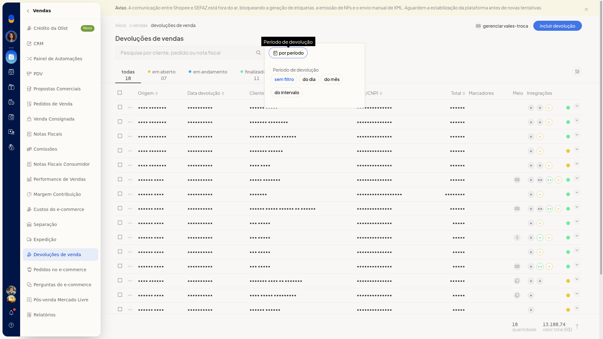

4. Use as abas **Todas**, **Em aberto**, **Em andamento** e **Finalizadas**. O rodapé mostra a quantidade e o total das devoluções exibidas.
5. Abra **Informações visíveis** e marque as colunas: **Origem**, **Data criação**, **Data devolução**, **Cliente**, **CPF/CNPJ**, **Total**, **Marcadores**, **Meio de pagamento**, **Integrações** e **Situação**.

   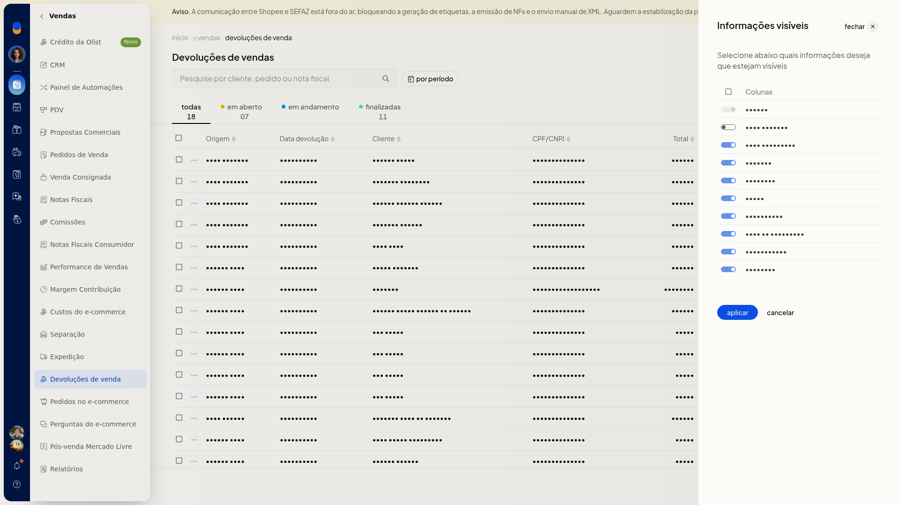

6. No menu da linha, escolha a ação: **Gerar nota de devolução**, **Editar observações internas**, **Estornar estoque**, **Gerenciar lotes de produtos**, **Compartilhar**, **Imprimir**, **Salvar em PDF**, **Alterar situação**, **Editar marcadores** ou **Excluir devolução**.

   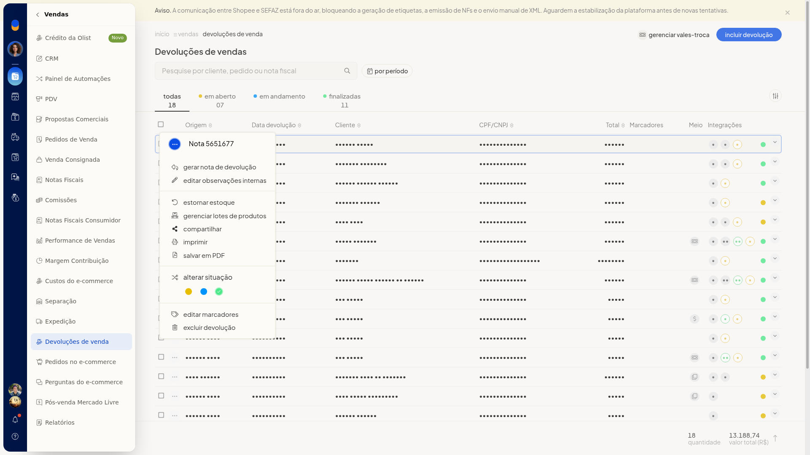

7. Para várias linhas, use **Alterar marcadores** ou **Excluir devoluções**. Em **Mais ações**, a lista oferece **Gerenciar vales-troca**. Assim você localiza a devolução e acessa nota, estoque, impressão, situação, marcadores e exclusão.

### Configurar o lançamento automático de estoque

1. Acesse **Configurações > Configurações ERP > Vendas > Configurações das devoluções de vendas**.

   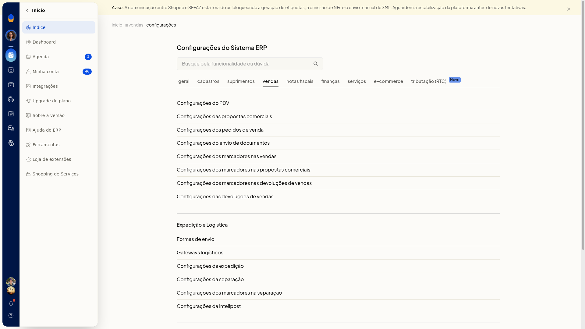

2. Marque ou desmarque **Lançar estoque automático ao finalizar devolução**. Ao finalizar uma devolução manualmente ou ao autorizar a nota de devolução no Sefaz, o estoque é lançado automaticamente.

   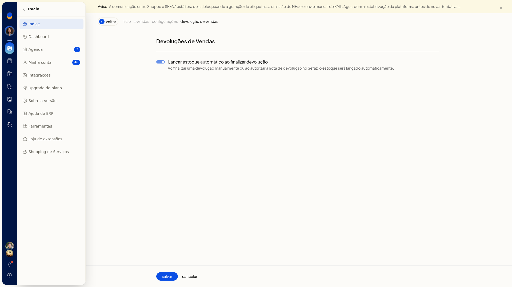

3. Clique em **Salvar** para gravar a configuração.

## Informações adicionais
### Vale-troca em aberto

Marcar como utilizado e excluir o vale-troca só aparecem quando ele ainda está em aberto.
