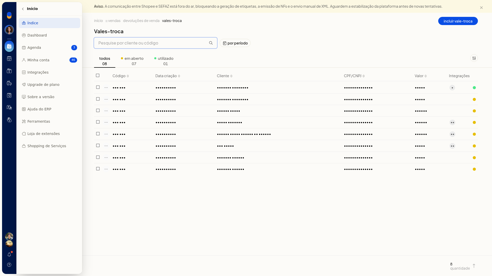
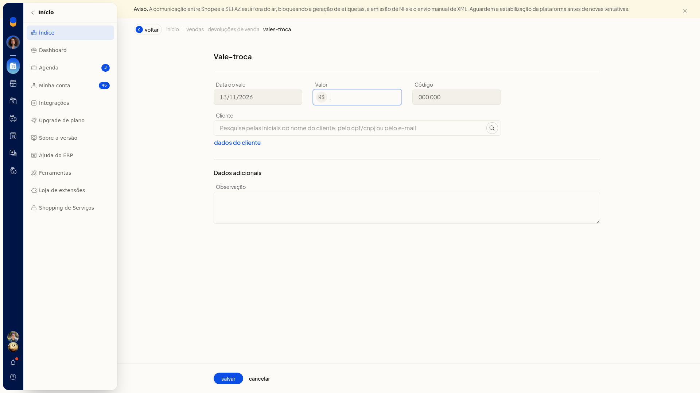
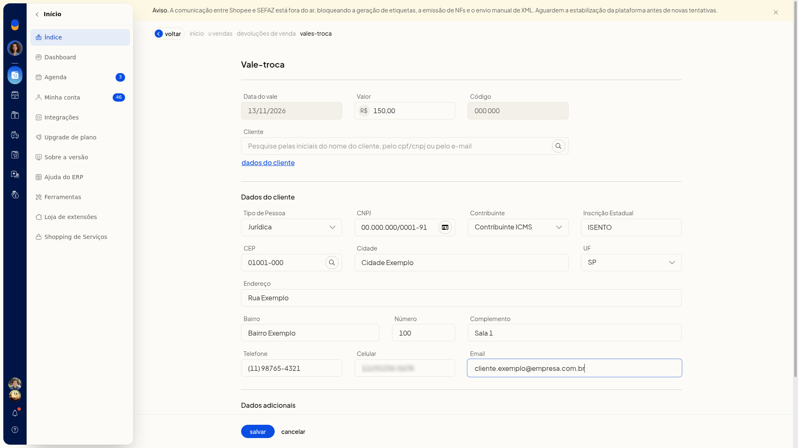
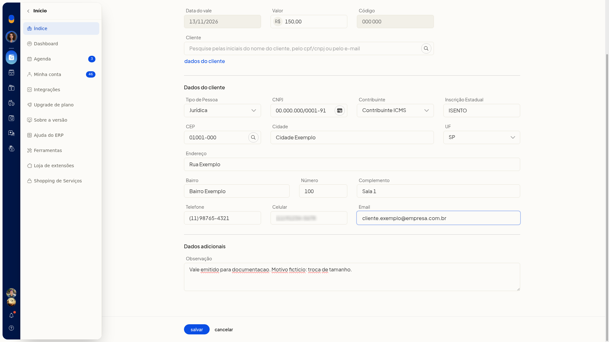

# Incluir e consultar vales-troca nas devoluções de venda

No ERP da Olist, você consulta os vales-troca ligados às devoluções de venda e inclui um novo vale. Na lista, dá para localizar um vale pelo cliente, pelo código ou pelo período e separar os vales em aberto dos já utilizados.

## Instruções
1. Acesse **Vendas > Devoluções de venda**.
2. Clique em **Gerenciar vales-troca**.

   

3. Busque pelo cliente ou pelo código do vale.
4. Filtre por período, se precisar.
5. Clique na aba **Todos**, **Em aberto** ou **Utilizado**.
6. Clique em **Incluir vale-troca**.

   

7. Confira a **Data do vale**, já preenchida no formato DD/MM/AAAA, e o **Código** exibido no formulário.
8. Informe o **Valor** em reais, com vírgula decimal.
9. No campo **Cliente**, pesquise pelas iniciais do nome, pelo CPF/CNPJ ou pelo email.
10. Clique em **Dados do cliente**.

#### Dados do cliente

11. Selecione o **Tipo de Pessoa**: **Jurídica**, **Física**, **Estrangeiro** ou **Estrangeiro no Brasil**.
12. Se o tipo for **Jurídica**, preencha **CNPJ**, **Contribuinte** e **Inscrição Estadual**.
13. Informe o **CEP** com hífen ou clique em **Buscar dados do CEP**.
14. Preencha **Cidade**, **UF**, **Endereço**, **Bairro**, **Número** e **Complemento**.
15. Preencha **Telefone**, **Celular** e **Email**.

   

#### Dados adicionais

16. Preencha **Observação**.

   

17. Clique em **Salvar**.

## Informações adicionais
- Marcar como utilizado e excluir o vale-troca só aparecem quando ele ainda está em aberto.
