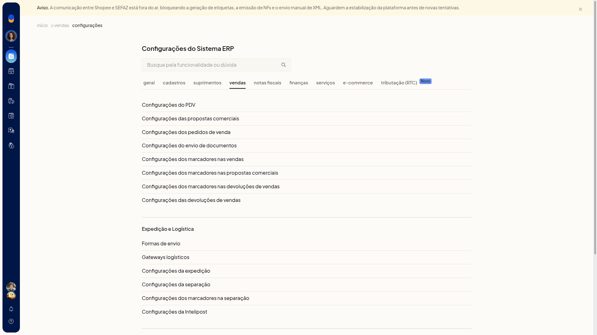
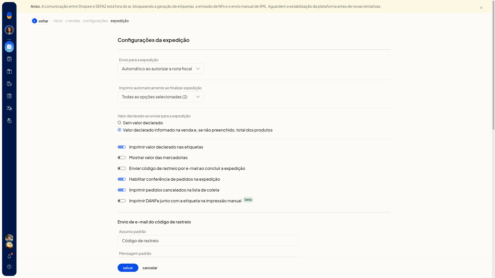
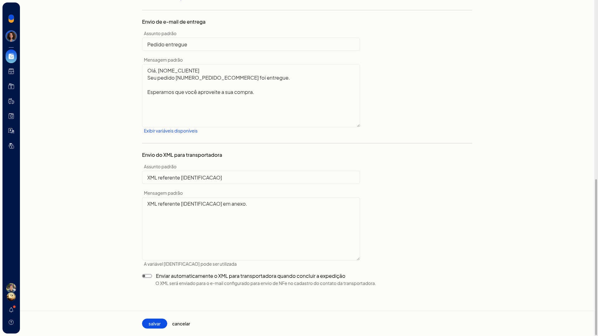
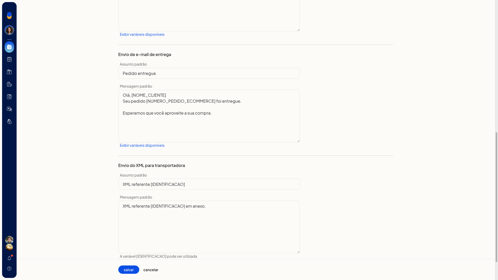

# Configurar a expedição

As configurações da expedição do ERP da Olist definem quando o pedido entra na expedição, o que é impresso ao finalizar e se a conferência, o valor declarado, o email de rastreio e o envio do XML ficam ligados. Nessa tela você também ajusta os modelos de email de rastreio, de entrega e de XML.

## Como acessar
Acesse **Configurações > Configurações ERP > Vendas > Configurações da expedição**.

## Envio para a expedição
Em **Envio para a expedição**, escolha quando o pedido vai para a expedição:

- **Manual**
- ao salvar o pedido
- ao aprovar o pedido
- ao salvar a nota fiscal
- **Automático ao autorizar a nota fiscal**

## Imprimir automaticamente ao finalizar expedição
Em **Imprimir automaticamente ao finalizar expedição**, selecione os documentos impressos ao finalizar a expedição. A seleção pode reunir **DANFE** e **Etiqueta de envio**.

## Valor declarado
O valor declarado pode usar o informado na venda e, na falta dele, o total dos produtos. A outra opção é **Sem valor declarado**.

## Opções da expedição
A mesma tela reúne estas opções, que você liga ou desliga:

- **Imprimir valor declarado nas etiquetas**
- **Habilitar conferência de pedidos**: com a opção ligada, a conferência de pedidos fica disponível. A conferência dos agrupamentos selecionados só aparece quando essa opção está habilitada.
- **Imprimir pedidos cancelados na lista de coleta**
- **Mostrar valor das mercadorias**
- **Enviar código de rastreio por e-mail ao concluir**
- **Imprimir DANFe junto com a etiqueta na impressão manual beta**

## Enviar automaticamente o XML para a transportadora ao concluir a expedição
**Enviar automaticamente o XML para a transportadora ao concluir a expedição** envia o XML para o email de NF-e do contato da transportadora.

## Modelos de email
Na mesma tela há modelos de email de rastreio, de entrega e de XML.

- o modelo de entrega usa o assunto **Pedido entregue**, com **[NOME_CLIENTE]** e **[NUMERO_PEDIDO_ECOMMERCE]**
- o modelo de XML usa o assunto **XML referente [IDENTIFICACAO]**

