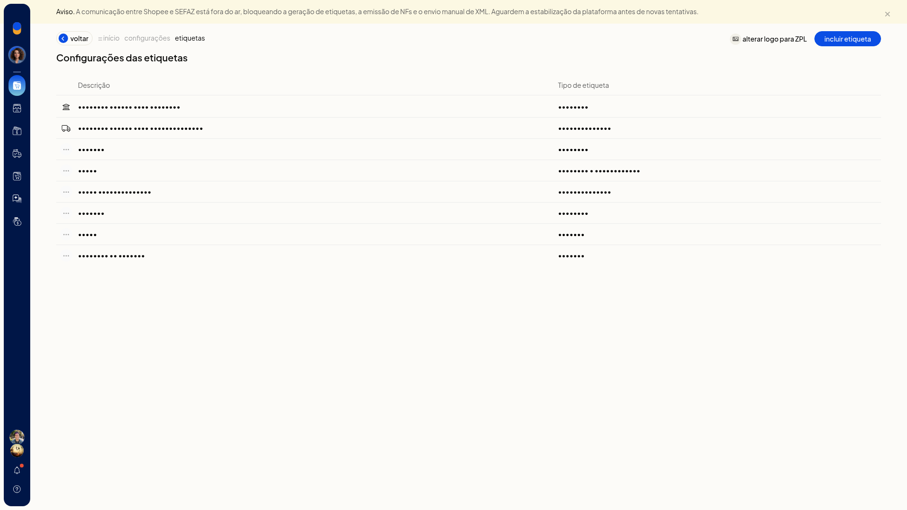
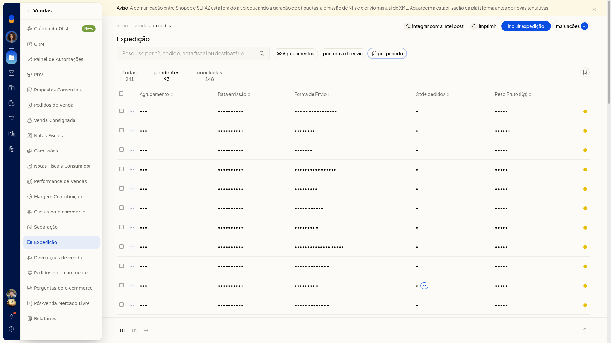
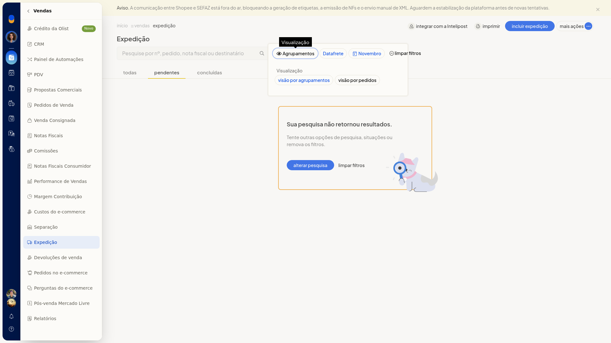
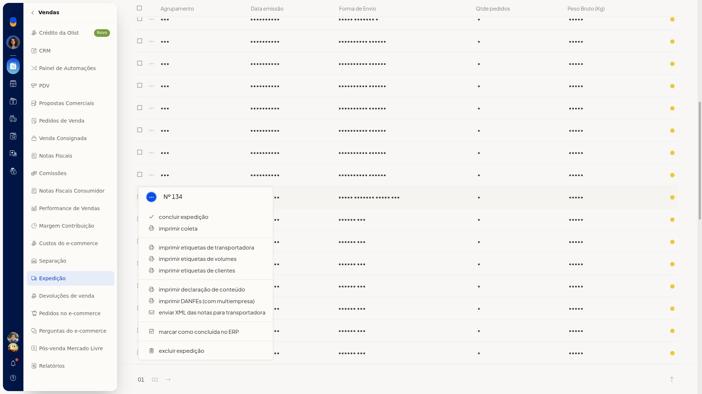

# Declaração de conteúdo eletrônica (DC-e)

No ERP da Olist, um agrupamento de transportadora com DC-e na expedição permite imprimir a declaração de conteúdo, além da coleta e das etiquetas de transportadora. Você também pode enviar o XML das notas para a transportadora a partir do mesmo menu.

## Importante
- **Imprimir declaração de conteúdo**, **Imprimir coleta**, **Imprimir etiquetas de transportadora** e **Enviar XML das notas para transportadora** só aparecem no agrupamento de transportadora com DC-e. Em um agrupamento de gateway, essas opções não entram no menu.

## Instruções
1. Acesse **Vendas > Expedição**.

   

2. Na lista, use as abas **Pendentes**, **Concluídas** ou **Todas** para localizar o agrupamento.

   

3. No controle **Agrupamentos**, selecione **Visão por agrupamentos**.

   

4. Abra o menu de contexto do agrupamento de transportadora com DC-e e clique em **Imprimir declaração de conteúdo**.

   
