# Etiquetas de envio: formatos e erros

## Importante
- Um aviso de indisponibilidade ligado a Shopee/SEFAZ, na lista de expedição e na lista de etiquetas, impede a impressão de etiquetas, a emissão de nota fiscal e o envio manual de XML.
- Não é possível imprimir as etiquetas do gateway logístico se o agrupamento foi concluído manualmente, sem integração com a logística.
- Para imprimir as etiquetas da forma de envio, os pedidos precisam já ter sido enviados para a forma de envio, e a forma de envio precisa oferecer impressão de etiquetas.
- Para imprimir as etiquetas do ecommerce, a expedição precisa ter pedido no ecommerce e a integração precisa estar ativa e permitir etiquetas.
- Coleta, etiqueta de transportadora, declaração de conteúdo e envio de XML só aparecem no menu de um agrupamento de transportadora com DC-e.

## Instruções
### Conferir o aviso que impede a impressão

1. Acesse **Vendas > Expedição**.
2. Se a lista exibir o aviso de indisponibilidade ligado a Shopee/SEFAZ, a impressão de etiquetas fica impedida, junto com a emissão de nota fiscal e o envio manual de XML.

   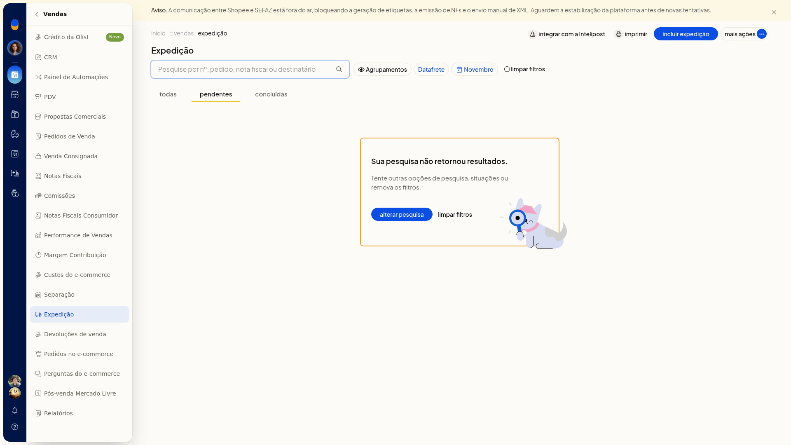

### Conferir o formato ao incluir um modelo

1. Acesse **Configurações > Configurações ERP > Geral > Configurações das etiquetas**.

   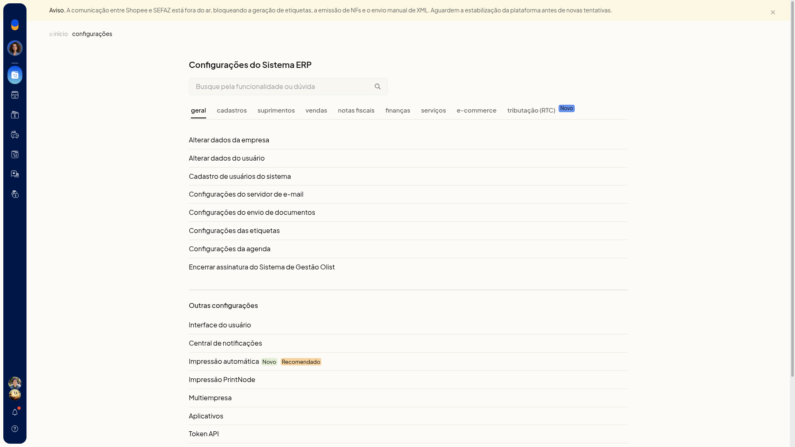

2. Na lista, confira os modelos pelo uso: **Correios**, **Transportadora**, **Produtos**, **Clientes e fornecedores** e **Volumes**.

   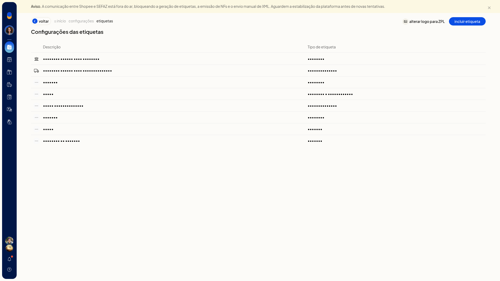

3. Clique em **incluir etiqueta**.
4. Selecione o tipo: **Clientes e fornecedores**, **Produtos**, **Volumes**, **Transportadora** ou **Separação**.
5. Clique em **Continuar**.

   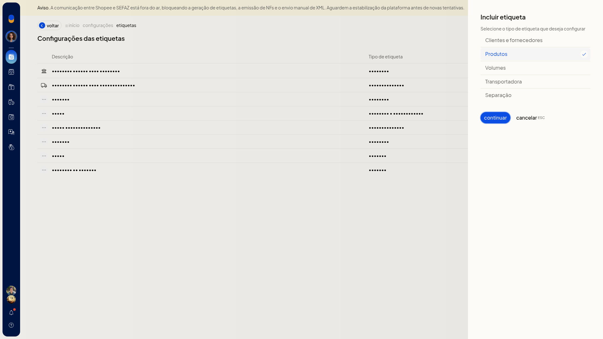

6. No formulário de etiqueta de produtos, informe a descrição.
7. Em **Modo de impressão**, escolha **Página** ou **Bobina**.
8. Em **Orientação**, escolha **Retrato** ou **Paisagem**.
9. Em **Dimensões**, selecione o código da folha, como **3080/3180**, **6080/6180** ou **A4050/A4250/A4350**.
10. Clique em **salvar** para gravar o modelo. Use **imprimir página de testes** só se quiser testar o formato antes, ou **cancelar** para sair sem gravar.

   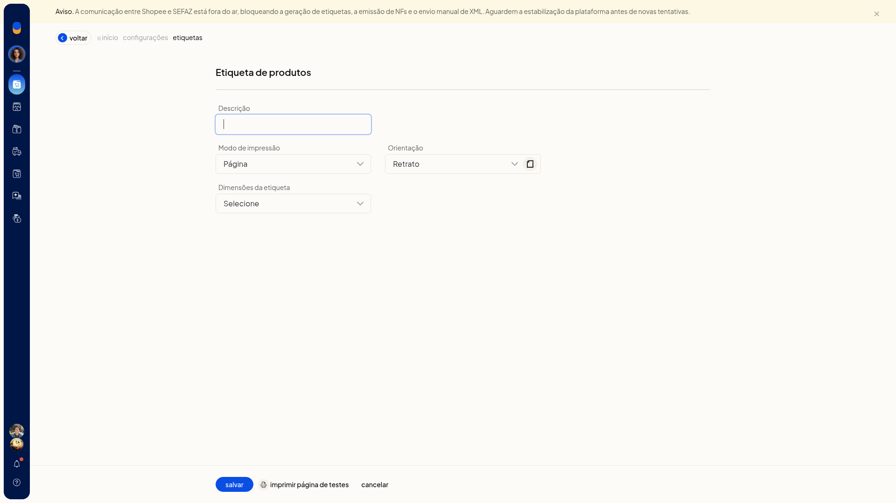

O mesmo **incluir etiqueta** abre o formulário de transportadora quando esse tipo é escolhido.

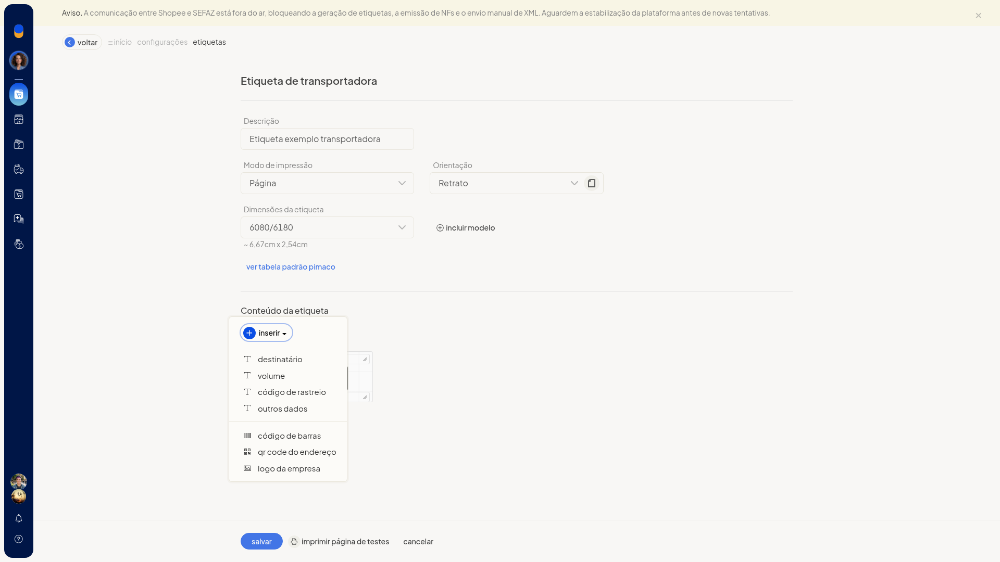

### Imprimir etiquetas no agrupamento

1. Acesse **Vendas > Expedição**.
2. Na visão por agrupamentos, abra o menu de contexto do agrupamento.
3. Em um agrupamento de gateway, escolha **Imprimir etiquetas de volumes** ou **Imprimir etiquetas de clientes**. O mesmo menu também oferece **Imprimir DANFEs**.

   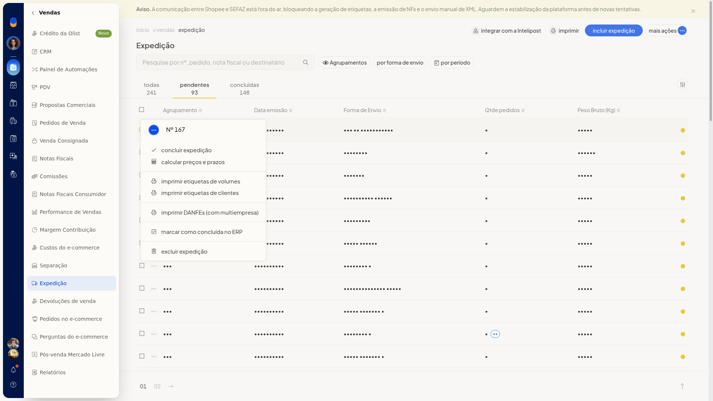

4. Em um agrupamento de transportadora com DC-e, escolha **Imprimir etiquetas de transportadora**. O menu também oferece **Imprimir coleta**, **Imprimir declaração de conteúdo** e **Enviar XML das notas para transportadora**. A impressão só segue se as regras do bloco Importante forem atendidas.

   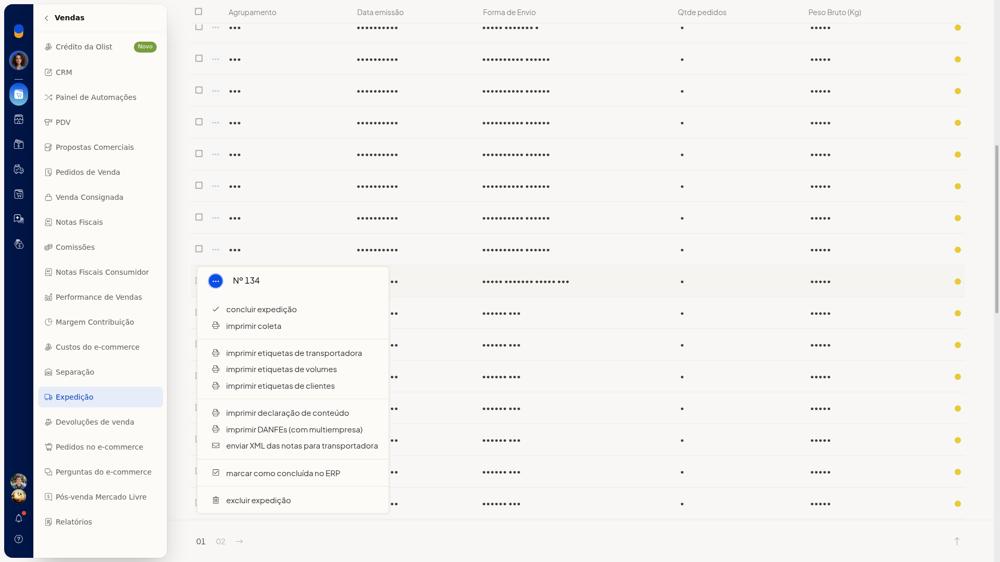

### Tratar o erro da impressão automática

1. Acesse **Configurações > Configurações ERP > Geral > Impressão automática (Novo/Recomendado)**.
2. Se a atribuição da impressora padrão exibir **Erro ao obter impressoras** e **Unable to establish connection with QZ Tray**, deixe o aplicativo de conexão (QZ Tray) acessível. Sem ele, a atribuição não lista impressoras. A tela também oferece **imprimir etiqueta teste**, **testar conexão** e **baixar aplicativo**.

   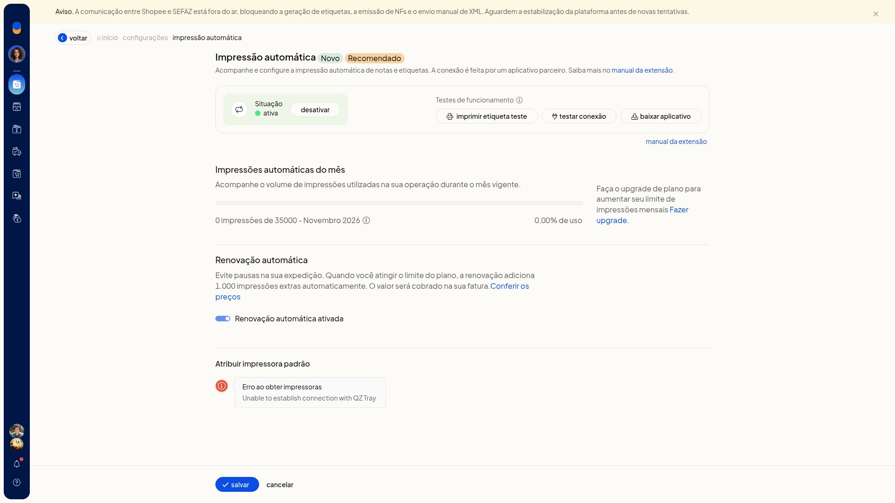

### Direcionar a etiqueta de envio no PrintNode

1. Acesse **Configurações > Configurações ERP > Geral > Impressão PrintNode**.
2. Siga o texto da página: crie a conta em www.printnode.com, instale e faça login no cliente, gere a API key e cole no campo **API Key**.
3. Em **Atribuir impressoras padrão**, abra **Impressão de etiquetas de envio**. A página avisa que a etiqueta de envio é enviada em ZPL e exige impressora Zebra. As opções começam em **Nenhuma** e passam a listar as impressoras que o PrintNode devolve.
4. Em **Atribuir impressoras por usuários**, abra quem vai imprimir e defina **Impressão de etiquetas de envio** em **Impressora padrão**.
5. Clique em **aplicar** para gravar a impressora dessa pessoa, ou em **cancelar** para fechar sem aplicar. Na página, clique em **Salvar** para gravar a configuração da conta.

   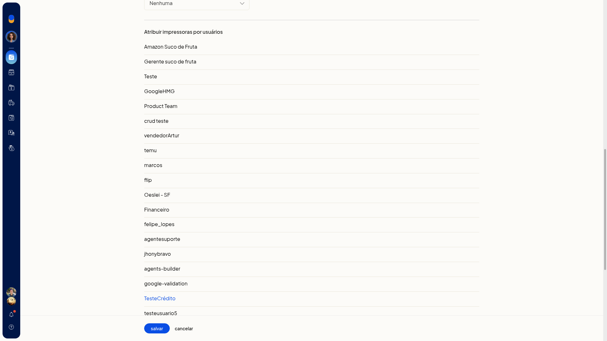

   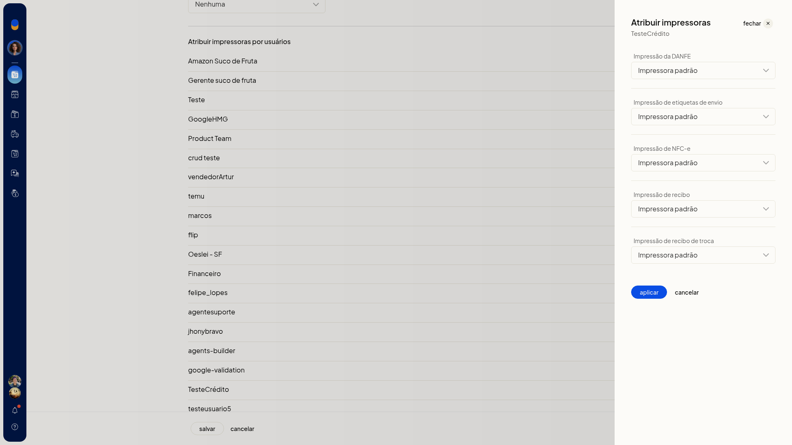

## Informações adicionais
- Na lista de etiquetas, o botão **alterar logo para ZPL** fica junto de **incluir etiqueta**.
- Em **Configurações > Configurações ERP > Vendas > Configurações da expedição**, **Imprimir automaticamente ao finalizar expedição** pode reunir **DANFE** e **Etiqueta de envio**.
- A opção **Imprimir valor declarado nas etiquetas** pode ficar ligada ou desligada nessa mesma tela.
