# Expedição

A expedição no ERP da Olist reúne pedidos e notas em agrupamentos para você concluir o envio, imprimir etiquetas, DANFE, coleta e declaração de conteúdo e encaminhar notas a uma logística, como a Intelipost.

Em **Vendas > Expedição** você consulta os agrupamentos, inclui a expedição com pedidos disponíveis, pedidos específicos ou objeto avulso e define quando o pedido entra na expedição e o que é impresso ou enviado ao concluir.

## Pré-requisitos
- Tenha uma forma de envio já cadastrada para filtrar a lista ou incluir a expedição.
- Para marcar as notas como despachadas na Intelipost, a empresa precisa ter o módulo Intelipost e o botão **Integrar com a Intelipost** disponível na barra da expedição.

## Importante
- Um aviso na lista de expedição informa indisponibilidade ligada a Shopee/SEFAZ. Esse aviso impede a impressão de etiquetas, a emissão de nota fiscal e o envio manual de XML.
- Coleta, etiqueta de transportadora, declaração de conteúdo e envio de XML só aparecem no agrupamento de transportadora com DC-e.
- Não é possível imprimir as etiquetas do gateway logístico se o agrupamento foi concluído manualmente, sem integração com a logística.
- Para imprimir as etiquetas da forma de envio, os pedidos precisam já ter sido enviados para a forma de envio, e a forma de envio precisa oferecer impressão de etiquetas.
- Para imprimir as etiquetas do ecommerce, a expedição precisa ter pedido no ecommerce e a integração precisa estar ativa e permitir etiquetas.
- A conferência de pedidos, e a conferência dos agrupamentos selecionados, só ficam disponíveis quando a conferência de pedidos está habilitada nas configurações de expedição.

## Instruções
### Consultar os agrupamentos

1. Acesse **Vendas > Expedição**.

   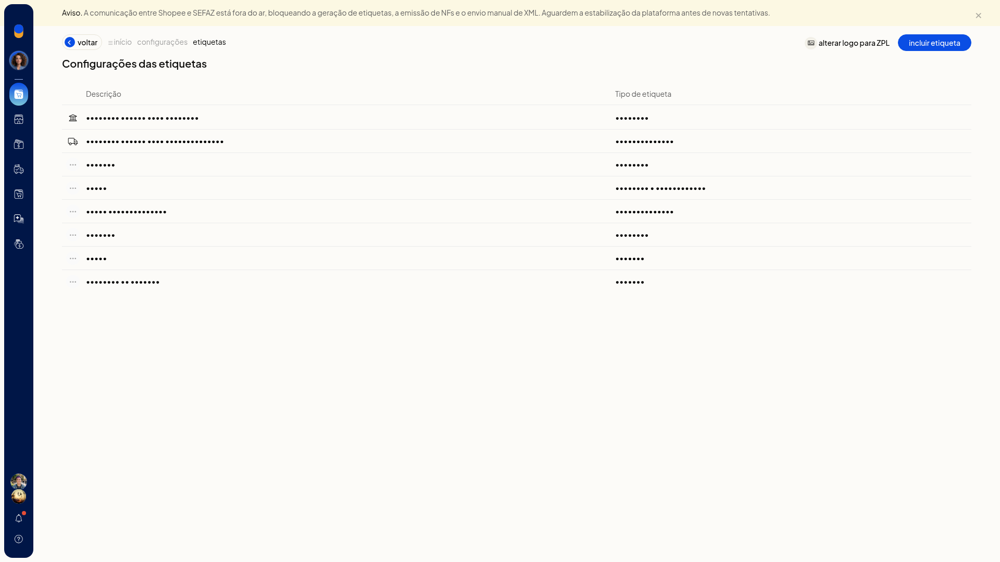

   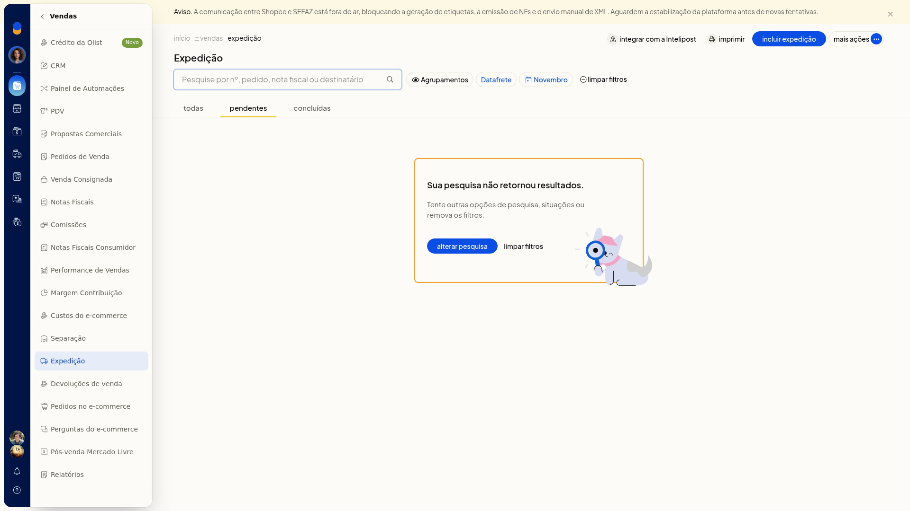

2. Use as abas **Pendentes**, **Concluídas** e **Todas**.

   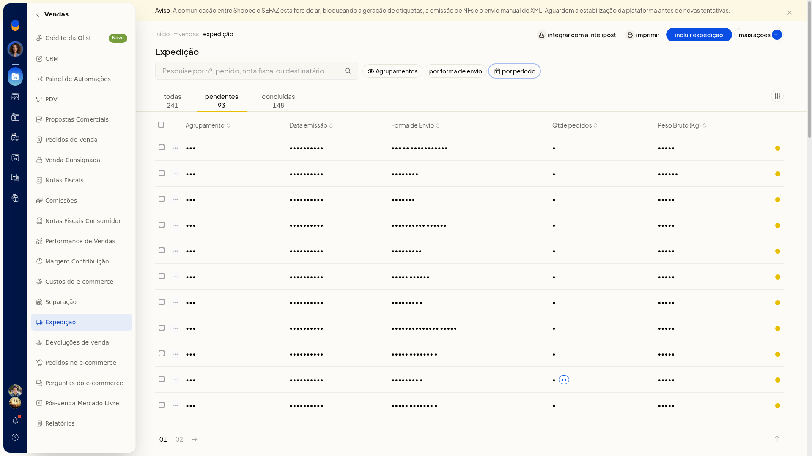

3. Filtre pela forma de envio e pelo período.
4. No controle **Agrupamentos**, escolha **Visão por agrupamentos** ou **Visão por pedidos**.

   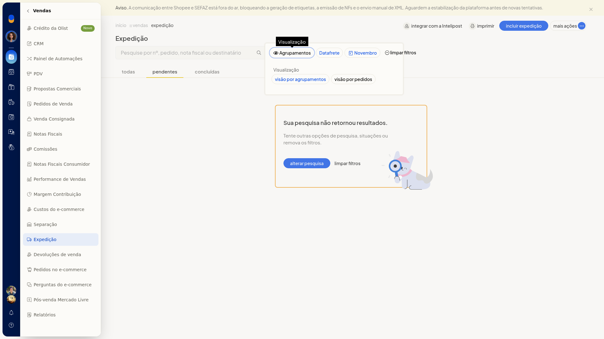

### Incluir a expedição

1. Em **Vendas > Expedição**, clique em **Incluir expedição**.
2. Confira a forma de envio.
3. Deixe desmarcada ou marque **Incluir pedidos e notas sem forma de envio**.
4. Em **Pedidos disponíveis**, filtre pela situação da separação e pelo período. O período é um intervalo de datas.

   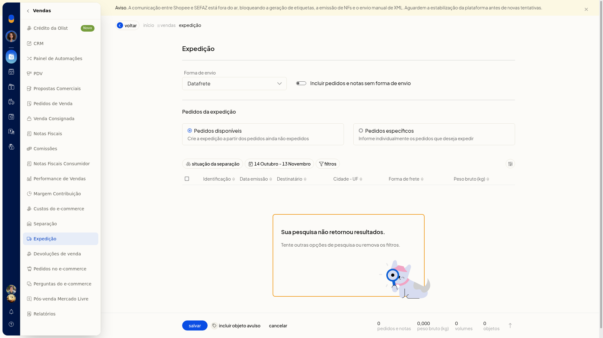

5. Para escolher registros pontuais, mude para **Pedidos específicos** e pesquise pelo pedido ou pela chave de acesso.

   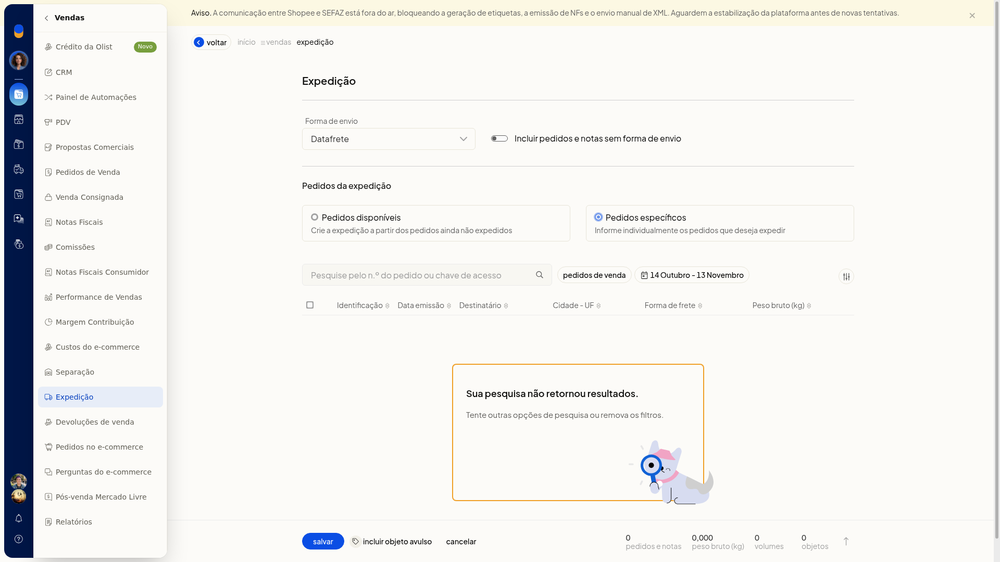

6. Clique em **Salvar**. **Cancelar** dispensa a inclusão.

### Incluir um objeto avulso

1. Dentro de **Incluir expedição**, clique em **Incluir objeto avulso**.
2. Informe a descrição, a data e o destinatário. A data usa o formato dd/mm/aaaa. O destinatário é um nome de cadastro. Se o nome não existir, a tela informa que o cadastro não foi encontrado.
3. Escolha o tipo: **Envelope**, **Pacote/Caixa** ou **Rolo/Cilindro**.
4. Informe a embalagem, a largura, o comprimento e os pesos da embalagem, líquido e bruto. Largura e comprimento são em centímetros, com vírgula decimal. Os pesos são em quilogramas, com vírgula decimal.

   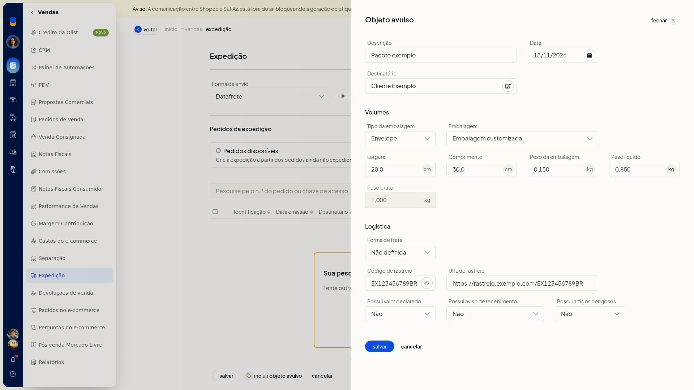

5. Defina a forma de frete, o código de rastreio, a URL de rastreio e as opções de valor declarado, AR e artigos perigosos, cada uma como sim ou não. A forma de envio acompanha a expedição. **Cancelar** fecha só esse painel e não grava o objeto.

### Imprimir a consulta

1. Na lista de expedição, ajuste a aba e os filtros.
2. Clique em **Imprimir**. Sem registros, a pré-visualização mostra o cabeçalho da empresa e a mensagem A consulta não retornou registros, tente especificar outras opções de pesquisa.

   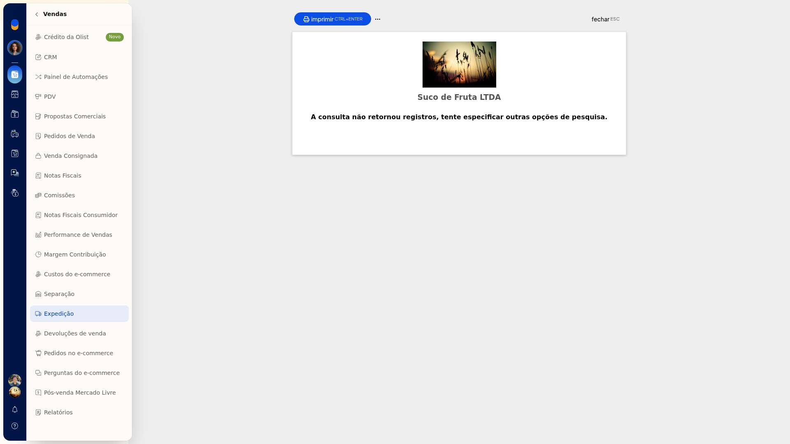

3. Feche com **Fechar**. O mesmo rótulo **Imprimir relatório** também aparece em **Mais ações**.

### Exportar os agrupamentos para planilha

1. Em **Vendas > Expedição**, abra **Mais ações**.
2. Clique em **Exportar para planilha**. A opção fica nesse menu, junto de **Imprimir relatório** e **Integrar com a Intelipost**.

   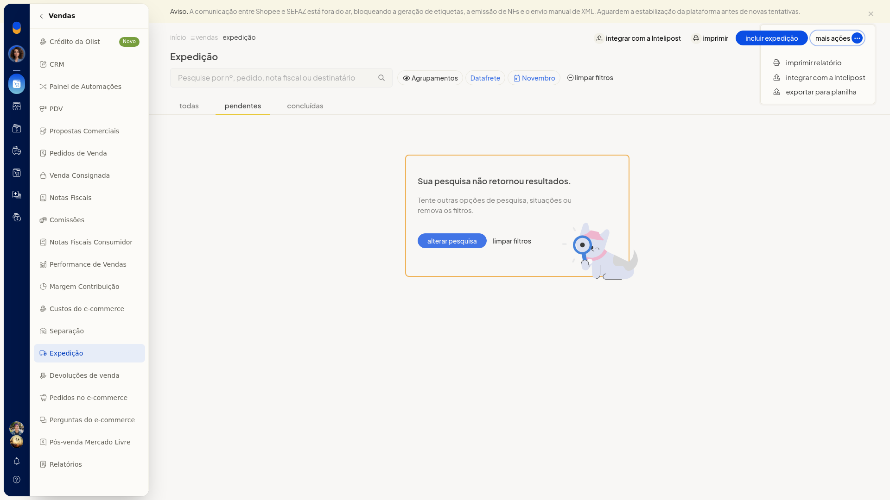

### Integrar notas com a Intelipost

1. Em **Vendas > Expedição**, clique em **Integrar com a Intelipost**. A mesma ação também está em **Mais ações**.
2. Na tela **Integrar notas fiscais com a Intelipost**, filtre por contato ou identificação, forma de envio, transportador e forma de frete.
3. Confira o resultado da pesquisa. Sem notas no filtro, a tela mostra Sua pesquisa não retornou resultados.

   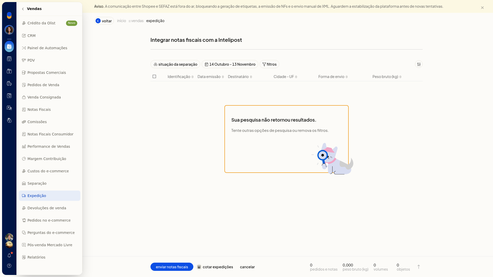

4. No rodapé, use **enviar notas fiscais** ou **cotar expedições**. **cancelar** fecha a tela sem enviar nem cotar.

   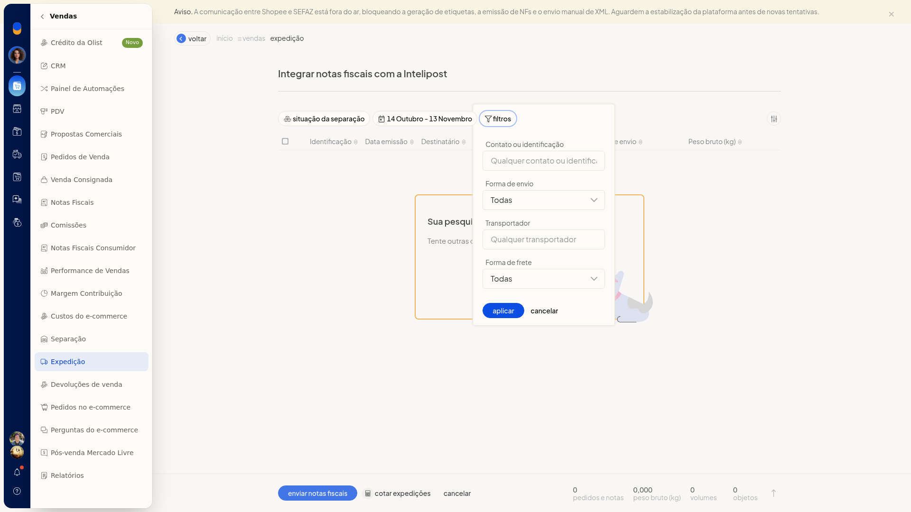

### Imprimir etiquetas, coleta e declaração de conteúdo

1. Na visão por agrupamentos, abra o menu de contexto do agrupamento.
2. Em um agrupamento de gateway, escolha a ação desejada: **Concluir expedição**, **Calcular preços e prazos**, **Imprimir etiquetas de volumes**, **Imprimir etiquetas de clientes**, **Imprimir DANFEs** (com multiempresa), **Marcar como concluída no ERP** ou **Excluir expedição**.

   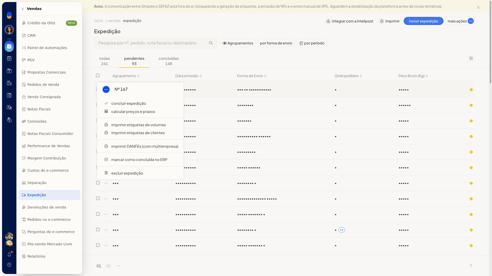

3. Em um agrupamento de transportadora com DC-e, além das ações em comum, escolha **Imprimir coleta**, **Imprimir etiquetas de transportadora**, **Imprimir declaração de conteúdo** ou **Enviar XML das notas para transportadora**.

   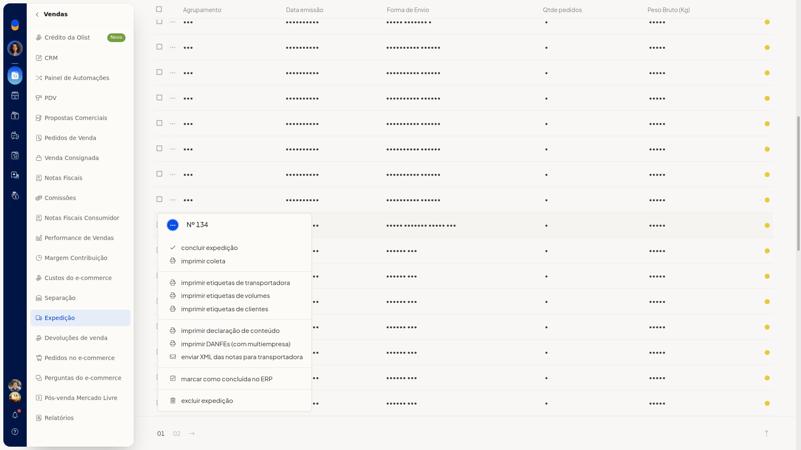

### Configurar a expedição

1. Acesse **Configurações > Configurações ERP > Vendas > Configurações da expedição**.

   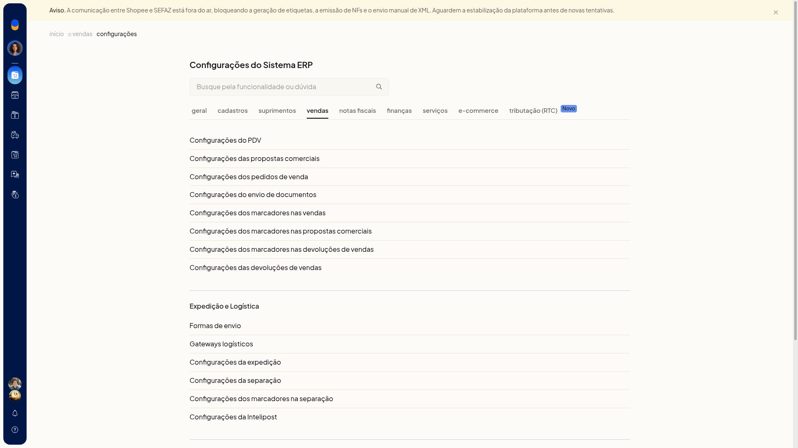

2. Em **Envio para a expedição**, escolha **Manual**, ao salvar o pedido, ao aprovar o pedido, ao salvar a nota fiscal ou **Automático ao autorizar a nota fiscal**.
3. Em **Imprimir automaticamente ao finalizar expedição**, selecione os documentos, como DANFE e etiqueta de envio.
4. Em **Valor declarado**, use o valor informado na venda e, na falta dele, o total dos produtos, ou escolha **Sem valor declarado**.

   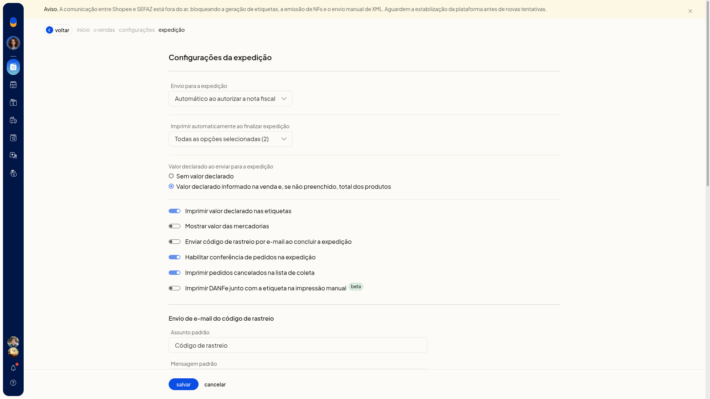

5. Ligue ou desligue **Imprimir valor declarado nas etiquetas**, **Habilitar conferência de pedidos**, **Imprimir pedidos cancelados na lista de coleta**, **Mostrar valor das mercadorias**, **Enviar código de rastreio por e-mail ao concluir** e **Imprimir DANFe junto com a etiqueta na impressão manual beta**.
6. Em **Enviar automaticamente o XML para a transportadora ao concluir a expedição**, ligue a opção se o XML deve ir para o email de NF-e do contato da transportadora.

   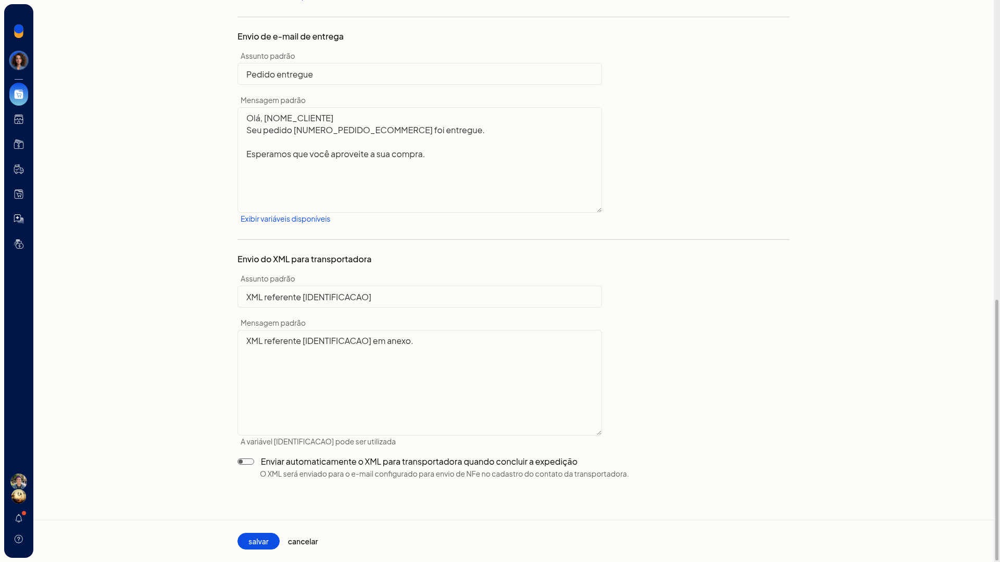

7. Revise os modelos de email de rastreio, de entrega e de XML. O modelo de entrega usa o assunto Pedido entregue, com [NOME_CLIENTE] e [NUMERO_PEDIDO_ECOMMERCE]. O modelo de XML usa o assunto XML referente [IDENTIFICACAO].

   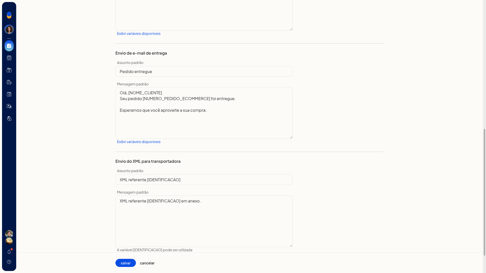

8. Clique em **Salvar**.

## Resultado
A lista de expedição mostra as abas com contagem e os agrupamentos, para você localizar o que ainda será expedido ou o que já foi concluído.

## Informações adicionais
- A visão por agrupamentos pode ser exportada para planilha a partir de **Mais ações**.
- No agrupamento você imprime etiquetas de volumes, etiquetas de clientes e DANFE, calcula preços e prazos, conclui a expedição ou marca a expedição como concluída no ERP.
- Em agrupamento de transportadora com DC-e, o menu também oferece impressão de coleta, etiquetas de transportadora, declaração de conteúdo e envio do XML das notas à transportadora.
