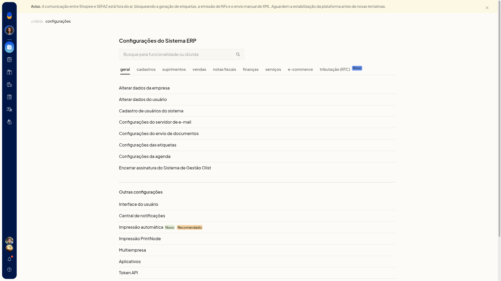
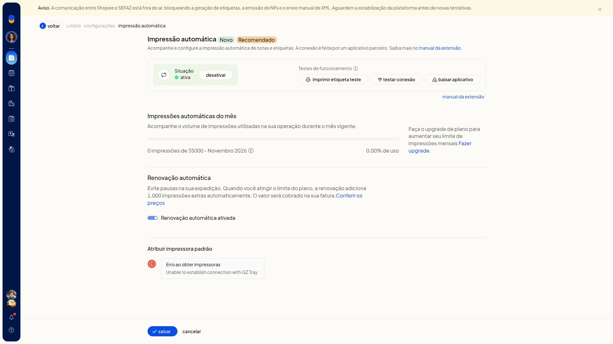
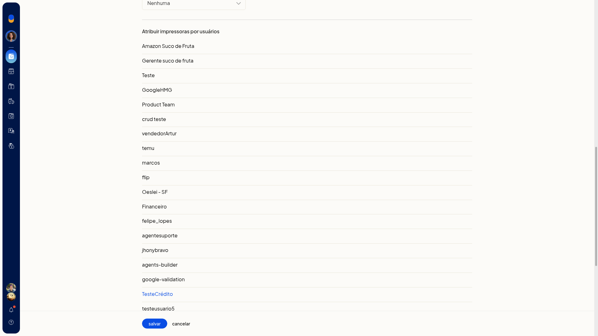
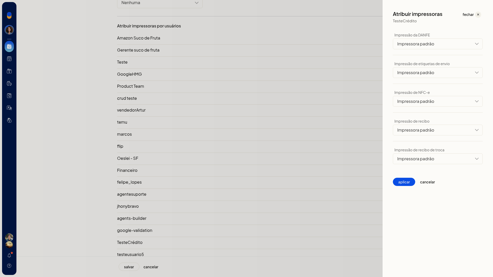

# Impressão automática e PrintNode

A impressão automática e o PrintNode, no ERP da Olist, enviam DANFE, etiqueta de envio, NFC-e e recibos direto para a impressora, sem escolher o equipamento a cada documento.

Na impressão automática, você acompanha a cota, testa a conexão e aponta a impressora padrão. No PrintNode, você informa a chave da conta e define a impressora padrão da conta ou a impressora de cada pessoa.

## Pré-requisitos
- Para a impressão automática listar as impressoras, o aplicativo de conexão (QZ Tray) precisa estar acessível.
- Para o PrintNode, tenha conta em www.printnode.com, o cliente instalado e logado nas impressoras, e a API key para colar no campo **API Key**.

## Importante
- Sem o QZ Tray, a atribuição da impressora padrão na impressão automática mostra **Erro ao obter impressoras** e **Unable to establish connection with QZ Tray**.
- No PrintNode, a etiqueta de envio sai em ZPL e exige impressora do tipo Zebra.

## Instruções
### Pela impressão automática

1. Acesse **Configurações > Configurações ERP > Geral > Impressão automática (Novo/Recomendado)**.

   

2. Confira a situação da impressão, a cota de uso e a opção **Renovação automática ativada**.
3. Se as impressoras não aparecerem, clique em **Baixar aplicativo** e deixe o QZ Tray acessível.
4. Clique em **Testar conexão**.
5. Atribua a impressora padrão. Com o QZ Tray acessível, a tela lista as impressoras. Sem ele, aparece o erro de conexão.

   

6. Clique em **Imprimir etiqueta teste** para validar a impressão.

### Pelo PrintNode

1. Acesse **Configurações > Configurações ERP > Geral > Impressão PrintNode**.
2. Crie a conta em www.printnode.com, instale o cliente e faça login nas impressoras.
3. Gere a API key no PrintNode e cole no campo **API Key**.
4. Clique em **Testar integração** para validar a conexão.
5. Em **Atribuir impressoras padrão**, selecione a impressora de cada documento. Cada lista começa em **Nenhuma**:
 - **Impressão da DANFE**
 - **Impressão de etiquetas de envio**
 - **Impressão de NFC-e**
 - **Impressão de recibo**
 - **Impressão de recibo de troca**
6. Em **Impressão de etiquetas de envio**, escolha uma impressora Zebra.
7. Para definir a impressora de uma pessoa, abra o cadastro em **Atribuir impressoras por usuários**.

   

8. Selecione **Impressora padrão** em cada uma das cinco impressões e clique em **Aplicar**.

   

9. Clique em **Salvar**. DANFE, etiqueta de envio, NFC-e e recibos passam a usar a impressora padrão da conta ou a impressora definida para cada pessoa.

## Resultado
Na impressão automática, a tela mostra a situação, a cota de uso e se a **Renovação automática ativada** está marcada. No PrintNode, os documentos ficam direcionados à impressora escolhida.

## Informações adicionais
- A tela do PrintNode tem um atalho para a impressão automática.
- As impressoras listadas no PrintNode são as que o serviço devolve, inclusive térmicas, laser e PDF.
