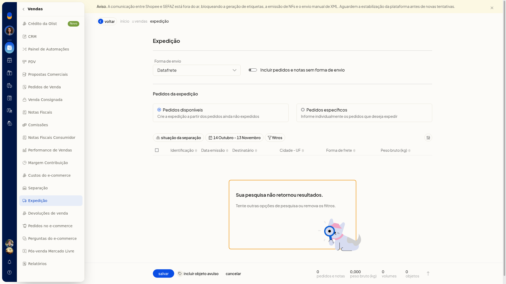
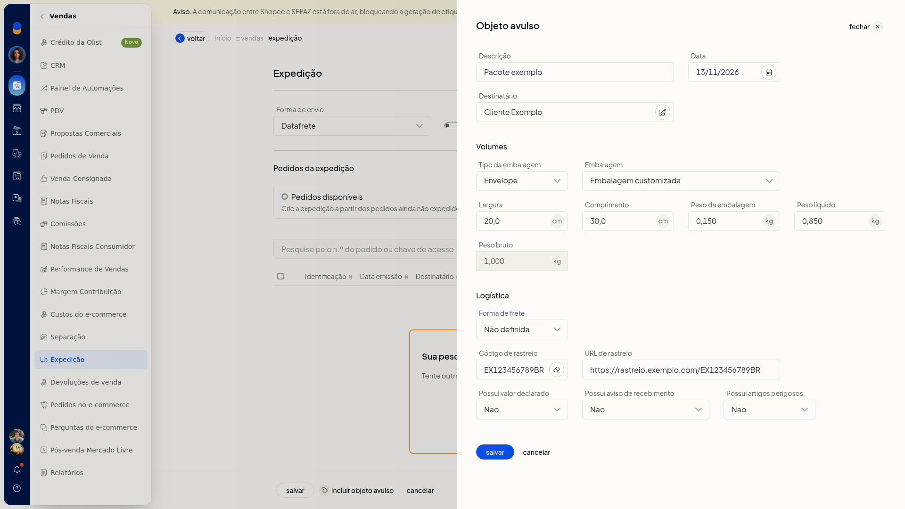

# Incluir um objeto avulso na expedição

## Pré-requisitos
- Tenha uma forma de envio já cadastrada para incluir a expedição.

## Importante
- Um nome de destinatário sem cadastro correspondente informa que o cadastro não foi encontrado.
- **Cancelar** fecha só o painel do objeto avulso e não grava o objeto.
- A forma de envio do objeto acompanha a expedição.

## Instruções
1. Acesse **Vendas > Expedição**.
2. Clique em **Incluir expedição**.
3. Confira a **Forma de envio**.

   

4. Clique em **Incluir objeto avulso**.

#### Dados do objeto

Nenhum campo desta parte é obrigatório.

5. Informe a **Descrição**.
6. Informe a **Data** no formato DD/MM/AAAA.
7. Informe o **Destinatário** com o nome do cadastro.

#### Tipo e medidas

Nenhum campo desta parte é obrigatório.

8. Escolha o **Tipo**: **Envelope**, **Pacote/Caixa** ou **Rolo/Cilindro**.
9. Informe a **Embalagem**.
10. Informe a **Largura** e o **Comprimento** em centímetros, com vírgula decimal.
11. Informe o **Peso embalagem**, o **Peso líquido** e o **Peso bruto** em quilogramas, com vírgula decimal.

#### Frete e opções

Nenhum campo desta parte é obrigatório.

12. Defina a **Forma de frete**, o **Código de rastreio** e a **URL de rastreio**. A URL é um endereço web.
13. Defina **Valor declarado**, **AR** e **Artigos perigosos** como sim ou não. A forma de envio acompanha a expedição, e o volume sem pedido vinculado fica preparado dentro dela.

   

## Resultado
O volume sem pedido vinculado fica preparado dentro da expedição.
