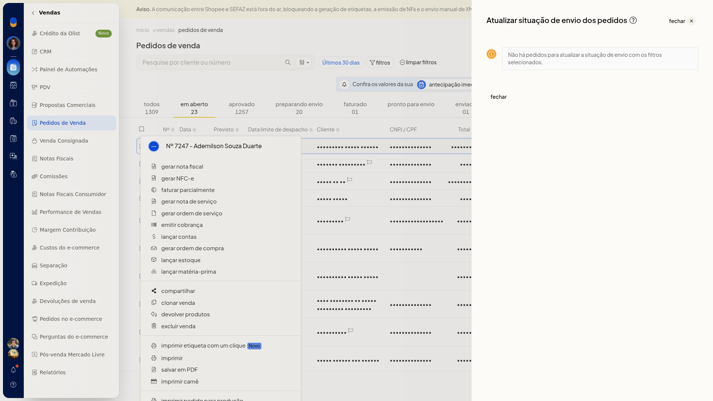

# Atualizar envio e rastreamento dos pedidos

No ERP da Olist, você atualiza a situação de envio dos pedidos a partir da lista de **Pedidos de Venda**. O painel mostra se os filtros atuais deixam algum pedido elegível, antes da confirmação.

## Importante
- O painel usa os filtros já aplicados na lista. Se nenhum pedido se encaixar, a tela indica que não há pedidos para atualizar.

## Instruções
1. Acesse **Vendas > Pedidos de Venda**.
2. Clique em **Mais ações**.
3. Clique em **Atualizar situação de envio dos pedidos**.

   

4. Confira se há pedidos elegíveis com os filtros selecionados. Se não houver pedidos para atualizar, clique em **Fechar** para voltar à lista.

## Resultado
O painel de atualização de envio abre na lista. Com os filtros da sessão, pode não haver pedidos para atualizar. **Fechar** devolve a lista de **Pedidos de Venda**.
