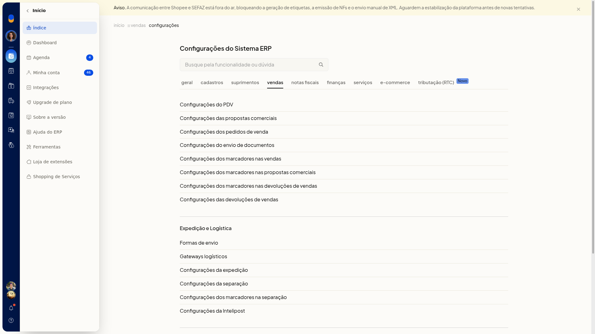
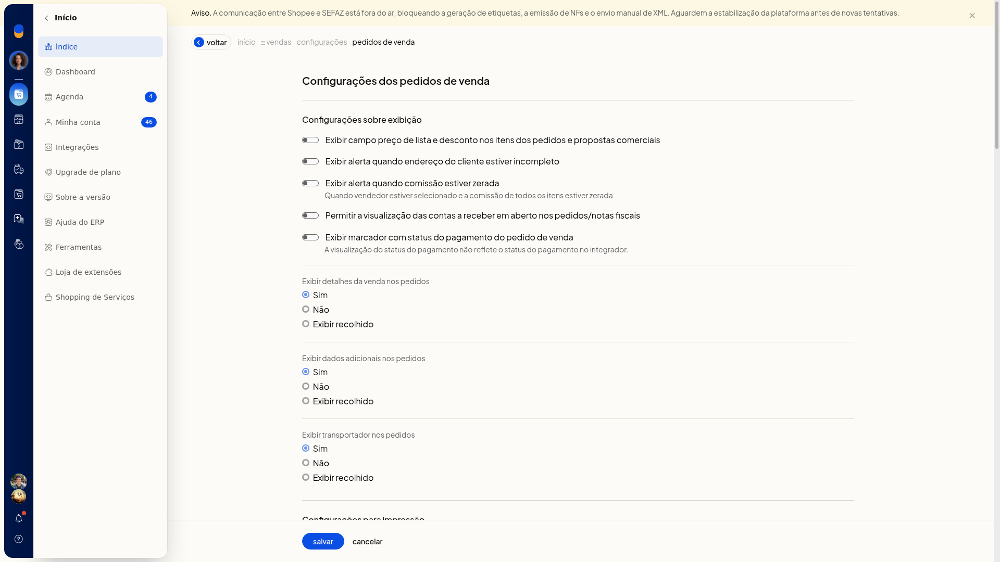
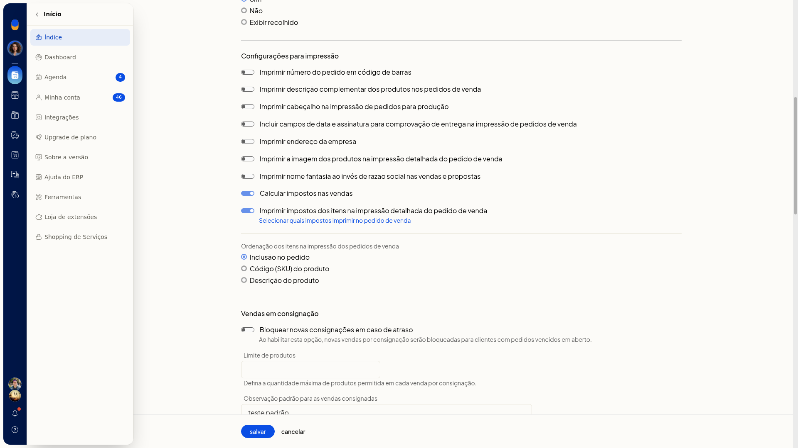
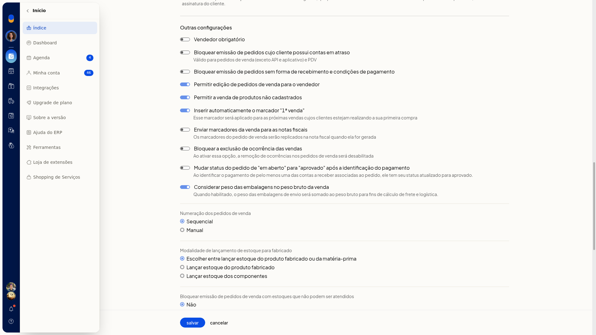
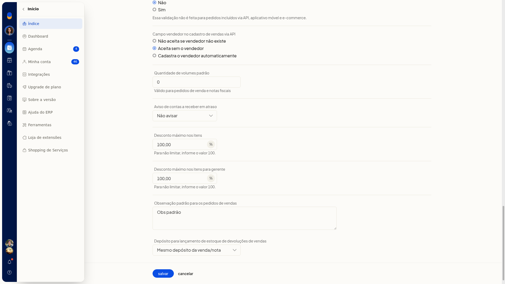

# Configurações dos pedidos de venda

No ERP da Olist, as configurações dos pedidos de venda definem como o pedido é exibido, impresso e emitido. Você ajusta exibição, impressão, consignação, numeração, estoque, descontos e regras de emissão.

O formulário fica em **Configurações > Configurações ERP > Vendas > Configurações dos pedidos de venda**.

## Importante
- Com **Bloquear emissão de pedidos de venda com estoques que não podem ser atendidos** em **Sim**, a validação não vale para pedidos incluídos via API, aplicativo móvel e ecommerce.
- Com **Bloquear emissão de pedidos cujo cliente possui contas em atraso** habilitado, a regra vale para pedidos de venda, exceto API e aplicativo, e para o PDV da Olist.
- O marcador de status do pagamento não reflete o status do pagamento no integrador.
- Para não limitar **Desconto máximo nos itens** ou **Desconto máximo nos itens para gerente**, informe 100.
- **Quantidade de volumes padrão** vale para pedidos de venda e notas fiscais.
- **Exibir alerta quando comissão estiver zerada** considera o vendedor selecionado e a comissão zerada em todos os itens.

## Instruções
1. Acesse **Configurações > Configurações ERP**.
2. Em **Vendas**, clique em **Configurações dos pedidos de venda**.

   

3. Ajuste as opções. Nenhuma delas é obrigatória.

#### Exibição

- **Exibir campo preço de lista e desconto nos itens dos pedidos e propostas comerciais**
- **Exibir alerta quando endereço do cliente estiver incompleto**
- **Exibir alerta quando comissão estiver zerada**: quando o vendedor estiver selecionado e a comissão de todos os itens estiver zerada.
- **Permitir a visualização das contas a receber em aberto nos pedidos/notas fiscais**
- **Exibir marcador com status do pagamento do pedido de venda**: a visualização não reflete o status do pagamento no integrador.
- Em **Exibir detalhes da venda nos pedidos**, **Exibir dados adicionais nos pedidos** e **Exibir transportador nos pedidos**, escolha **Sim**, **Não** ou **Exibir recolhido**.

#### Impressão

- **Imprimir número do pedido em código de barras**
- **Imprimir descrição complementar dos produtos nos pedidos de venda**
- **Imprimir cabeçalho na impressão de pedidos para produção**
- **Incluir campos de data e assinatura para comprovação de entrega na impressão de pedidos de venda**
- **Imprimir endereço da empresa**
- **Imprimir a imagem dos produtos na impressão detalhada do pedido de venda**
- **Imprimir nome fantasia ao invés de razão social nas vendas e propostas**
- **Calcular impostos nas vendas**
- **Imprimir impostos dos itens na impressão detalhada do pedido de venda**: selecione quais impostos imprimir no pedido de venda.
- Em **Ordenação dos itens na impressão dos pedidos de venda**, escolha **Inclusão no pedido**, **Código (SKU) do produto** ou **Descrição do produto**.

#### Consignação

- **Bloquear novas consignações em caso de atraso**: novas vendas por consignação ficam bloqueadas para clientes com pedidos vencidos em aberto.
- **Limite de produtos**: quantidade máxima de produtos em cada venda por consignação.
- **Observação padrão para as vendas consignadas**: preenche **Observações** de cada nova venda consignada e sai no comprovante, acima da assinatura.

#### Emissão

- **Vendedor obrigatório**
- **Bloquear emissão de pedidos cujo cliente possui contas em atraso**: vale para pedidos de venda, exceto API e aplicativo, e para o PDV da Olist.
- **Bloquear emissão de pedidos sem forma de recebimento e condições de pagamento**
- **Permitir edição de pedidos de venda para o vendedor**
- **Permitir a venda de produtos não cadastrados**
- **Inserir automaticamente o marcador "1ª venda"**: aplicado nas próximas vendas em que o cliente faz a primeira compra.
- **Enviar marcadores da venda para as notas fiscais**: os marcadores do pedido são replicados na nota fiscal quando ela é gerada.
- **Bloquear a exclusão de ocorrência das vendas**: a remoção de ocorrências nos pedidos de venda fica desabilitada.
- **Mudar status do pedido de "em aberto" para "aprovado" após a identificação do pagamento**: ao identificar o pagamento de pelo menos uma conta a receber do pedido, o status vai para aprovado.
- **Considerar peso das embalagens no peso bruto da venda**: soma o peso das embalagens de envio ao peso bruto para frete e logística.

#### Numeração e estoque

- Em **Numeração dos pedidos de venda**, escolha **Sequencial** ou **Manual**.
- Em **Modalidade de lançamento de estoque para fabricado**, escolha entre produto fabricado ou matéria-prima: lançar estoque do produto fabricado ou lançar estoque dos componentes.
- Em **Bloquear emissão de pedidos de venda com estoques que não podem ser atendidos**, escolha **Não** ou **Sim**. Essa validação não é feita para pedidos incluídos via API, aplicativo móvel e ecommerce.

#### Volumes, descontos e devolução

- Em **Campo vendedor no cadastro de vendas via API**, escolha **Não aceita se vendedor não existe**, **Aceita sem o vendedor** ou **Cadastra o vendedor automaticamente**.
- Informe **Quantidade de volumes padrão**. O valor vale para pedidos de venda e notas fiscais.
- Em **Aviso de contas a receber em atraso**, escolha **Não avisar** ou **Avisar a partir de 1 a 10 dias**.
- Informe **Desconto máximo nos itens** e **Desconto máximo nos itens para gerente** em percentual. Para não limitar, informe 100.
- Preencha **Observação padrão para os pedidos de vendas**.
- Em **Depósito para lançamento de estoque de devoluções de vendas**, escolha **Mesmo depósito da venda/nota** ou um depósito da empresa.

4. Clique em **Salvar** para gravar as regras dos pedidos de venda.
