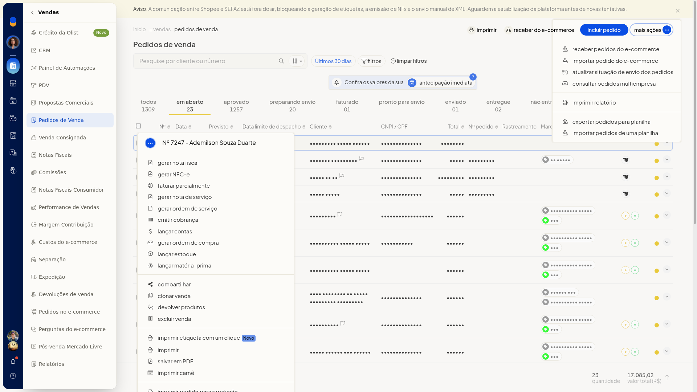

# Fluxo e situações dos pedidos

Em **Pedidos de Venda**, no ERP da Olist, você acompanha em que situação cada pedido está e muda essa situação quando o andamento muda. A lista separa os pedidos por situação e mostra a quantidade em cada aba.

Se **Pedidos de Venda** não aparecer para você, peça acesso ao administrador da conta.

## Instruções
1. Acesse **Vendas > Pedidos de Venda**.
2. Clique na aba da situação que você quer acompanhar. As abas da barra são **Todos**, **Em aberto**, **Aprovado**, **Preparando envio**, **Faturado**, **Pronto para envio**, **Enviado**, **Entregue** e **Não entregue**. No final da barra aparecem **Dados incompletos**, **Em devolução** e **Cancelado**. Cada aba mostra a quantidade de pedidos.
3. Na lista, abra o menu **•••** do pedido.

   

4. Em **Alterar situação**, clique na nova situação. As opções são **Em aberto**, **Aprovado**, **Preparando envio**, **Faturado**, **Pronto para envio**, **Enviado**, **Entregue**, **Não entregue**, **Dados incompletos**, **Em devolução** e **Cancelado**. A situação atual do pedido fica marcada nesse menu.

## Resultado
A aba escolhida destaca os pedidos daquela situação e mostra a quantidade. Em **Alterar situação**, a situação ativa do pedido fica marcada.

## Informações adicionais
### A situação pode ir para aprovado depois do pagamento

Se **Mudar status do pedido de "em aberto" para "aprovado" após a identificação do pagamento** estiver habilitada em **Configurações > Configurações ERP > Vendas > Configurações dos pedidos de venda**, a situação passa de **Em aberto** para **Aprovado** quando o pagamento de pelo menos uma conta a receber do pedido é identificado.
