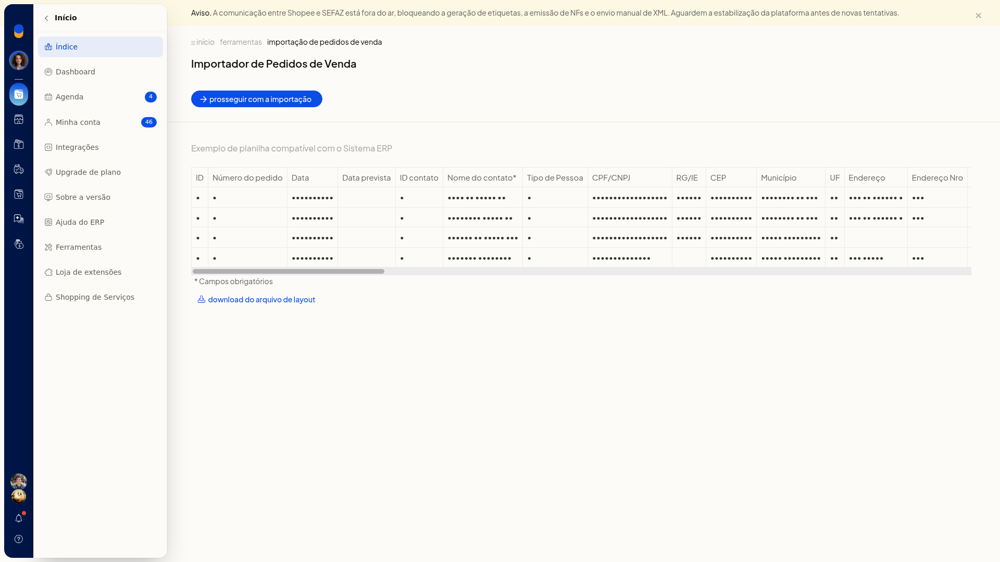
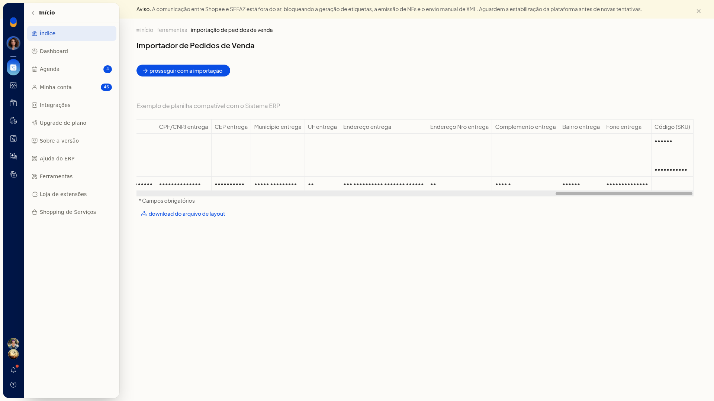

# Importar pedidos de venda de uma planilha

No ERP da Olist, você inclui pedidos de venda a partir de uma planilha. O layout fica no **Importador de Pedidos de Venda**, em **Vendas > Pedidos de Venda**.

## Pré-requisitos
- Se **Importar pedidos de uma planilha** não aparecer em **Mais ações**, peça acesso ao administrador da conta.

## Importante
- Baixe o layout na própria tela do importador antes de preencher a planilha.
- A coluna **Nome do contato** é obrigatória.

## Instruções
1. Acesse **Vendas > Pedidos de Venda**.
2. Clique em **Mais ações**.
3. Clique em **Importar pedidos de uma planilha**.
4. Clique em **Download do arquivo de layout**.

   

5. Preencha a planilha com as colunas do layout. A coluna **Nome do contato** é obrigatória.
 - **ID**
 - **Número do pedido**
 - **Data**
 - **Data prevista**
 - **ID contato**
 - **Nome do contato**
 - **Tipo de Pessoa**
 - **CPF/CNPJ**
 - **RG/IE**
 - **CEP**
 - **Município**
 - **UF**
 - **Endereço**
 - **Endereço Nro**
 - **Complemento**
 - **Bairro**
 - **Fone**
 - **Celular**
 - **e-mail**
 - **Desconto pedido (% ou valor)**
 - **Frete**
 - **Observações**
 - **Situação**
 - **ID produto**
 - **Descrição**
 - **Quantidade**
 - **Valor unitário**
 - **Desconto item %**
 - **Código de rastreamento**
 - **Número da ordem de compra**
 - **Vendedor**
 - **Despesas**
 - **Desconto do pedido rateado**
 - **Frete pedido rateado**
 - **Despesas pedido rateado**
 - **Destinatário**
 - **CPF/CNPJ entrega**
 - **CEP entrega**
 - **Município entrega**
 - **UF entrega**
 - **Endereço entrega**
 - **Endereço Nro entrega**
 - **Complemento entrega**
 - **Bairro entrega**
 - **Fone entrega**
 - **Código (SKU)**

   

6. Clique em **Prosseguir com a importação**.
