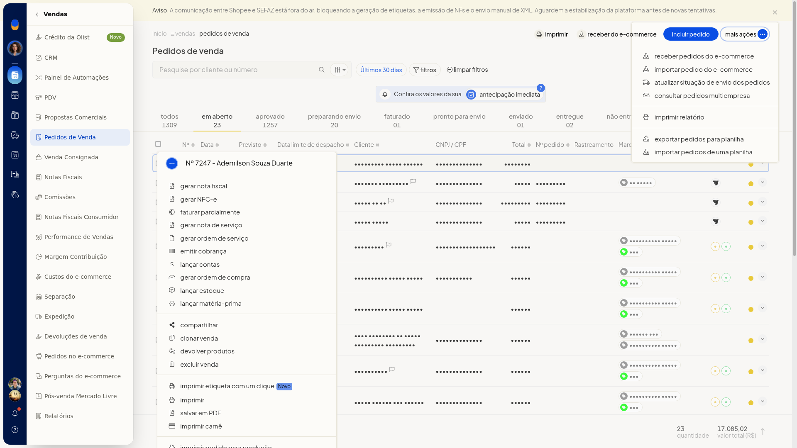
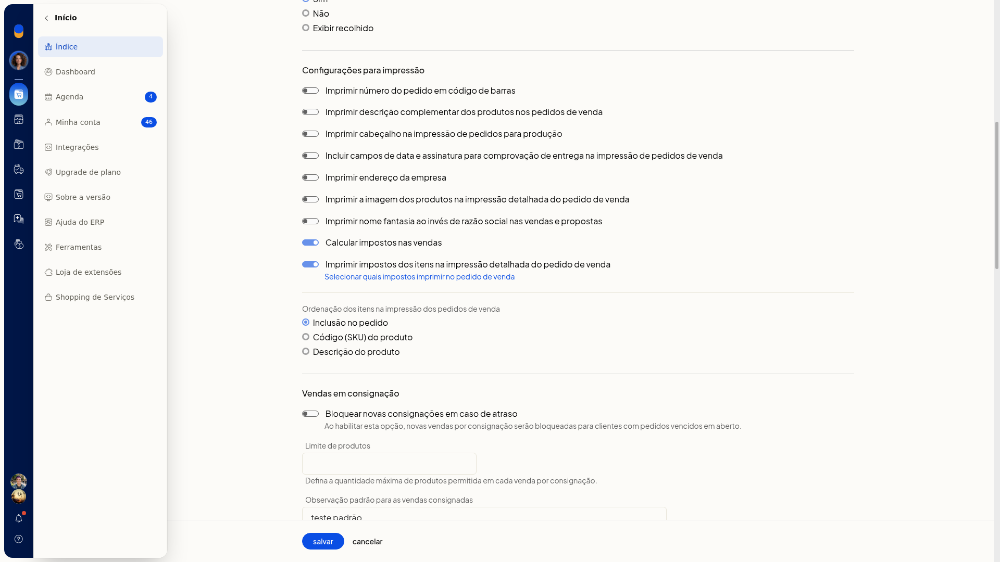

# Imprimir o pedido de venda

No ERP da Olist, você imprime o pedido de venda a partir da lista de pedidos. No menu do pedido, também dá para salvar o pedido em PDF, imprimir o carnê, imprimir o pedido para produção e imprimir a etiqueta com um clique.

## Instruções
1. Acesse **Vendas > Pedidos de Venda**.
2. Localize o pedido na lista.
3. Abra o menu **•••** desse pedido.

   

4. Clique em **Imprimir**, **Salvar em PDF**, **Imprimir carnê**, **Imprimir pedido para produção** ou **Imprimir etiqueta com um clique**.

## Informações adicionais
### A impressão segue as opções dos pedidos de venda

Em **Configurações > Configurações ERP > Vendas > Configurações dos pedidos de venda**, estas opções definem o que entra na impressão:

- **Imprimir número do pedido em código de barras**
- **Imprimir descrição complementar dos produtos nos pedidos de venda**
- **Imprimir cabeçalho na impressão de pedidos para produção**
- **Incluir campos de data e assinatura para comprovação de entrega na impressão de pedidos de venda**
- **Imprimir endereço da empresa**
- **Imprimir a imagem dos produtos na impressão detalhada do pedido de venda**
- **Imprimir nome fantasia ao invés de razão social nas vendas e propostas**
- **Calcular impostos nas vendas**
- **Imprimir impostos dos itens na impressão detalhada do pedido de venda**: selecione quais impostos imprimir no pedido de venda
- **Ordenação dos itens na impressão dos pedidos de venda**: **Inclusão no pedido**, **Código (SKU) do produto** ou **Descrição do produto**

