# Pedidos de venda: incluir, filtrar e gerenciar

Em **Pedidos de Venda**, no ERP da Olist, você inclui um pedido, filtra a lista e acompanha a situação. A partir do pedido, você gera nota, estoque, cobrança e impressão e atualiza o envio.

A inclusão também pode começar por planilha ou pelo ecommerce. Exibição, impressão, numeração, estoque, desconto e regras de emissão ficam em **Configurações dos pedidos de venda**.

## Pré-requisitos
- Se alguma opção não aparecer para você, peça acesso ao administrador da conta.

## Importante
- Vendedor, lista de preço, depósito, forma de recebimento e lojas de ecommerce vêm dos cadastros da empresa.
- Na planilha, a coluna **Nome do contato** é obrigatória.
- Com **Vendedor obrigatório** ativo, o vendedor passa a ser exigido no pedido.
- Com o bloqueio de emissão sem forma de recebimento ativo, o pedido exige forma de recebimento e condições de pagamento.

## Instruções
### Incluir pedido pela tela

1. Acesse **Vendas > Pedidos de Venda**.
2. Clique em **Incluir pedido**.
3. Preencha **Cliente**, **Vendedor** e **Lista de preço**. A tela pode já trazer **Número**, **Natureza da operação**, **Data da venda** e **Observações**. Use o controle de endereço de entrega diferente quando o destino não for o do cliente.

   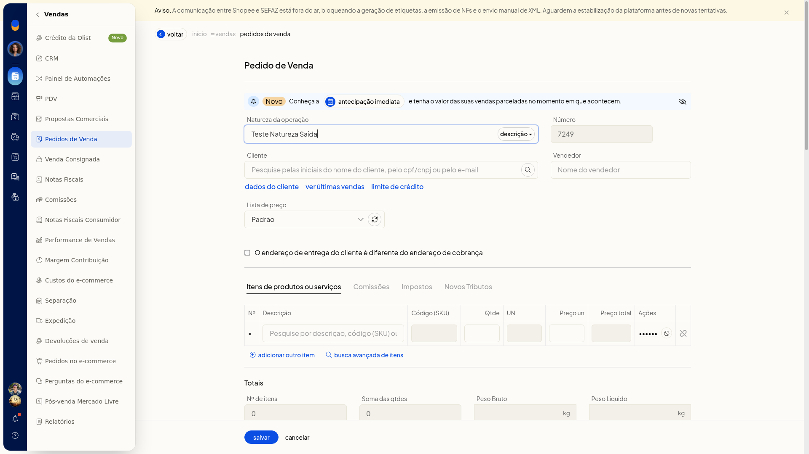

4. Informe os itens em **Descrição do item**, **Quantidade** e **Valor unitário**. Quantidade e valor unitário usam vírgula decimal. A tela mostra número de itens, soma das quantidades, peso bruto, peso líquido e os totais de IPI, ICMS ST + FCP ST, ICMS + FCP, PIS, COFINS, Difal, IBS estadual, IBS municipal, IBS total, CBS, total dos produtos e total da venda. Use **adicionar outro item** ou a **busca avançada** para incluir mais produtos.

   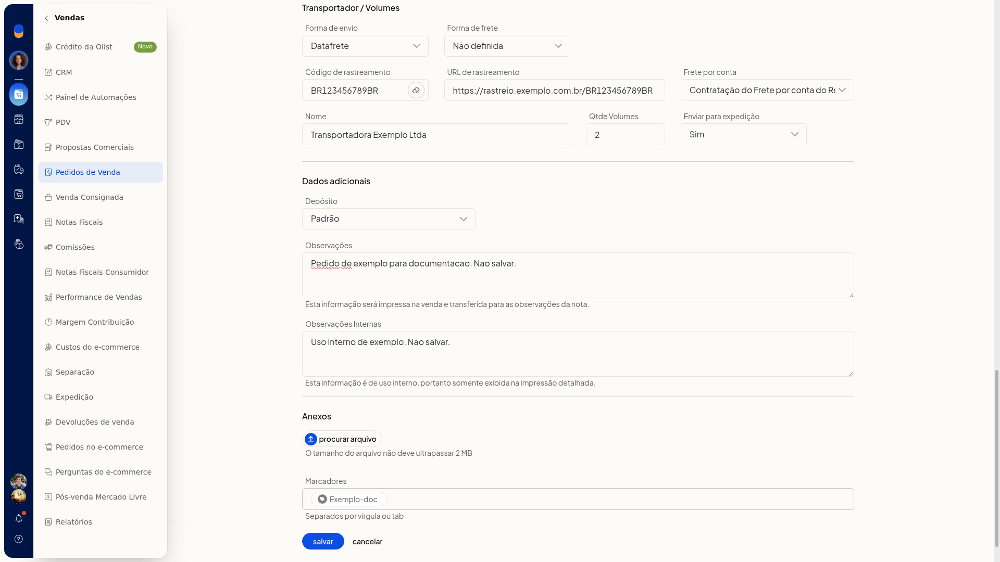

5. Complete **Data da venda**, **Data prevista de entrega**, **Data de envio**, **Data máxima de despacho**, **Nº do pedido**, **Identificador do pedido e-commerce**, **Nº no canal**, **Desconto**, **Frete do cliente**, **Frete da empresa** e **Despesas**. Em **Desconto**, use valor como 3,00 ou percentual como 10%. Frete e despesas usam vírgula decimal.
6. Em recebimento, preencha **Forma de recebimento**, **Meio**, **Gateway**, **Categoria** e **Condição de pagamento**. Use **gerar parcelas** se quiser montar as parcelas. Há também o controle **Sem intermediador**.
7. Em envio, preencha **Forma de envio**, **Forma de frete**, **Frete por conta**, **Nome do transportador**, **Código de rastreamento**, **URL de rastreamento**, **Quantidade de volumes**, **Enviar para expedição** e **Depósito**.
8. Preencha **Observações**, **Observações internas** e **Marcadores**. A tela também oferece **dados do cliente**, **ver últimas vendas** e **limite de crédito**.

   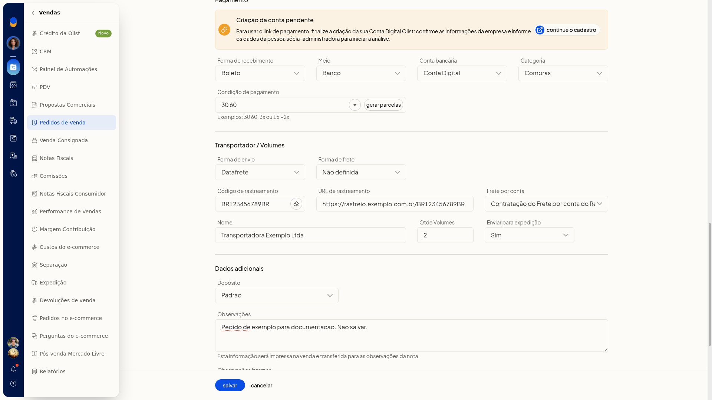

9. Clique em **Salvar** para gravar o pedido. **Cancelar** descarta a inclusão. O pedido fica com os totais calculados na tela.

### Filtrar pedidos na lista

1. Acesse **Vendas > Pedidos de Venda**.
2. Escolha a aba de situação: **Todos**, **Em aberto**, **Aprovado**, **Preparando envio**, **Faturado**, **Pronto para envio**, **Enviado**, **Entregue** ou **Não entregue**. No excedente da barra estão **Dados incompletos**, **Em devolução** e **Cancelado**. Cada aba mostra a quantidade.
3. Use a busca e o período.
4. Abra os filtros e preencha o que precisar:
 - **Vendedor**
 - **Marcador**, com **Sem filtro por marcador** e os marcadores da empresa, entre eles **1ª venda**
 - **E-commerce**, com **Selecione**, **Sem vínculo**, plataformas como Tray, VTEX, Dooca, Cartpanda, Yampi, Nuvemshop, Loja Integrada, Wix, Shopify, Shein, Amazon e Shopee, e as lojas da empresa
 - **Forma de recebimento da venda**
 - **Forma de envio**, com a opção **Todas**
 - **Produto**
 - **Estados**, com UF de AC a TO e EX
 - **Cidade**
5. Clique em **Aplicar**. A lista mostra só os pedidos da situação, do período e dos filtros escolhidos. **Cancelar** fecha o painel sem aplicar. Na lista também há **limpar filtros**.

   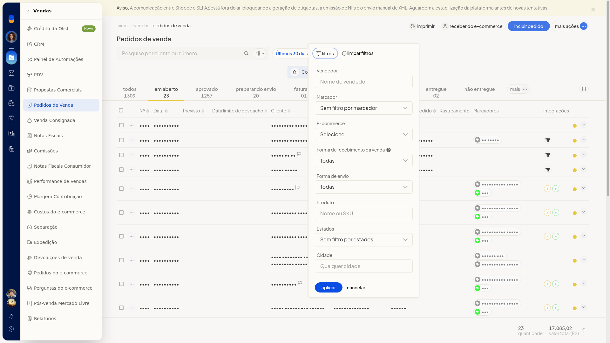

### Usar as ações do pedido

1. Acesse **Vendas > Pedidos de Venda**.
2. Localize o pedido.
3. Abra o menu **•••** desse pedido.

   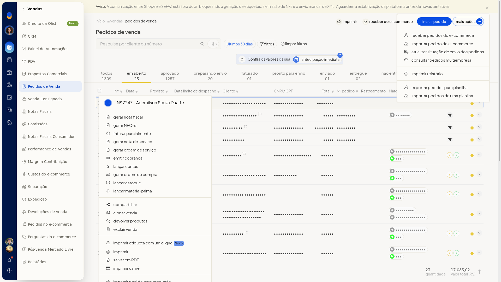

4. Escolha a ação. O menu traz **Gerar nota fiscal**, **Gerar NFC-e**, **Faturar parcialmente**, **Gerar nota de serviço**, **Gerar ordem de serviço**, **Emitir cobrança**, **Lançar contas**, **Gerar ordem de compra**, **Lançar estoque**, **Lançar matéria-prima**, **Compartilhar**, **Clonar venda**, **Devolver produtos**, **Excluir venda**, **Imprimir etiqueta com um clique**, **Imprimir**, **Salvar em PDF**, **Imprimir carnê**, **Imprimir pedido para produção** e **Alterar situação**. Você vê o que pode gerar, lançar ou imprimir antes de confirmar.

### Alterar a situação do pedido

1. Acesse **Vendas > Pedidos de Venda**.
2. Abra o menu **•••** do pedido.
3. Em **Alterar situação**, selecione a nova situação nos pontos coloridos: **Em aberto**, **Aprovado**, **Preparando envio**, **Faturado**, **Pronto para envio**, **Enviado**, **Entregue**, **Não entregue**, **Dados incompletos**, **Em devolução** ou **Cancelado**. A escolha fica no próprio menu, antes de confirmar a mudança.

### Importar pedidos de uma planilha

1. Acesse **Vendas > Pedidos de Venda**.
2. Abra **Mais ações**.
3. Clique em **Importar pedidos de uma planilha**.
4. Em **Importador de Pedidos de Venda**, clique em **Download do arquivo de layout**.

   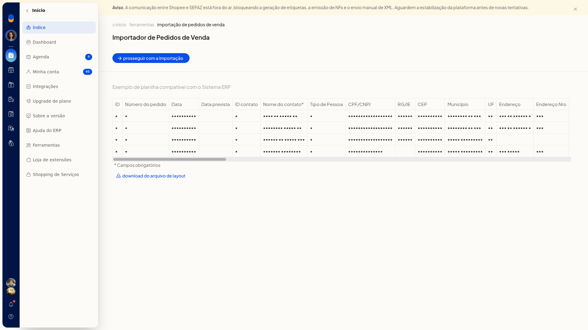

5. Preencha a planilha. A coluna **Nome do contato** é obrigatória. As demais colunas do layout são: **ID**, **Número do pedido**, **Data**, **Data prevista**, **ID contato**, **Tipo de Pessoa**, **CPF/CNPJ**, **RG/IE**, **CEP**, **Município**, **UF**, **Endereço**, **Endereço Nro**, **Complemento**, **Bairro**, **Fone**, **Celular**, **e-mail**, **Desconto pedido (% ou valor)**, **Frete**, **Observações**, **Situação**, **ID produto**, **Descrição**, **Quantidade**, **Valor unitário**, **Desconto item %**, **Código de rastreamento**, **Número da ordem de compra**, **Vendedor**, **Despesas**, **Desconto do pedido rateado**, **Frete pedido rateado**, **Despesas pedido rateado**, **Destinatário**, **CPF/CNPJ entrega**, **CEP entrega**, **Município entrega**, **UF entrega**, **Endereço entrega**, **Endereço Nro entrega**, **Complemento entrega**, **Bairro entrega**, **Fone entrega** e **Código (SKU)**.

   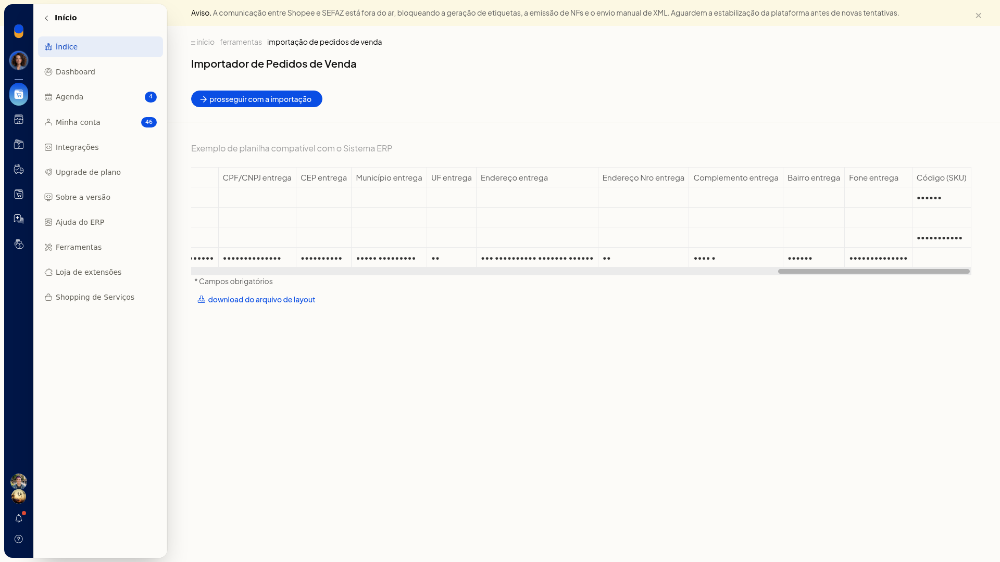

6. Clique em **Prosseguir com a importação** para enviar a planilha preenchida.

### Receber pedidos do ecommerce

1. Acesse **Vendas > Pedidos de Venda**.
2. Clique em **Receber do e-commerce** ou em **Mais ações > Receber pedidos do e-commerce**.
3. Na tela **Pedidos no e-commerce**, use a busca de pedido, que inclui a plataforma.

   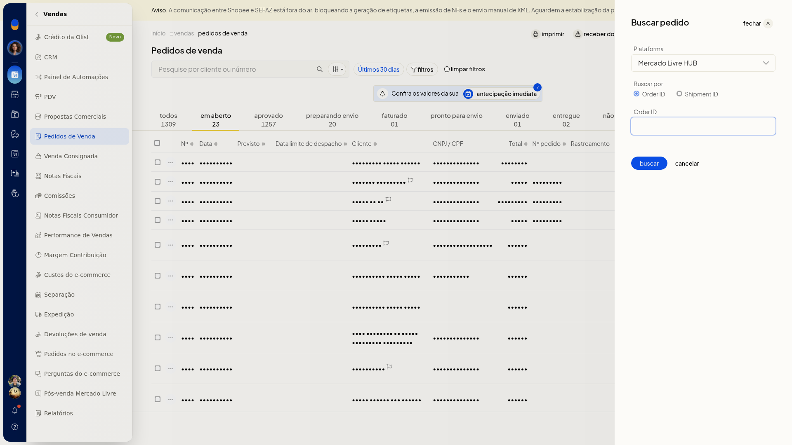

4. Clique em **Ações > Iniciar recebimento** para começar o recebimento.

### Importar um pedido do ecommerce

1. Acesse **Vendas > Pedidos de Venda**.
2. Abra **Mais ações**.
3. Clique em **Importar pedido do e-commerce**. O caminho da importação de um pedido fica nesse menu.

### Atualizar a situação de envio

1. Acesse **Vendas > Pedidos de Venda**.
2. Abra **Mais ações**.
3. Clique em **Atualizar situação de envio dos pedidos**. A tela indica se os filtros atuais deixam algum pedido elegível.

   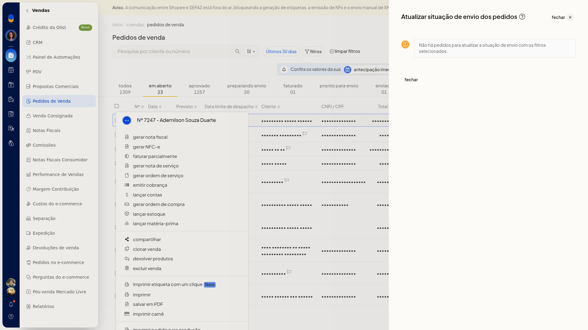

4. Clique em **Fechar** para voltar à lista quando não houver pedido para atualizar.

### Exportar pedidos para planilha

1. Acesse **Vendas > Pedidos de Venda**.
2. Abra **Mais ações**.
3. Clique em **Exportar pedidos para planilha**.

### Imprimir relatório e consultar multiempresa

1. Acesse **Vendas > Pedidos de Venda**.
2. Abra **Mais ações**.
3. Clique em **Imprimir relatório** ou em **Consultar pedidos multiempresa**. A barra da lista também tem **Imprimir**.

### Configurar os pedidos de venda

1. Acesse **Configurações > Configurações ERP**.
2. Em **Vendas**, abra **Configurações dos pedidos de venda**.

   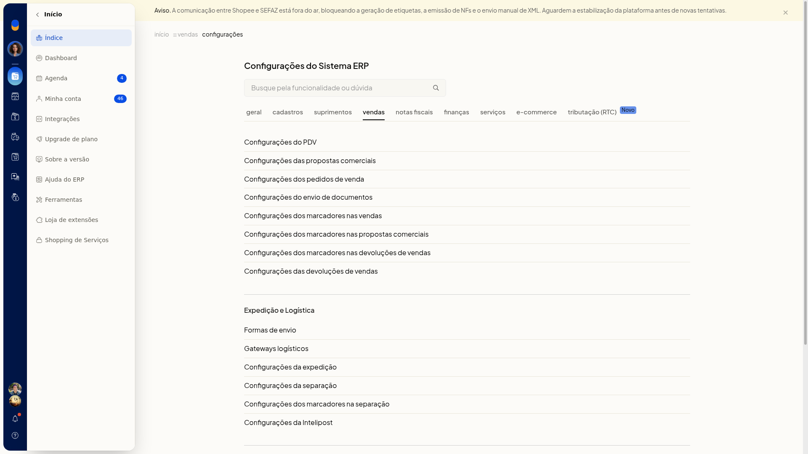

3. Em exibição, ajuste:
 - **Exibir campo preço de lista e desconto nos itens dos pedidos e propostas comerciais**
 - **Exibir alerta quando endereço do cliente estiver incompleto**
 - **Exibir alerta quando comissão estiver zerada**, quando o vendedor estiver selecionado e a comissão de todos os itens estiver zerada
 - **Permitir a visualização das contas a receber em aberto nos pedidos/notas fiscais**
 - **Exibir marcador com status do pagamento do pedido de venda**
 - **Exibir detalhes da venda nos pedidos**, **Exibir dados adicionais nos pedidos** e **Exibir transportador nos pedidos**, em **Sim**, **Não** ou **Exibir recolhido**

   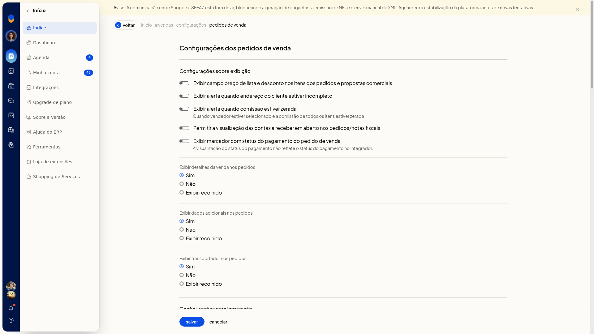

4. Em impressão, ajuste **Imprimir número do pedido em código de barras**, **Imprimir descrição complementar dos produtos nos pedidos de venda**, **Imprimir cabeçalho na impressão de pedidos para produção**, **Incluir campos de data e assinatura para comprovação de entrega na impressão de pedidos de venda**, **Imprimir endereço da empresa**, **Imprimir a imagem dos produtos na impressão detalhada do pedido de venda**, **Imprimir nome fantasia ao invés de razão social nas vendas e propostas**, **Calcular impostos nas vendas** e **Imprimir impostos dos itens na impressão detalhada do pedido de venda**. Nesse último, selecione quais impostos imprimir. Em **Ordenação dos itens na impressão dos pedidos de venda**, escolha **Inclusão no pedido**, **Código (SKU) do produto** ou **Descrição do produto**.

   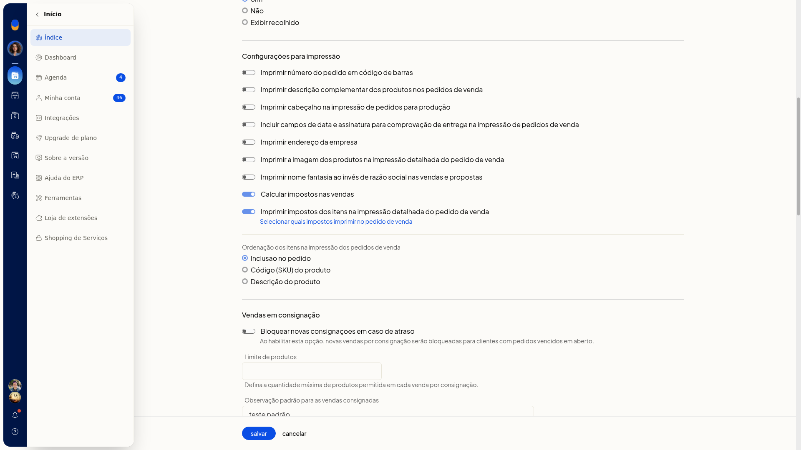

5. Em consignação, ajuste **Bloquear novas consignações em caso de atraso**, **Limite de produtos** e **Observação padrão para as vendas consignadas**. O bloqueio impede nova consignação para clientes com pedidos vencidos em aberto. O limite é a quantidade máxima de produtos em cada venda por consignação. A observação padrão preenche **Observações** da nova venda consignada e sai no comprovante, acima da assinatura.
6. Ajuste as outras regras: **Vendedor obrigatório**, **Bloquear emissão de pedidos cujo cliente possui contas em atraso**, **Bloquear emissão de pedidos sem forma de recebimento e condições de pagamento**, **Permitir edição de pedidos de venda para o vendedor**, **Permitir a venda de produtos não cadastrados**, **Inserir automaticamente o marcador "1ª venda"**, **Enviar marcadores da venda para as notas fiscais**, **Bloquear a exclusão de ocorrência das vendas**, **Mudar status do pedido de "em aberto" para "aprovado" após a identificação do pagamento** e **Considerar peso das embalagens no peso bruto da venda**.

   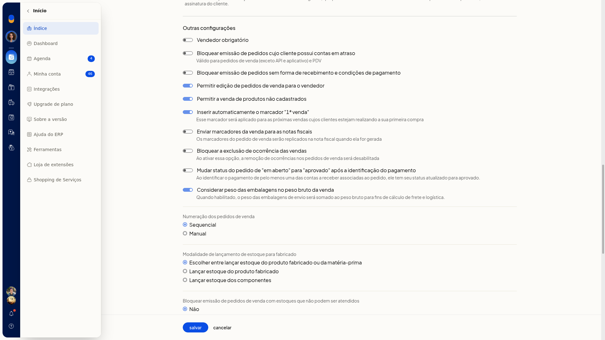

7. Em **Numeração dos pedidos de venda**, escolha **Sequencial** ou **Manual**. Em **Modalidade de lançamento de estoque para fabricado**, escolha entre produto fabricado ou matéria-prima, lançar estoque do produto fabricado, ou lançar estoque dos componentes. Em **Bloquear emissão de pedidos de venda com estoques que não podem ser atendidos**, escolha **Não** ou **Sim**.
8. Em **Campo vendedor no cadastro de vendas via API**, escolha **Não aceita se vendedor não existe**, **Aceita sem o vendedor** ou **Cadastra o vendedor automaticamente**.
9. Informe **Quantidade de volumes padrão**, **Aviso de contas a receber em atraso**, **Desconto máximo nos itens**, **Desconto máximo nos itens para gerente**, **Observação padrão para os pedidos de vendas** e **Depósito para lançamento de estoque de devoluções de vendas**. O aviso pode ficar em **Não avisar** ou **Avisar a partir de 1 a 10 dias**. O depósito oferece **Mesmo depósito da venda/nota** e os depósitos da empresa.

   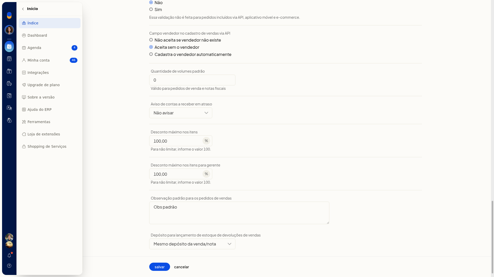

10. Clique em **Salvar** para gravar as regras. **Cancelar** descarta a alteração.

## Resultado
A lista de **Pedidos de Venda** reúne as abas de situação, a busca, o período e as ações **Incluir pedido**, **Receber do e-commerce**, **Imprimir** e **Mais ações**. No menu do pedido ficam as ações fiscais, de estoque, de impressão e os pontos de **Alterar situação**.

## Informações adicionais
- O marcador **1ª venda** entra nas próximas vendas em que o cliente faz a primeira compra.
- Os marcadores do pedido são replicados na nota fiscal quando ela é gerada, se o envio de marcadores estiver ativo.
- Com o bloqueio de exclusão de ocorrência ativo, a remoção de ocorrências nos pedidos fica desabilitada.
- Ao identificar o pagamento de pelo menos uma conta a receber do pedido, o status pode ir de em aberto para aprovado.
- O peso das embalagens de envio entra no peso bruto usado no frete e na logística, quando essa opção está ativa.
- A quantidade de volumes padrão vale para pedidos de venda e notas fiscais.
- Para não limitar **Desconto máximo nos itens** ou **Desconto máximo nos itens para gerente**, informe 100.
- O marcador de status do pagamento não reflete o status do pagamento no integrador.
- A validação de estoque que não pode ser atendido não é feita para pedidos incluídos via API, aplicativo móvel e ecommerce.
- O bloqueio por contas em atraso, quando habilitado, vale para pedidos de venda, exceto API e aplicativo, e para o PDV da Olist.
