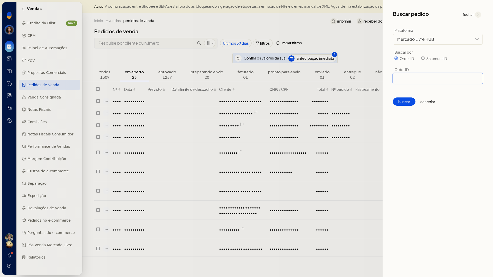

# Receber pedidos de venda do e-commerce

No ERP da Olist, você traz para **Pedidos de Venda** os pedidos que já estão no ecommerce. Na tela **Pedidos no e-commerce**, você busca o pedido pela plataforma e inicia o recebimento.

## Pré-requisitos
- Se **Receber do e-commerce** não aparecer, peça acesso ao administrador da conta. O recebimento também depende da importação de pedidos estar liberada para a empresa.

## Instruções
1. Acesse **Vendas > Pedidos de Venda**.
2. Clique em **Receber do e-commerce**. Você também pode abrir **Mais ações** e clicar em **Receber pedidos do e-commerce**.
3. Na tela **Pedidos no e-commerce**, busque o pedido. A busca inclui a plataforma.

   

4. Em **Ações**, clique em **Iniciar recebimento**.

## Informações adicionais
- A validação de estoque que não pode ser atendido não é feita para pedidos incluídos pelo ecommerce.
