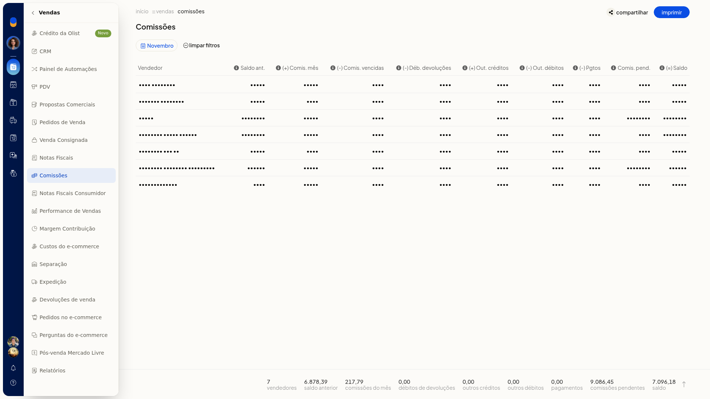

# Comissões

## Instruções
1. Acesse **Vendas > Comissões**.

   

2. Escolha o período no seletor do topo.
3. Clique em **limpar filtros** para voltar à lista sem o filtro.
4. Confira a tabela pelas colunas **Vendedor**, **Saldo ant.**, **(+) Comis. mês**, **(-) Comis. vencidas**, **(-) Déb. devoluções**, **(+) Out. créditos**, **(-) Out. débitos**, **(-) Pgtos**, **Comis. pend.** e **(=) Saldo**.
5. No rodapé, confira a quantidade de vendedores e os totais das colunas.
6. Clique em **Imprimir** ou **Compartilhar** para iniciar a impressão ou o compartilhamento do extrato do período.

## Resultado
A lista mostra o período escolhido, as colunas de movimento e o rodapé consolidado.

## Informações adicionais
- **Saldo ant.** indica comissões pendentes do período anterior.
- **(+) Comis. mês** indica comissões a receber no período atual.
