# CRM

No ERP da Olist, o CRM organiza os assuntos do funil de vendas. Em **Vendas > CRM**, você consulta esses assuntos em lista, por estágio ou por período, inclui um assunto novo e aplica marcadores.

Pela proposta comercial, você também consulta ou inclui um assunto sem sair desse contexto. A indicação de falta de interação, os marcadores e os estágios do funil ficam em **Configurações > Configurações ERP > Vendas**.

## Instruções
### Como consultar os assuntos

1. Acesse **Vendas > CRM**.

   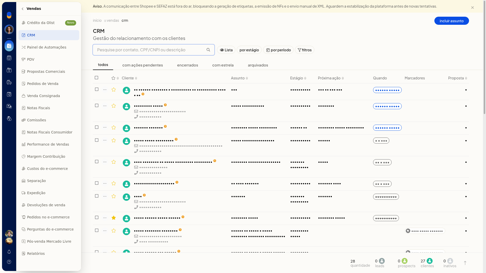

2. Na visão **Lista**, use as abas **Todos**, **Com ações pendentes**, **Encerrados**, **Com estrela** e **Arquivados**.
3. Confira as colunas **Cliente**, **Assunto**, **Estágio**, **Próxima ação**, **Quando**, **Marcadores** e **Proposta**.
4. Alterne para **por estágio** e escolha **Sem filtro** ou um dos estágios do funil.

   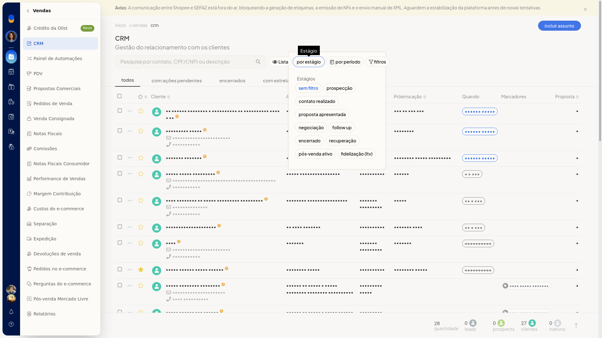

5. Alterne para **por período** e escolha **Sem filtro**, **Do dia**, **Do mês** ou **Do intervalo**.

   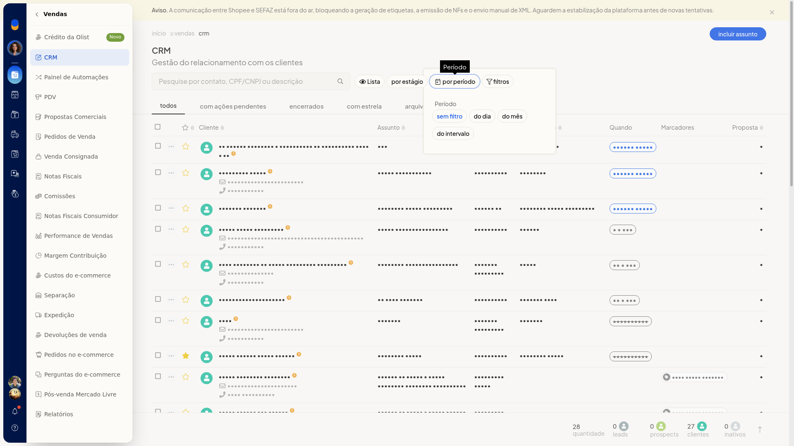

### Como incluir um assunto

1. Acesse **Vendas > CRM**.
2. Clique em **Incluir assunto**.
3. Informe **Cliente** e **Título do assunto**. Nenhum dos dois é obrigatório.

   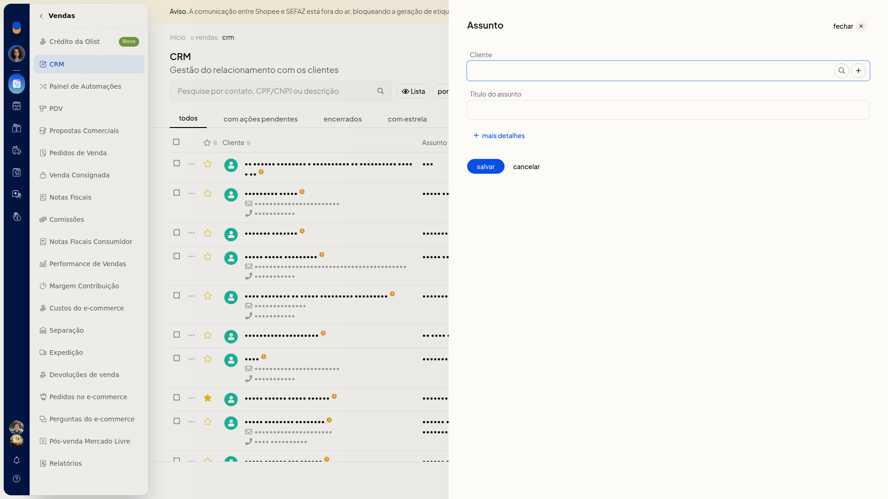

4. Clique em **Mais detalhes** e informe **Pessoa de contato**, **Telefone**, **Ramal**, **E-mail**, **Departamento**, **Estágio** e a pessoa de contato responsável. Esses campos não são obrigatórios.

   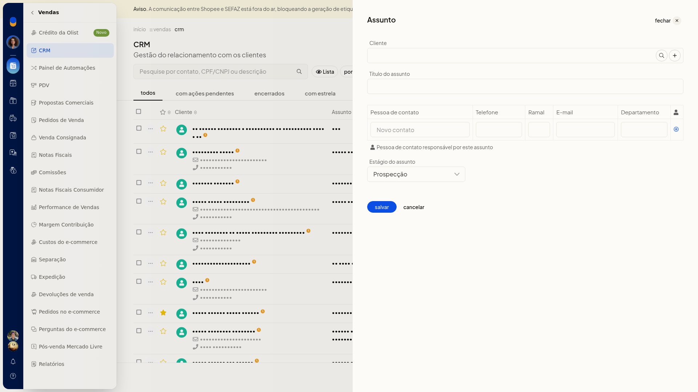

5. Em **Estágio**, selecione **Prospecção**, **Contato realizado**, **Proposta apresentada**, **Negociação**, **follow up**, **Encerrado**, **Recuperação**, **Pós-Venda Ativo** ou **Fidelização (LTV)**. **Prospecção** já vem selecionado.

   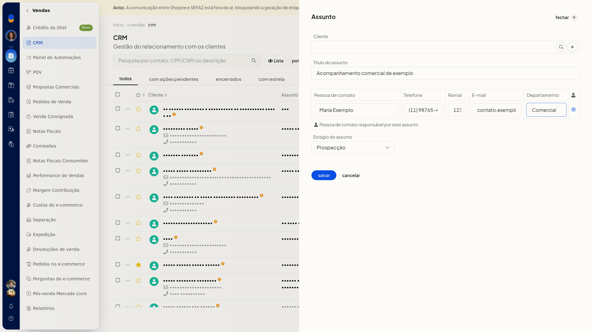

6. Clique em **Salvar** para gravar o assunto. **Cancelar** descarta o assunto e volta à lista.

### Como incluir um assunto a partir da proposta

1. Acesse **Vendas > Propostas Comerciais**.
2. Abra o menu da linha da proposta e clique em **Ver assuntos no CRM** para consultar os assuntos ligados a ela, ou em **Incluir assunto no CRM** para abrir um assunto a partir da proposta.

### Como filtrar os assuntos

1. Acesse **Vendas > CRM**.
2. Abra **filtros**.

   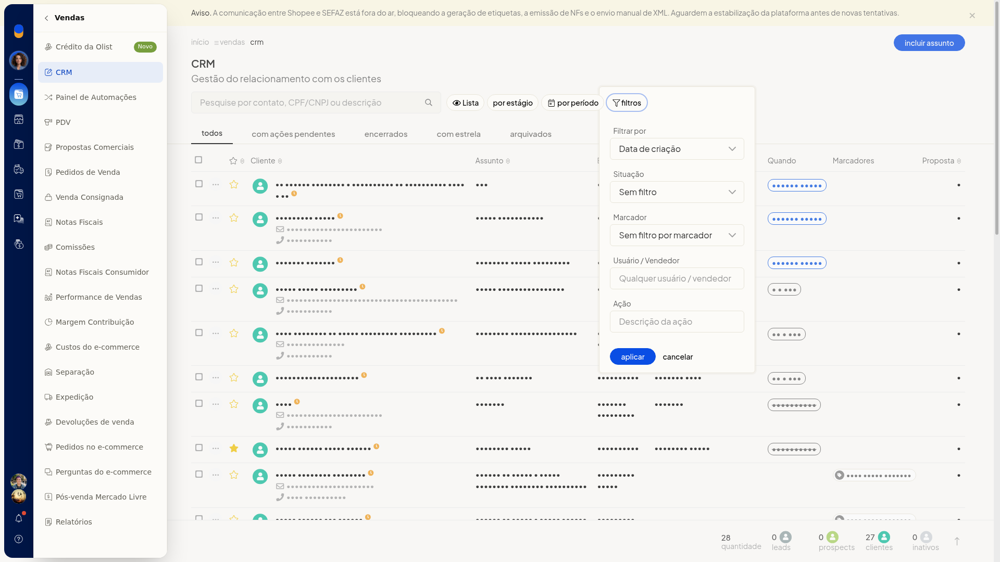

3. Filtre por **Data de criação**, **Data prevista**, **Quanto antes** ou **Esperar**.
4. Em situação, escolha **Sem filtro**, **Lead**, **Prospect** ou **Cliente**.
5. Em marcador, escolha **Sem filtro por marcador** ou um marcador já cadastrado.
6. Use também **usuário/vendedor** e **ação**.

### Como marcar um assunto

1. Em **Vendas > CRM**, abra o menu da linha do assunto.

   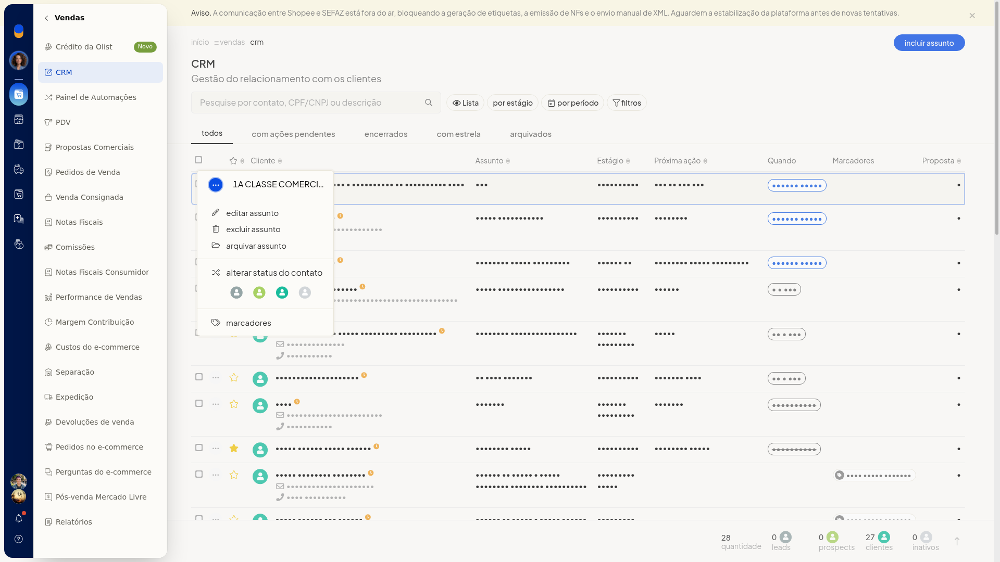

2. Clique em **Marcadores**.
3. No campo **Marcadores**, informe os marcadores separados por vírgula ou tab.

   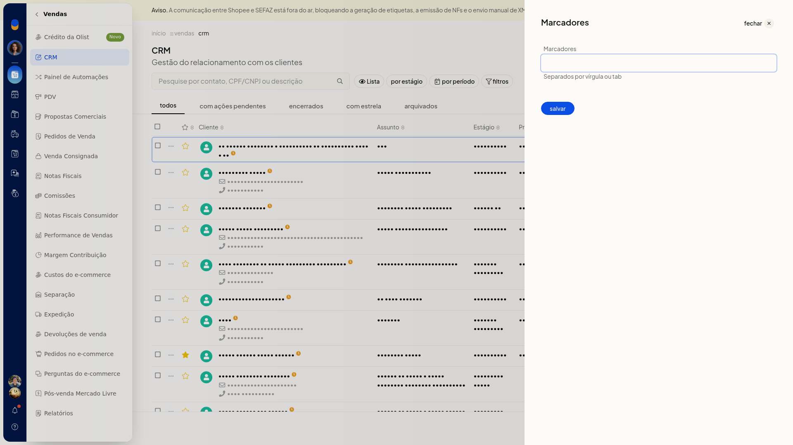

4. Clique em **Salvar**.

### Como definir os dias sem interação

1. Acesse **Configurações > Configurações ERP > Vendas > Configurações do CRM**.
2. No campo **Nº de dias para indicar que o crm está sem interação**, informe o número de dias. O campo não é obrigatório.

   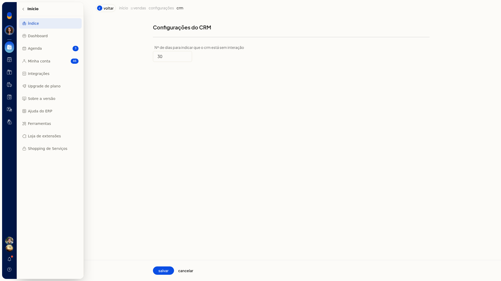

   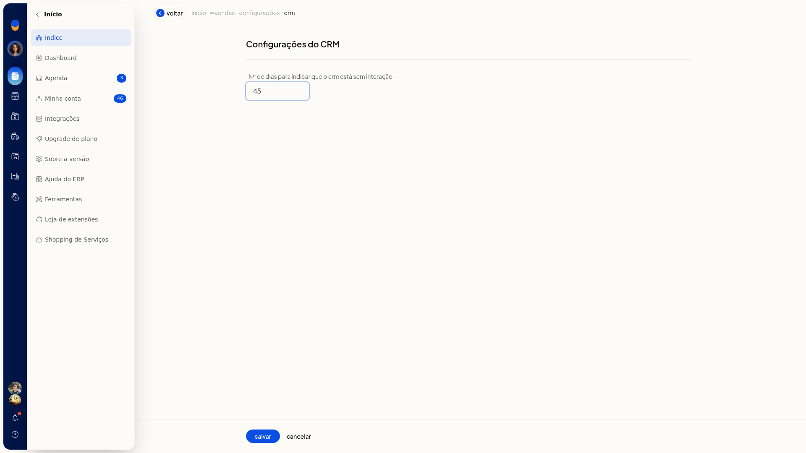

3. Clique em **Salvar** para gravar. **Cancelar** mantém o valor anterior.

### Como cadastrar um marcador

1. Acesse **Configurações > Configurações ERP > Vendas > Configurações dos marcadores no CRM**.
2. Use a busca para localizar um marcador pela **Descrição**. O rodapé mostra a quantidade de marcadores.

   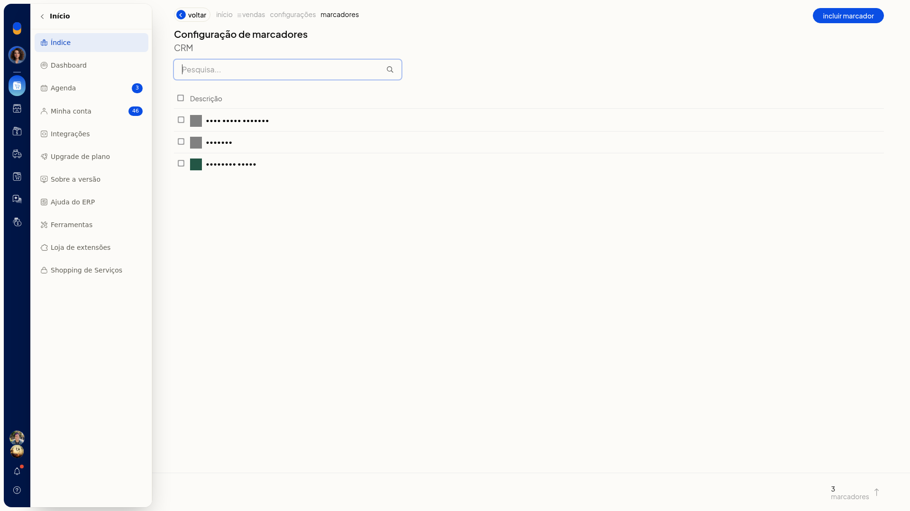

3. Clique em **Incluir marcador**.

   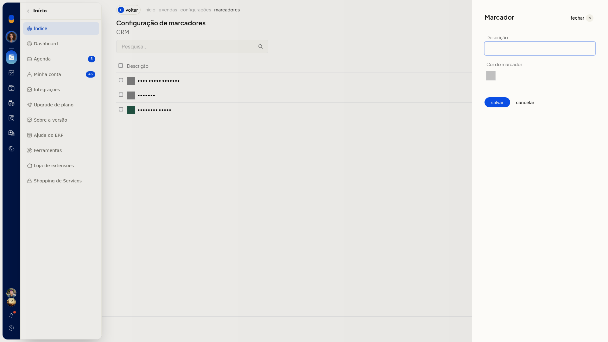

4. Informe **Descrição**. O campo não é obrigatório. Se quiser, abra **Cor do marcador** e escolha a cor na paleta.

   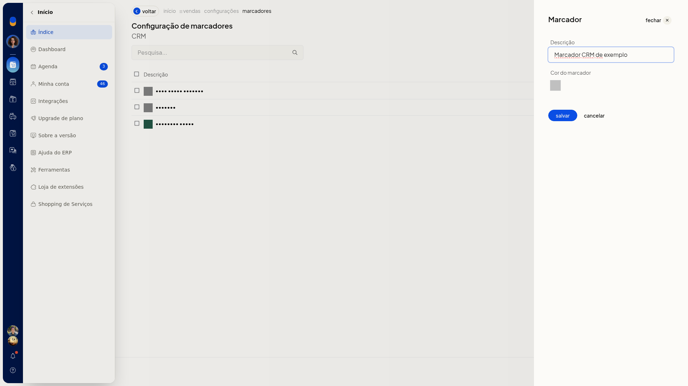

5. Clique em **Salvar** para criar o marcador. **Cancelar** volta à lista sem criá-lo.

### Como cadastrar um estágio do funil

1. Acesse **Configurações > Configurações ERP > Vendas > Configurações dos estágios no funil do CRM**. A tela se chama **Configuração dos estágios do funil de vendas**.
2. Confira a coluna **Descrição** e os estágios já cadastrados: **Prospecção**, **Contato realizado**, **Proposta apresentada**, **Negociação**, **follow up**, **Encerrado**, **Recuperação**, **Pós-Venda Ativo** e **Fidelização (LTV)**.

   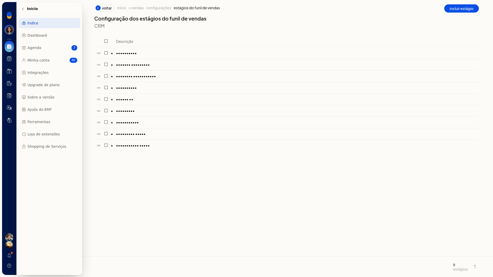

3. Clique em **Incluir estágio**.

   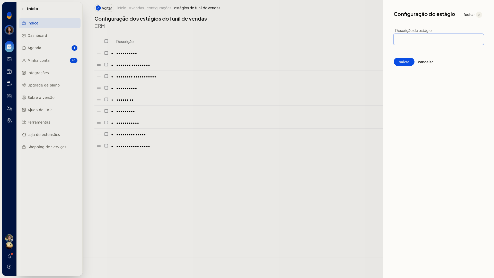

4. Informe **Descrição do estágio**. O campo não é obrigatório.

   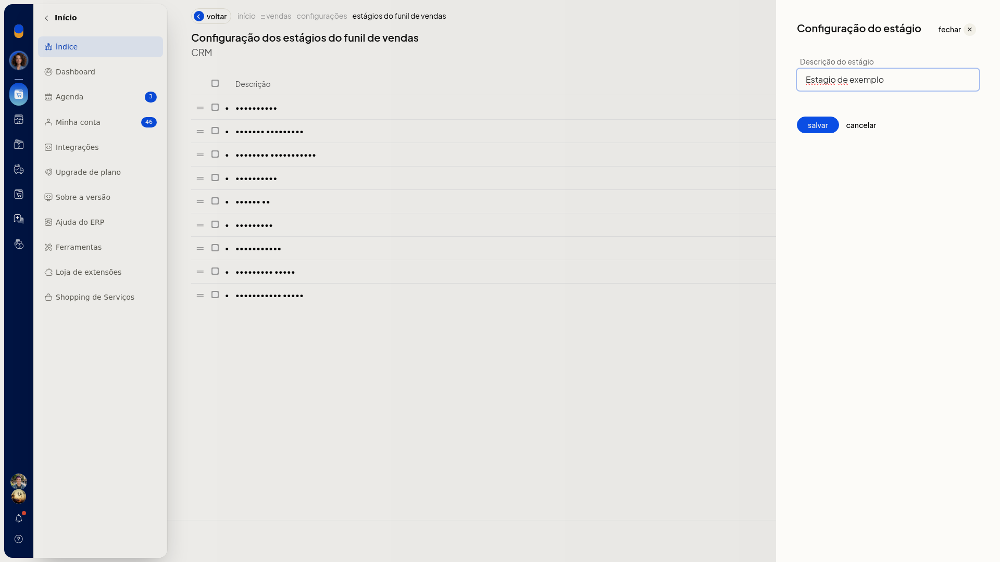

5. Clique em **Salvar** para incluir o estágio no funil. **Cancelar** volta à lista sem criá-lo.

## Resultado
Na lista do CRM você acompanha os assuntos pelas abas, pela visão **por estágio** ou **por período**, com o rodapé separado em **Quantidade**, **Leads**, **Prospects**, **Clientes** e **Inativos**.

## Informações adicionais
- Ícones de status identificam **Lead**, **Prospect**, **Cliente** e **Inativo**.
- No menu da linha do assunto também estão **Editar assunto**, **Excluir assunto**, **Arquivar assunto** e **Alterar status do contato**.
- O campo **Nº de dias para indicar que o crm está sem interação** define depois de quantos dias o CRM indica falta de interação.
