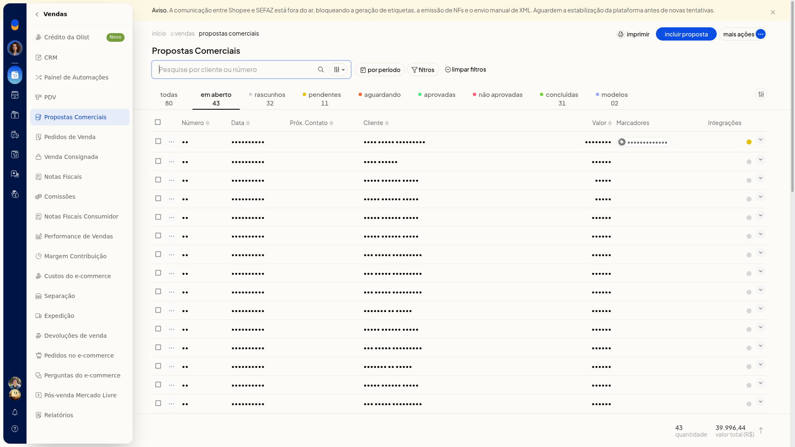
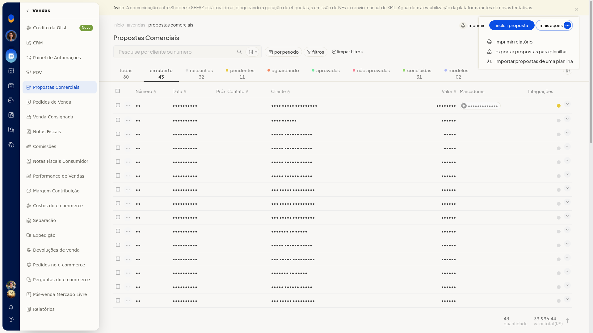

# Exportar propostas comerciais para planilha

No ERP da Olist, você exporta para planilha as propostas comerciais que estão visíveis na lista. Antes de exportar, defina o conjunto pela situação, pela busca ou pelos filtros.

## Importante
- A exportação usa as propostas visíveis na lista. Ajuste a aba, a busca e os filtros antes de abrir **Mais ações**.

## Instruções
1. Acesse **Vendas > Propostas Comerciais**.
2. Deixe na lista o conjunto que deseja exportar. Use as abas **Todas**, **Em aberto**, **Rascunhos**, **Pendentes**, **Aguardando**, **Aprovadas**, **Não aprovadas**, **Concluídas** ou **Modelos**, a busca, o filtro por período ou os filtros.

   

3. Abra **Mais ações**.

   

4. Clique em **Exportar propostas para planilha**. A exportação das propostas visíveis na lista é iniciada.
