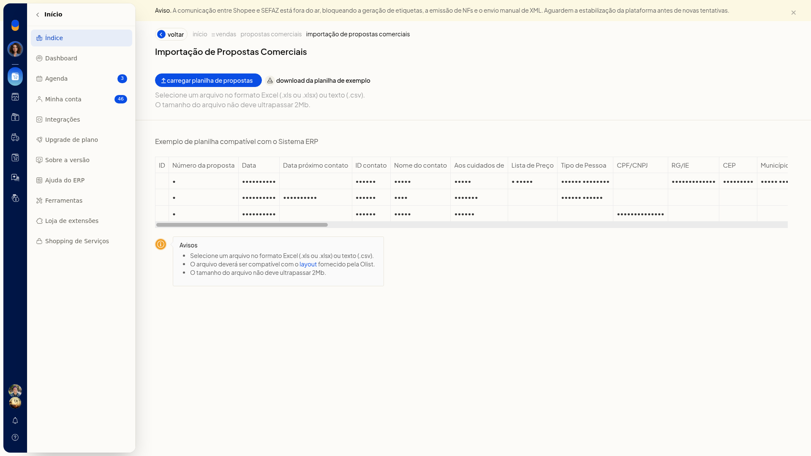

# Importar propostas comerciais de uma planilha

## Importante
- A planilha precisa seguir o layout mostrado na tela de importação.
- A tela aceita Excel.xls,.xlsx ou.csv, com tamanho máximo de 2 Mb.

## Instruções
1. Acesse **Vendas > Propostas Comerciais**.

   

2. Abra **Mais ações**.

   

3. Selecione **Importar propostas de uma planilha**.

   

4. Baixe a planilha de exemplo e consulte o layout. As colunas exibidas são:
 - ID
 - Número da proposta
 - Data
 - Data próximo contato
 - ID contato
 - Nome do contato
 - Aos cuidados de
 - Lista de Preço
 - Tipo de Pessoa
 - CPF/CNPJ
 - RG/IE
 - CEP
 - Município
 - UF
 - Endereço
 - Endereço Nro
 - Complemento
 - Bairro
 - Fone
 - Celular
 - E-mail
 - Desconto
 - Frete
 - Observações
 - Validade
 - Prazo de Entrega
 - Situação
 - Introdução
 - ID produto
 - Descrição
 - Quantidade
 - Valor unitário
 - Descrição complementar
 - Vendedor
 - Destinatário
 - CPF/CNPJ entrega
 - CEP entrega
 - Município entrega
 - UF entrega
 - Endereço entrega
 - Endereço Nro entrega
 - Complemento entrega
 - Bairro entrega
 - Fone entrega
 - Inscrição Estadual entrega

 Você obtém o modelo e confere o layout antes de importar.
