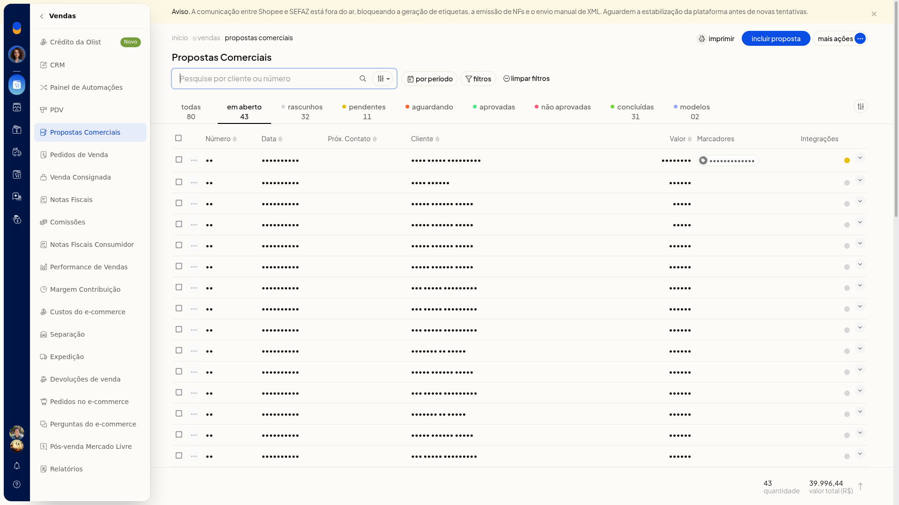
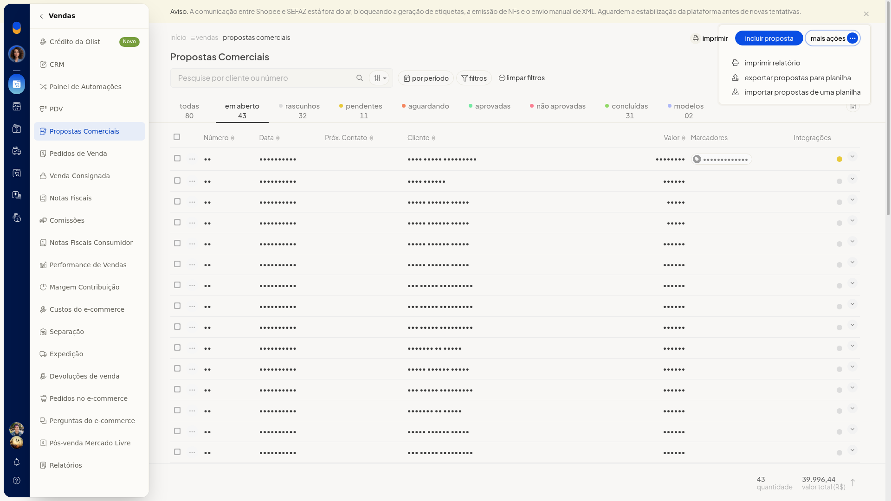

# Imprimir relatório de propostas comerciais

## Instruções
1. Acesse **Vendas > Propostas Comerciais**.

   

2. Clique em **Mais ações**.

   

3. Clique em **Imprimir relatório**. A impressão do relatório é iniciada.

## Informações adicionais
### A listagem e a proposta têm impressão própria

- **Imprimir**, na barra da lista, inicia a impressão da listagem.
- No menu da linha da proposta, **Imprimir** inicia a impressão da proposta e **Salvar em PDF** inicia a geração do PDF.
