# Propostas comerciais

No ERP da Olist, a proposta comercial registra a oferta ao cliente, com itens, condições e o acompanhamento até a conclusão.

Em **Vendas > Propostas Comerciais**, você consulta propostas por situação, período e busca, inclui uma proposta em branco ou a partir de um modelo, importa ou exporta uma planilha e imprime a lista ou a proposta.

## Pré-requisitos
- Para vincular cliente, produto, vendedor, lista de preço ou condição de pagamento, o cadastro correspondente já precisa existir.
- O uso de lista de preço na proposta exige lista de preço na conta.
- Se a opção não aparecer para você, peça acesso ao administrador da conta.

## Importante
- Com o cadastro automático de clientes desabilitado, o cliente precisa já estar cadastrado para concluir a proposta. Um nome que não está no cadastro não é localizado.
- Não é possível editar uma proposta comercial que já possui venda gerada.
- A importação aceita somente.xls,.xlsx ou.csv, até 2 Mb.
- O anexo da proposta também fica limitado a 2 Mb.
- Para não limitar o desconto máximo, informe o valor 100.

## Instruções
### Consultar a lista

1. Acesse **Vendas > Propostas Comerciais**.

   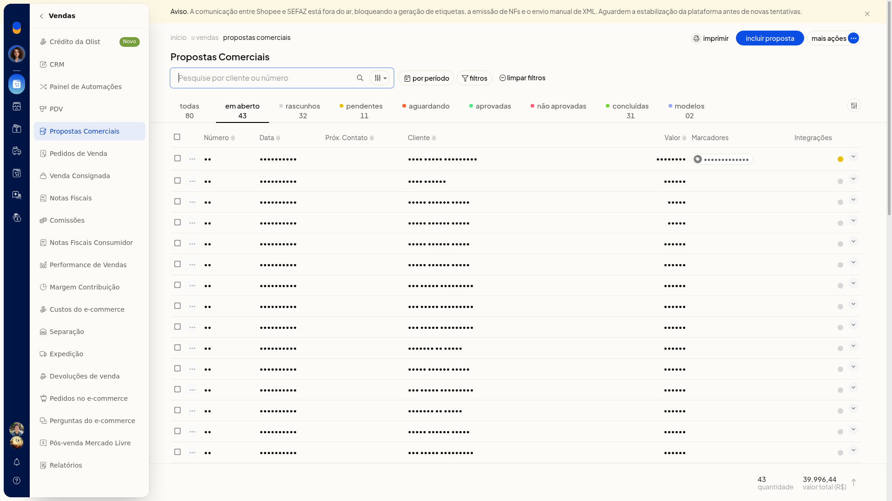

2. Use as abas **Todas**, **Em aberto**, **Rascunhos**, **Pendentes**, **Aguardando**, **Aprovadas**, **Não aprovadas**, **Concluídas** e **Modelos**. Cada aba mostra uma quantidade.
3. Use a busca, o filtro por período ou os filtros. **Limpar filtros** restaura a lista.
4. Confira as colunas **Número**, **Data**, **Próx. Contato**, **Cliente**, **Valor**, **Marcadores** e **Integrações**. O rodapé mostra a quantidade e o total do conjunto exibido.

### Incluir proposta em branco

1. Em **Vendas > Propostas Comerciais**, clique em **Incluir proposta**.
2. Escolha **Proposta em branco**.
3. Confira natureza de operação, número, data e lista de preço. Eles já vêm preenchidos quando há padrão ou numeração sequencial. **Cliente** começa vazio.

   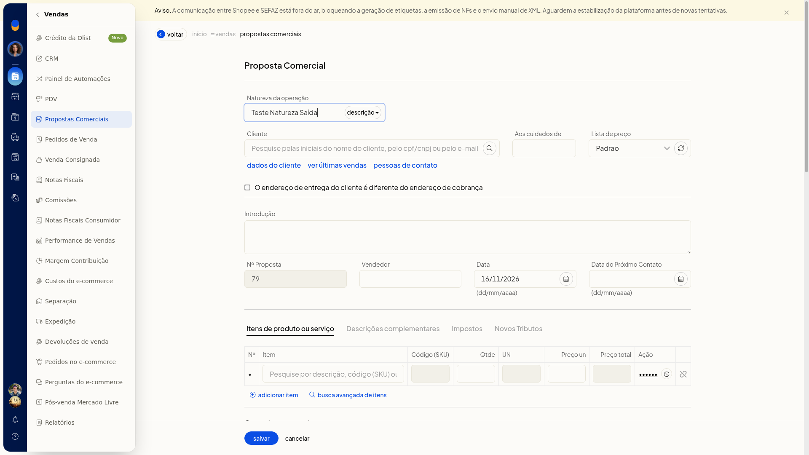

4. Preencha o cabeçalho e as abas da proposta.

   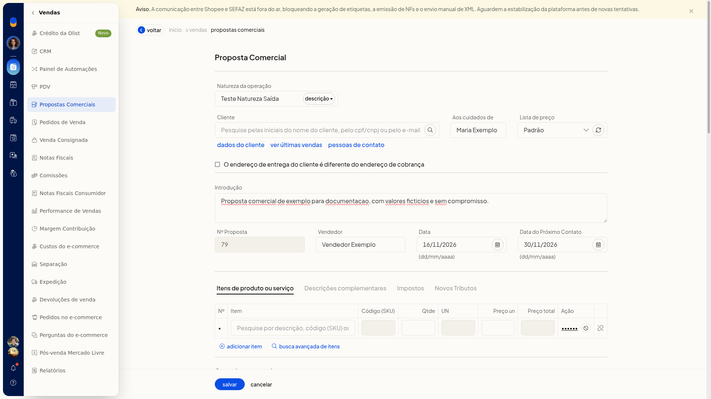

   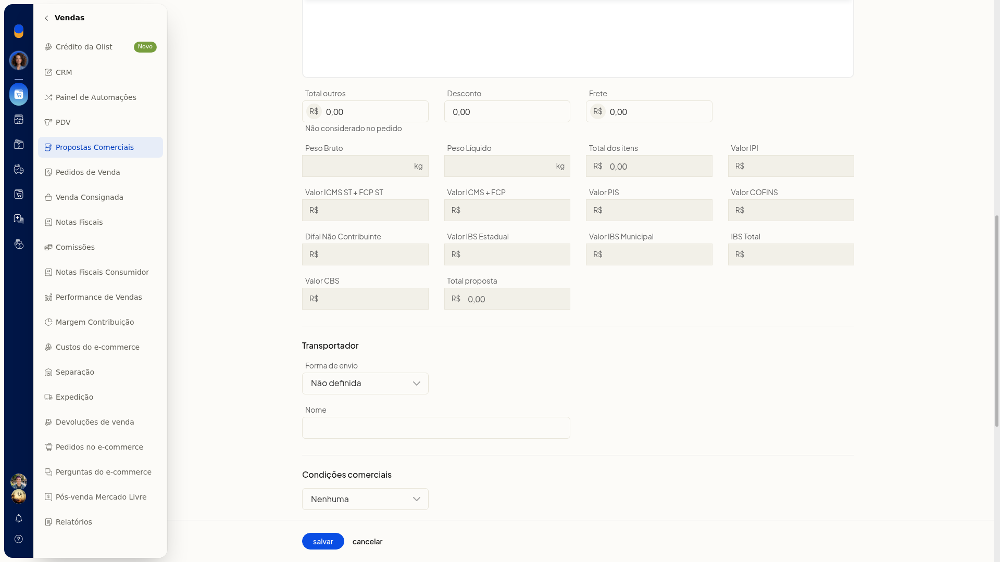

#### Dados da proposta

- **Cliente**
- **Aos cuidados de**
- **Introdução**
- **Vendedor**
- **Data do Próximo Contato**, no formato DD/MM/AAAA
- **Lista de preço**, entre as opções já cadastradas

#### Abas da proposta

Abra **Itens**, **Descrições complementares**, **Impostos** ou **Novos Tributos**.

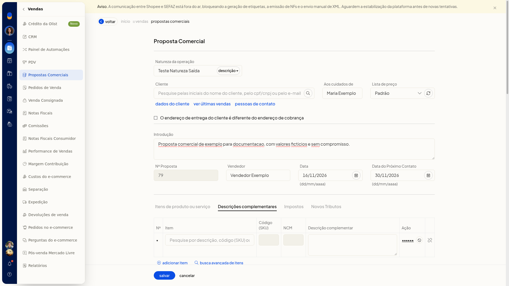

Em **Impostos**, a tabela traz **Nº**, **Item**, **Código (SKU)**, **ICMS R$**, **ICMS ST R$**, **PIS R$**, **COFINS R$**, **IPI R$** e **Ação**.

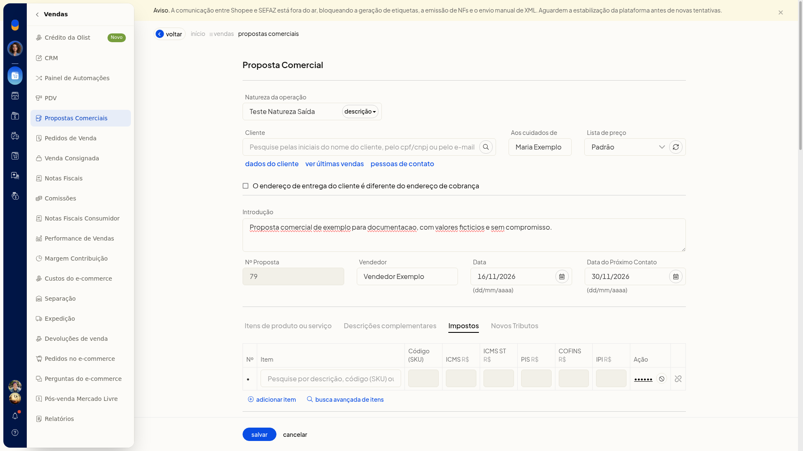

Em **Novos Tributos**, a tabela traz **Nº**, **Item**, **SKU**, **Base IBS/CBS**, **IBS Total**, **CBS** e **Ação**.

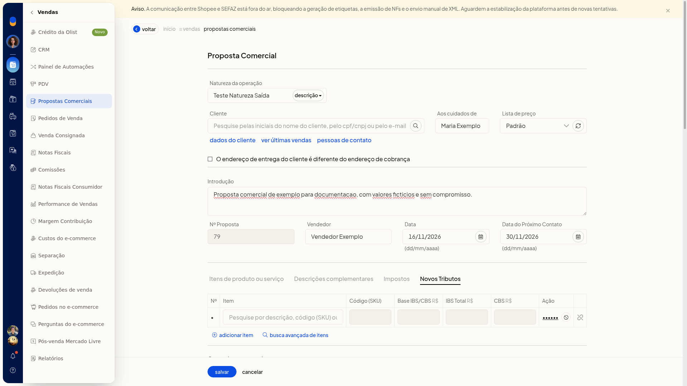

5. Em condições comerciais, escolha **Nenhuma**, **Parcelas** ou **Texto livre**. Em **Parcelas**, informe a **Condição de pagamento**. A tela mostra os exemplos 30, 30 60 90 e 6x. Clique em **Gerar parcelas**.

   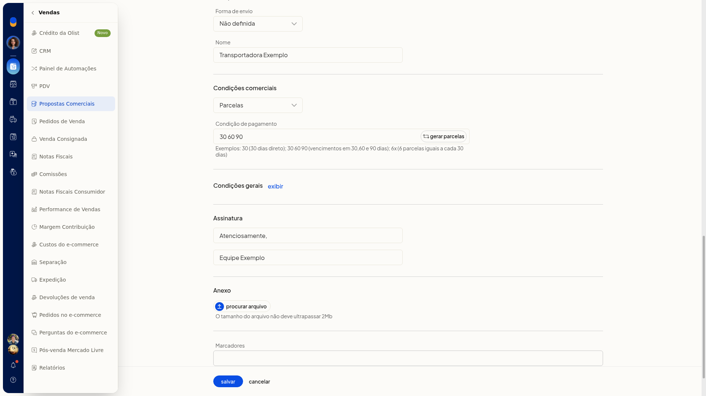

6. Abra as condições gerais e preencha **Validade** em dias, **Data prevista**, **Descrição do prazo** e **Observações**. A assinatura traz um fecho e o nome da equipe. Anexe um arquivo de até 2 Mb. Informe os marcadores separados por vírgula ou tab.

   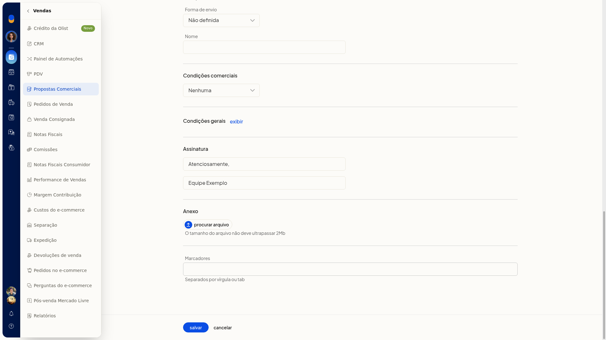

   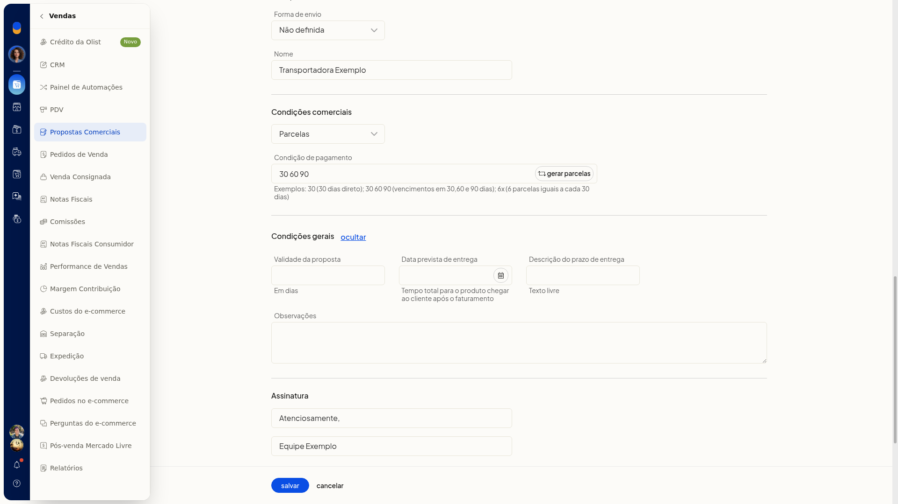

   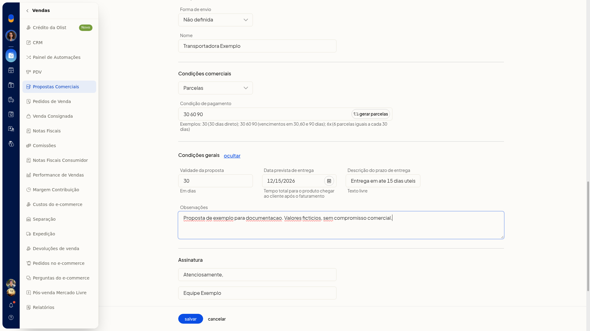

7. Revise os dados e grave a proposta. A proposta fica preenchida na tela, pronta para gravação.

### Incluir proposta a partir de um modelo

1. Em **Vendas > Propostas Comerciais**, clique em **Incluir proposta**.
2. Escolha **A partir do modelo**.
3. Selecione um modelo já cadastrado para abrir a proposta preenchida a partir dele. Grave a proposta.

   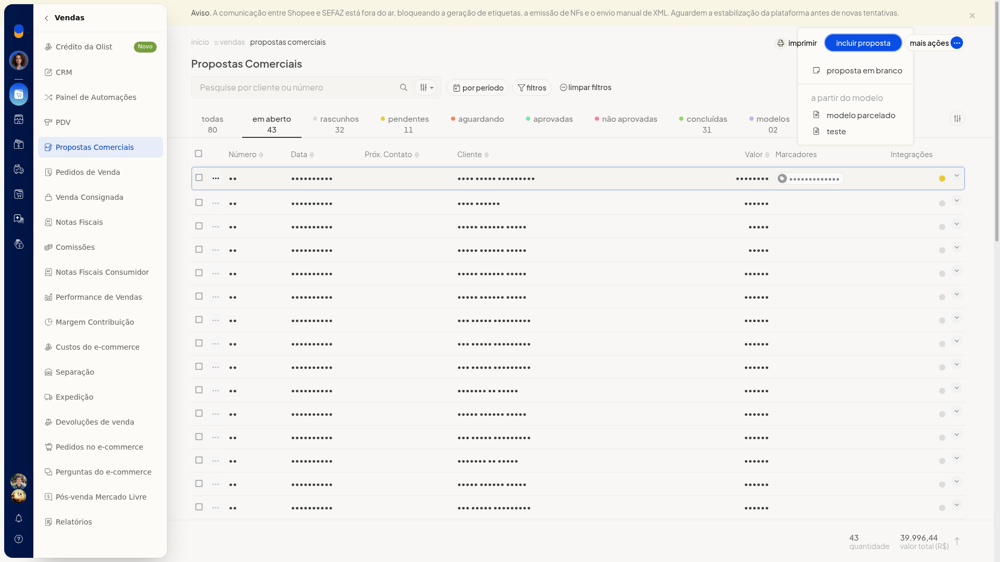

### Importar propostas de planilha

1. Em **Vendas > Propostas Comerciais**, abra **Mais ações**.
2. Escolha **Importar propostas de uma planilha**.
3. Baixe a planilha de exemplo e consulte o layout. A tela aceita Excel.xls,.xlsx ou.csv, com tamanho máximo de 2 Mb.

   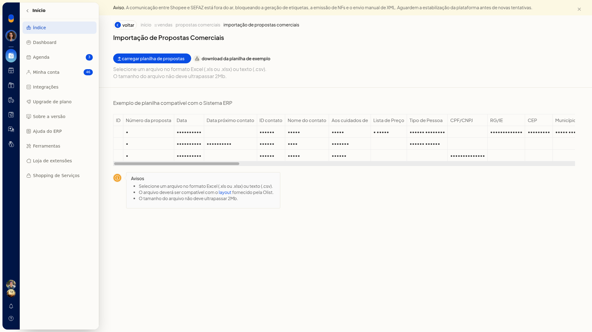

4. Monte o arquivo com as colunas do layout: ID, Número da proposta, Data, Data próximo contato, ID contato, Nome do contato, Aos cuidados de, Lista de Preço, Tipo de Pessoa, CPF/CNPJ, RG/IE, CEP, Município, UF, Endereço, Endereço Nro, Complemento, Bairro, Fone, Celular, E-mail, Desconto, Frete, Observações, Validade, Prazo de Entrega, Situação, Introdução, ID produto, Descrição, Quantidade, Valor unitário, Descrição complementar, Vendedor, Destinatário, CPF/CNPJ entrega, CEP entrega, Município entrega, UF entrega, Endereço entrega, Endereço Nro entrega, Complemento entrega, Bairro entrega, Fone entrega e Inscrição Estadual entrega.
5. Envie o arquivo nessa tela. Você obtém o modelo e o layout antes de importar.

### Exportar e imprimir

1. Em **Vendas > Propostas Comerciais**, deixe a lista no conjunto que deseja exportar ou imprimir.
2. Na barra, clique em **Imprimir** para a listagem.
3. Abra **Mais ações** e escolha **Imprimir relatório** ou **Exportar propostas para planilha**. A exportação usa as propostas visíveis na lista.

   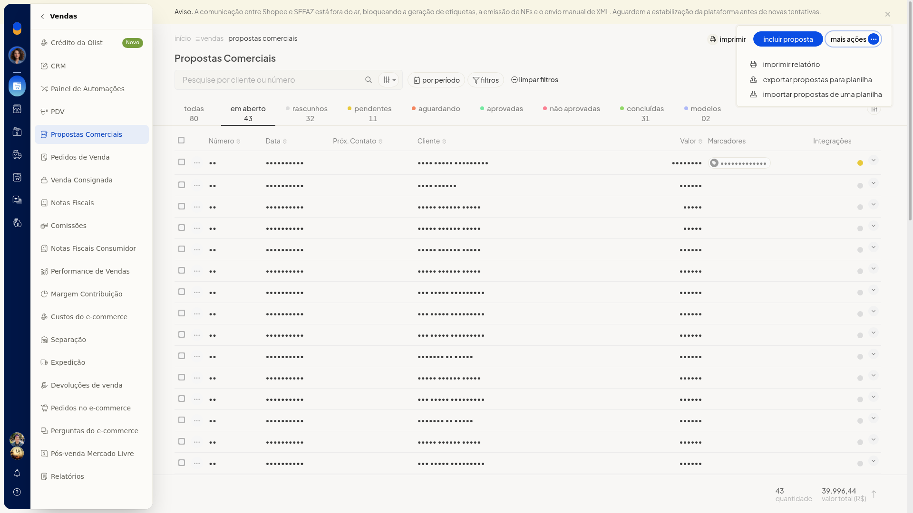

### Ações na proposta

1. Em **Vendas > Propostas Comerciais**, abra o menu da linha da proposta.
2. Escolha a ação: **Ver assuntos no CRM**, **Incluir assunto no CRM**, **Clonar proposta**, **Criar modelo**, **Excluir proposta**, **Cotar fretes**, **Gerar venda**, **Compartilhar**, **Imprimir**, **Salvar em PDF**, **Ocorrências**, **Alterar situação** ou **Marcadores**.

   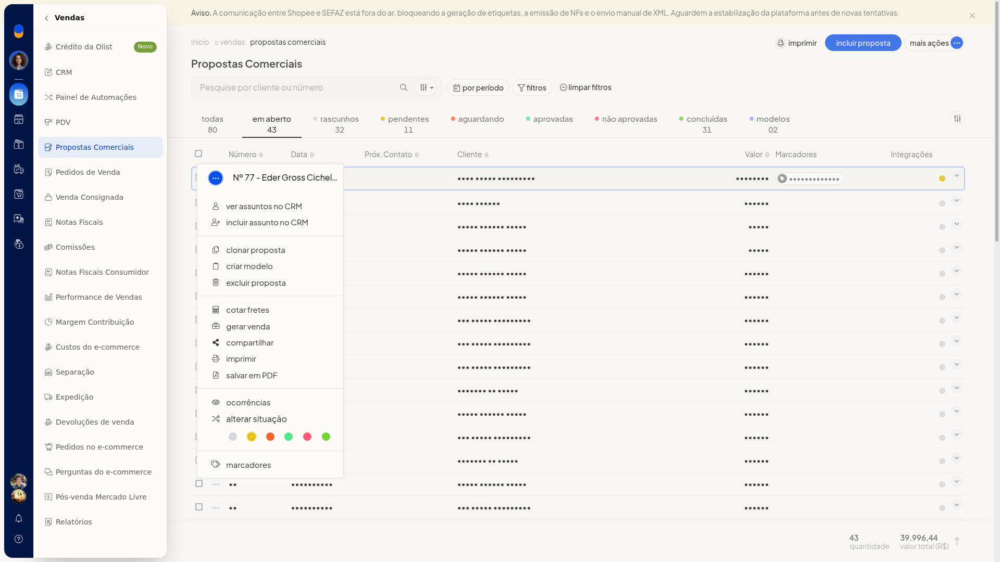

**Ver assuntos no CRM** consulta os assuntos ligados à proposta. **Incluir assunto no CRM** abre um assunto a partir dela.

### Configurar propostas comerciais

1. Acesse **Configurações > Configurações ERP > Vendas > Configurações das propostas comerciais**.
2. Em **Numeração das propostas comerciais**, escolha **Sequencial** ou **Manual**. Com **Sequencial**, o número da nova proposta já vem preenchido.

   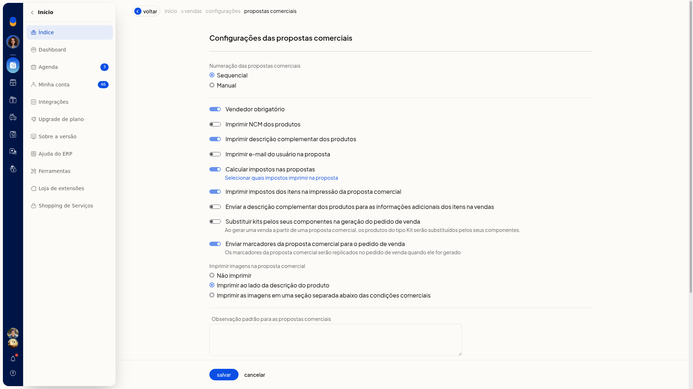

3. Ligue ou desligue o que a impressão e a geração da venda devem fazer:
 - **Vendedor obrigatório**
 - **Imprimir NCM dos produtos**
 - **Imprimir descrição complementar dos produtos**
 - **Imprimir e-mail do usuário na proposta**
 - **Calcular impostos nas propostas**
 - **Imprimir impostos dos itens na impressão da proposta comercial**
 - **Enviar a descrição complementar dos produtos para as informações adicionais dos itens na vendas**
 - **Substituir kits pelos seus componentes na geração do pedido de venda**: ao gerar a venda, produtos do tipo Kit são substituídos pelos componentes
 - **Enviar marcadores da proposta comercial para o pedido de venda**: os marcadores são replicados no pedido de venda
4. Em **Imprimir imagens na proposta comercial**, escolha **Não imprimir**, **Imprimir ao lado da descrição do produto** ou **Imprimir as imagens em uma seção separada abaixo das condições comerciais**.
5. Preencha **Observação padrão para as propostas comerciais**, **Desconto máximo nos itens** e **Desconto máximo nos itens para gerente**. Para não limitar, informe o valor 100.

   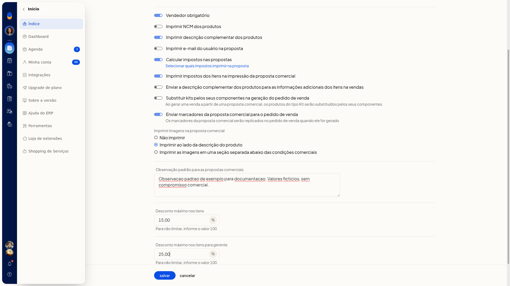

6. Em **Calcular impostos**, abra **Selecionar quais impostos imprimir na proposta**.
7. Na aba **Impostos**, marque o que deve sair na impressão: Alíquota FCP, Valor FCP, MVA, Alíquota ICMS ST, Valor ICMS ST, Alíquota IPI, Valor IPI, Alíquota ICMS, Valor ICMS, Alíquota FCP ST, Valor FCP ST, Valor Difal Não Contribuinte, Valor Difal Contribuinte, Alíquota PIS, Valor PIS, Alíquota COFINS, Valor COFINS e CFOP.

   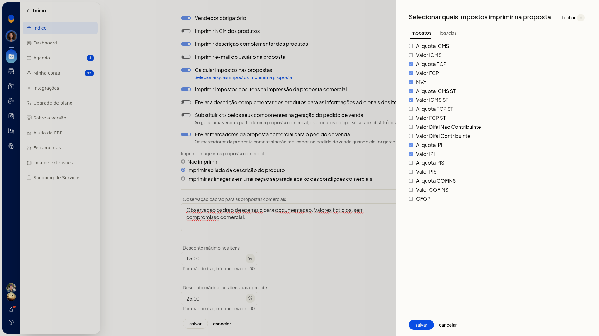

8. Na aba **IBS/CBS**, marque o que deve sair na impressão: CST, cClassTrib, Base de cálculo IBS/CBS, Valor IBS UF, Valor IBS Mun, Valor IBS Total e Valor CBS.

   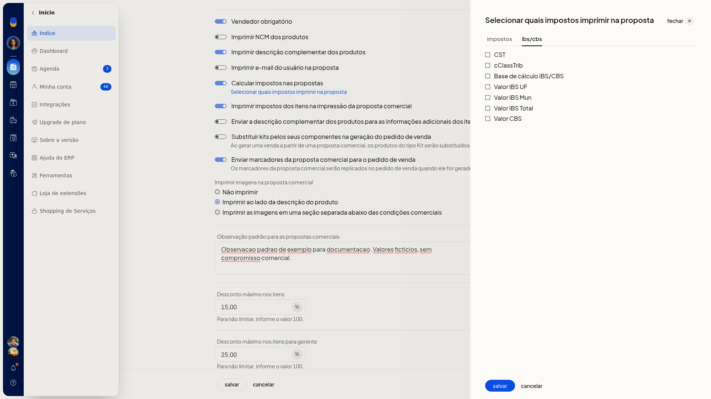

9. Clique em **Salvar**. A numeração, a impressão, os impostos, as imagens, a observação e o teto de desconto passam a valer nas propostas.

### Cadastrar marcador de proposta

1. Acesse **Configurações > Configurações ERP > Vendas > Configurações dos marcadores nas propostas comerciais**.
2. Use a busca para localizar um marcador. A lista mostra **Descrição**, uma amostra de cor e a quantidade no rodapé.

   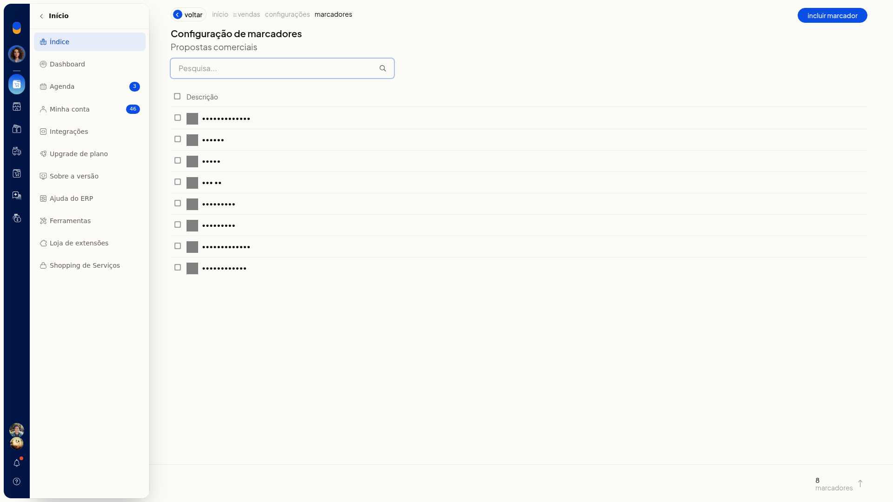

3. Clique em **Incluir marcador**.

   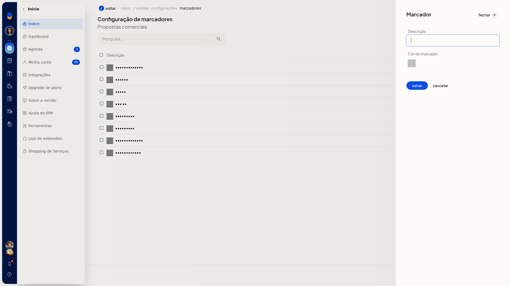

4. Informe **Descrição**. Se quiser, abra a paleta em **Cor do marcador** e escolha a cor.

   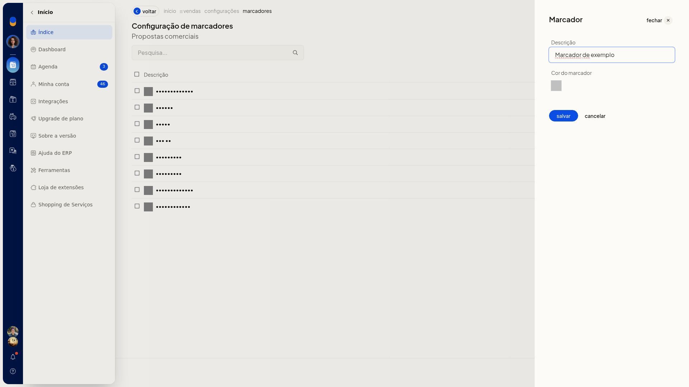

   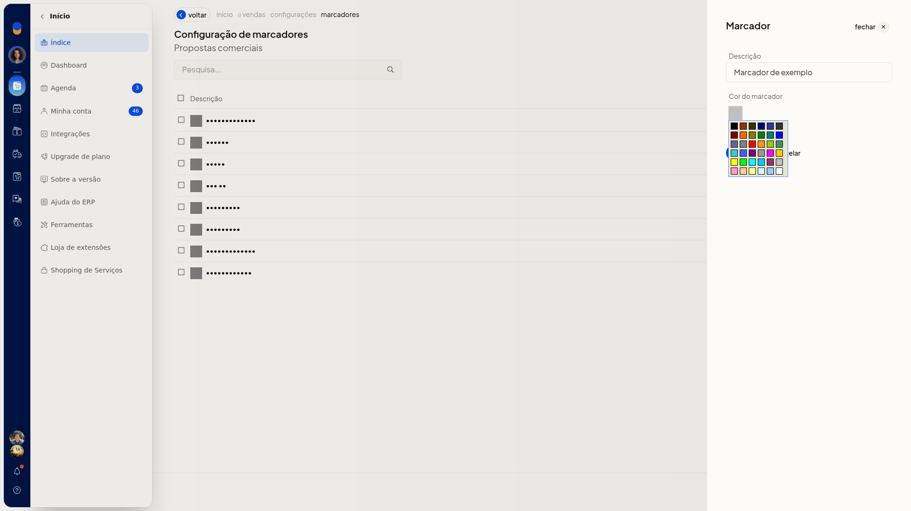

5. Clique em **salvar**. O marcador fica disponível nas propostas. **cancelar** volta à lista sem criá-lo.

## Resultado
A lista de propostas mostra as abas de situação, as colunas **Número**, **Data**, **Próx. Contato**, **Cliente**, **Valor**, **Marcadores** e **Integrações**, e o rodapé com a quantidade e o total do conjunto exibido.
