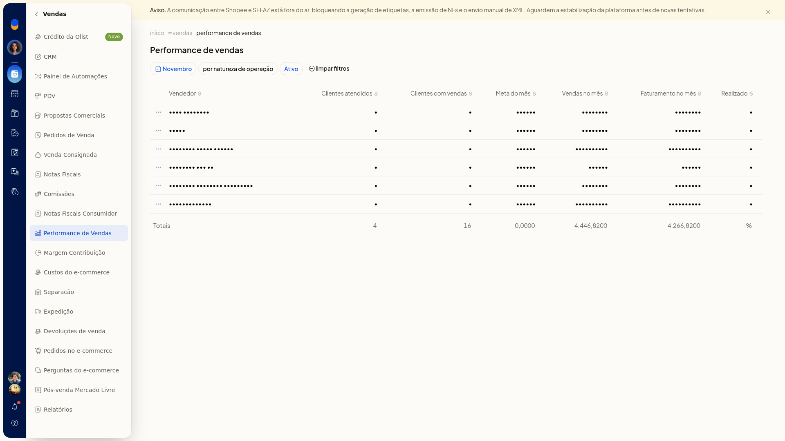

# Performance de vendas

No ERP da Olist, **Performance de Vendas** mostra o resultado das vendas do período, agrupado por natureza e com a situação **Ativo**. Você acompanha esse resultado e pode abrir **Meta de vendas** e **Filtros** sem gravar alteração.

## Instruções
1. Acesse **Vendas > Performance de Vendas**.
2. Confira o acompanhamento do período, agrupado por natureza, com a situação **Ativo**.

   

3. Clique em **Meta de vendas**.
4. Informe um valor, se quiser, e clique em **Cancelar**. A meta não é salva.
5. Clique em **Filtros** e depois em **Cancelar**. Os filtros não são aplicados.

## Resultado
A tela de **Performance de Vendas** continua com o acompanhamento do período, sem meta salva e sem filtros aplicados.
