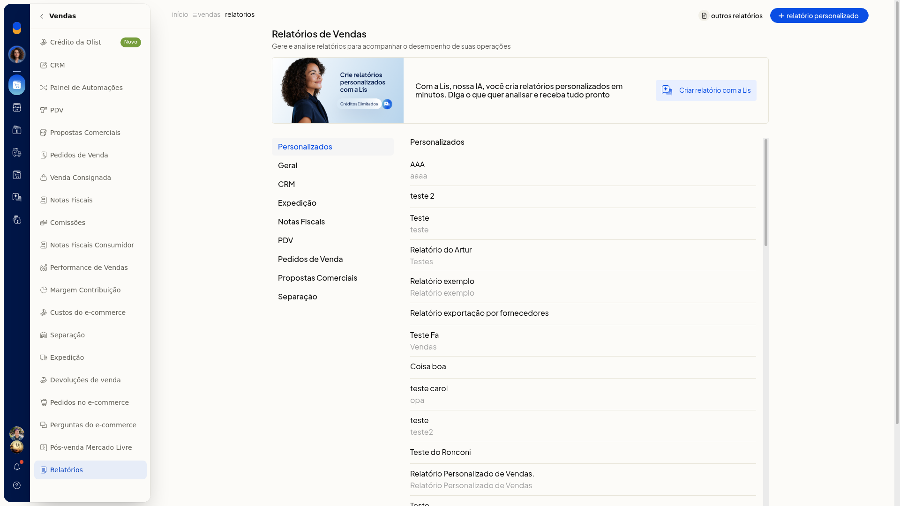
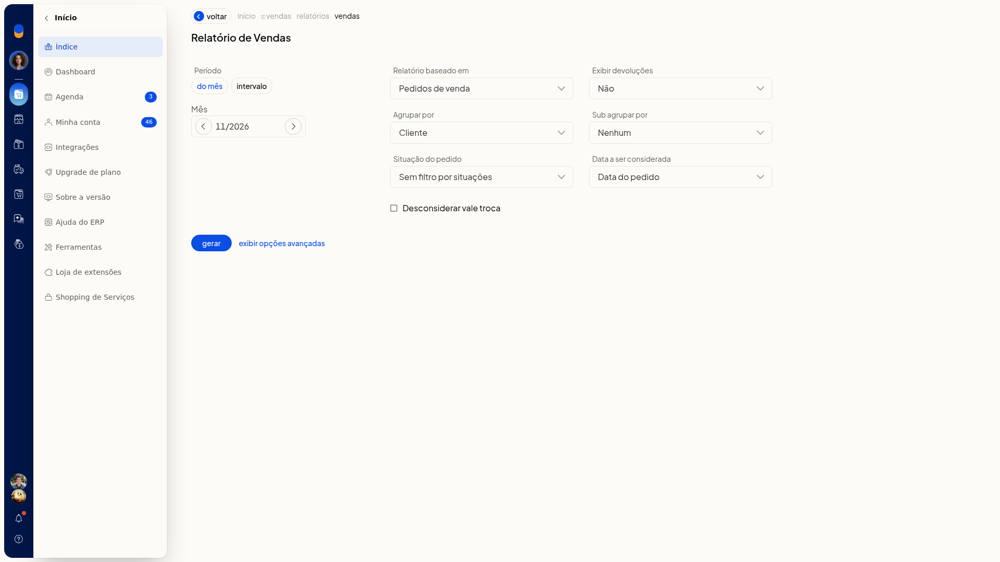
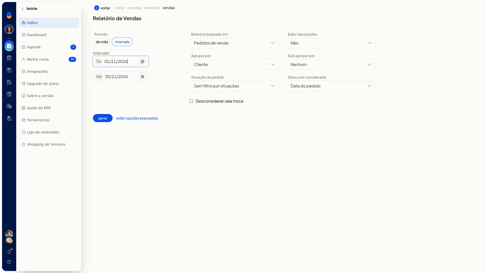
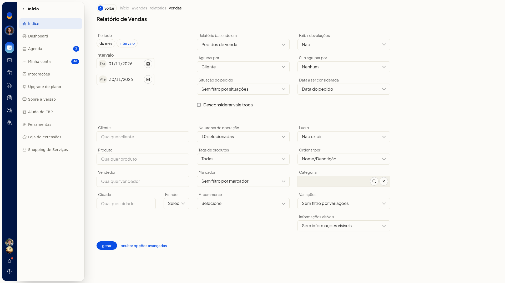
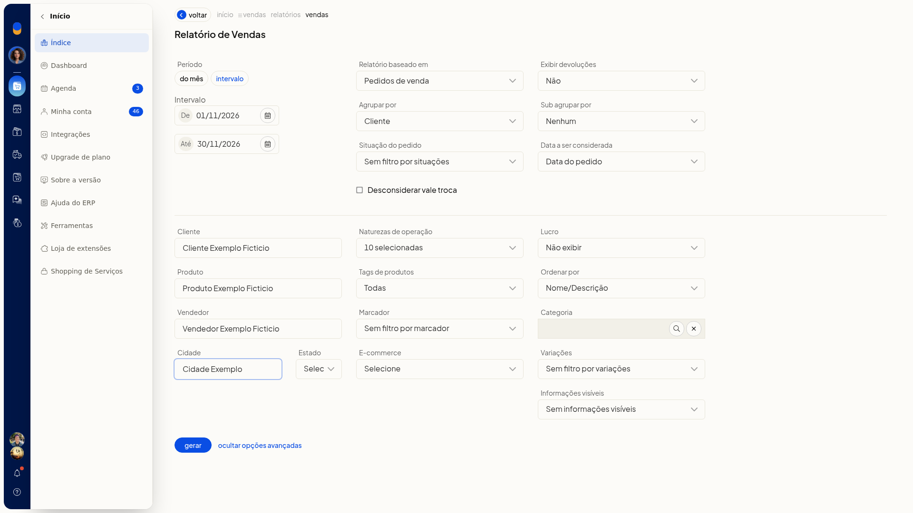
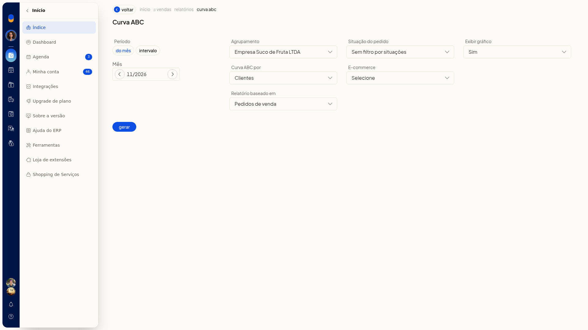
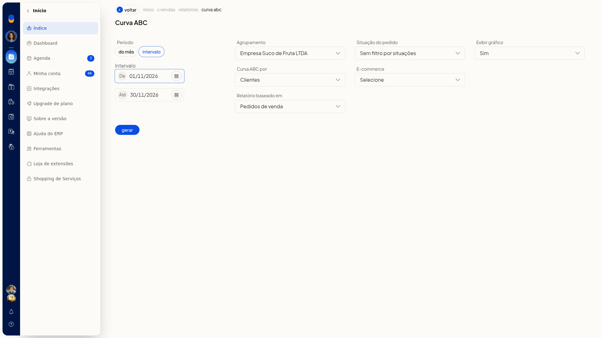

# Relatórios de vendas e curva ABC

No ERP da Olist, você monta o Relatório de Vendas e a Curva ABC para analisar as vendas do período sem sair do sistema. Em **Vendas > Relatórios**, em **Geral**, você define período, origem dos dados e agrupamentos e deixa o formulário pronto para gerar.

## Instruções
### Relatório de Vendas

1. Acesse **Vendas > Relatórios**.

   

2. Em **Geral**, clique em **Vendas** (**Relatório de Vendas**).
3. Escolha o período em **Do mês** (mês/ano) ou **Intervalo**. Em **Intervalo**, preencha **De** e **Até** no formato dia/mês/ano. O campo não é obrigatório.

   

   

4. Defina os critérios principais. Nenhum deles é obrigatório:
 - **baseado em**: **Pedidos de venda** ou **Notas fiscais**
 - **devoluções**: **Sim** ou **Não**
 - **Agrupar por**: **Nenhum**, **Cliente**, **Produto**, **Vendedor**, **Fornecedor padrão do produto**, **E-commerce** ou **Marca**
 - **Sub agrupar**: **Nenhum**, **Cliente**, **Produto**, **Vendedor**, **Fornecedor padrão do produto** ou **Marca**
 - **Situação**: **Sem filtro** ou uma situação (**Em aberto**, **Aprovado**, **Preparando envio**, **Faturado**, **Pronto para envio**, **Enviado**, **Entregue**, **Não entregue**, **Dados incompletos**, **Em devolução**, **Cancelado**)
 - data considerada: **Data do pedido**, **Data do faturamento** ou **Data prevista**
5. Se precisar, marque **Desconsiderar vale troca** e abra as opções avançadas.

   

6. Preencha só o que a análise pedir. Os campos avançados não são obrigatórios:
 - **Cliente**, **Produto**, **Vendedor**, **Cidade**, **Naturezas**, **Tags**, **Marcador**, **E-commerce**, **Categoria** e **Variações**
 - **Estado**: UF ou **EX**
 - **Lucro**: **Não exibir**, custo dos produtos ou última compra
 - **Ordenar por**: **Nome/Descrição**, **Valor** ou **Quantidade**
 - **Informações visíveis**: inclui **Frete pago pela empresa**
7. Confira período e critérios. O formulário fica preenchido e pronto para gerar.

   

### Curva ABC

1. Em **Vendas > Relatórios**, em **Geral**, clique em **Curva ABC**.
2. Escolha **Do mês** (mês/ano) ou **Intervalo**. Em **Intervalo**, preencha **De** e **Até** no formato dia/mês/ano. O período não é obrigatório.

   

   

3. Defina o agrupamento e os demais critérios. Nenhum deles é obrigatório:
 - **Curva ABC por**: **Clientes** ou **Produtos**
 - **baseado em**: **Pedidos** ou **Notas fiscais**
 - **Situação**: **Sem filtro** ou as mesmas situações do Relatório de Vendas
 - **E-commerce**
 - **Exibir gráfico**: **Sim** ou **Não**
4. Confira período e critérios. O formulário fica na tela anterior à geração.

## Resultado
**Vendas > Relatórios** mostra o catálogo, com **Vendas** e **Curva ABC** em **Geral**. Os dois formulários abrem com período e opções, antes de gerar.

## Informações adicionais
- O catálogo de **Vendas > Relatórios** também inclui **Relatório Financeiro de Vendas**.
