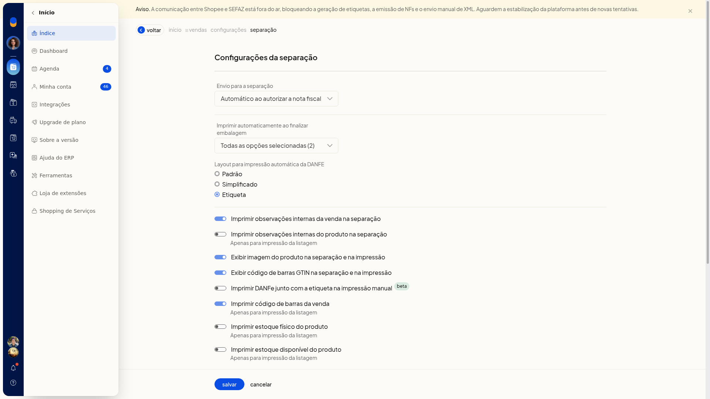
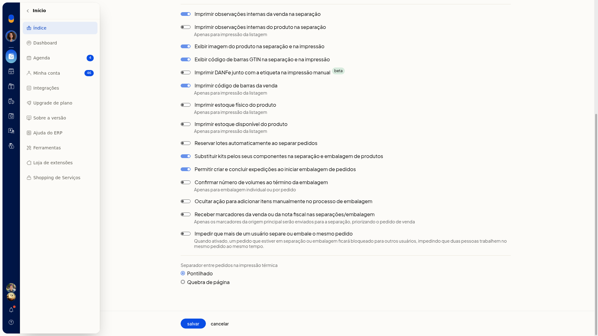

# Configurar a separação

As configurações da separação no ERP da Olist definem quando a venda entra na separação, o que é impresso e se a embalagem pode criar expedições. Você ajusta essas opções em **Configurações > Configurações ERP > Vendas > Configurações da separação**.

Nenhuma opção deste formulário é obrigatória.

## Instruções
1. Acesse **Configurações > Configurações ERP**.
2. Em **Vendas**, abra **Configurações da separação**.
3. Em **Envio para a separação**, escolha quando a venda entra na separação:
 - **Manual**
 - **Automático ao salvar o pedido**
 - **Automático ao aprovar o pedido**
 - **Automático ao salvar a nota fiscal**
 - **Automático ao autorizar a nota fiscal**
4. Em **Imprimir automaticamente ao finalizar embalagem**, marque **DANFE**, **Etiqueta de envio** ou as duas.
5. Em **Layout para impressão automática da DANFE**, escolha **Padrão**, **Simplificado** ou **Etiqueta**.

   

6. Marque o que deve aparecer na separação e na impressão:
 - **Imprimir observações internas da venda na separação**
 - **Imprimir observações internas do produto na separação**: vale apenas para a impressão da listagem
 - **Exibir imagem do produto na separação e na impressão**
 - **Exibir código de barras GTIN na separação e na impressão**
 - **Imprimir DANFe junto com a etiqueta na impressão manual beta**
 - **Imprimir código de barras da venda**: vale apenas para a impressão da listagem
 - **Imprimir estoque físico do produto**: vale apenas para a impressão da listagem
 - **Imprimir estoque disponível do produto**: vale apenas para a impressão da listagem
7. Marque como a separação trata lotes, kits, expedição, volumes e marcadores:
 - **Reservar lotes automaticamente ao separar pedidos**
 - **Substituir kits pelos seus componentes na separação e embalagem de produtos**
 - **Permitir criar e concluir expedições ao iniciar embalagem de pedidos**: com esta opção marcada, ao embalar a tela pergunta se deseja criar e concluir as expedições
 - **Confirmar número de volumes ao término da embalagem**: vale apenas para embalagem individual ou por pedido
 - **Ocultar ação para adicionar itens manualmente no processo de embalagem**
 - **Receber marcadores da venda ou da nota fiscal nas separações/embalagem**: só os marcadores da origem principal são enviados, com prioridade para o pedido de venda
8. Em **Impedir que mais de um usuário separe ou embale o mesmo pedido**, marque se o pedido em separação ou embalagem deve ficar bloqueado para as outras pessoas da conta.
9. Em **Separador entre pedidos na impressão térmica**, escolha **Pontilhado** ou **Quebra de página**.

   

10. Clique em **Salvar** para gravar as opções de envio, impressão, lotes, expedição, volumes e bloqueio.
