# Separação e embalagem

Na separação do ERP da Olist você consulta pedidos e notas por etapa, separa os itens e embala os pedidos. Também imprime a lista, a DANFE e as etiquetas, gera notas fiscais e envia os pedidos para a expedição.

As configurações definem quando a venda entra na separação, o que é impresso e se a embalagem pode criar expedições. Os marcadores identificam os registros na fila. A consulta fica em **Vendas > Separação**.

## Pré-requisitos
- Os pedidos ou as notas precisam já estar na separação. Em **Configurações da separação**, **Envio para a separação** define se o envio é manual ou automático.
- Se alguma opção não aparecer para você, peça acesso ao administrador da conta.

## Importante
- Para embalar pela barra, selecione ao menos um item. Sem seleção, **Embalar pedidos** avisa **Nenhum item selecionado para embalar**. **Fechar** (ESC) fecha o aviso.
- A pergunta **Criar e concluir expedições** aparece ao embalar quando **Permitir criar e concluir expedições ao iniciar embalagem de pedidos** está marcada.
- **Embalar por produto** não está disponível nos planos Começar e Crescer.
- O botão **Ações** não abre menu sem nenhum item selecionado.
- Na etapa **Embaladas checkout**, o menu da linha não oferece **Separar pedido**, **Embalar pedido checkout**, **Reiniciar progresso de separação** nem **Imprimir DANFE**.
- Não é possível alterar manualmente a situação de pedidos cancelados. Remova esses pedidos da separação antes.

## Instruções
### Consultar a fila

1. Acesse **Vendas > Separação**.
2. Escolha a etapa: **Aguardando separação**, **Em separação**, **Separadas** ou **Embaladas checkout**. Cada etapa mostra um contador.
3. Pesquise por destinatário ou número.
4. Filtre por período, marcador, **e-commerce**, depósito, estado, cidade, produto e origem da separação. No período, o tipo pode ser **Data de envio a separação**, **Data do pedido** ou **Data máxima do despacho**, e o intervalo **Sem filtro**, **Últimos 30 dias**, **Últimos 7 dias**, **Do dia**, **Do mês** ou **Do intervalo**. A origem pode ser **Pedidos**, **Notas** ou **Fulfillment**.
5. Em **Informações visíveis**, escolha as colunas da lista: **Identificação**, **Data de envio a separação**, **Destinatário**, **UF**, **Cidade**, **Forma de envio**, **Data do pedido**, **Separação**, **Data prevista de entrega**, **Prazo máximo de despacho**, **Marcadores**, **Integrações** e **Situação**. A lista mostra os itens da etapa e dos filtros, prontos para separar, embalar ou imprimir.

### Separar pedidos

1. Na lista, clique em **Separar pedidos** (atalho ctrl+s), em **Separar pedido** no menu da linha ou na mesma ação na barra da seleção.
2. Se aparecerem **Abrir lista de separação**, **Imprimir lista de separação** e **Marcar como separado**, escolha a opção. As duas primeiras estão ligadas à situação em separação e a terceira a separado. Em outros acessos, **Separar pedidos** abre direto **Separação de mercadorias**.
3. Na aba produtos, confira **Produto**, **Cód. (SKU/GTIN)**, **Qtd**, **Un** e **Localização**. Use o link **visualização padrão** quando precisar dele.

   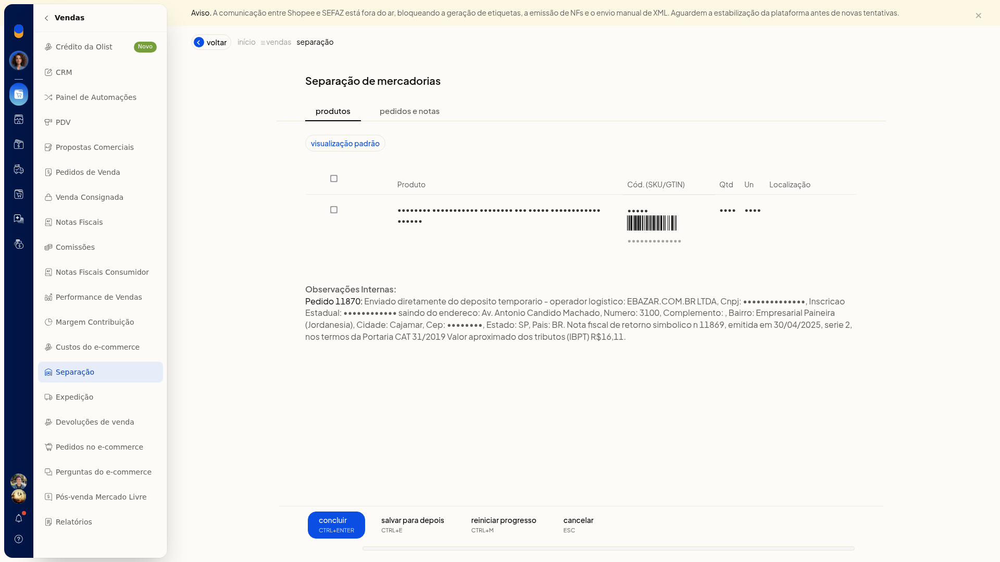

4. Abra a aba pedidos e notas para ver o pedido, os itens e a **Observação Interna**.

   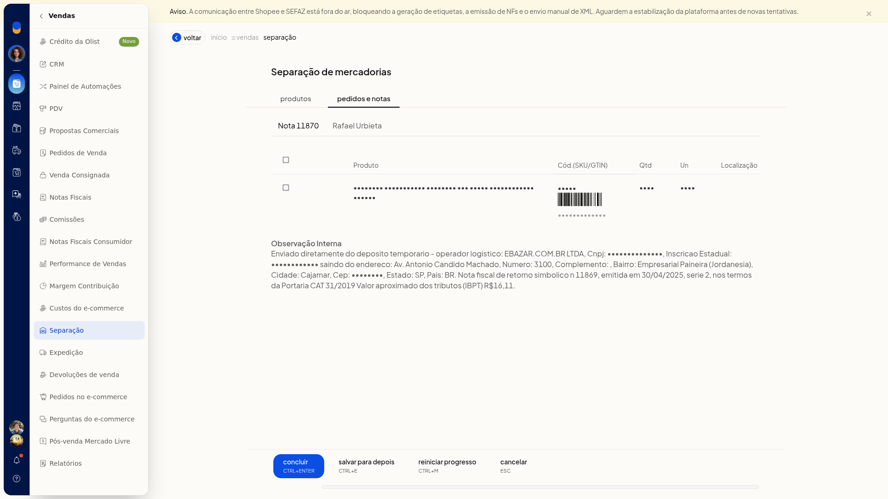

5. Clique em **Concluir** (ctrl+enter) para encerrar a separação. **Salvar para depois** (ctrl+e) guarda o andamento, **Reiniciar progresso** (ctrl+m) recomeça e **Cancelar** (esc) volta à lista.

**Separar fulfillment** no menu **Ações** (ctrl+f) e o atalho ctrl+g só aparecem se a empresa usa envios fulfillment.

### Embalar pedidos

1. Selecione ao menos um item da lista.
2. Clique em **Embalar pedidos** (ctrl+e) ou em **Embalar pedido checkout** no menu da linha.
3. Se abrir **Criar e concluir expedições**, clique em **Continuar** (CTRL+ENTER) para criar e concluir os agrupamentos de expedição dos pedidos a embalar, ou em **Deixar para depois** (ESC) para seguir sem criar a expedição.

   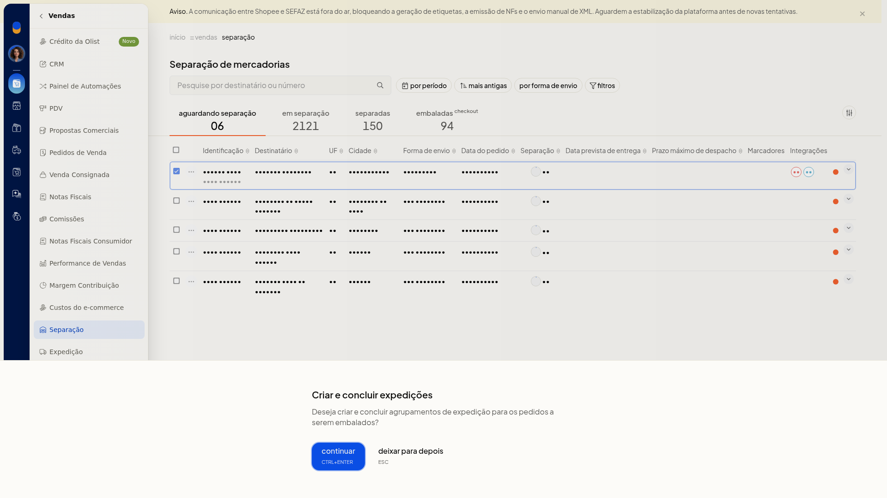

4. Em **Embalagem de mercadorias**, escolha **Embalar por pedido** ou **Embalar por produto**.

   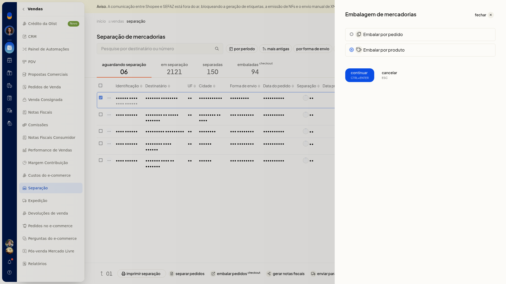

5. Clique em **Continuar** para seguir com a opção escolhida. **Cancelar** fecha a tela e volta à lista.

**Embalar fulfillment** (ctrl+h) só aparece se a empresa usa envios fulfillment.

### Usar as ações da linha e da seleção

1. Na etapa **Aguardando separação**, abra o menu da linha. As ações são **Separar pedido**, **Embalar pedido checkout**, **Reiniciar progresso de separação**, **Imprimir separação**, **Gerenciar lotes de produtos**, **Imprimir DANFE**, **Imprimir etiquetas de volumes**, **Alterar situação**, **Marcadores** e **Remover da separação**.

   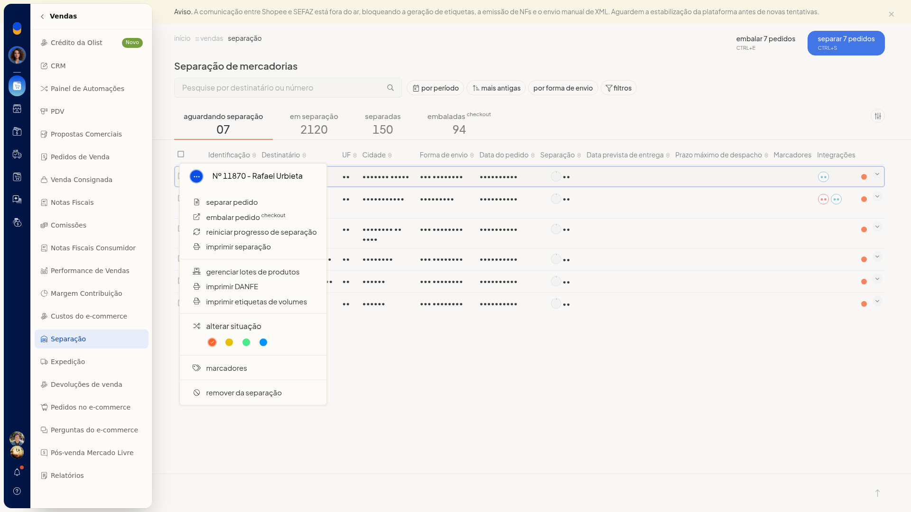

2. Selecione um pedido. A barra mostra a quantidade e **Imprimir separação**, **Separar pedidos**, **Embalar pedidos checkout**, **Gerar notas fiscais**, **Enviar para expedição** e **Mais ações**.

   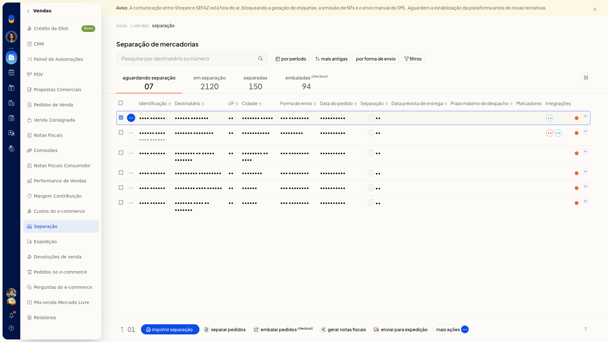

3. Abra **Mais ações** para **Gerar notas fiscais em lote**, **Imprimir etiquetas de envio**, **Imprimir etiquetas de volumes**, **Imprimir etiquetas de separação**, **Alterar situação**, **Alterar marcadores** e **Remover da separação**. A emissão da nota no checkout só segue se a emissão de nota fiscal estiver autorizada.

   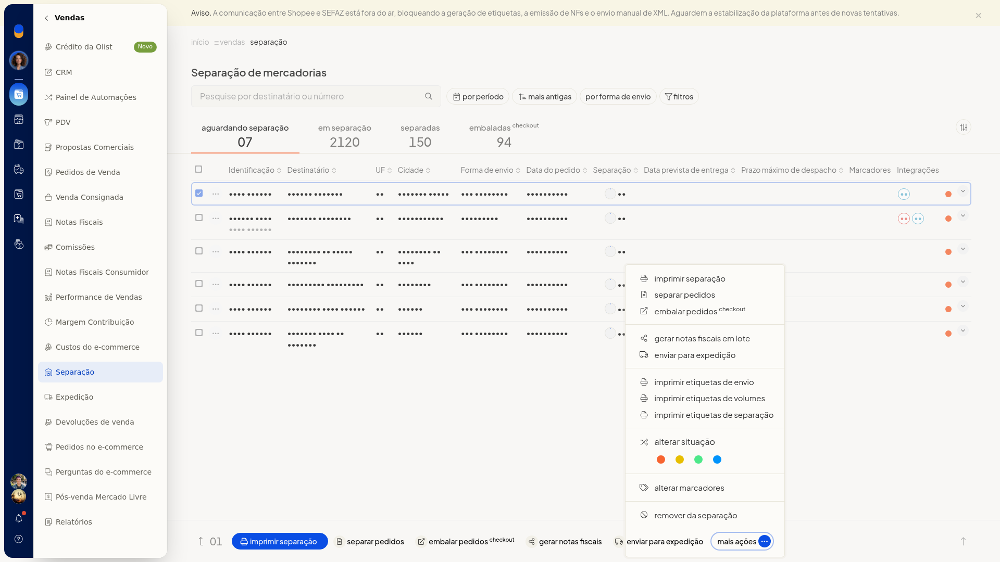

4. Na etapa **Embaladas checkout**, use o menu da linha para **Imprimir separação**, **Gerar nota fiscal**, **Gerenciar lotes de produtos**, **Imprimir etiquetas de volumes**, **Alterar situação**, **Marcadores** e **Remover da separação**.

   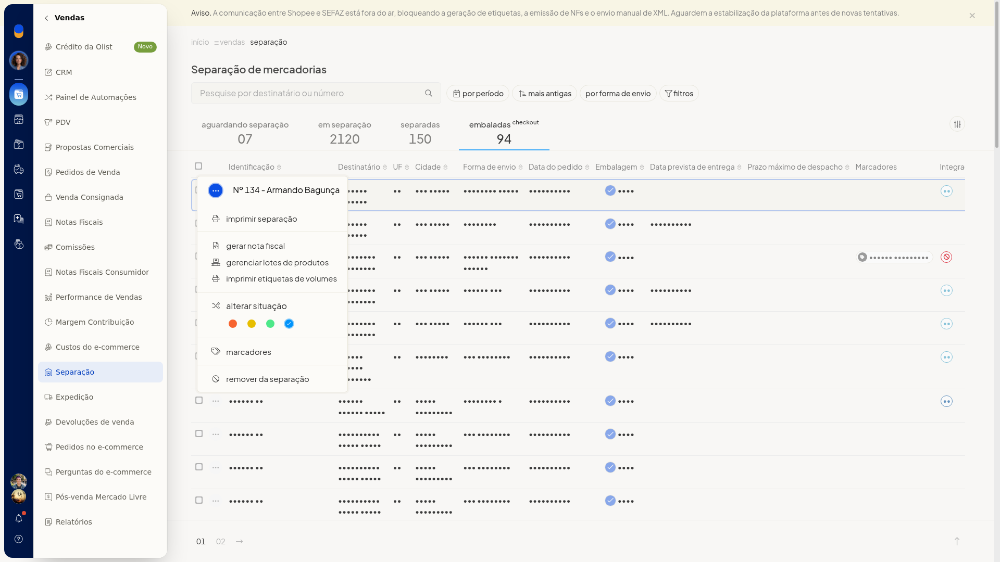

### Configurar a separação

1. Acesse **Configurações > Configurações ERP > Vendas > Configurações da separação**.
2. Em **Envio para a separação**, escolha **Manual**, **Automático ao salvar o pedido**, **Automático ao aprovar o pedido**, **Automático ao salvar a nota fiscal** ou **Automático ao autorizar a nota fiscal**.
3. Em **Imprimir automaticamente ao finalizar embalagem**, marque **DANFE**, **Etiqueta de envio** ou as duas. Em **Layout para impressão automática da DANFE**, escolha **Padrão**, **Simplificado** ou **Etiqueta**.

   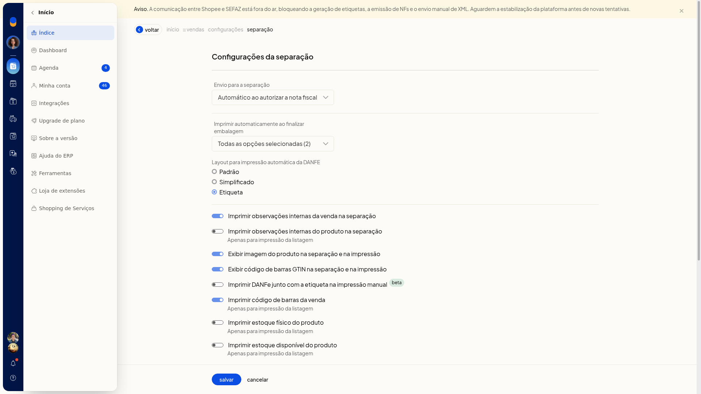

4. Ajuste as demais opções do formulário.

#### Impressão

- **Imprimir observações internas da venda na separação**
- **Imprimir observações internas do produto na separação**: vale apenas para a impressão da listagem
- **Exibir imagem do produto na separação e na impressão**
- **Exibir código de barras GTIN na separação e na impressão**
- **Imprimir DANFe junto com a etiqueta na impressão manual beta**
- **Imprimir código de barras da venda**: vale apenas para a impressão da listagem
- **Imprimir estoque físico do produto**: vale apenas para a impressão da listagem
- **Imprimir estoque disponível do produto**: vale apenas para a impressão da listagem
- **Separador entre pedidos na impressão térmica**: **Pontilhado** ou **Quebra de página**

#### Lotes, kits, expedição e bloqueio

- **Reservar lotes automaticamente ao separar pedidos**
- **Substituir kits pelos seus componentes na separação e embalagem de produtos**
- **Permitir criar e concluir expedições ao iniciar embalagem de pedidos**
- **Confirmar número de volumes ao término da embalagem**: vale apenas para embalagem individual ou por pedido
- **Ocultar ação para adicionar itens manualmente no processo de embalagem**
- **Receber marcadores da venda ou da nota fiscal nas separações/embalagem**: só os marcadores da origem principal são enviados, com prioridade para o pedido de venda
- **Impedir que mais de um usuário separe ou embale o mesmo pedido**: o pedido em separação ou embalagem fica bloqueado para as outras pessoas da conta

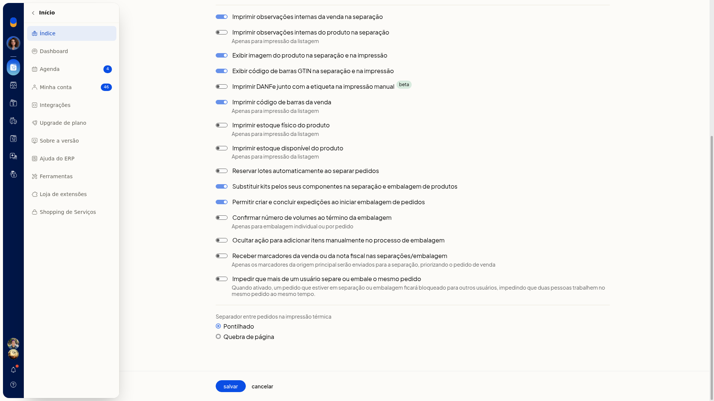

5. Clique em **Salvar** para gravar as opções. **Cancelar** descarta o que não foi salvo.

### Incluir marcador da separação

1. Acesse **Configurações > Configurações ERP > Vendas > Configurações dos marcadores na separação**.
2. Na seção **Separação**, use a pesquisa e a coluna **Descrição** para ver os marcadores já criados e clique em **Incluir marcador**.

   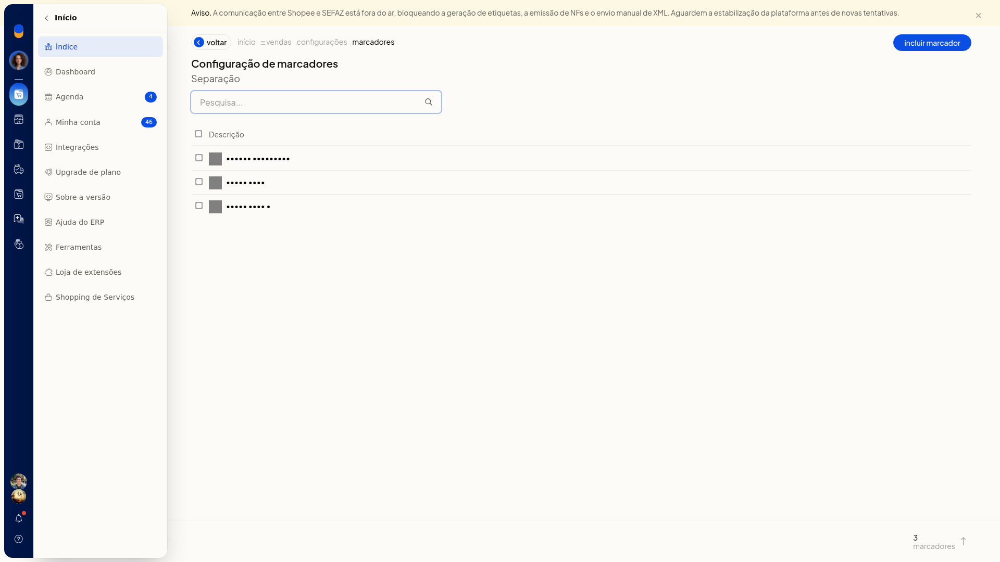

3. Preencha **Descrição** e escolha **Cor do marcador**.

   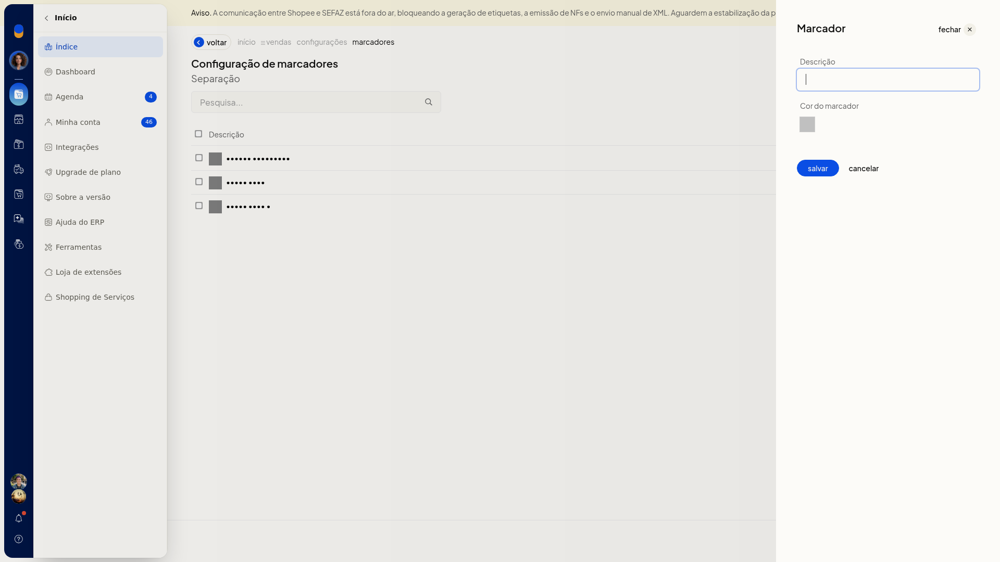

   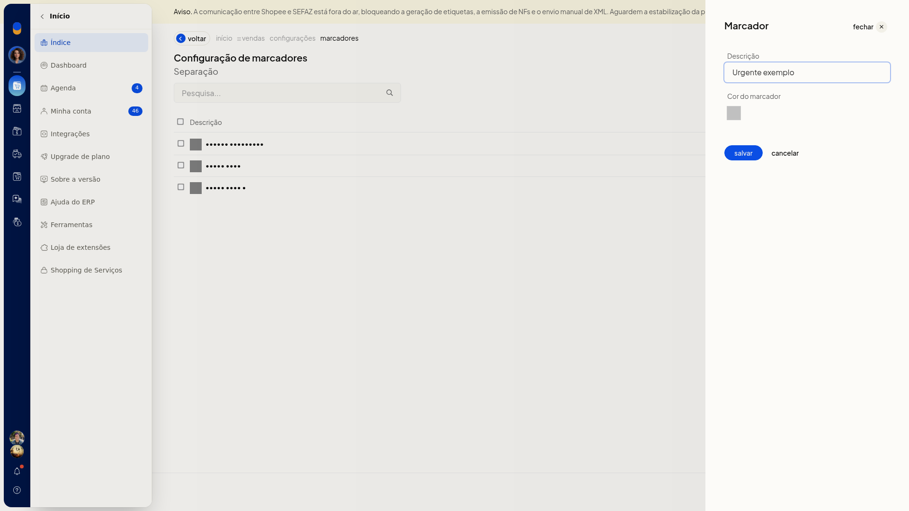

4. Clique em **Salvar** para criar o marcador. **Cancelar** fecha o painel e o marcador não entra na lista. Para usar um marcador no pedido, abra **Marcadores** no menu da linha ou **Alterar marcadores** na seleção. O filtro da lista também oferece **Sem filtro por marcador** e **Sem marcadores**.

## Resultado
A lista exibe a etapa escolhida com o contador. **Separar pedidos** abre **Separação de mercadorias**, com as abas produtos e pedidos e notas. Ao embalar um item selecionado, pode abrir **Criar e concluir expedições**; **Deixar para depois** abre **Embalagem de mercadorias**. **Cancelar** em **Separação de mercadorias** ou em **Embalagem de mercadorias** devolve à lista. **Cancelar** em **Incluir marcador** fecha o painel e o marcador não salvo não aparece na lista.

## Informações adicionais
### Condições da impressão de etiquetas

- A impressão das etiquetas do gateway logístico exige que já exista uma expedição da origem.
- A etiqueta de transportadora só é impressa quando a forma de envio é transportadora.

### Emissão de nota no checkout

A emissão da nota no checkout só segue se a emissão de nota fiscal estiver autorizada.

### Separação bloqueada

Com a separação bloqueada por outra pessoa, quem não tem permissão de alterar a situação não consegue mudá-la.
